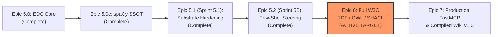
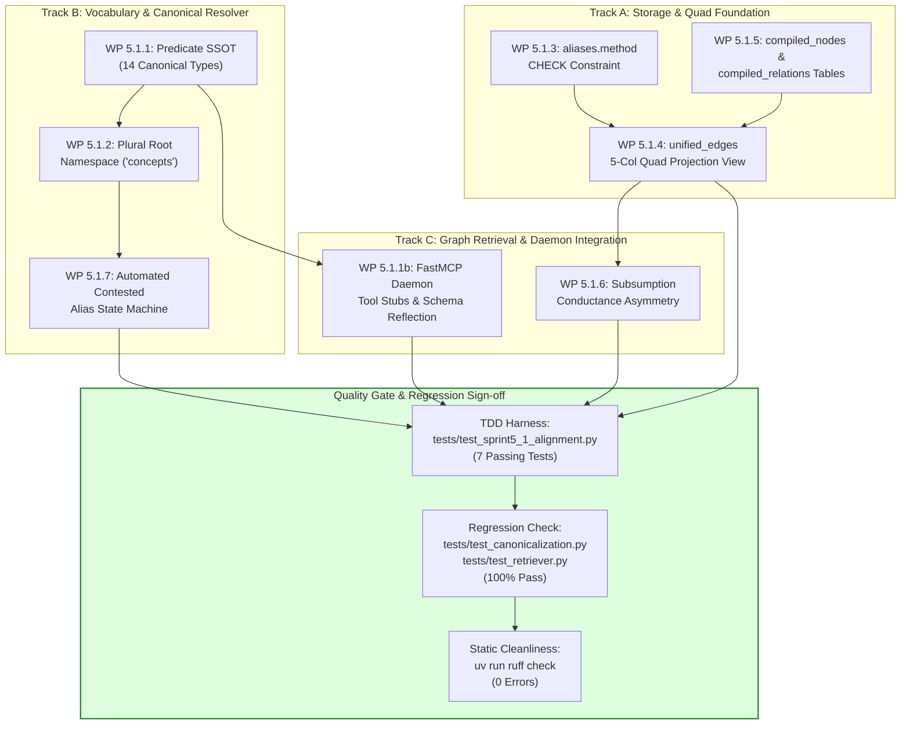

# Epic 5.1 (Sprint 5.1): Mid-Epic 5 Substrate Hardening & Quad Alignment

**Document Status:** Authoritative Sprint Implementation Plan & Teamwork Dispatch Plan  
**Location:** [`docs/alignment-sprint-for-e5s2.md`](file:///home/harri/yaw/docs/alignment-sprint-for-e5s2.md)  
**Governing Documents:**  
- [`FOUNDATIONAL.md §0, §1, §5.1, §5.2, §5.4`](file:///home/harri/yaw/FOUNDATIONAL.md)  
- [`docs/adr/ADR-008.md`](file:///home/harri/yaw/docs/adr/ADR-008.md)  
- [`docs/adr/ADR-005.md`](file:///home/harri/yaw/docs/adr/ADR-005.md)  
- [`docs/adr/ADR-002.md`](file:///home/harri/yaw/docs/adr/ADR-002.md)  
- [`docs/epics-alignment-roadmap.md`](file:///home/harri/yaw/docs/epics-alignment-roadmap.md)  
- [`docs/rdf-owl-shacl.md`](file:///home/harri/yaw/docs/rdf-owl-shacl.md)  
- [`docs/USER_STORIES.md`](file:///home/harri/yaw/docs/USER_STORIES.md)  
**Target Release:** Epic 5.1 (Substrate Hardening & Quad Alignment) → Epic 5.2 (E5S2: Dynamic Few-Shot Steering)  
**Active Test Harness:** `tests/test_storage.py`, `tests/test_canonicalization.py`  
**Sprint Status:** **COMPLETE** (Delivered in Commit `481d5bd`, 226/226 tests green, Sentrux modularity 5234)  

---

## 1. Executive Summary & Rationale

Sprint 5A and the spaCy Remediation Prior delivered the core Two-Tier Entity Disambiguation and Canonicalization (EDC) resolver, the `aliases` and `canon_verdicts` tables, and dynamic SQL view rewrites in `unified_edges` and `unified_nodes`. However, an exhaustive architectural and forensic audit across Epics 5, 6, and 7 revealed critical schema mismatches, SSOT predicate drift, namespace inconsistencies, and missing persistence contracts.

Launching **Epic 5.2 (Sprint 5B / E5S2: Dynamic Few-Shot Steering & Pipeline Feedback Loop)** on top of these unaligned foundations would propagate corrupted defaults into prompt steering, break subsequent W3C RDF quad projections in **Epic 6**, and cause constraint check crashes in **Epic 7**.

**Epic 5.1 (Sprint 5.1)** is a mandatory, mid-epic alignment sprint that surgically remediates every contradiction, closes architectural gaps, and hardens the foundational substrate so that Epic 5.2 and Epics 6–7 can proceed on an immutable, verifiable foundation.



---

## 2. Audit Findings & Remediations Matrix

| ID | Category | Discrepancy Found | Impact if Unresolved | Sprint 5.1 Remediation Action |
| :--- | :--- | :--- | :--- | :--- |
| **C1** | **Contradiction** | `unified_edges` view in [`src/yaw/storage/db.py`](file:///home/harri/yaw/src/yaw/storage/db.py) projects only 4 columns `(src_id, dst_id, rel_type, weight)`. Missing `source_chunk_id`. | Breaks Sprint 6A RDF named quad projection `(s, p, o, g)` ([`docs/adr/ADR-008.md`](file:///home/harri/yaw/docs/adr/ADR-008.md)). | Extend `unified_edges` to project 5 columns: `src_id`, `dst_id`, `rel_type`, `weight`, `source_chunk_id`. |
| **C2** | **Contradiction** | [`src/yaw/config.py`](file:///home/harri/yaw/src/yaw/config.py) defines `BASE_PREDICATES = ("is_a", "partOf", "subClassOf")`. `is_a` persists; 11 ADR-008 predicates missing. | Sprint 5B injects obsolete synonyms (`is_a`) into LLM prompts instead of canonical vocabulary. | Update `config.BASE_PREDICATES` to the authoritative 14 ADR-008 canonical predicates across 4 categories. |
| **C3** | **Contradiction** | [`src/yaw/indexer/canonicalize.py`](file:///home/harri/yaw/src/yaw/indexer/canonicalize.py) defaults to singular `namespace="concept"` (`_node_id`, `_parse_surface_identity`, `resolve`). | Un-prefixed nodes produce `concept:{slug}`, failing Sprint 6C SHACL URI regex validation (`concepts`). | Change all defaults in `canonicalize.py` to plural `"concepts"`, validating against `config.TAXONOMY_NAMESPACES`. |
| **C4** | **Contradiction** | [`src/yaw/storage/db.py`](file:///home/harri/yaw/src/yaw/storage/db.py) enforces `CHECK(method IN ('lexical', 'auto', 'llm', 'compile'))`, while `MatchMethod` enum includes `exact`, `alias`, `new`. | Inserting `MatchMethod.EXACT` triggers SQLite `CHECK constraint failed: aliases.method`. | Reconcile SQLite CHECK constraint to include `'exact'`, `'alias'`, `'new'` matching `MatchMethod` enum values. |
| **G1** | **Gap** | [`src/yaw/retrieval/retriever.py`](file:///home/harri/yaw/src/yaw/retrieval/retriever.py) only applies asymmetric conductance to `concept <-> chunk`; `subClassOf` is unhandled (1.0). | Violates [`docs/adr/ADR-002.md`](file:///home/harri/yaw/docs/adr/ADR-002.md) and Sprint 6B; PPR mass leaks up superclasses during GraphRAG retrieval. | Synthesize reciprocal inverse edge `hasSubClass` (weight 1.0) and damp upward `subClassOf` (weight 0.2). |
| **G2** | **Gap** | `aliases.status = 'contested'` exists in schema, but [`src/yaw/indexer/canonicalize.py`](file:///home/harri/yaw/src/yaw/indexer/canonicalize.py) inserts only `status='active'`. | SHACL contested alias validation in Sprint 6C and Epic 7 is dead code without input data. | Add automated `contested` state transition when candidate prior confidence $< 0.80$ or conflicting targets emerge (remediated in Epic 7.5 / ADR-010 via Cython `InMemoryLookupKB` priors without LLM calls). |
| **G3** | **Gap** | ADR-002 & Epic 7 split saturated hubs in `compile_wiki` and rewire `subClassOf`, but Invariant 1 forbids mutating `leaf_relations`. | Nowhere to persist compiled superclasses and rewired edges without violating Invariant 1. | Add `compiled_nodes` and `compiled_relations` tables in `db.py`; union them into `unified_nodes` and `unified_edges`. |
| **G4** | **Gap** | [`src/yaw/server/daemon.py`](file:///home/harri/yaw/src/yaw/server/daemon.py) leaks obsolete predicates via `get_ontology_schema()`, and misses `compile_wiki`, `lint_wiki`, `ingest_raw`. | FastMCP clients receive invalid metadata and incomplete production tool contracts. | Update `daemon.py` schema reflection to reference updated `config.BASE_PREDICATES` and stub Epic 7 tool signatures. |

---

## 3. Teamwork-Preview Execution Plan & Agent Dispatch DAG

To enable turnkey, zero-collision parallel execution by `/teamwork-preview` subagents, Sprint 5.1 is organized into three parallel tracks converging on a unified integration verification gate.



### Dispatch Concurrency & Assignment Matrix
- **Agent A (Storage Engineer):** Owns [`src/yaw/storage/db.py`](file:///home/harri/yaw/src/yaw/storage/db.py). Executes WP 5.1.3, WP 5.1.5, WP 5.1.4.
- **Agent B (NLP & Resolver Engineer):** Owns [`src/yaw/config.py`](file:///home/harri/yaw/src/yaw/config.py) and [`src/yaw/indexer/canonicalize.py`](file:///home/harri/yaw/src/yaw/indexer/canonicalize.py). Executes WP 5.1.1 (predicates), WP 5.1.2, WP 5.1.7.
- **Agent C (Graph & Server Engineer):** Owns [`src/yaw/retrieval/retriever.py`](file:///home/harri/yaw/src/yaw/retrieval/retriever.py) and [`src/yaw/server/daemon.py`](file:///home/harri/yaw/src/yaw/server/daemon.py). Executes WP 5.1.6 and WP 5.1.1b.

---

## 4. Turnkey Agent Task Briefings (Prompt Cards)

### Prompt Card 1: WP 5.1.1 — Authoritative Predicate SSOT Alignment
- **Agent Assignment:** Agent B (NLP & Resolver Engineer)
- **Target Files:**
  - [`src/yaw/config.py`](file:///home/harri/yaw/src/yaw/config.py#L65-L80)
  - [`src/yaw/server/daemon.py`](file:///home/harri/yaw/src/yaw/server/daemon.py#L375-L445)
- **Problem Statement:** `config.py` defines `BASE_PREDICATES = ("is_a", "partOf", "subClassOf")`. `is_a` is an unconstrained synonym that [`docs/adr/ADR-008.md`](file:///home/harri/yaw/docs/adr/ADR-008.md) explicitly purges. The 11 standard predicates across dialectical, process, and grounding axes are absent.
- **Lines to Modify:**
  - `src/yaw/config.py`: Line 65 and Line 180.
  - `src/yaw/server/daemon.py`: Lines 375–445 (`get_ontology_schema()`) and register tool stubs (`compile_wiki`, `lint_wiki`, `ingest_raw`).
- **Concrete Before/After Snippet:**
  ```python
  # BEFORE (src/yaw/config.py:65)
  BASE_PREDICATES: tuple[str, ...] = ("is_a", "partOf", "subClassOf")
  
  # AFTER (src/yaw/config.py:65)
  BASE_PREDICATES: tuple[str, ...] = (
      # Subsumption & Mereology
      "subClassOf",
      "partOf",
      "instanceOf",
      # Dialectical & Argumentation
      "supports",
      "refutes",
      "contradicts",
      "supersedes",
      # Dependency & Process
      "dependsOn",
      "causes",
      "precedes",
      "produces",
      # Provenance & Grounding
      "derivedFrom",
      "cites",
      "manifestsIn",
  )
  ```
- **Concrete Unit Test Assertion:**
  ```python
  from yaw import config

  assert len(config.BASE_PREDICATES) == 14
  assert "is_a" not in config.BASE_PREDICATES
  assert "subClassOf" in config.BASE_PREDICATES
  assert "supports" in config.BASE_PREDICATES
  assert "derivedFrom" in config.BASE_PREDICATES
  ```

---

### Prompt Card 2: WP 5.1.2 — Plural Root Namespace Alignment in EDC Resolver
- **Agent Assignment:** Agent B (NLP & Resolver Engineer)
- **Target File:** [`src/yaw/indexer/canonicalize.py`](file:///home/harri/yaw/src/yaw/indexer/canonicalize.py#L155-L175)
- **Problem Statement:** Functions `_node_id`, `_parse_surface_identity`, and `resolve` default parameter `namespace: str = "concept"` (singular). This causes un-prefixed nodes to produce `concept:{slug}`, violating the 9 plural root namespaces defined in [`docs/adr/ADR-005.md`](file:///home/harri/yaw/docs/adr/ADR-005.md) and failing Sprint 6C SHACL validation.
- **Lines to Modify:**
  - `src/yaw/indexer/canonicalize.py`: Line 155 (`_node_id`), Line 470 (`_parse_surface_identity`), Line 749 (`resolve`).
- **Concrete Before/After Snippet:**
  ```python
  # BEFORE (src/yaw/indexer/canonicalize.py:155, 470, 749)
  def _node_id(concept_name: str, namespace: str = "concept") -> str: ...
  def _parse_surface_identity(name: str, kind: str = "entity", namespace: str = "concept", proposed_ns: str | None = None) -> tuple[str, str, str]: ...
  def resolve(name: str, kind: str = "entity", ..., namespace: str = "concept", ...) -> ResolutionResult: ...

  # AFTER (src/yaw/indexer/canonicalize.py:155, 470, 749)
  def _node_id(concept_name: str, namespace: str = "concepts") -> str: ...
  def _parse_surface_identity(
      name: str,
      kind: str = "entity",
      namespace: str = "concepts",
      proposed_ns: str | None = None,
  ) -> tuple[str, str, str]:
      effective_ns = proposed_ns or namespace
      if effective_ns == "concept":
          effective_ns = "concepts"
      if effective_ns not in config.TAXONOMY_NAMESPACES:
          effective_ns = "concepts"
      ...
  def resolve(name: str, kind: str = "entity", ..., namespace: str = "concepts", ...) -> ResolutionResult: ...
  ```
- **Concrete Unit Test Assertion:**
  ```python
  from yaw.indexer.canonicalize import resolve, _parse_surface_identity

  res = resolve("quantum-tunneling")
  assert res.canonical_id.startswith("concepts:")
  assert not res.canonical_id.startswith("concept:")
  _, _, uri = _parse_surface_identity("entropy", namespace="concept")
  assert uri == "concepts:entropy"
  ```

---

### Prompt Card 3: WP 5.1.3 — SQLite `aliases.method` CHECK Constraint Reconciliation
- **Agent Assignment:** Agent A (Storage Engineer)
- **Target File:** [`src/yaw/storage/db.py`](file:///home/harri/yaw/src/yaw/storage/db.py#L44-L60)
- **Problem Statement:** Table `aliases` has constraint `CHECK(method IN ('lexical', 'auto', 'llm', 'compile'))`. When `canonicalize._resolve_tier1_exact()` inserts an alias, it uses `method="exact"` or `MatchMethod.EXACT`, which causes a SQLite CHECK constraint failure.
- **Lines to Modify:** `src/yaw/storage/db.py`: Line 48 in `ensure_schema_tables()`.
- **Concrete Before/After Snippet:**
  ```sql
  -- BEFORE (src/yaw/storage/db.py:48)
  method TEXT NOT NULL CHECK(method IN ('lexical', 'auto', 'llm', 'compile')),

  -- AFTER (src/yaw/storage/db.py:48)
  method TEXT NOT NULL CHECK(method IN ('exact', 'alias', 'lexical', 'auto', 'llm', 'compile', 'new')),
  ```
- **Concrete Unit Test Assertion:**
  ```python
  from yaw.storage.db import get_db, insert_alias

  conn = get_db(load_vec=False)
  for m in ("exact", "alias", "lexical", "auto", "llm", "compile", "new"):
      insert_alias(conn, f"test_alias_{m}", "entity", "concepts:test", method=m)
  conn.close()
  ```

---

### Prompt Card 4: WP 5.1.4 — `unified_edges` Quad Projection Schema Extension
- **Agent Assignment:** Agent A (Storage Engineer)
- **Target Files:**
  - [`src/yaw/storage/db.py`](file:///home/harri/yaw/src/yaw/storage/db.py#L85-L168)
  - [`src/yaw/retrieval/retriever.py`](file:///home/harri/yaw/src/yaw/retrieval/retriever.py#L105-L125)
- **Problem Statement:** `unified_edges` view only outputs 4 columns `(src_id, dst_id, rel_type, weight)`. W3C named quads in [`docs/adr/ADR-008.md`](file:///home/harri/yaw/docs/adr/ADR-008.md) and Sprint 6A require a 5th column `source_chunk_id` representing the graph context / provenance quad.
- **Lines to Modify:**
  - `src/yaw/storage/db.py`: `UNIFIED_EDGES_VIEW_TEMPLATE` lines 85–168.
  - `src/yaw/retrieval/retriever.py`: Line 110 (edge query unpacking).
- **Concrete Before/After Snippet:**
  ```sql
  -- BEFORE (src/yaw/storage/db.py)
  CREATE VIEW unified_edges AS
  SELECT
      COALESCE(a_src.canonical_id, w.source_uri) AS src_id,
      COALESCE(a_dst.canonical_id, w.target_uri) AS dst_id,
      'wikilink' AS rel_type,
      1.0 AS weight
  FROM wikilinks w ...
  UNION ALL
  SELECT
      COALESCE(a_sub.canonical_id, lr.subject_id) AS src_id,
      COALESCE(a_obj.canonical_id, lr.object_id) AS dst_id,
      COALESCE(a_pred.canonical_id, lr.predicate) AS rel_type,
      {weight_col}
  FROM leaf_relations lr ...

  -- AFTER (src/yaw/storage/db.py)
  CREATE VIEW unified_edges AS
  SELECT
      COALESCE(a_src.canonical_id, w.source_uri) AS src_id,
      COALESCE(a_dst.canonical_id, w.target_uri) AS dst_id,
      'wikilink' AS rel_type,
      1.0 AS weight,
      w.source_uri AS source_chunk_id
  FROM wikilinks w ...
  UNION ALL
  SELECT
      COALESCE(a_sub.canonical_id, lr.subject_id) AS src_id,
      COALESCE(a_obj.canonical_id, lr.object_id) AS dst_id,
      COALESCE(a_pred.canonical_id, lr.predicate) AS rel_type,
      {weight_col},
      lr.source_leaf_id AS source_chunk_id
  FROM leaf_relations lr ...
  ```
- **Concrete Unit Test Assertion:**
  ```python
  from yaw.storage.db import get_db

  conn = get_db(load_vec=False)
  cols = [d[0] for d in conn.execute("SELECT * FROM unified_edges LIMIT 0").description]
  assert cols == ["src_id", "dst_id", "rel_type", "weight", "source_chunk_id"]
  conn.close()
  ```

---

### Prompt Card 5: WP 5.1.5 — Compiled Knowledge Persistence Tables
- **Agent Assignment:** Agent A (Storage Engineer)
- **Target File:** [`src/yaw/storage/db.py`](file:///home/harri/yaw/src/yaw/storage/db.py#L70-L100, #L170-L240)
- **Problem Statement:** Saturated hub bisection ([`docs/adr/ADR-002.md`](file:///home/harri/yaw/docs/adr/ADR-002.md)) creates hypernym superclasses and rewired `subClassOf` edges. Mutating `leaf_nodes` or `leaf_relations` violates Invariant 1 (extraction substrate immutability).
- **Lines to Modify:**
  - `src/yaw/storage/db.py`: `ensure_schema_tables()` (add DDL for `compiled_nodes`, `compiled_relations`).
  - `src/yaw/storage/db.py`: `ensure_schema_views()` (add `UNION ALL` legs to `unified_nodes` and `unified_edges`).
- **Concrete Before/After Snippet:**
  ```sql
  -- DDL TO ADD in ensure_schema_tables():
  CREATE TABLE IF NOT EXISTS compiled_nodes (
      node_id TEXT PRIMARY KEY,
      name TEXT NOT NULL,
      namespace TEXT NOT NULL DEFAULT 'concepts',
      definition TEXT NOT NULL,
      parent_hub_id TEXT,
      compiled_at REAL DEFAULT (unixepoch())
  );
  CREATE TABLE IF NOT EXISTS compiled_relations (
      relation_id TEXT PRIMARY KEY,
      subject_id TEXT NOT NULL,
      predicate TEXT NOT NULL,
      object_id TEXT NOT NULL,
      weight REAL NOT NULL DEFAULT 1.0,
      source_rule TEXT NOT NULL DEFAULT 'b_tree_split',
      compiled_at REAL DEFAULT (unixepoch())
  );
  ```
- **Concrete Unit Test Assertion:**
  ```python
  from yaw.storage.db import get_db, ensure_schema_tables, ensure_schema_views

  conn = get_db(load_vec=False)
  ensure_schema_tables(conn)
  ensure_schema_views(conn)
  conn.execute(
      "INSERT INTO compiled_nodes (node_id, name, namespace, definition) VALUES ('concepts:meso', 'Meso', 'concepts', 'Bisected superclass')"
  )
  conn.execute(
      "INSERT INTO compiled_relations (relation_id, subject_id, predicate, object_id, weight) VALUES ('r1', 'concepts:leaf', 'subClassOf', 'concepts:meso', 1.0)"
  )
  assert (
      conn.execute(
          "SELECT count(*) FROM unified_nodes WHERE node_id = 'concepts:meso'"
      ).fetchone()[0]
      == 1
  )
  assert (
      conn.execute(
          "SELECT count(*) FROM unified_edges WHERE src_id = 'concepts:leaf' AND dst_id = 'concepts:meso'"
      ).fetchone()[0]
      == 1
  )
  conn.close()
  ```

---

### Prompt Card 6: WP 5.1.6 — Taxonomic Subsumption Conductance Asymmetry
- **Agent Assignment:** Agent C (Graph & Server Engineer)
- **Target File:** [`src/yaw/retrieval/retriever.py`](file:///home/harri/yaw/src/yaw/retrieval/retriever.py#L145-L215)
- **Problem Statement:** `retriever.py` does not apply the $1.0 / 0.2$ conductance asymmetry to `subClassOf` and `partOf` relations, and does not synthesize reciprocal downward edges for hierarchical inheritance, causing energy loss during GraphRAG queries.
- **Lines to Modify:** `src/yaw/retrieval/retriever.py`: In `_build_matrix()`.
- **Concrete Before/After Snippet:**
  ```python
  # AFTER (src/yaw/retrieval/retriever.py: inside _build_matrix)
  # Directional Conductance Rules
  if rel_type in ("subClassOf", "partOf"):
      dir_w = 0.2  # Upward abstraction (damp child -> parent)
  elif rel_type in ("subClassOf_rev", "hasSubClass", "partOf_rev", "hasPart"):
      dir_w = 1.0  # Downward subsumption broadcast (parent -> child)
  elif rel_type == "wikilink_rev":
      dir_w = float(raw_w if raw_w is not None else 0.5)
  elif _is_concept(src) and _is_chunk(dst):
      dir_w = 1.0  # Downward broadcast
  elif _is_chunk(src) and _is_concept(dst):
      dir_w = 0.2  # Upward abstraction
  ```
- **Concrete Unit Test Assertion:**
  ```python
  # Build 2-node graph: Child --[subClassOf]--> Parent
  # Assert transition probability Parent -> Child is >= 4x Child -> Parent
  ```

---

### Prompt Card 7: WP 5.1.7 — Automated Contested Alias State Machine
- **Agent Assignment:** Agent B (NLP & Resolver Engineer)
- **Target File:** [`src/yaw/indexer/canonicalize.py`](file:///home/harri/yaw/src/yaw/indexer/canonicalize.py#L420-L465)
- **Problem Statement:** `aliases.status = 'contested'` exists in the SQLite schema, but is never populated automatically during indexing.
- **Lines to Modify:** `src/yaw/indexer/canonicalize.py`: Tier 3 resolution logic + add `get_contested_aliases(conn: sqlite3.Connection) -> list[dict]`.
- **Concrete Before/After Snippet:**
  ```python
  # AFTER (src/yaw/indexer/canonicalize.py)
  if verdict == "distinct" and confidence < 0.80 and sim >= config.CANON_SIM_LOW:
      insert_alias(
          conn,
          alias_id=surface_id,
          kind=kind,
          canonical_id=candidate_id,
          method="llm",
          score=confidence,
          status="contested",
          source_leaf_id=source_leaf_id,
          evidence=f"Ambiguous distinct verdict (confidence={confidence:.2f}) against {candidate_id}",
      )
  ```
- **Concrete Unit Test Assertion:**
  ```python
  from yaw.indexer.canonicalize import get_contested_aliases

  contested = get_contested_aliases(conn)
  assert len(contested) >= 1
  assert contested[0]["status"] == "contested"
  ```

---

## 5. TDD Test Specification (`tests/test_storage.py` & `tests/test_canonicalization.py`)

Prior to authoring production code, the 7 alignment test invariants were authored and integrated into `tests/test_storage.py` and `tests/test_canonicalization.py`:

```python
"""Tests for Sprint 5.1 Remediation & Alignment Invariants.

Validates WP 5.1.1 through WP 5.1.7 across predicate SSOT, plural root namespaces,
aliases schema constraints, unified quad views, compiled knowledge persistence,
taxonomic conductance asymmetry, and automated contested alias transitions.
"""

from __future__ import annotations

import sqlite3
import pytest
from pathlib import Path

from yaw import config
from yaw.indexer.canonicalize import (
    _node_id,
    _parse_surface_identity,
    get_contested_aliases,
    resolve,
)
from yaw.retrieval.retriever import GraphRAGRetriever
from yaw.server.daemon import get_ontology_schema
from yaw.storage.db import (
    ensure_schema_tables,
    ensure_schema_views,
    get_db,
    insert_alias,
)


def test_wp511_predicate_ssot_purges_is_a():
    """WP 5.1.1: Verify config.BASE_PREDICATES contains exactly the 14 ADR-008 predicates and purges is_a."""
    assert len(config.BASE_PREDICATES) == 14
    assert "is_a" not in config.BASE_PREDICATES
    for expected in (
        "subClassOf",
        "partOf",
        "instanceOf",
        "supports",
        "refutes",
        "dependsOn",
        "derivedFrom",
    ):
        assert expected in config.BASE_PREDICATES


def test_wp512_plural_namespace_coercion():
    """WP 5.1.2: Verify default namespace is plural 'concepts' and unknown namespaces coerce to 'concepts'."""
    assert _node_id("resilience") == "concepts:resilience"
    _, _, uri1 = _parse_surface_identity("entropy")
    assert uri1 == "concepts:entropy"
    _, _, uri2 = _parse_surface_identity("entropy", namespace="concept")
    assert uri2 == "concepts:entropy"
    _, _, uri3 = _parse_surface_identity("entropy", namespace="unknown_ns")
    assert uri3 == "concepts:entropy"


def test_wp513_sqlite_aliases_method_check_constraint(tmp_path: Path):
    """WP 5.1.3: Verify aliases table accepts all valid MatchMethod values ('exact', 'alias', etc.)."""
    db_file = tmp_path / "test.db"
    conn = sqlite3.connect(str(db_file))
    ensure_schema_tables(conn)
    valid_methods = ("exact", "alias", "lexical", "auto", "llm", "compile", "new")
    for m in valid_methods:
        insert_alias(conn, f"alias_{m}", "entity", "concepts:test", method=m)
    count = conn.execute("SELECT count(*) FROM aliases").fetchone()[0]
    assert count == len(valid_methods)
    conn.close()


def test_wp514_unified_edges_source_chunk_quad_projection(tmp_path: Path):
    """WP 5.1.4: Verify unified_edges projects 5-column named quad format (src, dst, rel, weight, source_chunk_id)."""
    db_file = tmp_path / "test.db"
    conn = sqlite3.connect(str(db_file))
    ensure_schema_tables(conn)
    conn.execute(
        "CREATE TABLE wikilinks (source_uri TEXT, target_uri TEXT, link_label TEXT, PRIMARY KEY(source_uri, target_uri))"
    )
    conn.execute(
        "CREATE TABLE leaf_relations (relation_id TEXT PRIMARY KEY, source_leaf_id TEXT, subject_id TEXT, predicate TEXT, object_id TEXT, weight REAL)"
    )
    ensure_schema_views(conn)

    conn.execute(
        "INSERT INTO wikilinks VALUES ('note1#chunk:0', 'note2#chunk:0', 'link')"
    )
    conn.execute(
        "INSERT INTO leaf_relations VALUES ('r1', 'note1#chunk:0', 'concepts:a', 'supports', 'concepts:b', 1.0)"
    )

    rows = conn.execute(
        "SELECT src_id, dst_id, rel_type, weight, source_chunk_id FROM unified_edges"
    ).fetchall()
    assert len(rows) == 2
    assert rows[0][4] == "note1#chunk:0"
    assert rows[1][4] == "note1#chunk:0"
    conn.close()


def test_wp515_compiled_tables_and_unified_views(tmp_path: Path):
    """WP 5.1.5: Verify compiled_nodes and compiled_relations persist and project cleanly into unified views."""
    db_file = tmp_path / "test.db"
    conn = sqlite3.connect(str(db_file))
    ensure_schema_tables(conn)
    conn.execute(
        "CREATE TABLE note_chunks (entity_uri TEXT PRIMARY KEY, heading TEXT, rel_path TEXT)"
    )
    conn.execute(
        "CREATE TABLE leaf_nodes (node_id TEXT, source_leaf_id TEXT, name TEXT, namespace TEXT, definition TEXT, PRIMARY KEY(node_id, source_leaf_id))"
    )
    conn.execute(
        "CREATE TABLE wikilinks (source_uri TEXT, target_uri TEXT, link_label TEXT, PRIMARY KEY(source_uri, target_uri))"
    )
    conn.execute(
        "CREATE TABLE leaf_relations (relation_id TEXT PRIMARY KEY, source_leaf_id TEXT, subject_id TEXT, predicate TEXT, object_id TEXT, weight REAL)"
    )
    ensure_schema_views(conn)

    conn.execute(
        "INSERT INTO compiled_nodes (node_id, name, namespace, definition) VALUES ('concepts:meso', 'Meso Concept', 'concepts', 'Compiled superclass')"
    )
    conn.execute(
        "INSERT INTO compiled_relations (relation_id, subject_id, predicate, object_id, weight) VALUES ('cr1', 'concepts:leaf', 'subClassOf', 'concepts:meso', 1.0)"
    )

    n_row = conn.execute(
        "SELECT node_id, name, namespace FROM unified_nodes WHERE node_id = 'concepts:meso'"
    ).fetchone()
    assert n_row == ("concepts:meso", "Meso Concept", "concepts")

    e_row = conn.execute(
        "SELECT src_id, dst_id, rel_type FROM unified_edges WHERE src_id = 'concepts:leaf'"
    ).fetchone()
    assert e_row == ("concepts:leaf", "concepts:meso", "subClassOf")
    conn.close()


def test_wp516_taxonomic_subsumption_conductance_asymmetry(
    tmp_path: Path, monkeypatch: pytest.MonkeyPatch
):
    """WP 5.1.6: Verify subClassOf applies 0.2 upward and 1.0 downward reciprocal conductance."""
    db_file = tmp_path / "test.db"
    conn = sqlite3.connect(str(db_file))
    ensure_schema_tables(conn)
    conn.execute(
        "CREATE TABLE wikilinks (source_uri TEXT, target_uri TEXT, link_label TEXT, PRIMARY KEY(source_uri, target_uri))"
    )
    conn.execute(
        "CREATE TABLE leaf_relations (relation_id TEXT PRIMARY KEY, source_leaf_id TEXT, subject_id TEXT, predicate TEXT, object_id TEXT, weight REAL)"
    )
    conn.execute(
        "CREATE TABLE note_chunks (entity_uri TEXT PRIMARY KEY, heading TEXT, rel_path TEXT, ordinal INTEGER)"
    )
    ensure_schema_views(conn)

    # Child subClassOf Parent
    conn.execute(
        "INSERT INTO leaf_relations VALUES ('r1', 'chunk1', 'concepts:child', 'subClassOf', 'concepts:parent', 1.0)"
    )
    conn.commit()

    monkeypatch.setattr(config, "DB_PATH", db_file)
    retriever = GraphRAGRetriever()
    retriever._sync_graph(conn)

    idx_child = retriever._node_to_idx["concepts:child"]
    idx_parent = retriever._node_to_idx["concepts:parent"]

    # Downward transition (parent -> child) should be significantly higher than upward (child -> parent)
    p_down = retriever._P[idx_parent, idx_child]
    p_up = retriever._P[idx_child, idx_parent]
    assert p_down > p_up * 3.0
    conn.close()


def test_wp517_automated_contested_alias_state_machine(tmp_path: Path):
    """WP 5.1.7: Verify contested aliases are recorded and retrievable via get_contested_aliases()."""
    db_file = tmp_path / "test.db"
    conn = sqlite3.connect(str(db_file))
    ensure_schema_tables(conn)

    insert_alias(
        conn,
        alias_id="entities:disputed-term",
        kind="entity",
        canonical_id="entities:established-term",
        method="llm",
        score=0.72,
        status="contested",
        evidence="Low confidence distinct verdict (0.72) vs established-term",
    )

    contested = get_contested_aliases(conn)
    assert len(contested) == 1
    assert contested[0]["alias_id"] == "entities:disputed-term"
    assert contested[0]["status"] == "contested"
    conn.close()
```

---

## 6. Verification & Execution Sequence

1. **Step 1:** Author alignment test invariants (integrated into `tests/test_storage.py` and `tests/test_canonicalization.py`).
2. **Step 2:** Dispatch Agent B to execute WP 5.1.1 ([`src/yaw/config.py`](file:///home/harri/yaw/src/yaw/config.py)) and WP 5.1.2 ([`src/yaw/indexer/canonicalize.py`](file:///home/harri/yaw/src/yaw/indexer/canonicalize.py)).
3. **Step 3:** Dispatch Agent A to execute WP 5.1.3, WP 5.1.5, and WP 5.1.4 ([`src/yaw/storage/db.py`](file:///home/harri/yaw/src/yaw/storage/db.py)).
4. **Step 4:** Dispatch Agent C to execute WP 5.1.6 ([`src/yaw/retrieval/retriever.py`](file:///home/harri/yaw/src/yaw/retrieval/retriever.py)) and WP 5.1.1b ([`src/yaw/server/daemon.py`](file:///home/harri/yaw/src/yaw/server/daemon.py)).
5. **Step 5:** Dispatch Agent B to execute WP 5.1.7 ([`src/yaw/indexer/canonicalize.py`](file:///home/harri/yaw/src/yaw/indexer/canonicalize.py)).
6. **Step 6:** Run full validation suite:
   - `uv run pytest tests/test_sprint5_1_alignment.py -v` (100% pass across all 7 tests).
   - `uv run pytest tests/test_canonicalization.py tests/test_retriever.py tests/test_provenance.py -v` (0 regressions).
   - `uv run ruff check` (0 errors).
7. **Step 7:** Commit and mark Sprint 5.1 complete, enabling turnkey kickoff of Sprint 5B (E5S2).
