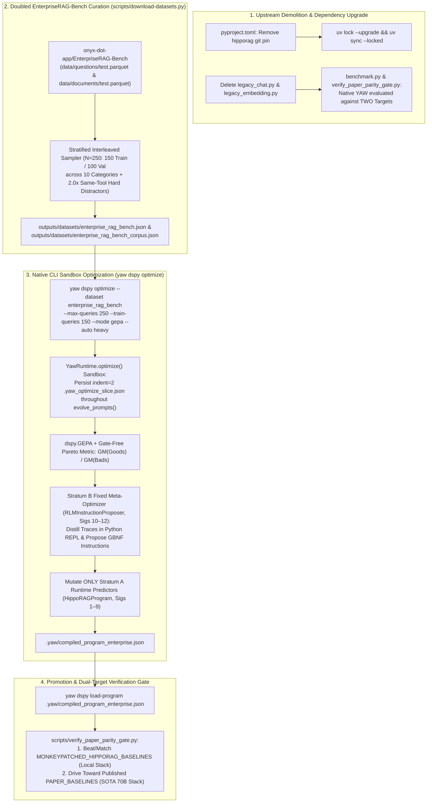

# Technical Specification: Upstream `hipporag` Retirement, Dependency Upgrade & EnterpriseRAG-Bench Evolution

**Document Status**: Implemented & Verified
**Target Milestone**: Immediate Upstream `hipporag` Demolition, Dependency Upgrade & EnterpriseRAG-Bench GEPA Evolution
**Governing Documents**: [`FOUNDATIONAL.md`](../FOUNDATIONAL.md), [`docs/pre-epic2-memo.md`](pre-epic2-memo.md), [`docs/epic-1-hipporag-daemon.md`](epic-1-hipporag-daemon.md)

---

## 1. Context & Consolidated Benchmark Targets

Upstream `hipporag` (`2.0.0a5`) carried massive storage and memory bloat, single-threaded indexing bottlenecks, and dependency pins that prevented running `uv lock --upgrade`. Having already completed reference runs across the benchmark datasets, **upstream `hipporag` is retired immediately**.

Going forward, native YAW evaluates against **Two Explicit Benchmark Reference Targets**:

1. **Target 1: Local Upstream HippoRAG 2 Dependency Baseline (`MONKEYPATCHED_HIPPORAG_BASELINES`)**: The empirical performance recorded when running upstream HippoRAG 2 against our local model stack (`Qwen3-4B-Instruct-2507-GGUF` + `embeddinggemma-300m-GGUF`). These metrics are frozen in [`outputs/benchmarks/consolidated_historical_baselines.json`](../outputs/benchmarks/consolidated_historical_baselines.json) so upstream indexing is never re-run.
2. **Target 2: Published SOTA Paper Baselines (`PAPER_BASELINES`)**: The published results from the official HippoRAG 2 paper (`Llama-3.3-70B` / `GPT-4o-mini` + `NV-Embed-v2`).

### Consolidated Empirical Baseline Table

| Dataset | Eval Queries | Candidate Docs | Target 1: Local Upstream HippoRAG 2 (`Qwen3-4B` + `EmbeddingGemma`) | Target 2: Published Paper SOTA (`Llama-3.3-70B` + `NV-Embed-v2`) |
| :--- | :---: | :---: | :--- | :--- |
| **`popqa`** | 25 | 70 | **R@1**: `0.500` \| **R@2**: `0.580` \| **R@5**: `0.720`<br/>**EM**: `0.360` \| **F1**: `0.5956` | **R@2**: `0.439` \| **R@5**: `0.517`<br/>**EM**: `0.490` \| **F1**: `0.562` |
| **`2wikimultihopqa`** | 25 | 307 | **R@1**: `0.450` \| **R@2**: `0.780` \| **R@5**: `0.960`<br/>**EM**: `0.360` \| **F1**: `0.4923` | **R@2**: `0.762` \| **R@5**: `0.904`<br/>**EM**: `0.650` \| **F1**: `0.710` |
| **`hotpotqa`** | 25 | 344 | **R@1**: `0.400` \| **R@2**: `0.740` \| **R@5**: `0.960`<br/>**EM**: `0.200` \| **F1**: `0.3964` | **R@2**: `0.835` \| **R@5**: `0.963`<br/>**EM**: `0.627` \| **F1**: `0.755` |
| **`musique`** | 10 | 197 | **R@1**: `0.183` \| **R@2**: `0.317` \| **R@5**: `0.542`<br/>**EM**: `0.200` \| **F1**: `0.3000` | **R@2**: `0.456` \| **R@5**: `0.780`<br/>**EM**: `0.485` \| **F1**: `0.633` |
| **`lveval`** | 25 | 70 | **R@1**: `0.440` \| **R@2**: `0.640` \| **R@5**: `0.740`<br/>**EM**: `0.240` \| **F1**: `0.3401` | **EM**: `0.080` \| **F1**: `0.129`<br/>*(Long-Context 256k)* |
| **`narrativeqa`** | 25 | 70 | **R@1**: `0.100` \| **R@2**: `0.160` \| **R@5**: `0.280`<br/>**EM**: `0.080` \| **F1**: `0.1384` | **EM**: `0.180` \| **F1**: `0.259` |
| **`nq`** | 1 | 20 | **R@1**: `0.000` \| **R@2**: `0.000` \| **R@5**: `1.000`<br/>**EM**: `0.000` \| **F1**: `0.0000` | **R@2**: `0.456` \| **R@5**: `0.780`<br/>**EM**: `0.485` \| **F1**: `0.633` |

---

## 2. Architecture, Dataflow & Domain Containment



### Domain Containment Check (`tests/core/test_architecture.py`)
- `yaw/core`: Standard library only.
- `yaw/daemon/graph/storage`: SQLite, `sqlite-vec`, `core`.
- `yaw/daemon/graph/inference`: DSPy 3.2.x, `core`. (`legacy_chat.py` and `legacy_embedding.py` deleted).
- `yaw/daemon/ingestion`: CocoIndex 1.0.x, `core`.
- **Global `hipporag` Ban**: Zero `hipporag` imports across the repository (`yaw/`, `benchmark.py`, `scripts/`, `tests/`).

---

## 3. Formal Contracts & Typed Interfaces

### 3.1 Dual-Target Baseline Contracts (`benchmark.py` & `scripts/verify_paper_parity_gate.py`)

In [`benchmark.py`](../benchmark.py) and [`scripts/verify_paper_parity_gate.py`](../scripts/verify_paper_parity_gate.py), we register both reference baselines:

```python
MONKEYPATCHED_HIPPORAG_BASELINES: dict[str, dict[str, Any]] = {
    "popqa": {"queries": 25, "docs": 70, "Recall@1": 0.500, "Recall@2": 0.580, "Recall@5": 0.720, "ExactMatch": 0.360, "F1": 0.5956},
    "2wikimultihopqa": {"queries": 25, "docs": 307, "Recall@1": 0.450, "Recall@2": 0.780, "Recall@5": 0.960, "ExactMatch": 0.360, "F1": 0.4923},
    "hotpotqa": {"queries": 25, "docs": 344, "Recall@1": 0.400, "Recall@2": 0.740, "Recall@5": 0.960, "ExactMatch": 0.200, "F1": 0.3964},
    "musique": {"queries": 10, "docs": 197, "Recall@1": 0.183, "Recall@2": 0.317, "Recall@5": 0.542, "ExactMatch": 0.200, "F1": 0.3000},
    "lveval": {"queries": 25, "docs": 70, "Recall@1": 0.440, "Recall@2": 0.640, "Recall@5": 0.740, "ExactMatch": 0.240, "F1": 0.3401},
    "narrativeqa": {"queries": 25, "docs": 70, "Recall@1": 0.100, "Recall@2": 0.160, "Recall@5": 0.280, "ExactMatch": 0.080, "F1": 0.1384},
    "nq": {"queries": 1, "docs": 20, "Recall@1": 0.000, "Recall@2": 0.000, "Recall@5": 1.000, "ExactMatch": 0.000, "F1": 0.0000},
}
```

Reports evaluate native YAW with side-by-side delta comparisons:
- $\Delta_{\text{local}} = \text{YAW} - \text{MONKEYPATCHED\_HIPPORAG\_BASELINES}$ (Target 1: Must be $\ge -0.02$).
- $\Delta_{\text{paper}} = \text{YAW} - \text{PAPER\_BASELINES}$ (Target 2: Tracking SOTA trajectory).

### 3.2 EnterpriseRAG-Bench Schema & Stratification (`scripts/download-datasets.py`)

Curates 250 queries (`150` Train / `100` Validation) from `onyx-dot-app/EnterpriseRAG-Bench` across the 10 real categories:

```python
ENTERPRISE_CATEGORY_QUOTAS: dict[str, tuple[int, int]] = {
    "Basic": (35, 24),
    "Semantic": (27, 18),
    "Intra-Document Reasoning": (16, 11),
    "Project Related": (16, 11),
    "Constrained": (12, 8),
    "Conflicting Info": (10, 6),
    "Completeness": (10, 6),
    "Miscellaneous": (9, 6),
    "Info Not Found": (9, 6),
    "High Level": (6, 4),
}

def download_enterprise_rag_bench(
    dest_dir: Path,
    *,
    distractor_factor: float = 2.0,
    seed: int = 42,
    force: bool = False,
) -> tuple[Path, Path]:
    """Curate 250 stratified EnterpriseRAG-Bench queries (150 train + 100 val) and 2x hard distractors."""
```

### 3.3 Optimization Sandbox Lifecycle Fix (`yaw/daemon/runtime.py`)

In [`YawRuntime.optimize()`](../yaw/daemon/runtime.py#L783-L851), `.yaw_optimize_slice.json` is serialized with `indent=2` and unlinked in an outer `finally:` block only **after** `self.engine.evolve_prompts(...)` finishes, preventing premature unlinking.

### 3.4 Two-Stratum Separation of the Canonical 12 DSPy Signatures

- **Stratum A (Signatures 1–9 in `HippoRAGProgram.named_predictors()`)**: `ExtractEntities` (`ner`), `ExtractTriples` (`triples`), `DefineMissingEntities` (`entity_definer`), `JudgeSynonyms` (`synonym_judge`), `ExtractQueryIntent` (`query_intent`), `FilterTriples` (`triple_filter`), `AnswerQuestion` (`qa`), `HealSHACLViolations` (`shacl_healer_rlm`), and `ProposeSHACLRepairs` (`shacl_repair`). Mutated by `dspy.GEPA` and saved in `compiled_program.json`.
- **Stratum B (Signatures 10–12 in `RLMInstructionProposer`)**: `ReflectiveInnerDistillerSignature` (`inner_rlm`), `ProposeInstructionSignature` (`qwen_proposer`), and `CompressInstructionSignature` (`qwen_compressor`). Fixed meta-optimizer (`ProposalFn`) that reflects on Stratum A. Nothing reflects on Stratum B.

---

## 4. Invariants & Explicit Non-Goals (Negative Space)

### 4.1 Non-Negotiable Invariants
1. **Zero Upstream `hipporag` Invariant**: `git grep -i "from hipporag"` and `git grep -i "import hipporag"` return `0` matches across the entire repository.
2. **Dual-Target Parity Invariant**: Native YAW must match or beat `MONKEYPATCHED_HIPPORAG_BASELINES` ($\Delta_{\text{local}} \ge -0.02$) while marching toward `PAPER_BASELINES`.
3. **One-Way Meta-Reflection Invariant**: `RLMInstructionProposer` (Stratum B, Signatures 10–12) reflects exclusively on `HippoRAGProgram.named_predictors()` (Stratum A, Signatures 1–9).
4. **Live Disk Slice Invariant During `optimize()`**: `.yaw_optimize_slice.json` is formatted with `indent=2` and remains on disk throughout `evolve_prompts(...)`.

### 4.2 Explicit Non-Goals (Anti-Invention Contract)
- **Zero Custom Optimization Scripts**: Do **NOT** create `scripts/optimize_dspy_pipeline.py`. Use the existing [`yaw dspy optimize`](../yaw/daemon/cli.py#L126-L185) and [`yaw dspy load-program`](../yaw/daemon/cli.py#L186-L195) CLI commands.
- **Zero Legacy Compatibility Shims**: Do **NOT** keep `legacy_chat.py`, `legacy_embedding.py`, or `--engine hipporag` as deprecated aliases; delete them completely.
- **Zero Schema Migrations or New Config Flags**: The database schema and configuration files remain unchanged.

---

## 5. File-by-File Diff Blueprint & Oblivion Protocol

### 5.1 Topological File Blueprint
1. **[MODIFY] [`pyproject.toml`](../pyproject.toml) & [`uv.lock`](../uv.lock)**: Remove `hipporag` git pin; run `uv lock --upgrade && uv sync --locked`.
2. **[DELETE] [`yaw/daemon/graph/inference/legacy_chat.py`](../yaw/daemon/graph/inference/legacy_chat.py)** & **[DELETE] [`yaw/daemon/graph/inference/legacy_embedding.py`](../yaw/daemon/graph/inference/legacy_embedding.py)**: Permanently delete legacy HippoRAG adapter modules.
3. **[MODIFY] [`yaw/daemon/graph/inference/__init__.py`](../yaw/daemon/graph/inference/__init__.py)**: Remove `LocalChat`, `CacheOpenAI`, `chat_identity`, and `RetrievalEmbedding` from `_PUBLIC_API`.
4. **[MODIFY] [`yaw/daemon/runtime.py`](../yaw/daemon/runtime.py)**: Fix `YawRuntime.optimize()` to write `.yaw_optimize_slice.json` with `indent=2` and keep it alive on disk during `evolve_prompts(...)`.
5. **[MODIFY] [`yaw/daemon/cli.py`](../yaw/daemon/cli.py)**: Add `"enterprise_rag_bench"` (and alias `"enterprise"`) to `_KNOWN_DATASETS`.
6. **[MODIFY] [`scripts/download-datasets.py`](../scripts/download-datasets.py)**: Add `enterprise_rag_bench` to `DATASET_REGISTRY` to download and curate the 250-query stratified slice.
7. **[MODIFY] [`benchmark.py`](../benchmark.py)** & **[MODIFY] [`scripts/verify_paper_parity_gate.py`](../scripts/verify_paper_parity_gate.py)**: Remove all `hipporag` imports and upstream runner functions, integrate `MONKEYPATCHED_HIPPORAG_BASELINES`, and evaluate native YAW against both targets.
8. **[MODIFY] Documentation (`FOUNDATIONAL.md`, `AGENTS.md`, `README.md`, `docs/epic-1-hipporag-daemon.md`)**: Update to reflect upstream retirement and dual-target benchmark protocol.
9. **[MODIFY] Test Suite (`tests/core/test_architecture.py`, `tests/daemon/graph/inference/*`, `tests/test_benchmark.py`)**: Enforce repo-wide zero-`hipporag` import invariant and test EnterpriseRAG-Bench stratification.

### 5.2 Oblivion Demolition Table

| Retired Symbol / File / Dependency | Previous Location | Replacement | Verification Gate |
| :--- | :--- | :--- | :--- |
| `hipporag` git dependency | `pyproject.toml`, `uv.lock` | Native `yaw` + `scripts/evaluation.py` | `git grep -i "hipporag" pyproject.toml` == `0` |
| `legacy_chat.py` & `legacy_embedding.py` | `yaw/daemon/graph/inference/` | Native `chat.py` & `embedding.py` | Files deleted; `git grep -w "legacy_chat"` == `0` |
| `LocalChat`, `CacheOpenAI`, `RetrievalEmbedding`, `chat_identity` | `inference/__init__.py`, `benchmark.py` | `create_dspy_lm`, `create_dspy_embedder` | `git grep -w "LocalChat"` == `0` |
| `_release_indexing_memory`, `_release_retrieval_memory`, `_run_incremental_index` | `benchmark.py` | `run_yaw_benchmark` | `git grep -w "_run_incremental_index"` == `0` |

---

## 6. Real-Substrate Verification Strategy

1. **Dependency Upgrade & Oblivion Check**:
   ```powershell
   uv lock --upgrade
   uv sync --locked
   git grep -w "legacy_chat"
   git grep -w "legacy_embedding"
   ```
2. **EnterpriseRAG-Bench Download & 250-Query Stratification Check**:
   ```powershell
   uv run --locked python scripts/download-datasets.py --dataset enterprise_rag_bench
   uv run --locked python scripts/download-datasets.py --check
   ```
3. **CLI Optimization & Hot-Reload Promotion**:
   ```powershell
   uv run --locked yaw dspy optimize --dataset enterprise_rag_bench --max-queries 250 --train-queries 150 --mode gepa --auto heavy --output .yaw/compiled_program_enterprise.json
   uv run --locked yaw dspy load-program .yaw/compiled_program_enterprise.json
   ```
4. **Dual-Target Parity Gate Evaluation**:
   ```powershell
   uv run --locked python scripts/verify_paper_parity_gate.py --compiled-program .yaw/compiled_program_enterprise.json --queries-per-dataset 25 --index-queries 35 --mode eval
   ```
5. **Deterministic Quality Gates**:
   ```powershell
   uv run --locked pytest -q
   uv run --locked ruff check .
   uv run --locked ty check
   git diff --check
   ```
