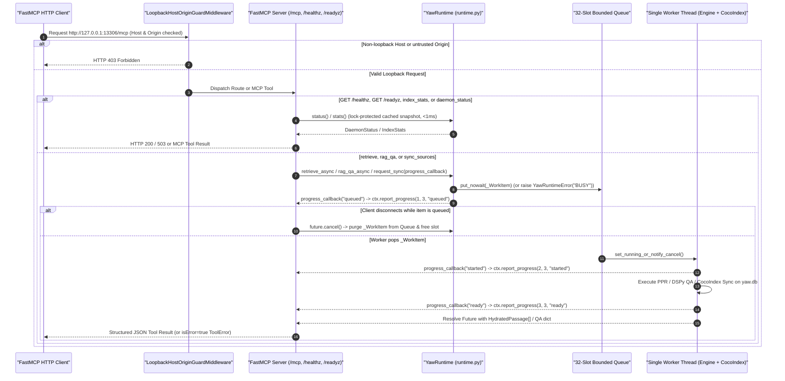

# Epic 2: FastMCP Streamable HTTP Adapter (`yaw/daemon/mcp_server.py`)

Owner: [FOUNDATIONAL](../FOUNDATIONAL.md) | Prerequisite: [Epic 1](epic-1-hipporag-daemon.md) (`D1-A0..D1-A6` passed) | Results: [evaluation](evaluation.md) | Sprint Specs: [Sprint 1 (`E2-S1`)](epic-2-sprint-1-spec.md), [Sprint 2 (`E2-S2`)](epic-2-sprint-2-spec.md)

---

## Pre-Epic 2 Codebase Audit & Baseline Alignment (2026-10-25)

Following the completion of Epic 1 (`E1-S1..E1-S6` in [epic-1-hipporag-daemon.md](epic-1-hipporag-daemon.md)), YAW evolved substantially (Gemma 4 128K serving profile, textbook `dspy.Ensemble` wrapping `HippoRAGProgram`, W3C SKOS/RDF/OWL/SHACL closed-world schema with `entity_labels` and `shacl_conforms`, 1-indexed CocoIndex Rust Tree-sitter AST hydration, and `CorpusIngestor` over `ManagedConnection`). Auditing the live codebase against the original Epic 2 plan surfaced **9 concrete gaps** resolved across [Sprint 1 (`E2-S1`)](epic-2-sprint-1-spec.md) and [Sprint 2 (`E2-S2`)](epic-2-sprint-2-spec.md):

| # | Audit Area | Original Epic 2 Assumption | Actual Codebase State (`yaw/`) | Epic 2 Resolution (SSOT) |
| :--- | :--- | :--- | :--- | :--- |
| **1** | **Dependencies** ([`pyproject.toml`](../pyproject.toml#L11-L21), [`uv.lock`](../uv.lock)) | Locked `fastmcp` installed (`E2-S1`). | `fastmcp` is absent from `pyproject.toml` and `uv.lock`. (Unused `"optuna>=5.0.0"` remains at [`pyproject.toml:17`](../pyproject.toml#L17) pending Epic 3). | Add `"fastmcp>=3.0.0"` to [`pyproject.toml`](../pyproject.toml#L11-L21) and lock via `uv lock` + `uv sync --locked` in [`E2-S1`](epic-2-sprint-1-spec.md#step-01). |
| **2** | **Adapter Module** (`yaw/daemon/mcp_server.py`) | Mounts `FastMCP` onto `YawRuntime` lifespan at `127.0.0.1:13306/mcp`. | `yaw/daemon/mcp_server.py` does not exist yet. [`YawConfig`](../yaw/core/config.py#L190-L193) already defines `queue_maxsize = 32`, `http_host = "127.0.0.1"`, `http_port = 13306`, and `http_path = "/mcp"` mapped to `[runtime]` ([`config.py:547-550`](../yaw/core/config.py#L547-L550)). | Create `yaw/daemon/mcp_server.py` consuming `YawConfig.{http_host,http_port,http_path}` in [`E2-S1`](epic-2-sprint-1-spec.md#step-03). |
| **3** | **AST Containment Law** ([`test_architecture.py`](../tests/core/test_architecture.py#L53-L81)) | `mcp_server.py` imports **only** `yaw.daemon.runtime`, `yaw.core.*`, and `fastmcp`; never `ingestion/`, `graph/`, `storage/`, or `inference/`. | [`is_allowed_internal_import`](../tests/core/test_architecture.py#L72-L74) checks only `importer_pkg == "yaw.daemon"`, which currently permits `mcp_server.py` to import `yaw.daemon.graph.*` or `yaw.daemon.ingestion.*`. | Tighten [`tests/core/test_architecture.py`](../tests/core/test_architecture.py#L53-L81) with an explicit `importer_mod == "yaw.daemon.mcp_server"` rule allowing only `yaw.daemon.runtime` and `yaw.core.*` in [`E2-S1`](epic-2-sprint-1-spec.md#step-01). |
| **4** | **`content_hash` & `stale_on_disk`** ([`types.py`](../yaw/core/types.py#L30-L50), [`hydration.py`](../yaw/daemon/graph/storage/hydration.py#L607-L636), [`engine.py`](../yaw/daemon/graph/engine.py#L2998-L3050), [`runtime.py`](../yaw/daemon/runtime.py#L761-L854)) | `retrieve` returns `{rank, text, score, chunk_id, content_hash, stale_on_disk, source: ...}`; `rag_qa` returns `{answer, evidence: passages[:5], last_sync_at}`. | 1. `yaw.db` and [`ChunkPointer`](../yaw/core/types.py#L30-L39) are contentless (no stored `content_hash`).<br/>2. [`YawGraphEngine._hydrate_maxp_passages`](../yaw/daemon/graph/engine.py#L3040-L3050) strips `HydratedPassage.stale_on_disk` and drops empty stale hits.<br/>3. [`YawRuntime.retrieve_async`](../yaw/daemon/runtime.py#L780-L782) and [`rag_qa_async`](../yaw/daemon/runtime.py#L826) hardcode `stale_on_disk=False` and omit `content_hash`. | 1. Compute `content_hash` on-the-fly (`"sha256:" + sha256(text).hexdigest()`) in `serialize_hydrated_passage`.<br/>2. Detect `stale_on_disk` on missing/truncated files or mutated uncoalesced spans (`compute_chunk_id(...) != cid`) and propagate through `hydrate_ranked_passages` into `retrieve` and `rag_qa` in [`E2-S1`](epic-2-sprint-1-spec.md#step-02). |
| **5** | **Queue Cancellation & 32-Slot `BUSY` Budget** ([`runtime.py`](../yaw/daemon/runtime.py#L515-L547)) | Cancel before execution removes the queued item; once running on the worker thread, finish the operation and discard the disconnected client's result. | [`YawRuntime.submit`](../yaw/daemon/runtime.py#L529-L547) pushes `_WorkItem` onto `queue.Queue(maxsize=32)`. Calling `fut.cancel()` marks the future cancelled, **but `_WorkItem` remains inside `self._queue._queue`** until popped by `_worker_loop`, inflating `queue_depth` and consuming one of the 32 slots. | Attach a future done-callback in [`YawRuntime.submit`](../yaw/daemon/runtime.py#L529-L547) that immediately removes a cancelled `_WorkItem` from `self._queue._queue` under `self._queue.mutex` if not yet running, freeing the slot and updating `queue_depth` in [`E2-S1`](epic-2-sprint-1-spec.md#step-02). |
| **6** | **Startup Sync vs. `/healthz` & `/readyz`** ([`runtime.py`](../yaw/daemon/runtime.py#L353-L415)) | `/healthz` = 200 liveness; `/readyz` = 200 when committed index is ready/empty, 503 when starting/stopping/failed. | [`YawRuntime.start(sync_on_start=True)`](../yaw/daemon/runtime.py#L395-L397) blocks synchronously on `self.sync_now()`. If run before Uvicorn binds the socket, HTTP probes cannot observe `lifecycle == "starting"`. | Add `defer_initial_sync: bool = False` to [`YawRuntime.start()`](../yaw/daemon/runtime.py#L353): when mounted by FastMCP lifespan, initial sync is queued on the worker thread while `lifecycle == "starting"` until completion transitions `lifecycle = "ready"` in [`E2-S1`](epic-2-sprint-1-spec.md#step-02). |
| **7** | **Foreground & Background CLI** ([`cli.py`](../yaw/daemon/cli.py#L540-L631)) | One process, one `yaw.db` owner, one worker queue; no separate `serve-mcp` process. | [`handle_daemon_run`](../yaw/daemon/cli.py#L540-L577) starts `YawRuntime` and blocks on `runtime.wait()` without starting FastMCP HTTP. | Wire [`handle_daemon_run`](../yaw/daemon/cli.py#L540-L577) to `run_mcp_daemon(...)` in `yaw/daemon/mcp_server.py`, linking `YawRuntime.request_stop()` (Win32 Named Event / `SIGINT` / `SIGTERM`) to Uvicorn shutdown in [`E2-S1`](epic-2-sprint-1-spec.md#step-03). |
| **8** | **Async Progress Bridging** (`yaw/daemon/mcp_server.py`) | Emit real `Context.report_progress` stages (`queued`, `started`, `ready`) without blocking `asyncio`. | [`YawRuntime.submit`](../yaw/daemon/runtime.py#L544-L545) and [`_worker_loop`](../yaw/daemon/runtime.py#L608-L609,L640-L641) invoke synchronous `progress_callback(stage: str)` from caller and worker threads. | Bridge `progress_callback` into the running `asyncio` loop via `loop.call_soon_threadsafe` + `asyncio.Queue` to await `ctx.report_progress(progress=i, total=3, message=stage)` in [`E2-S2`](epic-2-sprint-2-spec.md#step-04). |
| **9** | **Error Precedence & `bool` Guard** ([`runtime.py`](../yaw/daemon/runtime.py#L761-L845)) | Return `isError=true` with fixed codes: `INVALID_INPUT`, `NOT_READY`, `EMPTY_INDEX` (QA only), `BUSY`, `MODEL_ERROR`, `CONSISTENCY_ERROR`, `SHUTTING_DOWN`. | 1. `isinstance(True, int)` is `True` in Python, so `retrieve_async` accepts `top_k=True`.<br/>2. `rag_qa_async` checks `self.stats().chunks == 0` before lifecycle state, raising `EMPTY_INDEX` instead of `NOT_READY`/`SHUTTING_DOWN` on an unstarted empty DB. | Reject `isinstance(top_k, bool)` in `retrieve_async`, check lifecycle (`SHUTTING_DOWN` / `NOT_READY`) before `EMPTY_INDEX` in `rag_qa_async`, and raise FastMCP `ToolError(f"[{err.code}] {err.message}")` in [`E2-S2`](epic-2-sprint-2-spec.md#step-04). |

---

## Containment & Transport Contract

- **Containment Law:** `yaw/daemon/mcp_server.py` resides in `yaw/daemon/` and imports **only** `yaw.daemon.runtime`, `yaw.core.*`, and `fastmcp` (plus Starlette/Uvicorn/stdlib transport primitives). It never imports `ingestion/`, `graph/`, `storage/`, or `inference/` directly ([`tests/core/test_architecture.py`](../tests/core/test_architecture.py#L53-L81) enforced).
- Mount `FastMCP` onto the `YawRuntime` lifespan at `http://127.0.0.1:13306/mcp` (`config.http_host`, `config.http_port`, `config.http_path`).
- One process (`yaw daemon run` / `yaw daemon start`), one `yaw.db` owner (`.yaw/yaw.db.lock`), one 32-slot worker queue. No separate `serve-mcp` process, no `stdio`/`sse` entry points, no wildcard CORS.
- Loopback security guard (`LoopbackHostOriginGuardMiddleware`) validates `Host` and `Origin` headers before requests reach FastMCP, returning HTTP `403 Forbidden` on DNS-rebinding `Host` headers or untrusted cross-origin `Origin` headers.
- Health routes:
  - `GET /healthz`: `200 OK` (`{"status": "ok", "lifecycle": ...}`) whenever the event loop is responsive.
  - `GET /readyz`: `200 OK` (`{"ready": true, "lifecycle": "ready", "chunks": ...}`) when the committed index is ready or empty; `503 Service Unavailable` when `lifecycle in ("starting", "stopping", "stopped", "degraded", "failed")`.



---

## Tools (5 Fixed Endpoints Delegating to `YawRuntime`)

All query/question inputs are trimmed, non-empty, and $\le 1024$ UTF-8 bytes ([`validate_query_input`](../yaw/daemon/runtime.py#L130-L139)).

| Tool | Args | Annotations | Action & Return (`yaw/daemon/runtime.py` queue) |
| --- | --- | --- | --- |
| `retrieve` | `query: str`, `top_k: int = 5` (1–20) | `readOnlyHint=true`, `idempotentHint=true`, `openWorldHint=false` | Queue `runtime.retrieve_async(query, top_k)`. Return `{"query": str, "top_k": int, "results": [{"rank": int, "text": str, "score": float, "chunk_id": str, "content_hash": str, "stale_on_disk": bool, "source": {"rel_posix_path": str, "start_line": int, "end_line": int, "title": str}}, ...]}` with MaxP canonical passage span aggregation ($S(\text{passage}) = \max_{c \in \text{passage}} S(c)$) and 1-indexed line hydration. |
| `rag_qa` | `question: str` | `readOnlyHint=true`, `idempotentHint=false`, `openWorldHint=false` | Queue `runtime.rag_qa_async(question)`. Return `{"question": str, "answer": str, "reasoning": str, "evidence": passages[:5], "last_sync_at": float \| None}` where each item in `evidence` has the exact serialized passage schema above. |
| `index_stats` | none | `readOnlyHint=true`, `idempotentHint=true`, `openWorldHint=false` | Read cached `runtime.stats().to_dict()` (`chunks`, `entities`, `facts`, `edges`, `config_fingerprint`, `openie_checkpoints`, `entity_labels`, `shacl_conforms`) without blocking on the worker thread. |
| `daemon_status` | none | `readOnlyHint=true`, `idempotentHint=true`, `openWorldHint=false` | Read cached `runtime.status().to_dict()` (`lifecycle`, `provider_ready`, `sync_state`, `queue_depth`, `active_op`, redacted `last_error`, `last_sync_at`, `pid`) without blocking on the worker thread. |
| `sync_sources` | none | `readOnlyHint=false`, `destructiveHint=true`, `idempotentHint=true`, `openWorldHint=false` | Call `runtime.request_sync()`; return `{"scan_id": str, "status": "accepted" \| "already_pending"}`. Triggers coalesced CocoIndex incremental sync across 30+ supported Tree-sitter file formats with $\pi_{\mathcal{W}, \mathcal{B}}$ key projection. |

---

## Execution & Error Rules

- Never block the `asyncio` loop; await `YawRuntime` queue `Future`s via `asyncio.wrap_future`.
- Emit real `Context.report_progress` stages (`queued` `1/3`, `started` `2/3`, `ready` `3/3`).
- Cancel before execution removes the queued `_WorkItem` from `self._queue` immediately (freeing the slot in the 32-slot budget and decrementing `queue_depth`); once running on the worker thread, finish the operation and discard the disconnected client's result.
- Catch `YawRuntimeError` and raise FastMCP `ToolError(f"[{err.code}] {err.message}")` so the MCP response sets `isError=true` with fixed codes: `INVALID_INPUT`, `NOT_READY`, `EMPTY_INDEX` (QA only), `BUSY`, `MODEL_ERROR`, `CONSISTENCY_ERROR`, `SHUTTING_DOWN`.

---

## Sprints & Acceptance Checks

- **Copy/Adapt From:** `git show d1bc65e:src/yaw/server/daemon.py:90-160` (`FastMCP("yaw-mcp")` initialization, `@mcp.tool()` registration).
- **Drop (Anti-Spaghetti):** Drop `d1bc65e:daemon.py`'s ontology tools (`compile_wiki`, `lint_wiki`, `load_ontology`, `set_extraction_mode`, `get_ontology_schema`), `stdio` transport branches, and direct `yaw.retrieval`/`yaw.storage` imports.

| Sprint | Detailed Spec | Target Node & Files | Exit Condition |
| --- | --- | --- | --- |
| **Sprint 1 (`E2-S1`)** | [epic-2-sprint-1-spec.md](epic-2-sprint-1-spec.md) | `pyproject.toml`, `uv.lock`, `tests/core/test_architecture.py`, `yaw/daemon/graph/storage/hydration.py`, `yaw/daemon/graph/engine.py`, `yaw/daemon/runtime.py`, `yaw/daemon/mcp_server.py`, `yaw/daemon/cli.py` | Locked `fastmcp` installed; `/mcp`, `/healthz`, `/readyz` bind to `YawRuntime` lifespan in `yaw daemon run`; `content_hash`/`stale_on_disk` & queue slot cancellation wired; `test_architecture.py` passes (`0` cross-domain imports) |
| **Sprint 2 (`E2-S2`)** | [epic-2-sprint-2-spec.md](epic-2-sprint-2-spec.md) | `yaw/daemon/mcp_server.py`, `tests/daemon/test_mcp_http.py`, `README.md`, `docs/evaluation.md` | All 5 tools, progress notifications (`queued`, `started`, `ready`), pre-execution cancellation slot reclamation, `BUSY` queue overflow, and `Host`/`Origin` checks pass over real loopback TCP |

- [ ] **E2-A1 (`E2-S1`):** FastMCP server mounts onto `YawRuntime` lifespan with zero direct `ingestion`/`graph`/`storage`/`inference` imports; `/healthz` and `/readyz` reflect live `YawRuntime` state (`200` vs `503`).
- [ ] **E2-A2 (`E2-S2`):** FastMCP client connects over TCP to `127.0.0.1:13306/mcp` (or ephemeral loopback port in tests), lists 5 tools with annotations, receives `queued` $\to$ `started` $\to$ `ready` progress events, and retrieves 1-indexed line-hydrated passages (with `content_hash` and `stale_on_disk`) + QA answers.
- [ ] **E2-A3 (`E2-S2`):** Two concurrent TCP clients share one `yaw.db` owner; `daemon_status`, `index_stats`, and `/healthz` respond in `<2s` during slow inference; 32-slot overflow returns `BUSY` and pre-execution cancellation frees its slot immediately; `Host`/`Origin` guard rejects non-loopback requests with `403`; live CocoIndex edits update citations atomically.

---

## Next Epic: Epic 3 Proposal ("The Great Cleanup & Configurable Substrate")

### 1. Motivation & Goals
As YAW solidifies its native HippoRAG 2 engine, knowledge graph traversal, and FastMCP transport across Epics 1 and 2, historical scaffolding, compatibility shims, and hardcoded prompt/parameter surfaces must be systematically eliminated. Epic 3 will align the user-facing CLI with strict domain containment, introduce standalone Optuna hyperparameter optimization, and externalize all hyperparameters and seed prompts into declarative configuration.

### 2. Core Pillars of Epic 3

#### A. CLI Surface Reconsideration & Anti-Sprawl Cleanup
- **Purge the `yaw dspy` Historical Misnomer:** The `dspy` command group was an early development shim. Benchmarking, optimization, and program promotion belong to native engine operations.
- **Strict Domain-Aligned CLI Hierarchy:**
  ```text
  yaw daemon   {start|stop|status|run}
  yaw graph    {build|rebuild|lint}
  yaw optimize {gepa|optuna|hybrid}
  yaw evaluate {benchmark|gate}
  yaw config   {get|set|show}
  ```
- **Deprecation of Legacy Shims:** Remove unused flags, dead parameter aliases, and obsolete compatibility wrappers across `cli.py` and `runtime.py`.

#### B. Standalone Optuna Hyperparameter Optimization (`yaw optimize optuna <flags>`)
- **Fast, Non-LLM Graph Traversal Tuning:** Decouple continuous/discrete numerical hyperparameter tuning from slow LLM prompt reflection.
- **Trial Velocity:** Optuna evaluates candidate traversal settings on pre-indexed graphs via fast SciPy CSR PPR runs (executing 100 validation queries in seconds).
- **Comprehensive Traversal Parameter Search Space:**
  - PPR Dynamics: `damping` ($\alpha$), `beta` ($\beta$), `activation` (`scaled_tanh`, `linear`, `sigmoid`), `activation_param`, `dual_weight`.
  - Seeding & Disambiguation: `passage_seed_pool_k`, `fts_seed_pool_k`, `same_sense_cosine_gate`, `synonymy_threshold`.
  - SKOS Traversal Policies: `skos_broader_up`, `skos_broader_down`, `skos_related`, `fact_forward`, `fact_reverse`, `parallel_aggregation` (`max`, `sum`, `capped_sum`), `parallel_cap`.
- **Output:** Writes the best-performing `RelationTraversalPolicy` and retrieval parameters directly to `yaw.toml` or candidate presets.

#### C. Fully Configurable Hyperparameter Architecture (`yaw.toml`)
- Restructure `yaw.toml` with explicit domain sections so zero engine knobs are hardcoded in source:
  ```toml
  [graph.traversal]
  damping = 0.5
  beta = 0.5
  activation = "scaled_tanh"
  dual_weight = 0.5

  [graph.policy]
  skos_broader_up = 1.0
  skos_broader_down = 0.5
  skos_related = 1.0
  fact_forward = 1.0
  fact_reverse = 1.0
  parallel_aggregation = "max"
  parallel_cap = 2.0

  [graph.seeding]
  passage_seed_pool_k = 10
  fts_seed_pool_k = 10
  same_sense_cosine_gate = 0.85
  ```

#### D. Externalized Seed Prompts & Demonstrations
- **Eliminate Hardcoded Strings in Source:** Move hardcoded prompt docstrings, signature instructions, and seed few-shot demonstrations out of `yaw/daemon/graph/inference/prompts.py` and `program.py`.
- **Declarative Prompt Files (`prompts/*.toml` or `[inference.prompts]` in `yaw.toml`):**
  - Allow manual inspection, version-controlled prompt tuning, and custom few-shot demo injection without python code modifications.
  - DSPy signatures load instructions and demonstrations dynamically from config at startup while maintaining strict GBNF grammar validation.
