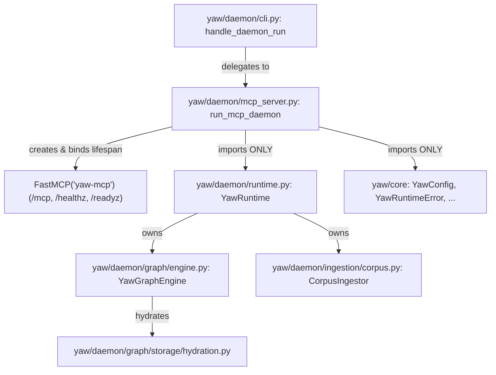

# Epic 2 — Sprint 1 Specification (`E2-S1`): Containment Lock, Runtime Contracts & Lifespan HTTP Mount

Parent Epic SSOT: [epic-2-fastmcp-http.md](epic-2-fastmcp-http.md) | Next Sprint: [Sprint 2 (`E2-S2`)](epic-2-sprint-2-spec.md) | Constitution: [FOUNDATIONAL.md](../FOUNDATIONAL.md)

---

## 1. Context & Root-Cause Problem Statement

Before exposing YAW's 5 MCP tools over TCP in [Sprint 2 (`E2-S2`)](epic-2-sprint-2-spec.md), five foundational substrates must be locked in `E2-S1`:
1. [`pyproject.toml`](../pyproject.toml#L11-L21) and [`uv.lock`](../uv.lock) do not yet declare `fastmcp`.
2. [`is_allowed_internal_import`](../tests/core/test_architecture.py#L72-L74) in `tests/core/test_architecture.py` checks only `importer_pkg == "yaw.daemon"`, which would permit `yaw/daemon/mcp_server.py` to import `yaw.daemon.graph.*` or `yaw.daemon.ingestion.*` in violation of the Epic 2 containment law ([epic-2-fastmcp-http.md](epic-2-fastmcp-http.md#containment--transport-contract)).
3. [`YawGraphEngine._hydrate_maxp_passages`](../yaw/daemon/graph/engine.py#L3040-L3050) discards `HydratedPassage.stale_on_disk` and [`YawRuntime.retrieve_async`](../yaw/daemon/runtime.py#L780-L782) / [`rag_qa_async`](../yaw/daemon/runtime.py#L826) hardcode `stale_on_disk=False` while omitting `content_hash`.
4. [`YawRuntime.submit`](../yaw/daemon/runtime.py#L529-L547) leaves cancelled `_WorkItem` instances inside `self._queue._queue` until the worker thread pops them (inflating `queue_depth` and consuming slots in the 32-slot `BUSY` budget), and [`YawRuntime.start(sync_on_start=True)`](../yaw/daemon/runtime.py#L395-L397) blocks synchronously on `self.sync_now()`, preventing HTTP health probes from observing `lifecycle == "starting"`.
5. [`handle_daemon_run`](../yaw/daemon/cli.py#L540-L577) currently runs `YawRuntime` headlessly via `runtime.wait()` without mounting FastMCP HTTP.

---

## 2. Architecture, Dataflow & Domain Containment



### Domain Containment Check (`tests/core/test_architecture.py`)
- `yaw/daemon/mcp_server.py` has canonical module name `yaw.daemon.mcp_server`.
- Internal `yaw.*` imports inside `yaw.daemon.mcp_server` are restricted strictly to `yaw.daemon.runtime` and `yaw.core.*`.
- Any import of `yaw.daemon.ingestion.*`, `yaw.daemon.graph.*`, `yaw.daemon.graph.storage.*`, or `yaw.daemon.graph.inference.*` inside `yaw/daemon/mcp_server.py` is rejected by [`tests/core/test_architecture.py`](../tests/core/test_architecture.py#L53-L81).

---

## 3. Formal Contracts & Typed Interfaces

### Step 01: Dependency Lock & AST Containment Guard (`pyproject.toml`, `tests/core/test_architecture.py`) {#step-01}

```python
# In tests/core/test_architecture.py:
def is_allowed_internal_import(
    importer_pkg: str,
    imported_mod: str,
    *,
    importer_mod: str | None = None,
) -> bool:
    """Validate containment law: package P imports only P.* (descendants) or yaw.core.*.

    Additionally, yaw.daemon.mcp_server is a thin transport adapter and may only import
    yaw.daemon.runtime and yaw.core.* (zero direct ingestion, graph, storage, or inference imports).
    """
    if not imported_mod.startswith("yaw.") and imported_mod != "yaw":
        return True

    if imported_mod == "yaw.core" or imported_mod.startswith("yaw.core."):
        return True

    if importer_mod == "yaw.daemon.mcp_server":
        return bool(
            imported_mod == "yaw.daemon.runtime"
            or imported_mod.startswith("yaw.daemon.runtime.")
        )
    ...
```

### Step 02: Hydration Metadata, Queue Slot Reclamation & Deferred Startup Sync (`hydration.py`, `engine.py`, `runtime.py`) {#step-02}

```python
# In yaw/daemon/graph/storage/hydration.py:
def _hydrate_spans(
    spans: Sequence[CoalescedSpan],
    corpus_root: Path,
) -> list[HydratedPassage]:
    """Hydrate coalesced spans from disk, marking stale_on_disk=True when:
    1. The file is missing or truncated before start_line (read_corpus_lines returns None), OR
    2. A single unexpanded chunk span's raw on-disk text no longer hashes to its indexed chunk_id.
    """

# In yaw/daemon/graph/engine.py:
def hydrate_ranked_passages(
    self,
    ranked_chunks: Sequence[tuple[str, float]],
    top_k: int,
) -> list[HydratedPassage]:
    """Thread-safe MaxP hydration of ranked (chunk_id, score) pairs preserving stale_on_disk."""

# In yaw/daemon/runtime.py:
def compute_passage_content_hash(text: str) -> str:
    """Compute deterministic SHA-256 hex digest ('sha256:<hex>') of hydrated passage text."""
    return "sha256:" + hashlib.sha256(text.encode("utf-8")).hexdigest()


def serialize_hydrated_passage(rank: int, passage: HydratedPassage) -> dict[str, Any]:
    """Serialize a 1-indexed HydratedPassage into the canonical runtime/MCP passage dictionary."""
    return {
        "rank": int(rank),
        "text": passage.text,
        "score": float(passage.score),
        "chunk_id": passage.pointer.chunk_id,
        "content_hash": compute_passage_content_hash(passage.text),
        "stale_on_disk": bool(passage.stale_on_disk),
        "source": {
            "rel_posix_path": passage.pointer.rel_posix_path,
            "start_line": int(passage.pointer.start_line),
            "end_line": int(passage.pointer.end_line),
            "title": passage.pointer.title,
        },
    }


class YawRuntime:
    def start(
        self,
        *,
        sync_on_start: bool = True,
        defer_initial_sync: bool = False,
    ) -> None:
        """Acquire exclusive yaw.db.lock, open CocoIndex + YawGraphEngine, and start worker thread.

        If `defer_initial_sync=False` (default for CLI/test callers), `sync_on_start=True` blocks
        until the initial sync finishes and transitions `lifecycle` to `'ready'`.
        If `defer_initial_sync=True` (used by FastMCP HTTP lifespan), the initial sync is enqueued
        on the worker thread while `lifecycle` remains `'starting'` until the sync completes.
        """
```

#### Queue Slot Reclamation Contract in [`YawRuntime.submit`](../yaw/daemon/runtime.py#L515-L547):
When `fut.cancel()` is invoked before `_worker_loop` pops `item`:
- A completion callback registered via `fut.add_done_callback(...)` acquires `self._queue.mutex`:
  - If `fut.cancelled()` and `item in self._queue._queue`, it removes `item` from `self._queue._queue`, increments `self._queue.unfinished_tasks` adjustment (`self._queue.unfinished_tasks -= 1`), notifies `self._queue.not_full`, and calls `self._update_state()` outside the queue mutex.
  - Consequently, `self._queue.qsize()` (`status().queue_depth`) and the 32-slot `put_nowait` capacity reflect the cancellation immediately without waiting for the currently executing worker task to finish.

### Step 03: FastMCP Lifespan Mount, `/healthz`, `/readyz` & CLI Integration (`mcp_server.py`, `cli.py`) {#step-03}

```python
# In yaw/daemon/mcp_server.py:
def create_mcp_server(
    runtime: YawRuntime,
    *,
    manage_runtime_lifespan: bool = True,
    sync_on_start: bool = True,
    defer_initial_sync: bool = True,
) -> FastMCP:
    """Create the FastMCP('yaw-mcp') server mounted to `runtime` lifespan with /healthz and /readyz."""


async def serve_mcp_http_async(
    runtime: YawRuntime,
    *,
    host: str | None = None,
    port: int | None = None,
    path: str | None = None,
    manage_runtime_lifespan: bool = True,
    sync_on_start: bool = True,
    defer_initial_sync: bool = True,
    max_seconds: float | None = None,
) -> int:
    """Serve FastMCP Streamable HTTP over Uvicorn until `runtime.request_stop()` or `max_seconds`."""


def run_mcp_daemon(
    config: YawConfig,
    *,
    program: Any = None,
    embedder: Any = None,
    max_seconds: float | None = None,
    sync_on_start: bool = True,
) -> int:
    """Run the persistent daemon + FastMCP HTTP server in the foreground (`yaw daemon run`)."""
```

---

## 4. Invariants & Explicit Non-Goals

- **Lifespan Coupling Invariant:** Entering the FastMCP ASGI app lifespan calls `runtime.start(sync_on_start=sync_on_start, defer_initial_sync=defer_initial_sync)`; exiting the lifespan calls `runtime.stop()`, guaranteeing `.yaw/yaw.db.lock` is always released on Uvicorn exit.
- **Stop Signal Unification Invariant:** Calling `YawRuntime.signal_local_stop(lock_path)` (from `yaw daemon stop` via Win32 Named Kernel Event or POSIX `SIGTERM`/`SIGINT`) sets `runtime._stop_event`, which triggers a background monitor task inside `serve_mcp_http_async` to set `uvicorn_server.should_exit = True`.
- **Health vs. Readiness Invariant:**
  - `GET /healthz` returns HTTP `200` (`{"status": "ok", "lifecycle": st.lifecycle}`) whenever the ASGI event loop is alive.
  - `GET /readyz` returns HTTP `200` (`{"ready": True, "lifecycle": "ready", "chunks": stats.chunks}`) strictly when `st.lifecycle == "ready"`, and HTTP `503` (`{"ready": False, "lifecycle": st.lifecycle, "last_error": st.last_error}`) when `st.lifecycle in ("starting", "stopping", "stopped", "degraded", "failed")`.
- **Explicit Non-Goals:**
  - Zero changes to SQLite table schemas in `yaw/daemon/graph/storage/db.py`.
  - Zero direct imports from `yaw.daemon.graph`, `yaw.daemon.ingestion`, `yaw.daemon.graph.storage`, or `yaw.daemon.graph.inference` in `yaw/daemon/mcp_server.py`.

---

## 5. File-by-File Blueprint & Oblivion Protocol

| Order | Tag | File | Planned Changes |
| :--- | :--- | :--- | :--- |
| **1** | `[MODIFY]` | [`pyproject.toml`](../pyproject.toml#L11-L21), [`uv.lock`](../uv.lock) | Add `"fastmcp>=3.0.0"` to dependencies and run `uv lock` + `uv sync --locked`. |
| **2** | `[MODIFY]` | [`tests/core/test_architecture.py`](../tests/core/test_architecture.py#L53-L81) | Enforce `importer_mod == "yaw.daemon.mcp_server"` import restriction (`yaw.daemon.runtime` and `yaw.core.*` only) and add synthetic boundary tests. |
| **3** | `[MODIFY]` | [`yaw/daemon/graph/storage/hydration.py`](../yaw/daemon/graph/storage/hydration.py#L607-L636) | Track whether a `MutableSpan` / `CoalescedSpan` was expanded or coalesced; if unexpanded and `compute_chunk_id(...) != cid`, mark `stale_on_disk=True`. |
| **4** | `[MODIFY]` | [`yaw/daemon/graph/engine.py`](../yaw/daemon/graph/engine.py#L2998-L3050) | Add `hydrate_ranked_passages(ranked_chunks, top_k) -> list[HydratedPassage]` preserving `stale_on_disk` (including missing/truncated files). |
| **5** | `[MODIFY]` | [`yaw/daemon/runtime.py`](../yaw/daemon/runtime.py#L353-L854) | Add `defer_initial_sync` to `start()`; add pre-execution cancellation slot removal in `submit()`; add `compute_passage_content_hash` and `serialize_hydrated_passage`; fix `bool` `top_k` check in `retrieve_async` and lifecycle-before-`EMPTY_INDEX` check in `rag_qa_async`; redact `api_key` in `last_error`. |
| **6** | `[NEW]` | `yaw/daemon/mcp_server.py` | Create FastMCP server factory, lifespan manager, `/healthz` and `/readyz` custom routes, `serve_mcp_http_async`, and `run_mcp_daemon`. |
| **7** | `[MODIFY]` | [`yaw/daemon/cli.py`](../yaw/daemon/cli.py#L540-L577) | Delegate `handle_daemon_run` to `run_mcp_daemon`. |

### Oblivion Demolition Table

| Retired Pattern / Symbol | Previous Location | Replacement | Verification Gate |
| :--- | :--- | :--- | :--- |
| Headless `runtime.wait()` in `handle_daemon_run` | [`yaw/daemon/cli.py:570-571`](../yaw/daemon/cli.py#L570-L571) | `run_mcp_daemon(...)` in `yaw/daemon/mcp_server.py` | `yaw daemon run` serves HTTP on `config.http_port` |
| Hardcoded `stale_on_disk=False` in `retrieve_async` & `rag_qa_async` | [`yaw/daemon/runtime.py:781,826`](../yaw/daemon/runtime.py#L781) | `engine.hydrate_ranked_passages` + `serialize_hydrated_passage` | `git grep "stale_on_disk=False" yaw/daemon/runtime.py` returns `0` matches |

---

## 6. Real-Substrate Verification Plan (`E2-A1`)

```powershell
uv run --locked pytest tests/core/test_architecture.py tests/daemon/test_runtime.py -vv
uv run --locked ruff check .
uv run --locked ty check
git diff --check
```
