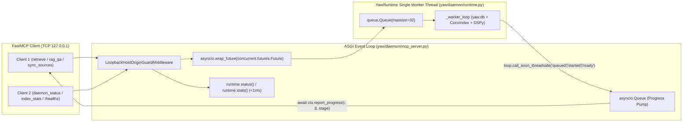

# Epic 2 — Sprint 2 Specification (`E2-S2`): 5 MCP Tools, Progress Streaming, Loopback Security & Real-TCP Verification

Parent Epic SSOT: [epic-2-fastmcp-http.md](epic-2-fastmcp-http.md) | Prerequisite: [Sprint 1 (`E2-S1`)](epic-2-sprint-1-spec.md) | Constitution: [FOUNDATIONAL.md](../FOUNDATIONAL.md)

---

## 1. Context & Root-Cause Problem Statement

With the `FastMCP` server mounted onto `YawRuntime`'s lifespan in [Sprint 1 (`E2-S1`)](epic-2-sprint-1-spec.md), Sprint 2 (`E2-S2`) completes the 5 fixed MCP tools (`retrieve`, `rag_qa`, `index_stats`, `daemon_status`, `sync_sources`), bridges worker-thread progress callbacks (`queued`, `started`, `ready`) into non-blocking `Context.report_progress` notifications over Streamable HTTP, enforces loopback `Host`/`Origin` request protection, and verifies all multi-client concurrency, cancellation, and error contracts over real loopback TCP sockets (`tests/daemon/test_mcp_http.py`).

---

## 2. Architecture, Dataflow & Domain Containment



### Domain Containment Check
- `yaw/daemon/mcp_server.py` imports **only** `yaw.daemon.runtime`, `yaw.core.*`, `fastmcp`, `mcp.types`, `starlette`, `uvicorn`, and `stdlib`.
- `tests/daemon/test_mcp_http.py` tests the full stack over real loopback TCP sockets (`127.0.0.1:<ephemeral_port>`) using `fastmcp.Client` and `urllib.request`, real SQLite (`yaw.db`), real CocoIndex ingestion, and a localhost loopback HTTP inference server.

---

## 3. Formal Contracts & Typed Interfaces

### Step 04: 5 Fixed MCP Tools, Async Progress Pump & Loopback Security Guard (`yaw/daemon/mcp_server.py`) {#step-04}

```python
_PROGRESS_STAGES: dict[str, tuple[int, int]] = {
    "queued": (1, 3),
    "started": (2, 3),
    "ready": (3, 3),
}


async def _await_runtime_future_with_progress(
    submit_fn: Callable[[Callable[[str], None]], Future[T]],
    ctx: Context | None,
) -> T:
    """Submit work to YawRuntime, stream ('queued', 'started', 'ready') to ctx.report_progress,
    and await the worker Future without blocking the asyncio loop.

    On asyncio.CancelledError (client disconnect), calls fut.cancel() so queued items are
    immediately removed from YawRuntime._queue while in-flight items finish on the worker thread.
    Translates YawRuntimeError(code, message) into FastMCP ToolError(f'[{code}] {message}').
    """
```

#### Exact Tool Contracts on `FastMCP("yaw-mcp")`:

1. **`retrieve(query: str, top_k: int = 5, ctx: Context | None = None) -> dict[str, Any]`**
   - Annotations: `ToolAnnotations(title="Retrieve Passages", readOnlyHint=True, destructiveHint=False, idempotentHint=True, openWorldHint=False)`
   - Validation: `validate_query_input(query)` and `not isinstance(top_k, bool) and isinstance(top_k, int) and 1 <= top_k <= 20`.
   - Returns:
     ```python
     {
         "query": cleaned_query,
         "top_k": top_k,
         "results": [serialize_hydrated_passage(idx + 1, hp) for idx, hp in enumerate(passages)],
     }
     ```
2. **`rag_qa(question: str, ctx: Context | None = None) -> dict[str, Any]`**
   - Annotations: `ToolAnnotations(title="Multi-Hop RAG QA", readOnlyHint=True, destructiveHint=False, idempotentHint=False, openWorldHint=False)`
   - Validation: `validate_query_input(question)`; raises `ToolError("[NOT_READY] ...")` if `lifecycle == "starting"`, `ToolError("[SHUTTING_DOWN] ...")` if `lifecycle in ("stopping", "stopped")`, and `ToolError("[EMPTY_INDEX] ...")` if `stats().chunks == 0`.
   - Returns:
     ```python
     {
         "question": str,
         "answer": str,
         "reasoning": str,
         "evidence": list[dict[str, Any]],  # up to 5 items from serialize_hydrated_passage
         "last_sync_at": float | None,
     }
     ```
3. **`index_stats() -> dict[str, Any]`**
   - Annotations: `ToolAnnotations(title="Graph Index Statistics", readOnlyHint=True, destructiveHint=False, idempotentHint=True, openWorldHint=False)`
   - Returns: `runtime.stats().to_dict()` immediately from memory without touching the worker queue.
4. **`daemon_status() -> dict[str, Any]`**
   - Annotations: `ToolAnnotations(title="Daemon Lifecycle & Queue Status", readOnlyHint=True, destructiveHint=False, idempotentHint=True, openWorldHint=False)`
   - Returns: `runtime.status().to_dict()` immediately from memory without touching the worker queue.
5. **`sync_sources(ctx: Context | None = None) -> dict[str, Any]`**
   - Annotations: `ToolAnnotations(title="Incremental Corpus Sync", readOnlyHint=False, destructiveHint=True, idempotentHint=True, openWorldHint=False)`
   - Action: Emits `"queued"` progress notification if `ctx is not None`, invokes `runtime.request_sync()`, and returns `{"scan_id": str, "status": "accepted" | "already_pending"}`.

#### Loopback Host & Origin Protection Contract (`LoopbackHostOriginGuardMiddleware`):
- Allowed `Host` values (hostname portion after stripping optional `:port`): `{"127.0.0.1", "localhost", "::1", "[::1]", configured_host.lower()}`. Missing or non-matching `Host` header returns HTTP `403 Forbidden` (`{"error": "INVALID_INPUT", "message": "Forbidden Host header."}`).
- Allowed `Origin` values: `Origin` header may be omitted (standard non-browser MCP clients); if present, its parsed scheme must be `http` or `https` and its hostname must be in `{"127.0.0.1", "localhost", "::1", configured_host.lower()}`. Any other `Origin` (including `"null"` or external domains) returns HTTP `403 Forbidden` (`{"error": "INVALID_INPUT", "message": "Forbidden Origin header."}`).

---

## 4. Invariants & Explicit Non-Goals

- **7 Canonical Error Codes Invariant:** Every `YawRuntimeError` raised synchronously during input validation or asynchronously on the worker queue is surfaced to the MCP client as an MCP tool error (`result.is_error == True`) whose text begins with `[{code}]` where `code` $\in$ `{"INVALID_INPUT", "NOT_READY", "EMPTY_INDEX", "BUSY", "MODEL_ERROR", "CONSISTENCY_ERROR", "SHUTTING_DOWN"}`.
- **Progress Ordering Invariant:** For any `retrieve` or `rag_qa` tool call with a client progress handler, progress notifications arrive in monotonic order: `(1, 3, "queued")` $\to$ `(2, 3, "started")` $\to$ `(3, 3, "ready")`.
- **Non-Blocking Read Invariant:** While the single worker thread is blocked inside slow LLM/embedding execution (`retrieve`, `rag_qa`, or `sync_sources`), concurrent calls to `daemon_status`, `index_stats`, `GET /healthz`, and `GET /readyz` complete in `<2.0s` without waiting on the worker thread.
- **Explicit Non-Goals:**
  - Zero `stdio` or `sse` transport shims.
  - Zero wildcard CORS headers.

---

## 5. File-by-File Blueprint (`E2-S2`) {#step-05}

| Order | Tag | File | Planned Changes |
| :--- | :--- | :--- | :--- |
| **1** | `[MODIFY]` | `yaw/daemon/mcp_server.py` | Register all 5 tools with `ToolAnnotations`, wire `_await_runtime_future_with_progress`, attach `LoopbackHostOriginGuardMiddleware`, and map `YawRuntimeError` to `ToolError`. |
| **2** | `[NEW]` | `tests/daemon/test_mcp_http.py` | Author comprehensive unmocked loopback TCP test suite covering `E2-A1`, `E2-A2`, and `E2-A3`. |
| **3** | `[MODIFY]` | [`README.md`](../README.md), [`docs/evaluation.md`](evaluation.md), [`docs/epic-2-fastmcp-http.md`](epic-2-fastmcp-http.md) | Document FastMCP HTTP endpoint and 5 tools in `README.md`, record measured test/acceptance metrics in `docs/evaluation.md`, and check off `E2-A1..E2-A3` in `docs/epic-2-fastmcp-http.md`. |

---

## 6. Real-Substrate Verification Strategy (`tests/daemon/test_mcp_http.py`)

All tests in `tests/daemon/test_mcp_http.py` run without mocks against a live `Uvicorn` + `FastMCP` server bound to `127.0.0.1:<ephemeral_port>`, a real `tmp_path` SQLite `yaw.db`, real CocoIndex file ingestion, and a localhost loopback HTTP inference server:

1. **`test_e2_a1_lifespan_healthz_readyz_and_containment`:**
   - Verifies `/healthz` returns `200` and `/readyz` returns `503` while initial startup sync is running (`lifecycle == "starting"`), transitions `/readyz` to `200` once `lifecycle == "ready"`, and returns `503` when `lifecycle == "degraded"` or stopping.
2. **`test_e2_a2_five_tools_progress_and_hydrated_passages`:**
   - Connects `fastmcp.Client("http://127.0.0.1:<port>/mcp")`, verifies exact 5 tool names and `readOnlyHint`/`destructiveHint` annotations.
   - Executes `retrieve` and `rag_qa` with a `progress_handler`, asserting `[("queued", 1, 3), ("started", 2, 3), ("ready", 3, 3)]`.
   - Verifies 1-indexed `start_line`/`end_line`, `content_hash`, and `stale_on_disk=False` on intact files, then modifies/deletes the file on disk before re-sync and asserts `stale_on_disk=True`.
3. **`test_e2_a2_error_codes_contract`:**
   - Verifies `isError=true` and exact `[CODE]` prefixes for `INVALID_INPUT` (empty query, `>1024` UTF-8 bytes, `top_k=0`, `top_k=21`, `top_k=True`), `EMPTY_INDEX` (`rag_qa` on empty corpus), `NOT_READY`, `BUSY`, `MODEL_ERROR`, `CONSISTENCY_ERROR`, and `SHUTTING_DOWN`.
4. **`test_e2_a3_two_concurrent_clients_nonblocking_status_busy_and_cancellation`:**
   - Connects two concurrent `fastmcp.Client` instances over TCP while the worker thread is paused inside a slow loopback inference request (`0.6s`).
   - Asserts `daemon_status`, `index_stats`, and `GET /healthz` respond in `<0.2s` (`<< 2.0s` gate).
   - Fills all 32 queue slots (`queue_maxsize=4` in isolated test or `32` full slots), proves the overflow request fails fast with `[BUSY]`, cancels one queued request before worker execution, and proves the freed slot immediately accepts a new request and decrements `queue_depth`.
5. **`test_e2_a3_live_cocoindex_sync_sources_and_host_origin_guard`:**
   - Edits a workspace file, calls `sync_sources` (verifying `"accepted"` and coalesced `"already_pending"`), and verifies updated citations on `retrieve`.
   - Sends raw HTTP requests with `Host: evil.example.com` and `Origin: https://evil.example.com` to `/mcp`, asserting HTTP `403 Forbidden`.

### Deterministic Quality Gates

```powershell
uv run --locked preflight
uv run --locked pytest tests/core/test_architecture.py tests/daemon/test_mcp_http.py -vv
uv run --locked ruff check .
uv run --locked ty check
git diff --check
```
