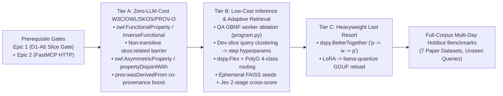

# Epic 3: Performance, Symbolic Pruning & Full-Corpus Scale

Owner: [FOUNDATIONAL](../FOUNDATIONAL.md) | Prerequisite: [Epic 2](epic-2-fastmcp-http.md) | Results: [evaluation](evaluation.md)

| Relation | Links |
| --- | --- |
| Governed by | [FOUNDATIONAL.md](../FOUNDATIONAL.md), [AGENTS.md](../AGENTS.md) |
| Prerequisite | [Epic 1](epic-1-hipporag-daemon.md): owns core `yaw.db` engine and `7`-dataset `[target]` slice-based paper parity gate (`D1-A6`); [Epic 2](epic-2-fastmcp-http.md): owns `FastMCP` Streamable HTTP transport, `5` `[target]` MCP tool contracts, and `source_content_hash` provenance |
| Rules | [daemon.md](../.agents/rules/daemon.md): `yaw/daemon/*.py`, `yaw/daemon/ingestion/*.py`; [graph-storage.md](../.agents/rules/graph-storage.md): `yaw/daemon/graph/*.py`, `yaw/daemon/graph/storage/*.py`; [inference.md](../.agents/rules/inference.md): `yaw/daemon/graph/inference/*.py`; [tests.md](../.agents/rules/tests.md): `tests/**/*.py`, `benchmark.py`, `scripts/**/*.py`; [docs.md](../.agents/rules/docs.md): `docs/**/*.md`, `FOUNDATIONAL.md`, `README.md` |
| Owns code | Post-Epic 2 performance scaling, deterministic W3C/OWL/SKOS/PROV-O distractor pruning (`yaw/daemon/graph/storage/shacl.py`, `yaw/daemon/graph/ppr.py`), adaptive retrieval & novel DSPy orchestration (`yaw/daemon/graph/inference/program.py`, `yaw/daemon/graph/inference/retriever.py`, `yaw/daemon/graph/engine.py`), `msgspec` / bytecode hot-path execution, and post-Epic 2 codebase reduction across `yaw/` and `scripts/` (pinned baseline commit: `deddf36`) |
| Peers | [w3c-improvements.md](w3c-improvements.md): owns `3`-stage `[target]` Gemma 4 ontology cascade (`W1`–`W5`) and Active EDC canonicalization; [epistemic-confidence-spec.md](epistemic-confidence-spec.md): owns `pool_confidences`, `bayesian_noisy_or`, and `1`-hop `[target]` S27 confidence resolution; [dspy-improvements.md](dspy-improvements.md): owns zero-shot `dspy.GEPA` + external `dspy.Ensemble` contract and `dspy.Flex` notes; [native-cocoindex-graph.md](native-cocoindex-graph.md): owns declarative `DatabaseSink` graph publication and scheme-free `64+64` vs. `128` `[target]` chunk invariance; [native-cocoindex-indexing.md](native-cocoindex-indexing.md): owns `64`-chunk `[target]` micro-batch source ingestion and persistent `coco_lmdb` memoization |
| References | [HippoRAG (`2405.14831v3`)](arxiv-2405.14831v3-hipporag.md), [HippoRAG 2 (`2502.14802v1`)](arxiv-2502.14802v1-hipporag2.md), [model-evaluation.md](model-evaluation.md), `PolyG` (`arXiv:2504.02112v2`), `BetterTogether` (`arXiv:2407.10930`), `Think-on-Graph` (`arXiv:2307.07697`), `zilliztech/vector-graph-rag` Jev (`https://github.com/zilliztech/vector-graph-rag/blob/main/evaluation/jev/README.md`) |
| Supersedes / superseded by | Extracts and governs the Epic 3 roadmap summarized in [epic-1-hipporag-daemon.md §Decisions](epic-1-hipporag-daemon.md#decisions) and the deferred optimization items in [epic-2-fastmcp-http.md §Deferred Epic 3 ideas](epic-2-fastmcp-http.md#deferred-epic-3-ideas--outside-this-epic) |
| Records | [evaluation.md](evaluation.md), [evaluation-graph-storage.md](evaluation-graph-storage.md), [evaluation-inference.md](evaluation-inference.md), [evaluation-ingestion.md](evaluation-ingestion.md), [evaluation-testing.md](evaluation-testing.md) |

---

## 1. Status, Entry Gate & Separation of Concerns

Epic 3 is the post-feature-completion **performance, symbolic pruning, and full-corpus scaling** epic (`"a shady map is better than no map at all"` — [Decisions](#decisions), `2026-11-08`). It does **not** begin until both prerequisite epics pass their acceptance gates:

1. **[Epic 1 (`D1-A6`)](epic-1-hipporag-daemon.md):** Passes the clean-slate `7`-dataset `[target]` slice-based paper parity gate (`scripts/verify_paper_parity_gate.py --compiled-program .yaw/compiled_program.json --mode eval --fresh`) against Target 1 (`monkeypatched_hipporag`) and Target 2 (`paper_70b`).
2. **[Epic 2 (`E2-A1`..`E2-A3`)](epic-2-fastmcp-http.md):** Completes the `FastMCP` Streamable HTTP transport (`yaw/daemon/mcp_server.py`), the `5` `[target]` MCP tool contracts (`retrieve`, `rag_qa`, `index_stats`, `daemon_status`, `sync_sources`), and `ChunkPointer.source_content_hash` source-freshness provenance.

### 1.1 How Epic 2 Ties Into Epic 3 (Architectural Decoupling)
- **Locked External Boundary, Mutable Internal Engine:** In [Epic 2](epic-2-fastmcp-http.md), `yaw/daemon/mcp_server.py` imports only `yaw.daemon.runtime` and `yaw.core.*`, delegating retrieval and QA to `runtime.retrieve(query, top_k)` and `runtime.rag_qa(question)` while validating physical source freshness via `ChunkPointer.source_content_hash`.
- Because MCP tool schemas, progress stages (`1/3` `[target]` `queued`, `2/3` `[target]` `started`, `3/3` `[target]` `ready`), and `Passage` citation envelopes are frozen at the `runtime.py` boundary in Epic 2, Epic 3 can freely swap internal W3C/OWL/SKOS/PROV-O pruning rules, CSR transition operators, `dspy.Flex` / query-cluster routing policies, and `msgspec` binary/JSON sidecar serializers without breaking a single MCP client or transport test.

### 1.2 Baseline Already in Place from Epic 1 (Do Not Re-Invent)
At pinned commit `deddf36`, YAW already implements the following mechanisms from Epic 1 and [w3c-improvements.md](w3c-improvements.md); Epic 3 builds upon them rather than re-proposing them:
- **Non-Linear 1-Lipschitz PPR & Degree Normalization (`arXiv:2609.32929v1`):** [`apply_graph_activation`](file:///c:/Users/Harri.Ahokas/Documents/yaw/yaw/daemon/graph/ppr.py#L28-L48) (`"scaled_tanh"` default parameter `5.0` `[observed: yaw/daemon/graph/ppr.py:21, deddf36]`), [`build_transition_matrix`](file:///c:/Users/Harri.Ahokas/Documents/yaw/yaw/daemon/graph/ppr.py#L75-L85) ($\beta = 0.5$ `[observed: yaw/daemon/graph/ppr.py:80, deddf36]` symmetric degree normalization $W(\beta) = D_{\text{in}}^{-\beta} A D_{\text{out}}^{-(1-\beta)}$), and `run_ppr` `[y, z]` dual-feature combination (`dual_weight = 0.5` `[observed: yaw/daemon/graph/ppr.py:245, deddf36]`).
- **`1`-Hop `[target]` SKOS S27 Bayes-Factor Weighting & Cagle Reification:** [`pool_confidences`](file:///c:/Users/Harri.Ahokas/Documents/yaw/yaw/daemon/graph/storage/shacl.py#L20-L29) and `bayesian_noisy_or` (`yaw/core`) with `1`-hop `[target]` non-transitive `skos:broader` S27 disjointness in `yaw/daemon/graph/storage/shacl.py` (`deddf36`).
- **Induced W3C Subgraph QA Grounding:** `format_subgraph_for_qa` in [`yaw/daemon/graph/storage/hydration.py`](file:///c:/Users/Harri.Ahokas/Documents/yaw/yaw/daemon/graph/storage/hydration.py) (`deddf36`), injecting structured entity definitions and reified `rdf:Statement` facts alongside hydrated disk passages.
- **High-Throughput SQLite Connection PRAGMAs (`2026-11-08`):** `_configure_connection_pragmas` (`open_yaw_db`, `open_managed_yaw_db`, and `open_readonly_yaw_db` in `yaw/daemon/graph/storage/db.py`) configures `PRAGMA cache_size = -65536` (`64` `[target]` MiB page cache) and `PRAGMA mmap_size = 268435456` (`256` `[target]` MiB memory-mapped I/O) alongside `PRAGMA synchronous = NORMAL` and `PRAGMA temp_store = MEMORY`.
- **Vectorized BLAS Entity Synonym Candidate Mining (`2026-11-08`):** `find_entity_synonym_candidates` (`yaw/daemon/graph/storage/graph_ops.py`) computes contiguous `float32` BLAS matrix cosine distances (`mat[src_indices] @ mat.T`), deterministic `(distance ASC, entity_id ASC)` tie-breaking (`np.argsort(..., kind="stable")`), and reverse top-$k$ candidate discovery without per-entity `vec0` `MATCH` SQLite loops.

---

## 2. Falsifiable Spec Goals

Thresholds declared below are never loosened after seeing a benchmark run. Every experimental mechanism in Epic 3 is evaluated via paired ablation and retained **if and only if** it yields a statistically meaningful improvement without regressing non-targeted metrics.

### Goal 1 — SOTA Recall@N, EM & F1 (Easy Deterministic Wins First, Heavyweight Weight-Tuning Last)
- **Measure:** Disjoint held-out retrieval `Recall@1`, `Recall@2`, `Recall@5`, `Recall@10`, `Recall@20` and QA `EM`, `F1` (plus the unweighted arithmetic mean `compute_task_quality_score` over all `7` `[target]` metrics in [`yaw/daemon/graph/inference/parsers.py`](file:///c:/Users/Harri.Ahokas/Documents/yaw/yaw/daemon/graph/inference/parsers.py) at commit `deddf36`) across the `7` `[target]` paper benchmark datasets (`sample`, `musique`, `2wikimultihopqa`, `hotpotqa`, `popqa`, `nq_rear`, `triviaqa`)—first on the `10`-query `[target]` per-dataset slice gate (`70` `[target]` total slice queries) and subsequently on the full-corpus unseen holdout sets.
- **Reference:** Paired evaluation on identical consumer hardware (`gemma-4-E4B-it-qat-q4_0-gguf-Q4_0` + `embeddinggemma-300m-GGUF`, `parallel = 1` `[target]`) against:
  1. The post-Epic 2 YAW baseline commit (`[target]`),
  2. Target 1 (`MONKEYPATCHED_HIPPORAG_BASELINES` in `data/benchmarks/baselines.json`, e.g., `2wikimultihopqa` `Recall@5 = 0.9091` `[observed: data/benchmarks/baselines.json, deddf36]`, `musique` `Recall@5 = 0.6818` `[observed: data/benchmarks/baselines.json, deddf36]`),
  3. Target 2 (`PAPER_BASELINES` from [HippoRAG 2 (`2502.14802v1`)](arxiv-2502.14802v1-hipporag2.md) in `data/benchmarks/baselines.json`, e.g., `2wikimultihopqa` `Recall@5 = 0.904` `[observed: data/benchmarks/baselines.json, deddf36]`, `musique` `Recall@5 = 0.747` `[observed: data/benchmarks/baselines.json, deddf36]`), and
  4. Contemporary GraphRAG SOTA reference points: `zilliztech/vector-graph-rag` Jev (`Recall@5 = 0.8661` `[observed: zilliztech/vector-graph-rag evaluation/jev README]` mean across `musique` `0.7466` `[observed: zilliztech/vector-graph-rag evaluation/jev README]`, `2wikimultihopqa` `0.9026` `[observed: zilliztech/vector-graph-rag evaluation/jev README]`, and `hotpotqa` `0.9490` `[observed: zilliztech/vector-graph-rag evaluation/jev README]`), plus `PolyG` (`arXiv:2504.02112v2`) as an architectural traversal-taxonomy reference (`PolyBench`).
- **Passes when:** Each retained Tier A / Tier B / Tier C mechanism achieves a strictly positive paired gain ($\Delta \text{score} > 0.0$ `[target]`) on the `7`-dataset `[target]` slice harness without regressing other datasets, and the resulting system beats `MONKEYPATCHED_HIPPORAG_BASELINES` (`[target]`) and matches or beats `PAPER_BASELINES` (`[target]`) on full-corpus holdout evaluation.
- **Fails if / does not count:** Retaining any mechanism whose paired ablation delta is neutral or negative; fitting query-space cluster centroids, prompts, or traversal weights on the evaluation split (`[train_queries:max_queries]`) instead of the disjoint train split (`[0:train_queries]`); dropping parser-accepted `facts` rows during publication in violation of [FOUNDATIONAL.md §4.4](../FOUNDATIONAL.md); fabricating cross-batch edges to eliminate legitimate semantic islands; loosening acceptance tolerances post-run; or citing loopback fake-provider tests as retrieval/QA quality evidence.

### Goal 2 — Demoscene Execution Speed
- **Measure:** Wall-clock execution latency and peak RSS memory across `4` `[target]` hot paths:
  1. `64`-chunk `[target]` incremental publication (`plan_graph_publication` + `DatabaseSink`),
  2. Sparse CSR transition matrix assembly (`build_transition_matrix`) and `run_ppr` power iteration (`yaw/daemon/graph/ppr.py`, commit `deddf36`),
  3. `1`-indexed `[target]` disk line hydration and span coalescing (`yaw/daemon/graph/storage/hydration.py`, commit `deddf36`), and
  4. Optimization checkpoint, audit-trail, and telemetry sidecar serialization (`yaw/daemon/graph/inference/optimizer.py`, commit `deddf36`).
- **Reference:** Paired warm-cache vs. warm-cache and cold-cache vs. cold-cache benchmark runs on the same host machine against the post-Epic 2 baseline commit.
- **Passes when:** Paired wall-clock time decreases ($R_{\text{time}} < 1.0$ `[target]`) and peak RSS memory does not increase ($R_{\text{mem}} \le 1.0$ `[target]`) across all `4` `[target]` hot paths while producing bit-identical canonical `yaw.db` graph state and identical top-$k$ retrieval rankings.
- **Fails if / does not count:** Comparing warm runs against cold runs; loosening PPR convergence tolerance (`tol = 1e-6` `[observed: yaw/daemon/graph/ppr.py:243, deddf36]`) or SHACL fixed-point iteration bounds to game latency; bypassing SHACL validation (`lint_graph_shacl`) or Epic 2 `source_content_hash` verification to save CPU cycles; introducing an unsynchronized secondary vector store outside `_current_csr_cache_key()`; holding SQLite write transactions across LLM HTTP calls; or mutating floating-point normalization in ways that break fixed-evidence `64+64` vs. `128` `[target]` canonical graph equality.

### Goal 3 — Radical Codebase Reduction & Maintainability
- **Measure:** Net production line count (`yaw/**/*.py` and `scripts/*.py`), module count, and cyclomatic/import complexity after Epic 2 completes.
- **Reference:** Post-Epic 2 baseline commit on `dev`.
- **Passes when:** Net production LOC across `yaw/` and `scripts/` decreases ($\Delta \text{LOC} < 0$ `[target]`), `0` `[target]` duplicate helper pipelines or dormant feature switches remain, `100%` `[target]` of the real-substrate test suite passes, and `uv run ty check`, `uv run ruff check`, and `tests/core/test_architecture.py` report `0` `[target]` violations.
- **Fails if / does not count:** Code-golfing (compressing readable multi-line statements into opaque one-liners), stripping runtime invariant assertions or SHACL shapes to lower line counts, or leaving retired code behind `=None` flags instead of deleting it outright.

---

## 3. Ordered Experimental Toolbox & Technical Design

To respect consumer-hardware constraints (`parallel = 1` `[target]` local `llama.cpp` slot), Goal 1 experiments are ordered strictly by **Return on Investment (ROI)**: deterministic zero-LLM-cost W3C symbolic pruning first, low-cost inference and adaptive routing second, and weight-distillation finetuning (`dspy.BetterTogether`) strictly as a heavyweight last resort.



### 3.1 Goal 1, Tier A — Deterministic Zero-LLM-Cost W3C / OWL / SKOS / PROV-O Disambiguation & Distractor Pruning (`shacl.py`, `ppr.py`)

Multi-hop GraphRAG failures on `musique` and `2wikimultihopqa` come primarily from **hub-entity flooding** (generic concepts absorbing PPR mass) and **bridge-fact dilution** (distractor passages sharing a surface predicate with the true bridge entity). Tier A attacks both using closed-world SQLite SQL and CSR matrix algebra at `0` `[target]` additional LLM calls while strictly preserving [FOUNDATIONAL.md §4.4](../FOUNDATIONAL.md) (no dropped parser-accepted statements during publication) and [w3c-improvements.md `W2`](w3c-improvements.md) (no cross-label auto-merges bypassing Gemma 4):

1. **OWL 2 RL `owl:FunctionalProperty` & `owl:InverseFunctionalProperty` (`sh:maxCount 1` `[target]` Cardinality & Candidate Mining in `shacl.py` & `ppr.py`):**
   - *Functional properties (`P rdf:type owl:FunctionalProperty` — e.g., `birthPlace`, `capitalOf`, `foundedInYear`, `authoredBy`, `headquarteredIn`):* Formally, $(x, P, y_1) \land (x, P, y_2) \implies y_1 = y_2$. When a subject $x$ has multiple objects $y_1, y_2$ under a functional predicate $P$:
     - If $(y_1, y_2)$ are already linked by `owl:differentFrom` (or incompatible scalar literals), all parser-accepted `facts` rows remain persisted in `yaw.db` ([FOUNDATIONAL.md §4.4](../FOUNDATIONAL.md)), and `build_transition_matrix` (`yaw/daemon/graph/ppr.py`) down-weights the lower-confidence competing fact edge (`bayesian_noisy_or` over `fact_sources` + `edge_sources` provenance count) so contradicted distractors do not bleed PPR conductance `[assumption, probe E3-P1]`.
     - If $(y_1, y_2)$ are unadjudicated resources with compatible types, surface $(y_1, y_2)$ as a high-priority candidate pair in `find_entity_synonym_candidates` for Stage 1 `JudgeLabels` adjudication.
   - *Inverse-functional properties (`P rdf:type owl:InverseFunctionalProperty` — e.g., unique identifiers, tax/ticker codes, official titles):* $(x_1, P, y) \land (x_2, P, y)$ deterministically mines $(x_1, x_2)$ into `find_entity_synonym_candidates` even when their surface labels have low lexical/dense similarity, routing split bridge nodes to Gemma 4 (`JudgeLabels`) without violating Invariant `W2` `[assumption, probe E3-P1]`.
2. **SKOS Non-Transitive Associative Barrier (`skos:related` `2`-Hop `[target]` Decay in `ppr.py`):**
   - Under W3C SKOS S23/S24, `skos:related` is symmetric (`owl:SymmetricProperty`) but explicitly **not** transitive (unlike `skos:broaderTransitive`).
   - In [`build_transition_matrix`](file:///c:/Users/Harri.Ahokas/Documents/yaw/yaw/daemon/graph/ppr.py#L75-L120) (`deddf36`), treating `skos:related` as an unconstrained Markov transition allows $A \xrightarrow{\text{skos:related}} B \xrightarrow{\text{skos:related}} C$ `2`-hop `[target]` associative drift across loosely coupled hubs.
   - *Mechanism:* Separate transition state or apply a non-backtracking / `2`-hop `[target]` associative barrier so `skos:related` edges can expand `1` `[target]` hop from a seed or fact-reached entity, but consecutive `skos:related` $\to$ `skos:related` transitions are zeroed (`0.0` `[target]`), forcing multi-hop conductance to travel through reified `rdf:Statement` (`fact`) edges `[assumption, probe E3-P2]`.
3. **OWL 2 RL `owl:AsymmetricProperty` & `owl:propertyDisjointWith` (Directional & Mutually Exclusive Path Pruning in `ppr.py` & `shacl.py`):**
   - For asymmetric relations (causal, temporal, hierarchical, partitive), $P(x, y) \implies \neg P(y, x)$; for disjoint properties ($P_1 \text{ owl:propertyDisjointWith } P_2$), $P_1(x, y) \implies \neg P_2(x, y)$.
   - Enforce `owl:propertyDisjointWith` deterministically in `auto_heal_deterministic_shacl` (generalizing the existing S27 `skos:broader` $\cap$ `skos:related` = $\emptyset$ Bayes-factor check) and orient `RelationTraversalPolicy` multipliers by query polarity so forward vs. inverse hops (`head -> tail` vs. `tail -> head`) do not bleed probability mass backward `[assumption, probe E3-P2]`.
4. **W3C PROV-O (`prov:wasDerivedFrom`) Co-Provenance Bridge Reinforcement (`ppr.py`):**
   - Every YAW `rdf:Statement` (`facts`) and semantic edge (`edges`) carries exact chunk provenance in `fact_sources` and `edge_sources` (`prov:wasDerivedFrom`).
   - During multi-hop entity-to-entity transitions $e_1 \xrightarrow{f_1} e_2 \xrightarrow{f_2} e_3$, weight the bridge node $e_2$'s outgoing transition by provenance coherence (shared document / AST section island in `fact_sources` or high `bayesian_noisy_or` multi-chunk corroboration), penalizing single-mention uncorroborated distractor islands `[assumption, probe E3-P2]`.

### 3.2 Goal 1, Tier B — Low-Cost Inference & Adaptive Retrieval Enhancements (`program.py`, `engine.py`, `retriever.py`)

1. **Forcing `build_dspy_qa_grammar` GBNF on the QA Reader (`yaw/daemon/graph/inference/program.py`):**
   - *Current behavior at commit `deddf36`:* In [`YawProgram._bind_predictor_lms`](file:///c:/Users/Harri.Ahokas/Documents/yaw/yaw/daemon/graph/inference/program.py#L270-L289) (`deddf36`), `self.qa.set_lm(orchestrator)` (line `288` at `deddf36`) binds `self.qa` (`dspy.ChainOfThought(AnswerQuestion)`) to the unconstrained `orchestrator` LM (`_yaw_supports_gbnf=False`) instead of the GBNF-enabled `worker` LM (`_yaw_supports_gbnf=True`). Even though `YawGBNFAdapter.resolve_grammar` maps `AnswerQuestion` (`{"reasoning", "answer"}`) to `build_dspy_qa_grammar()`, binding `self.qa` to `orchestrator` skips `extra_body={"grammar": ...}` at runtime.
   - *Experiment:* Evaluate binding `self.qa` to `worker` (`_yaw_supports_gbnf=True`, enforcing `build_dspy_qa_grammar()`) vs. `orchestrator` (`_yaw_supports_gbnf=False`) on the `7`-dataset `[target]` slice harness, measuring held-out `EM`, `F1`, and JSON parse reliability `[assumption, probe E3-P3]`.
2. **Query-Space Embedding, Clustering & Per-Step Hyperparameter Routing (`engine.py`, `retriever.py`):**
   - Reuse the already-computed `768`-dim `[observed: yaw/core/config.py, deddf36]` `EmbeddingGemma` query vector (`query_passage_vec`, `0` `[target]` additional model invocations) to compare incoming queries against $K$ cluster centroids fitted strictly on the disjoint training split (`[0:train_queries]`).
   - Each cluster centroid stores hand-tuned or GEPA-discovered step hyperparameters ($\beta$, `damping`, `dual_weight`, `linking_top_k`, `passage_node_weight`, and `RelationTraversalPolicy` weights), routing each query via in-memory cosine similarity to its specialized traversal profile without sandbox overhead `[assumption, probe E3-P3]`.
3. **`dspy.Flex` + PolyG (`arXiv:2504.02112v2`) `4`-Class `[target]` $\langle s, p, o \rangle$ Adaptive Traversal & Sub-Question Decomposition:**
   - Following `PolyG` (*Adaptive Graph Traversal for Diverse GraphRAG Questions*, `arXiv:2504.02112v2`), decompose queries by their missing $\langle s, p, o \rangle$ elements and expose YAW's deterministic SQLite/CSR primitives as bounded tools to `dspy.Flex` ([dspy-improvements.md §5](dspy-improvements.md#5-post-epic-2-roadmap-tool-driven-orchestration-via-dspyflex)):
     - **Class 1 — $\langle s, p, o \rangle$ (Verification / Boolean):** Direct SQLite `facts` + `entity_labels` lookup (`1`-hop `[target]` check).
     - **Class 2 — $\langle s, p, * \rangle$ or $\langle *, p, o \rangle$ (Targeted Attribute / Role Walk):** Directional `RelationTraversalPolicy` weighting edges whose predicate matches $p$ (forward `fact_forward` for $\langle s, p, * \rangle$, reverse `fact_reverse` for $\langle *, p, o \rangle$).
     - **Class 3 — $\langle s, *, o \rangle$ (Multi-Hop Bridge Discovery):** Bidirectional PPR seeding ($p_0[s] = 0.5$ `[target]`, $p_0[o] = 0.5$ `[target]`) to surface intersecting intermediate bridge entities $b$ on $s \leftrightarrow b \leftrightarrow o$.
     - **Class 4 — $\langle s, *, * \rangle$ (Open-Ended Ego-Graph Summary):** `1`-hop `[target]` ego-graph inspection (`inspect_entity_or_fact`) + diverse passage hydration.
   - For `3`–`4` `[target]` hop compositional chains (`musique`), pair `dspy.Flex` with iterative sub-question decomposition (*Think-on-Graph* `arXiv:2307.07697` / *Self-Ask*), resolving hop `1` `[target]` (`q_1 -> e_1`) before re-seeding PPR from $e_1$ for hop `2` `[target]` (`q_2(e_1) -> e_2`) `[assumption, probe E3-P4]`.
4. **Read-Only Ephemeral FAISS Candidate Seed Search & Jev-Style `2`-Stage `[target]` Cross-Scoring:**
   - Benchmark DSPy's built-in FAISS vector index integration for candidate seed lookup against `sqlite-vec` `vec0` KNN. To honor [FOUNDATIONAL.md §2.4 & §4.2](../FOUNDATIONAL.md) ("One authoritative database"), any FAISS index must be a **read-only in-memory ephemeral projection** hydrated from `yaw.db` (`chunk_vec`, `fact_vec`, `entity_vec`) and invalidated by `_current_csr_cache_key()` alongside `_csr_graph` ([`yaw/daemon/graph/engine.py:679-709`](file:///c:/Users/Harri.Ahokas/Documents/yaw/yaw/daemon/graph/engine.py#L679-L709), `deddf36`)—never a persistent sidecar file or competing writer.
   - Evaluate a Jev-inspired (`zilliztech/vector-graph-rag`) `2`-stage `[target]` cross-scoring pass: after Stage 1 (`EmbeddingGemma` + FTS5 RRF + `FilterTriples` + CSR PPR) narrows the corpus to the top-$N$ (`10`–`20` `[target]`) candidate passages/facts, run a lightweight Stage 2 listwise/pairwise cross-scoring pass (`dspy.Predict` with GBNF or a dedicated tiny cross-encoder) to prune look-alike distractor passages before hydration `[assumption, probe E3-P5]`.

### 3.3 Goal 1, Tier C — Heavyweight Last Resort: `dspy.BetterTogether` (`arXiv:2407.10930`)

> [!WARNING] Consumer-Hardware Last Resort
> `dspy.BetterTogether` requires external LoRA/QLoRA training in PyTorch (BF16/FP16 VRAM outside `llama.cpp`), `llama-quantize` GGUF conversion, and server hot-reloading. It is retained in the Epic 3 toolbox **strictly as a Tier C last resort** if and only if Tiers A and B do not clear full-corpus SOTA targets.

#### Technical Primer: `dspy.BetterTogether` in `dspy[deno] == 3.4.1` `[measured: uv.lock, deddf36]` (`dspy/teleprompt/bettertogether.py`)
1. **Core Algorithm (`arXiv:2407.10930`):** Jointly optimizes **prompt instructions/demos (`p`)** and **LM weights (`w`)** via an alternating strategy string (canonical default `"p -> w -> p"`):
   - **Step 1 (`p`):** Optimizes predictor prompts so the base LM generates higher-reward multi-step reasoning traces (`FilterTriples`, `ExtractQueryIntent`, `AnswerQuestion`).
   - **Step 2 (`w`):** Runs `BootstrapFinetune(metric=..., multitask=True)` over traces generated by the Step-1 prompt-optimized program, filtering trajectories by `metric` and finetuning the underlying model weights on passing `(input, output)` pairs.
   - **Step 3 (`p`):** Re-optimizes prompts against the newly weight-tuned LM so instructions adapt to the updated weight distribution.
2. **YAW Integration Mechanics (If Invoked in Tier C):**
   - **Subclass or Wrap for `dspy.GEPA` + Zero-Shot (`exclude_demos=True`):** Upstream `BetterTogether.__init__` hardcodes `BootstrapFewShotWithRandomSearch` for `"p"` and `BootstrapFinetune` (without `exclude_demos=True`) for `"w"`. To honor YAW's zero-shot rule (`max_bootstrapped_demos = 0` `[target]`, [dspy-improvements.md §1](dspy-improvements.md#1-zero-shot-optimization-reward-contract--runtime-binding)), pass `dspy.GEPA` as the prompt optimizer and configure `BootstrapFinetune(..., exclude_demos=True)` so finetuning distills GEPA's instruction behavior directly into zero-shot weights.
   - **Scope `train_kwargs` to Query-Time Predictors Only:** Never finetune graph-construction predictors (`ner`, `triples`, `label_judge`, `hierarchy_judge`, `related_judge`) inside a `"w"` step without rebuilding `yaw.db`. Scope `train_kwargs` strictly to `query_intent`, `triple_filter`, and `qa.predict` over a frozen `yaw.db` graph index.
   - **Custom `YAWLlamaCppProvider(dspy.clients.Provider)`:** Because `dspy.LM` talks to `llama.cpp` over HTTP (`openai/...`), `BetterTogether` requires a custom `Provider` whose `FinetuneJob.run()` trains a Unsloth/PEFT QLoRA adapter on the JSONL trace dump in `outputs/`, merges and quantizes via `llama-quantize` to `Q4_K_M` / `Q4_0` GGUF, reloads the local `llama.cpp` server slot, and returns the updated `model` ID.
   - **Mandatory Fail-Fast Check (`AGENTS.md` Prime Directive):** Upstream `BetterTogether._run_strategies` catches strategy exceptions and sets `student.flag_compilation_error_occurred = True`. Any YAW caller **must** immediately assert `assert not getattr(compiled, "flag_compilation_error_occurred", False)` and re-raise on failure.

### 3.4 Goal 2 — Demoscene Execution Speed (`msgspec`, `dis` Bytecode & Vectorized CSR)

1. **C-Backed `msgspec.Struct` Serialization (`optimizer.py`, `runtime.py`, `storage/`):**
   - `msgspec == 0.22.0` `[measured: uv.lock, deddf36]` is already locked and installed in the workspace environment via `cocoindex == 1.1.0` `[measured: uv.lock, deddf36]`. Promote `msgspec` to a direct dependency in `pyproject.toml` and replace `json.loads` / `json.dumps` and `dataclasses.asdict` in high-frequency sidecar and cache paths (`.yaw/optimize_program_*.json`, `openie_chunks` JSON columns, `meta['dspy_trails_state']`, and runtime tool response payloads) with zero-copy C-extension `msgspec.Struct` and `msgspec.json.Encoder` / `Decoder` buffers `[assumption, probe E3-P6]`.
2. **Python `dis` Bytecode & Opcode Reduction in Hot Loops (`ppr.py`, `hydration.py`, `shacl.py`):**
   - Inspect inner loops with `python -m dis` (`dis.dis`) to eliminate per-edge and per-row Python object allocations, attribute lookups (`LOAD_ATTR`), closure cell dereferences (`LOAD_DEREF`), and generator overhead in `build_transition_matrix`, `coalesce_spans`, and `canonicalize_entity_labels_edc`.
3. **Vectorized CSR Matrix Construction & Pre-Allocated Work Buffers (`ppr.py`):**
   - Replace Python `dict[tuple[int, int], list[float]]` edge accumulation in [`build_transition_matrix`](file:///c:/Users/Harri.Ahokas/Documents/yaw/yaw/daemon/graph/ppr.py#L117-L120) (`deddf36`) with pre-allocated NumPy `int32` / `float64` coordinate arrays (`np.fromiter` / `scipy.sparse.coo_matrix` $\to$ `tocsr()` with vectorized degree scaling) and reuse pre-allocated `p` / `next_p` work vectors in `run_ppr` `[assumption, probe E3-P7]`.

### 3.5 Goal 3 — Radical Codebase Reduction & Post-Epic 2 Consolidation

After [Epic 2](epic-2-fastmcp-http.md) lands `mcp_server.py` and `source_content_hash`:
- Audit every module across `yaw/core/`, `yaw/daemon/`, and `scripts/` to delete redundant serialization wrappers, duplicate SQL query builders, one-off CLI plumbing, and any remaining transitional shims from Epics 1 and 2.
- Consolidate deferred CLI/config ergonomics from [Epic 2 §Deferred Epic 3 ideas](epic-2-fastmcp-http.md#deferred-epic-3-ideas--outside-this-epic) only where they strictly reduce net line count and cognitive surface.

---

## 4. Semantics, Invariants & Open Questions (`Open:`)

### Non-Negotiable Invariants
1. **Strict Containment & Transport Isolation:** All Epic 3 changes obey `tests/core/test_architecture.py` (`0` `[target]` cross-domain edges; `ppr.py` imports only `stdlib`, `numpy`, `scipy`, and `yaw.core.*`; `mcp_server.py` imports only `yaw.daemon.runtime`, `yaw.core.*`, and transport/stdlib APIs).
2. **Batch-Independent Graph Equality ([native-cocoindex-graph.md](native-cocoindex-graph.md)):** Deterministic W3C/OWL/SKOS/PROV-O rules in Tier A must preserve exact fixed-evidence canonical graph equality between `64+64` `[target]` and `128` `[target]` chunk ingestion runs, with `0` `[target]` parser-accepted `facts` rows dropped during publication ([FOUNDATIONAL.md §4.4](../FOUNDATIONAL.md)).
3. **Evidence-Gated Retention:** No Tier A, Tier B, or Tier C mechanism merges into `dev` without a paired ablation entry in [evaluation.md](evaluation.md) / [evaluation-graph-storage.md](evaluation-graph-storage.md) / [evaluation-inference.md](evaluation-inference.md) showing a statistically meaningful gain.

### Open Questions (`Open:`)
- `Open:` Which of the `7` `[target]` datasets in the Epic 1 slice-based parity gate (`D1-A6`) lag Target 1 (`monkeypatched_hipporag`) or Target 2 (`paper_70b`), and by what margin on `Recall@2`, `Recall@5`, `EM`, and `F1`?
  - *Constraint:* Full-corpus multi-day Tier 2 benchmarking on a dataset runs only after the `10`-query `[target]` slice gate confirms whether current retrieval/QA accuracy already clears the target or requires Tier A / Tier B adjustments first.
  - *Resolved by:* Completing the clean-slate Epic 1 slice gate (`scripts/verify_paper_parity_gate.py --compiled-program .yaw/compiled_program.json --mode eval --fresh`) and recording the per-dataset gap matrix in [evaluation.md](evaluation.md).
- `Open:` Which specific predicates in the benchmark corpora qualify for closed-world `owl:FunctionalProperty`, `owl:InverseFunctionalProperty`, `owl:AsymmetricProperty`, and `owl:propertyDisjointWith` declarations without over-downweighting legitimate multi-valued relations (e.g., a person having multiple `child` or `award` objects vs. `1` `[target]` `birthPlace` or `dateOfBirth`)?
  - *Constraint:* Functional/asymmetric property rules must never drop `facts` rows from `yaw.db` or regress recall on single-hop and multi-hop dev queries (`0` `[target]` recall regression).
  - *Resolved by:* Probe `E3-P1` (`ontologist` subagent audit of predicate distributions on the dev slice before wiring `shacl.py` and `ppr.py`).
- `Open:` What cluster count $K$ and centroid routing schema should query-space hyperparameter routing use?
  - *Constraint:* $2 \le K \le 8$ `[target]` centroids fitted strictly on the disjoint training split (`[0:train_queries]`) using `768`-dim `[observed: yaw/core/config.py, deddf36]` `EmbeddingGemma` query vectors (`0` `[target]` extra model calls).
  - *Resolved by:* Probe `E3-P3` cross-validated ablation on the dev slice.
- `Open:` Does `dspy.Flex` (`BridgeRuntime` Deno/Pyodide sandbox in `dspy[deno] == 3.4.1` `[measured: uv.lock, deddf36]`) outperform static `YawProgram` + query-space cluster routing on `Recall@5` and `F1` per unit of wall-clock latency on a single `parallel = 1` `[target]` `llama.cpp` slot?
  - *Constraint:* Must improve held-out `compute_task_quality_score` without violating interactive daemon queue responsiveness (`<2 s` `[target]` status/health reads under [Epic 2](epic-2-fastmcp-http.md)).
  - *Resolved by:* Probe `E3-P4` paired ablation on the `7`-dataset `[target]` slice harness.

---

## 5. Capability Gates & Probes

| Probe ID | Dependency / Capability | Real-Substrate Probe | Pass Criterion & Stop Rule |
| --- | --- | --- | --- |
| `E3-P1` | In-process SQLite `owl:FunctionalProperty` / `owl:InverseFunctionalProperty` in `shacl.py` & `ppr.py` (`sqlite3` stdlib) | Unmocked `pytest` + dev-slice ablation comparing graph state and `Recall@5` with/without functional distractor down-weighting and IFP candidate mining | `0` `[target]` dropped `facts` rows; `0` `[target]` un-adjudicated cross-label auto-merges; $\Delta \text{Recall@5} > 0.0$ `[target]`. Stop and restrict predicate whitelist if any true multi-valued relation is down-weighted. |
| `E3-P2` | Non-transitive `skos:related` barrier & `prov:wasDerivedFrom` co-provenance boost in `ppr.py` (`numpy`, `scipy` locked in `uv.lock`) | Unmocked `tests/daemon/graph/test_ppr.py` + `7`-dataset `[target]` slice ablation | Consecutive `skos:related` hops receive `0.0` `[target]` direct transition mass; $\Delta \text{Recall@5} > 0.0$ `[target]` on multi-hop slices (`musique`, `2wikimultihopqa`). Stop and revert if single-hop recall regresses. |
| `E3-P3` | QA GBNF `worker` binding (`program.py:288`, `deddf36`) & query-space clustering (`scipy` / `numpy` on `768`-dim `[observed: yaw/core/config.py, deddf36]` `EmbeddingGemma` vectors) | Paired dev-slice ablation for `self.qa.set_lm(worker)` and cross-validated $2 \le K \le 8$ `[target]` cluster routing fitted on `[0:train_queries]` | `0` `[target]` extra model calls for cluster routing and statistically meaningful $\Delta \text{score} > 0.0$ `[target]` on held-out slice queries. |
| `E3-P4` | `dspy.Flex` (`dspy[deno] == 3.4.1` `[measured: uv.lock, deddf36]`) + PolyG `4`-class `[target]` $\langle s, p, o \rangle$ tool routing | Paired slice benchmark comparing `YawProgram` static flow vs. `dspy.Flex` tool orchestration | Strictly higher `Recall@5` / `F1` (`[target]`) on `musique` / `2wikimultihopqa` slices; abort and discard if `parallel = 1` `[target]` REPL turns degrade accuracy or cause timeouts. |
| `E3-P5` | Read-only ephemeral FAISS seed projection & `2`-stage `[target]` Jev cross-scoring | Paired `sqlite-vec` `vec0` vs. in-memory FAISS seed benchmark (invalidated by `_current_csr_cache_key()`) + Stage-2 reranker ablation | Retain FAISS only if faster or more accurate than `sqlite-vec` `vec0` while remaining a pure in-memory projection of `yaw.db` (`0` `[target]` persistent sidecar files). |
| `E3-P6` | `msgspec == 0.22.0` `[measured: uv.lock, deddf36]` C-extension serialization (promote from transitive `cocoindex == 1.1.0` `[measured: uv.lock, deddf36]` dependency to direct `pyproject.toml` dependency) | Direct import + round-trip benchmark on `.yaw/optimize_program_*.json`, `openie_chunks`, and `scripts/watchdog.py` on Python `3.14.9` `[target]` | $R_{\text{time}} < 0.5$ `[target]` serialization latency vs. stdlib `json` with bit-identical decoded structures. |
| `E3-P7` | Vectorized CSR construction & `dis` opcode reduction (`ppr.py`, `hydration.py`) | Paired `dis.dis` instruction count + `build_transition_matrix` / `run_ppr` wall-clock benchmark on $10^4+$ `[target]` edges | Bit-identical `CSRGraph.transition_t` (`np.allclose` at `atol=1e-12` `[target]`) and $R_{\text{time}} < 1.0$ `[target]`. |

---

## 6. Removal Inventory (Post-Epic 2 Consolidation Targets)

Every retired construct below is deleted completely (zero `=None` flags or compatibility wrappers) during Checkpoints `E3-C3` and `E3-C4`:

| Retired item | Location (`path:symbol`, commit `deddf36`) | Replacement | Exit check |
| --- | --- | --- | --- |
| Ad-hoc `json.loads` / `json.dumps` sidecar & audit-trail serialization helpers | `yaw/daemon/graph/inference/optimizer.py`, `yaw/daemon/graph/inference/program.py:dump_audit_trails`, `scripts/watchdog.py` | Typed `msgspec.Struct` schemas + `msgspec.json.encode` / `decode` | `Select-String -Path yaw\daemon\graph\inference\optimizer.py, scripts\watchdog.py -Pattern "json\.loads|json\.dumps"` matches only external DSPy `.save()`/`.load()` boundaries (`0` `[target]` hot-loop stdlib `json` calls) |
| Per-edge Python `dict[tuple[int, int], list[float]]` accumulation loop | `yaw/daemon/graph/ppr.py:build_transition_matrix` (`L117-L120`, `deddf36`) | Vectorized NumPy coordinate arrays + `scipy.sparse.coo_matrix.tocsr()` | `0` `[target]` `pair_weights: dict` allocations in `yaw/daemon/graph/ppr.py` |
| Duplicated chunk-span / hydration formatting plumbing across engine & storage | `yaw/daemon/graph/engine.py`, `yaw/daemon/graph/storage/hydration.py` | Single canonical span-coalescing and subgraph formatting pipeline in `storage/hydration.py` | Net $\Delta \text{LOC} < 0$ `[target]` across `yaw/` and `scripts/` with `100%` `[target]` test pass rate |

---

## 7. Checkpoints & Subagent Orchestration Pipeline

Status is tracked in `docs/reviews/epic-3-performance.md` (created when Epic 3 execution begins) and measured results are recorded in [evaluation.md](evaluation.md).

| Checkpoint | Scope & Bounded Inputs | Subagent Pipeline | Exit Gate |
| --- | --- | --- | --- |
| `E3-C1` | **Tier A W3C/OWL/SKOS/PROV-O Pruning:** Prototype `E3-P1` (`owl:FunctionalProperty` distractor down-weighting in `ppr.py` & `owl:InverseFunctionalProperty` candidate mining in `shacl.py`) and `E3-P2` (non-transitive `skos:related` barrier, `owl:AsymmetricProperty`, `prov:wasDerivedFrom` co-provenance boost) in `shacl.py` and `ppr.py`. | `ontologist` (design W3C/OWL shapes & transition algebra) $\to$ `simplifier` (implement in `shacl.py`, `ppr.py`) $\to$ `critic (Model="flash")` (verify invariants & paired ablation) | Unmocked unit tests + paired `7`-dataset `[target]` slice ablation recorded in [evaluation-graph-storage.md](evaluation-graph-storage.md); only mechanisms with $\Delta \text{score} > 0.0$ `[target]` survive. |
| `E3-C2` | **Tier B Adaptive Retrieval, QA GBNF & Novel DSPy Experiments:** Evaluate `E3-P3` (`self.qa` GBNF `worker` ablation in `program.py:288` at `deddf36` + query-space clustering), `E3-P4` (`dspy.Flex` + PolyG `4`-class `[target]` $\langle s, p, o \rangle$ routing & sub-question decomposition), and `E3-P5` (ephemeral FAISS seed search + `2`-stage `[target]` cross-scoring). | `research` (audit dev-slice query clusters & tool surfaces) $\to$ `simplifier` (implement surviving Tier B mechanisms) $\to$ `critic (Model="flash")` (audit zero holdout leakage & paired scores) | Paired `7`-dataset `[target]` slice ablation recorded in [evaluation-inference.md](evaluation-inference.md); non-improving experiments deleted completely. |
| `E3-C3` | **Goal 2 Demoscene Speed Pass (`msgspec`, Vectorized CSR, `dis` Bytecode):** Execute probes `E3-P6` and `E3-P7` across `ppr.py`, `hydration.py`, `shacl.py`, `optimizer.py`, and `scripts/watchdog.py`. | `research` (profile hot paths & `dis` bytecode) $\to$ `simplifier` (vectorize CSR & wire `msgspec`) $\to$ `critic (Model="flash")` (verify bit-identical outputs & paired timings) | $R_{\text{time}} < 1.0$ `[target]` and $R_{\text{mem}} \le 1.0$ `[target]` across all `4` `[target]` hot paths recorded in [evaluation.md](evaluation.md). |
| `E3-C4` | **Goal 3 Radical Codebase Reduction & Full-Corpus Holdout Gate:** Eliminate residual hand-rolled duplication across `yaw/` and `scripts/`; execute full-corpus disjoint holdout benchmarks across the `7` `[target]` paper datasets (invoking Tier C `dspy.BetterTogether` only if needed to clear full-corpus targets). | `critic (Model="flash")` (dead-code & duplication inventory) $\to$ `simplifier` (atomic deletion & consolidation) $\to$ `critic (Model="flash")` (verify $\Delta \text{LOC} < 0$ `[target]` & `100%` `[target]` gates) | $\Delta \text{LOC} < 0$ `[target]`, all quality gates green, and full-corpus holdout results recorded in [evaluation.md](evaluation.md). |

---

## 8. Verification Fixture Matrix & Quality Gates

| Real-Substrate Fixture | Required Result |
| --- | --- |
| Fixed-evidence `64+64` vs. `128` `[target]` batch equivalence under Tier A W3C/OWL/SKOS/PROV-O rules (`tmp_path` SQLite + `coco_lmdb`) | Identical canonical `entities`, `entity_labels`, `facts`, and `edges` sets (`0` `[target]` dropped `facts` rows; `0` `[target]` SHACL violations in `lint_graph_shacl(conn, auto_heal=False)`) |
| `owl:FunctionalProperty` & `owl:InverseFunctionalProperty` boundary trap (`tests/daemon/graph/storage/test_shacl.py`) | Competing objects on a functional property remain persisted in `facts` while lower-confidence contradicted edges are down-weighted in `CSRGraph`; inverse-functional matches surface in `find_entity_synonym_candidates` without bypassing `JudgeLabels` |
| Non-transitive `skos:related` `2`-hop `[target]` barrier (`tests/daemon/graph/test_ppr.py`) | Path $A \xrightarrow{\text{skos:related}} B \xrightarrow{\text{skos:related}} C$ receives `0.0` `[target]` consecutive associative transition mass, while $A \xrightarrow{\text{fact}} B \xrightarrow{\text{skos:related}} C$ remains active |
| Disjoint train/eval split isolation for query-cluster routing (`tests/daemon/graph/inference/test_optimizer.py`) | Cluster centroids fit exclusively on `[0:train_queries]`; passing overlapping train and eval query IDs raises `ValueError` immediately |
| Ephemeral FAISS projection cache invalidation (`tests/daemon/graph/test_engine.py`) | Mutating `chunk_vec`, `entity_vec`, or `fact_vec` in `yaw.db` updates `_current_csr_cache_key()` and invalidates the in-memory FAISS projection on the very next query (`0` `[target]` stale hits, `0` `[target]` sidecar files on disk) |
| Vectorized CSR & `msgspec` round-trip equivalence (`tests/daemon/graph/test_ppr.py`, `tests/daemon/graph/inference/test_program.py`) | Vectorized `build_transition_matrix` matches reference CSR within `atol=1e-12` `[target]`; `msgspec` sidecar encode/decode round-trips `100%` `[target]` of fields identically |

All Epic 3 checkpoints must pass the mandatory repository quality gates on real substrates (zero mocked SQLite, filesystem, or CSR matrices):

```bash
uv run ty check
uv run ruff check --fix
uv run ruff format
uv run pytest
git diff --check
```

---

## Decisions

- 2026-11-08: "I want the slice test first to know if the full corpus benchmarking is worth it or if we need to make adjustments to have a realistic chance at stabbing those targets. That is a decision better left as an Open question after the slice based gate - most probably answered as epic 3, after the mcp epic 2 is done. We could actually formulate it like that. Epic 3, the performance epic. Epic 2, the feature completion epic." (User). Establishes the 3-Epic separation of concerns: Epic 1 completes on the clean-slate `7`-dataset `[target]` slice-based paper parity gate (`D1-A6`), Epic 2 completes the FastMCP feature/transport contract, and Epic 3 owns performance scaling and full-corpus multi-day holdout benchmarks.
- 2026-11-08: "You could also outline the spec goals in a brief manner for epic 3:
  1. Lift Recall@N, EM and F1 to levels that beat HippoRAG2 and match or beat the absolute pinnacle of whatever is the hottest graphrag in arxiv right now.
  2. Lift the execution speed to jaw dropping levels, use all the tricks in the demoscene playbook: C-binaries like msgspec, optimization through Python disassembler for less opcodes for the same behavior, etc.
  3. Remove all sprawling, handrolled logic and near duplication left over after epic 2, make the codebase entirely maintainable and concise, idiomatic, readable.
  but please keep the epic 3 outline brief. We don’t need to plan it entirely yet - epic 2 hasn’t even started yet, but it might be beneficial to understand how epic 2 ties into epic 3 through foundational and the rest of the docs. A shady map is better than no map at all." (User). Defines the `3` `[target]` falsifiable goals of Epic 3 and its architectural handoff from Epic 2.
- 2026-11-08: "Good. For Epic 3, I’d also like to experiment on even more novel ideas, preferably utilising the full capabilities of DSPy, like, dspy.Flex and the built in FAISS for candidate seed search, and so on - even embedding the query examples from our current dev slice and hand tuning hyperparameters for specific queries, clustering the query space and comparing the embedded query to them for optimized hyperparameter choices for each step, using the dspy.BetterTogether module for tuning the actual retrieval model, forcing GBNF for the QA reader, etc, should be on the table. Everything benchmarked and decisions taken only on statistically meaningful improvements." (User). Places `dspy.Flex`, built-in FAISS seed search, dev-slice query-space clustering for step hyperparameter routing, `dspy.BetterTogether`, and mandatory GBNF on `self.qa` into the Epic 3 experimental toolbox under strict paired-benchmark retention gates.
- 2026-11-08: "How about this: https://github.com/zilliztech/vector-graph-rag/blob/main/evaluation/jev/README.md do we have anything to battle these metrics? it sounds intimidating." / "How about this? We’re not there yet, but this would seem like something dspy.Flex could hit: https://arxiv.org/html/2504.02112v2" / "Also, is there something in the W3C rules we could do to deterministically improve the graph disambiguation in epic 3, is there any literature we could tap into and find something that tackles these “hard bridge facts” and “distractors”? I’m also very much willing for you to research the dspy.BetterTogether module - send the research subagent to do a little primer on it for epic 3 docs." (User). Anchors Epic 3 Goal 1 against `zilliztech/vector-graph-rag` (Jev) and `PolyG` (`arXiv:2504.02112v2` `4`-class `[target]` $\langle s, p, o \rangle$ adaptive traversal), adds deterministic W3C/OWL/SKOS/PROV-O disambiguation & distractor pruning, and includes the `dspy.BetterTogether` (`arXiv:2407.10930`) technical primer.
- 2026-11-08: "Oh my. So dspy.BetterTogether is a heavyweight last resort - better consumer hw reality would be to skip that.. but we’ll keep it as a last resort in the epic 3 toolbox. The easy probable wins first, like the W3C improvements. Your findings on the owl semantics, for example, are really insightful. I feel like there’s a lot there to tap into." / "I don’t really know why you haven’t written a real “epic-3-*” document yet, but please do it now, based on our conversation history. Remember the separation of concerns." (User). Orders the Epic 3 Goal 1 toolbox strictly by consumer-hardware ROI (Tier A deterministic W3C/OWL/SKOS/PROV-O wins first, Tier B low-cost inference & adaptive routing second, Tier C `dspy.BetterTogether` heavyweight weight-tuning last) and establishes `docs/epic-3-performance.md` as a canonical Tier 2 specification with strict separation of concerns across Epics 1, 2, and 3.
