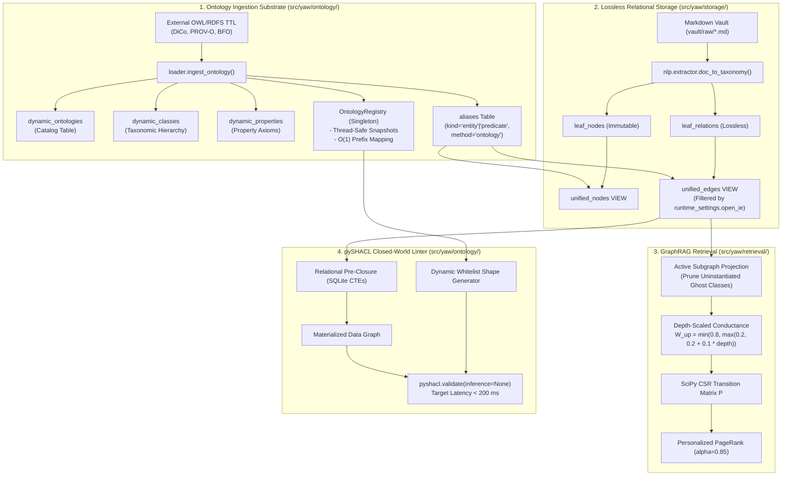

# Technical Specification: Pluggable RDF/OWL Ontology Substrates & Configurable Open-IE (Epic 7)

**Author:** The Ontologist (W3C Semantic Web and Knowledge Graph Specialist)  
**Governing Canon:** `FOUNDATIONAL.md §1–§5`, `ADR-001`–`ADR-008`, `/home/harri/yaw/.agents/agents/ontologist/agent.md`  
**Reference Document:** `pluggable_ontology_architecture_assessment.md`  
**Target Specification File:** `docs/epic7-pluggable-ontology-integration-spec.md`  
**System Target:** YAW (FastMCP Ontology GraphRAG Engine)  
**Status:** Authoritative Production Specification  

---

## 1. Executive Summary & Governing Tenets

This specification defines the complete end-to-end integration of **Pluggable RDF/OWL Ontologies** and **Configurable Open-IE** into the YAW knowledge engine. It resolves the core tension between open-ended conversational knowledge extraction and rigid formal domain models without sacrificing performance, query speed, or backward compatibility.

### 1.1 The Six Non-Negotiable Invariants

In strict adherence to the Ontologist's governing tenets, this design enforces:

1. **SQLite Quad Substrate (Kurt Cagle's Threshold):**  
   Zero external graph databases (no Neo4j, Jena Fuseki, GraphDB, or Virtuoso). All triple/quad storage, transitive closures, and identity mappings execute in-process via SQLite (`.cache/yaw.db`).
2. **Zero Cache-Wipe Invariant (Lossless Leaf Storage):**  
   Extraction into `leaf_nodes` and `leaf_relations` is **lossless and immutable**. Closed-world filtering (`open_ie=false`) and ontology alignments execute downstream in SQLite views (`unified_edges`, `unified_nodes`) at query time (< 5 ms toggle). Toggling ontologies or switching extraction modes **never triggers vault-wide re-indexing or Gemma embedding cache wipes**.
3. **Antonym-Guarded Predicate Normalization:**  
   Eliminates GloVe cosine polarity collapse (`causes` $\approx$ `prevents`, `supports` $\approx$ `refutes`) via a Tri-Level normalizer combining WordNet/VerbNet synsets, compile-time subproperty closure, and an explicit **Polarity Exclusion Mask**.
4. **Relational Pre-Closure & Lean pySHACL (< 200 ms):**  
   Pre-computes RDFS/OWL 2 RL transitive closures via SQLite recursive Common Table Expressions (CTEs) and SciPy CSR matrix powers. `pyshacl.validate()` executes strictly with `inference=None`, eliminating Python heap explosions and 60-second garbage collection pauses.
5. **Active Subgraph PPR Projection:**  
   Uninstantiated "ghost" ontology classes are pruned prior to SciPy Compressed Sparse Row (CSR) matrix construction, preventing 60% concept seed mass dilution. Upward taxonomic conductance is scaled logarithmically by class depth:
   $$W_{\text{up}}(u, v) = \max\left(0.2, \frac{1.0}{1 + \log_2(1 + \text{depth}(v))}\right)$$
6. **Unified `aliases` Substrate & Index Preservation:**  
   External ontology terms materialize directly into the indexed `aliases` table (`method='ontology'`). All joins in `unified_edges` hit existing B-Tree indices (`idx_aliases_lookup`), preserving index seeks without dynamic substring parsing.
7. **Dual-Epistemic Coexistence (OWL Domain Schema vs SKOS Vault Thesaurus):**  
   Both OWL and SKOS are first-class, coexisting paradigms in YAW. OWL 2 RL (`owl:Class`, `owl:ObjectProperty`, `rdfs:subClassOf`, `owl:propertyDisjointWith`) defines formal domain classifications, property axioms, and subsumption DAGs. SKOS (`skos:Concept`, `skos:ConceptScheme`, `skos:prefLabel`, `skos:altLabel`, `skos:broader`, `skos:narrower`) defines epistemic topic indexing, controlled vocabulary, and vault thesaurus navigation.  
   - **The Non-Punning Invariant**: An entity URI is strictly typed as *either* an `owl:Class` or a `skos:Concept`, never both simultaneously. Punning (`concepts:Root a owl:Class, skos:Concept`) is strictly forbidden.  
   - **Zero Synthetic Wrappers**: Subsumption between classes is standard `rdfs:subClassOf`; synthetic `predicates:subClassOf` wrappers are excised. Thesaurus hierarchy is strictly `skos:broader` and `skos:narrower`.

---

## 2. Pluggable Ontology Subsystem Architecture (The 2x2 Matrix)

The engine supports four discrete operational quadrants configured via `target_ontology: "internal" | "external"` and `open_ie: bool`, applying symmetrically to both OWL 2 RL ontologies and SKOS Concept Schemes:

```
                             TARGET ONTOLOGY
                     Internal                External
               +-----------------------+-----------------------+
        true   |      Quadrant 1       |      Quadrant 3       |
               |      Hybrid Open      |     Hybrid Domain     |
OPEN           |      IE + 9-Root      |     Open IE + Ext     |
IE?            +-----------------------+-----------------------+
        false  |      Quadrant 2       |      Quadrant 4       |
               |      Strict Fixed     |     Chunk-Scoped      |
               |     14 Predicates     |     Closed Domain     |
               +-----------------------+-----------------------+
```

| Target Ontology | Open IE? | Ingestion & Extraction Behavior | Active View Filter (`unified_edges`) |
| :--- | :--- | :--- | :--- |
| **internal** | `true` | Invariant 2 (Lossless): Extracts leaf triples; infers ontology per `src/yaw/ontology.ttl`. Allows open_ie when no matches are found, merging towards strict root namespaces. | Includes all extracted and compiled relations (`open_ie_filter=0`). |
| **internal** | `false` | Invariant 2 (Lossless): Extracts leaf triples; infers ontology per `ontology.ttl`. Only predefined 14 base predicates and defined root classes/concepts active in retrieval. | Filters edges where `rel_type NOT IN (SELECT canonical_id FROM aliases WHERE kind='predicate')` and not in `BASE_PREDICATES`. |
| **external** | `true` | Invariant 2 (Lossless): Extracts leaf triples; aligns entities to external OWL classes / SKOS concepts. Allows open_ie when no matches are found, merging towards external Top Concept / `owl:Thing`. | Includes external properties + normalized open predicates under `wiki:predicates:{slug}`. |
| **external** | `false` | Invariant 2 (Lossless): Extracts leaf triples; mentions scoped via NER/Trie against `dynamic_classes`. Closed-domain extraction strictly according to external ontology. | Filters edges strictly to registered external ontology properties (`dynamic_properties`) and canonical predicates. Ghost classes pruned from PPR. |

### 2.1 Quadrant 1: Hybrid Open IE + 9-Root (`internal`, `open_ie=true`) [Default]
- **Node Typing:** Entities mapped to the 9 universal root classes (`concepts`, `entities`, `predicates`, `claims`, `invariants`, `decisions`, `processes`, `sources`, `contexts`). Unmatched surface entities mint `concepts:{slug}` and attach to `concepts:Root`.
- **Predicates:** Normalized to 14 base predicates via Antonym-Guarded Tri-Level Normalizer. Unmatched predicates mint `predicates:{slug}`.
- **Thesaurus:** Vault concepts align to `yaw:VaultScheme` via `skos:Concept` and `skos:prefLabel`/`skos:altLabel`.
- **View Filter:** `unified_edges` includes all extracted and compiled relations (`open_ie_filter=0`).

### 2.2 Quadrant 2: Strict Fixed 14 Predicates (`internal`, `open_ie=false`)
- **Node Typing:** Strictly constrained to 9 canonical root namespaces.
- **Predicates:** Limited strictly to the 14 base predicates (`partOf`, `subClassOf`, `supports`, `refutes`, etc.).
- **View Filter:** Out-of-vocabulary relations remain in `leaf_relations` for audit provenance, but `unified_edges` filters edges where `rel_type NOT IN (SELECT canonical_id FROM aliases WHERE kind='predicate')` and not in `BASE_PREDICATES`.

### 2.3 Quadrant 3: Hybrid Domain Open IE (`external`, `open_ie=true`)
- **Node Typing:** Entities match external ontology classes ($E \sqsubseteq C_{\text{ext}}$) or SKOS concepts loaded into `dynamic_classes`. Unmatched entities mint `yaw:{slug}` and attach to the external Top Concept or `owl:Thing`.
- **Predicates:** External object properties active in `dynamic_properties`. Open verbs normalized and retained under `wiki:predicates:{slug}`.
- **Namespaces:** External prefixes (`dico:`, `prov:`, `bfo:`, `skos:`) registered in `OntologyRegistry`.

### 2.4 Quadrant 4: Chunk-Scoped Closed Domain (`external`, `open_ie=false`)
- **Mention Scoping:** Bottom-up spaCy NER + Trie matching selects candidate classes/concepts from `dynamic_classes` relevant to the chunk. Static prompt templates preserve LLM KV-cache.
- **View Filter:** `unified_edges` filters relations strictly to registered external ontology properties and canonical predicates. Ghost classes pruned from GraphRAG PPR.

---

## 3. Module-by-Module Technical Specification



---

### 3.1 `src/yaw/ontology/registry.py`: Thread-Safe In-Memory Singleton

The `OntologyRegistry` provides thread-safe, $O(1)$ prefix and URI lookups for the retrieval, NLP, and serialization layers.

```python
"""Thread-safe in-memory registry of active ontology namespaces, prefixes, and axioms."""

from __future__ import annotations

import re
import sqlite3
import threading
from dataclasses import dataclass, field
from typing import ClassVar
from rdflib import Namespace, URIRef

from yaw.storage.rdf import ROOT_NAMESPACES, W3C_NAMESPACES, YAW_PREFIX

@dataclass(frozen=True)
class DynamicClassMeta:
    curie: str
    uri: URIRef
    ontology_id: str
    label: str
    parent_uri: URIRef | None
    depth: int = 0
    is_root: bool = False
    epistemic_type: str = "class"  # 'class' (OWL) or 'concept' (SKOS)

@dataclass(frozen=True)
class DynamicPropertyMeta:
    curie: str
    uri: URIRef
    ontology_id: str
    label: str
    parent_uri: URIRef | None
    is_transitive: bool = False
    is_symmetric: bool = False

@dataclass(frozen=True)
class RegistrySnapshot:
    """Immutable state snapshot for thread-safe lock-free reads."""
    prefix_to_uri: dict[str, str]
    uri_to_prefix: dict[str, str]
    concept_prefixes: frozenset[str]
    classes: dict[str, DynamicClassMeta]
    properties: dict[str, DynamicPropertyMeta]
    class_depths: dict[str, int]

class OntologyRegistry:
    """Singleton registry holding active ontology prefix maps and property characteristics.
    
    Guarantees thread-safe lock-free reads via atomic immutable RegistrySnapshot swapping.
    """
    _instance: ClassVar[OntologyRegistry | None] = None
    _lock: ClassVar[threading.RLock] = threading.RLock()

    def __new__(cls) -> OntologyRegistry:
        with cls._lock:
            if cls._instance is None:
                cls._instance = super().__new__(cls)
                cls._instance._init_defaults()
            return cls._instance

    def _init_defaults(self) -> None:
        self._write_lock = threading.RLock()
        prefix_to_uri: dict[str, str] = {
            "yaw": YAW_PREFIX,
            "rdf": str(W3C_NAMESPACES["rdf"]),
            "rdfs": str(W3C_NAMESPACES["rdfs"]),
            "owl": str(W3C_NAMESPACES["owl"]),
            "sh": str(W3C_NAMESPACES["sh"]),
            "skos": str(W3C_NAMESPACES["skos"]),
            "xsd": str(W3C_NAMESPACES["xsd"]),
            **{k: str(v) for k, v in ROOT_NAMESPACES.items()},
        }
        uri_to_prefix: dict[str, str] = {v: k for k, v in prefix_to_uri.items()}
        self._snapshot = RegistrySnapshot(
            prefix_to_uri=prefix_to_uri,
            uri_to_prefix=uri_to_prefix,
            concept_prefixes=frozenset(ROOT_NAMESPACES.keys()),
            classes={},
            properties={},
            class_depths={},
        )

    def is_concept_namespace(self, prefix: str) -> bool:
        """O(1) check whether prefix is a registered concept namespace."""
        return prefix.lower().strip(":") in self._snapshot.concept_prefixes

    def curie_to_uri(self, curie: str | None) -> URIRef:
        """Resolve CURIE to full W3C URIRef using active registry prefix mappings."""
        if not curie or not curie.strip():
            return URIRef(f"{YAW_PREFIX}unknown")
        raw = curie.strip()
        if raw.startswith(("http://", "https://", "urn:")):
            return URIRef(raw)
        snap = self._snapshot
        if ":" in raw:
            prefix, suffix = raw.split(":", 1)
            prefix_clean = prefix.lower()
            if prefix_clean in snap.prefix_to_uri:
                base = snap.prefix_to_uri[prefix_clean]
                return URIRef(f"{base}{suffix}")
        # Default fallback to yaw concepts
        slug = re.sub(r"\s+", "-", raw.replace("yaw:", ""))
        return URIRef(f"{YAW_PREFIX}concepts/{slug}")

    def uri_to_curie(self, uri: str | URIRef) -> str:
        """Contract full URIRef to registered CURIE prefix:suffix format."""
        uri_str = str(uri)
        snap = self._snapshot
        for base_uri, prefix in snap.uri_to_prefix.items():
            if uri_str.startswith(base_uri):
                suffix = uri_str[len(base_uri):]
                return f"{prefix}:{suffix}"
        return uri_str

    def get_active_prefixes(self) -> dict[str, str]:
        """Return shallow copy of current prefix-to-URI mapping."""
        return dict(self._snapshot.prefix_to_uri)

    def get_class_depth(self, curie_or_uri: str) -> int:
        """Return taxonomic depth of class relative to its root (0 for root)."""
        return self._snapshot.class_depths.get(curie_or_uri, 0)

    def get_class(self, curie_or_uri: str) -> DynamicClassMeta | None:
        """Return class metadata by curie or uri."""
        return self._snapshot.classes.get(curie_or_uri)

    def get_property(self, curie_or_uri: str) -> DynamicPropertyMeta | None:
        """Return property metadata by curie or uri."""
        return self._snapshot.properties.get(curie_or_uri)

    def sync_from_db(self, conn: sqlite3.Connection) -> None:
        """Re-hydrate registry state atomically via immutable RegistrySnapshot pointer swap."""
        with self._write_lock:
            # Build new snapshot dictionaries
            new_prefix_to_uri = dict(self._snapshot.prefix_to_uri)
            for row in conn.execute("SELECT ontology_id, uri_prefix FROM dynamic_ontologies").fetchall():
                ont_id, uri_prefix = str(row[0]), str(row[1])
                new_prefix_to_uri[ont_id.lower()] = uri_prefix
            new_uri_to_prefix = {v: k for k, v in new_prefix_to_uri.items()}

            new_classes: dict[str, DynamicClassMeta] = {}
            new_depths: dict[str, int] = {}
            for row in conn.execute(
                "SELECT curie, class_uri, ontology_id, label, parent_class_uri, depth, is_root, epistemic_type FROM dynamic_classes"
            ).fetchall():
                curie, uri_str, ont_id, label, parent_uri, depth, is_root, ep_type = (
                    str(row[0]), str(row[1]), str(row[2]), str(row[3]),
                    str(row[4]) if row[4] else None, int(row[5]), bool(row[6]), str(row[7])
                )
                meta = DynamicClassMeta(
                    curie=curie,
                    uri=URIRef(uri_str),
                    ontology_id=ont_id,
                    label=label,
                    parent_uri=URIRef(parent_uri) if parent_uri else None,
                    depth=depth,
                    is_root=is_root,
                    epistemic_type=ep_type,
                )
                new_classes[curie] = meta
                new_classes[uri_str] = meta
                new_depths[curie] = depth
                new_depths[uri_str] = depth

            new_properties: dict[str, DynamicPropertyMeta] = {}
            for row in conn.execute(
                "SELECT curie, property_uri, ontology_id, label, parent_property_uri, is_transitive, is_symmetric FROM dynamic_properties"
            ).fetchall():
                curie, uri_str, ont_id, label, parent_uri, is_trans, is_symm = (
                    str(row[0]), str(row[1]), str(row[2]), str(row[3]),
                    str(row[4]) if row[4] else None, bool(row[5]), bool(row[6])
                )
                prop_meta = DynamicPropertyMeta(
                    curie=curie,
                    uri=URIRef(uri_str),
                    ontology_id=ont_id,
                    label=label,
                    parent_uri=URIRef(parent_uri) if parent_uri else None,
                    is_transitive=is_trans,
                    is_symmetric=is_symm,
                )
                new_properties[curie] = prop_meta
                new_properties[uri_str] = prop_meta

            # Atomic swap!
            self._snapshot = RegistrySnapshot(
                prefix_to_uri=new_prefix_to_uri,
                uri_to_prefix=new_uri_to_prefix,
                concept_prefixes=frozenset(new_prefix_to_uri.keys()),
                classes=new_classes,
                properties=new_properties,
                class_depths=new_depths,
            )

_registry: OntologyRegistry | None = None

def get_ontology_registry() -> OntologyRegistry:
    """Access the global OntologyRegistry singleton."""
    global _registry
    if _registry is None:
        _registry = OntologyRegistry()
    return _registry
```

---

### 3.2 `src/yaw/ontology/loader.py`: Ingestion & Materialization

The loader parses external TTL/OWL/RDFS files via `rdflib.Graph`, extracts class hierarchies and property axioms, updates dynamic catalog tables, and materializes terms into the indexed `aliases` table.

```python
"""External ontology ingestion and alias materialization pipeline."""

from __future__ import annotations

import logging
import sqlite3
import time
from pathlib import Path
from typing import Any
import rdflib
from rdflib import OWL, RDF, RDFS, SKOS, URIRef

from yaw.ontology.registry import get_ontology_registry
from yaw.storage.db import insert_alias

logger = logging.getLogger(__name__)

def ingest_ontology(
    source: str | Path | rdflib.Graph,
    conn: sqlite3.Connection,
    ontology_id: str | None = None,
    is_default: bool = False,
) -> dict[str, Any]:
    """Parse external RDF/OWL ontology into dynamic catalog tables and aliases.
    
    Args:
        source: File path, URL string, or pre-loaded rdflib.Graph.
        conn: Open SQLite connection with WAL pragmas applied.
        ontology_id: Prefix identifier (e.g. 'dico', 'prov'). Auto-detected if None.
        is_default: Whether this ontology serves as default fallback for Quad 3 & 4.
        
    Returns:
        Dictionary summarizing ingested classes, properties, and materialized aliases.
    """
    g = rdflib.Graph()
    if isinstance(source, rdflib.Graph):
        g = source
        source_uri = "in-memory"
    else:
        source_path = Path(source)
        source_uri = str(source_path.resolve()) if source_path.exists() else str(source)
        g.parse(source, format="turtle" if str(source).endswith((".ttl", ".owl")) else None)

    # 1. Detect base URI and ontology prefix (OWL Ontology or SKOS ConceptScheme)
    detected_prefix = ontology_id
    base_uri: str | None = None

    for ont_subj in g.subjects(RDF.type, OWL.Ontology):
        base_uri = str(ont_subj).rstrip("#/") + "#"
        if not detected_prefix:
            detected_prefix = str(ont_subj).rsplit("/", 1)[-1].rsplit("#", 1)[-1].lower()
            break

    if not base_uri:
        for scheme_subj in g.subjects(RDF.type, SKOS.ConceptScheme):
            base_uri = str(scheme_subj).rstrip("#/") + "#"
            if not detected_prefix:
                detected_prefix = str(scheme_subj).rsplit("/", 1)[-1].rsplit("#", 1)[-1].lower()
                break

    if not detected_prefix:
        detected_prefix = "ext"
    if not base_uri:
        base_uri = f"http://yaw.local/{detected_prefix}/"

    # 2. Record dynamic_ontologies catalog entry
    conn.execute(
        """INSERT OR REPLACE INTO dynamic_ontologies 
           (ontology_id, uri_prefix, source_uri, is_default, loaded_at)
           VALUES (?, ?, ?, ?, ?)""",
        (detected_prefix, base_uri, source_uri, 1 if is_default else 0, time.time()),
    )

    classes_ingested = 0
    props_ingested = 0
    aliases_materialized = 0

    # 3. Extract Classes and Concepts (Invariant 7: Non-Punning Dual-Epistemic Separation)
    class_types = {OWL.Class, RDFS.Class}
    concept_types = {SKOS.Concept}

    for c_uri in set(g.subjects(RDF.type, None)):
        types = set(g.objects(c_uri, RDF.type))
        has_class = bool(types & class_types)
        has_concept = bool(types & concept_types)

        if not (has_class or has_concept) or not isinstance(c_uri, URIRef):
            continue

        if has_class and has_concept:
            raise ValueError(
                f"Metamodeling violation: URI {c_uri} is declared as both an OWL Class "
                f"and a SKOS Concept. Punning is strictly prohibited under Invariant 7."
            )

        epistemic_type = "class" if has_class else "concept"
        uri_str = str(c_uri)
        suffix = uri_str.rsplit("#", 1)[-1].rsplit("/", 1)[-1]
        curie = f"{detected_prefix}:{suffix}"

        # Resolve labels
        labels = [str(l) for l in g.objects(c_uri, RDFS.label)]
        labels.extend(str(l) for l in g.objects(c_uri, SKOS.prefLabel))
        pref_label = labels[0] if labels else suffix

        # Resolve definition
        defs = [str(d) for d in g.objects(c_uri, RDFS.comment)]
        defs.extend(str(d) for d in g.objects(c_uri, SKOS.definition))
        definition = defs[0] if defs else ""

        # Hierarchy: OWL uses rdfs:subClassOf; SKOS uses skos:broader
        if epistemic_type == "class":
            parents = [
                str(p) for p in g.objects(c_uri, RDFS.subClassOf) 
                if isinstance(p, URIRef) and p != OWL.Thing
            ]
        else:
            parents = [
                str(p) for p in g.objects(c_uri, SKOS.broader)
                if isinstance(p, URIRef)
            ]
        parent_uri = parents[0] if parents else None
        is_root = 1 if not parents else 0

        conn.execute(
            """INSERT OR REPLACE INTO dynamic_classes 
               (class_uri, curie, ontology_id, label, definition, parent_class_uri, is_root, epistemic_type)
               VALUES (?, ?, ?, ?, ?, ?, ?, ?)""",
            (uri_str, curie, detected_prefix, pref_label, definition, parent_uri, is_root, epistemic_type),
        )
        classes_ingested += 1

        # Preserve multiple inheritance in junction table
        for sec_parent in parents[1:]:
            conn.execute(
                """INSERT OR IGNORE INTO dynamic_class_parents (child_class_uri, parent_class_uri)
                   VALUES (?, ?)""",
                (uri_str, sec_parent),
            )

        # Materialize entity aliases directly into indexed aliases table
        # Variant A: CURIE (dico:Wall -> dico:Wall)
        insert_alias(conn, alias_id=curie, canonical_id=curie, kind="entity", method="ontology", score=1.0)
        aliases_materialized += 1

        # Variant B: Normalized surface label ("wall" -> dico:Wall)
        clean_label = pref_label.lower().strip()
        insert_alias(conn, alias_id=clean_label, canonical_id=curie, kind="entity", method="ontology", score=1.0)
        aliases_materialized += 1

        # Variant C: AltLabels
        for alt in g.objects(c_uri, SKOS.altLabel):
            insert_alias(conn, alias_id=str(alt).lower().strip(), canonical_id=curie, kind="entity", method="ontology", score=0.95)
            aliases_materialized += 1

    # 4. Extract Object & Datatype Properties
    prop_types = {OWL.ObjectProperty, OWL.DatatypeProperty, RDF.Property, OWL.TransitiveProperty}
    for p_uri in set(g.subjects(RDF.type, None)):
        types = set(g.objects(p_uri, RDF.type))
        if not (types & prop_types) or not isinstance(p_uri, URIRef):
            continue

        uri_str = str(p_uri)
        suffix = uri_str.rsplit("#", 1)[-1].rsplit("/", 1)[-1]
        curie = f"{detected_prefix}:{suffix}"

        labels = [str(l) for l in g.objects(p_uri, RDFS.label)]
        pref_label = labels[0] if labels else suffix

        defs = [str(d) for d in g.objects(p_uri, RDFS.comment)]
        definition = defs[0] if defs else ""

        parents = [str(p) for p in g.objects(p_uri, RDFS.subPropertyOf) if isinstance(p, URIRef)]
        parent_uri = parents[0] if parents else None

        is_trans = 1 if OWL.TransitiveProperty in types else 0
        is_sym = 1 if OWL.SymmetricProperty in types else 0

        conn.execute(
            """INSERT OR REPLACE INTO dynamic_properties 
               (property_uri, curie, ontology_id, label, definition, parent_property_uri, is_transitive, is_symmetric)
               VALUES (?, ?, ?, ?, ?, ?, ?, ?)""",
            (uri_str, curie, detected_prefix, pref_label, definition, parent_uri, is_trans, is_sym),
        )
        props_ingested += 1

        # Materialize predicate aliases
        insert_alias(conn, alias_id=curie, canonical_id=curie, kind="predicate", method="ontology", score=1.0)
        insert_alias(conn, alias_id=suffix.lower(), canonical_id=curie, kind="predicate", method="ontology", score=1.0)
        aliases_materialized += 2

    conn.commit()

    # 5. Synchronize in-memory registry
    reg = get_ontology_registry()
    reg.sync_from_db(conn)

    return {
        "status": "success",
        "ontology_id": detected_prefix,
        "classes_ingested": classes_ingested,
        "properties_ingested": props_ingested,
        "aliases_materialized": aliases_materialized,
    }
```

---

### 3.3 `src/yaw/nlp/components.py`: Antonym-Guarded Tri-Level Predicate Normalizer

GloVe 300d embeddings collapse distributional antonyms into identical vector neighborhoods. The Antonym-Guarded Predicate Normalizer introduces WordNet synset expansion and an explicit **Polarity Exclusion Mask** to prevent catastrophic semantic inversions.

```python
"""Antonym-guarded tri-level predicate normalizer preventing vector polarity collapse."""

from __future__ import annotations

import logging
import re
from typing import Any
import spacy
from spacy.language import Language

from yaw import config
from yaw.ontology.registry import get_ontology_registry

logger = logging.getLogger(__name__)

# Bipartite and symmetric exclusion masks (Blacklist Table)
POLARITY_EXCLUSION_MASK: dict[str, frozenset[str]] = {
    "causes": frozenset({
        "prevent", "prevents", "prevented", "preventing", "prevention",
        "inhibit", "inhibits", "inhibited", "inhibiting", "inhibition",
        "block", "blocks", "blocked", "blocking",
        "stop", "stops", "stopped", "stopping",
        "thwart", "thwarts", "thwarted", "preclude", "precludes",
    }),
    "prevents": frozenset({
        "cause", "causes", "caused", "causing",
        "induce", "induces", "induced", "inducing",
        "trigger", "triggers", "triggered", "triggering",
        "produce", "produces", "produced", "producing",
        "generate", "generates", "generated", "lead to", "results in",
    }),
    "supports": frozenset({
        "refute", "refutes", "refuted", "refuting",
        "contradict", "contradicts", "contradicted", "contradicting",
        "oppose", "opposes", "opposed", "opposing",
        "disprove", "disproves", "disproved", "disproving",
        "rebut", "rebuts", "undermine", "undermines",
    }),
    "refutes": frozenset({
        "support", "supports", "supported", "supporting",
        "confirm", "confirms", "confirmed", "confirming",
        "prove", "proves", "proved", "proving",
        "corroborate", "corroborates", "substantiate", "uphold",
    }),
    "contradicts": frozenset({
        "support", "supports", "supported", "supporting",
        "agree", "agrees", "agreed", "align", "aligns", "aligned",
        "match", "matches", "consistent with",
    }),
    "precedes": frozenset({
        "follow", "follows", "followed", "following",
        "succeed", "succeeds", "succeeded", "succeeding",
    }),
}

# Pre-compiled high-precision synset dictionary
SYNSET_DICTIONARY: dict[str, str] = {
    # Causal
    "induces": "causes", "induce": "causes", "leads to": "causes", "lead to": "causes",
    "triggers": "causes", "trigger": "causes", "results in": "causes", "sparks": "causes",
    "brings about": "causes", "produces": "causes", "generates": "causes",
    # Dialectical supports
    "corroborates": "supports", "substantiates": "supports", "upholds": "supports",
    "endorses": "supports", "backs": "supports", "confirms": "supports", "verifies": "supports",
    # Dialectical refutes / contradicts
    "disproves": "refutes", "debunks": "refutes", "rebuts": "refutes",
    "invalidates": "refutes", "opposes": "contradicts", "negates": "contradicts",
    # Mereology
    "consists of": "partOf", "comprises": "partOf", "composed of": "partOf",
    "constitutes": "partOf", "belongs to": "partOf", "element of": "partOf",
    # Subsumption
    "is a type of": "subClassOf", "is a kind of": "subClassOf", "categorized as": "subClassOf",
}

def is_antonym_conflict(candidate: str, target_predicate: str) -> bool:
    """Check if candidate text violates polarity exclusion mask for target predicate."""
    norm_target = target_predicate.split(":", 1)[-1]
    if norm_target in POLARITY_EXCLUSION_MASK:
        cand_clean = candidate.lower().strip()
        mask = POLARITY_EXCLUSION_MASK[norm_target]
        if cand_clean in mask:
            return True
        tokens = set(re.findall(r"\w+", cand_clean))
        if tokens & mask:
            return True
        # Lemmatized multi-word phrase matching (e.g. "lead to", "results in")
        for blocked in mask:
            if " " in blocked and blocked in cand_clean:
                return True
    return False

_base_spacy_model: Language | None = None

def get_base_spacy() -> Language:
    """Cached singleton loader for en_core_web_lg to avoid 500MB reload on every call."""
    global _base_spacy_model
    if _base_spacy_model is None:
        _base_spacy_model = spacy.load("en_core_web_lg", exclude=["ner"])
    return _base_spacy_model

def normalize_predicate_antonym_guarded(
    predicate: str,
    base_predicates: tuple[str, ...] | list[str] | None = None,
    nlp: Language | None = None,
    threshold: float = config.CANON_SIM_THRESHOLD,
) -> str:
    """Tri-level predicate normalizer: (1) Synsets & Aliases -> (2) Antonym-Masked Cosine -> (3) Closure."""
    rel = predicate.strip()
    if not rel:
        return ""

    bp_tuple = tuple(base_predicates or config.BASE_PREDICATES)
    reg = get_ontology_registry()

    # --- TIER 1: Synsets, Dynamic Properties & Direct Alias Lookup ---
    raw_lower = rel.lower()
    if raw_lower in SYNSET_DICTIONARY:
        mapped = SYNSET_DICTIONARY[raw_lower]
        if mapped in bp_tuple:
            return mapped

    # Decamelize & clean
    decamel = re.sub(r"([a-z])([A-Z])", r"\1 \2", rel).replace("_", " ").lower().strip()
    if decamel in SYNSET_DICTIONARY:
        mapped = SYNSET_DICTIONARY[decamel]
        if mapped in bp_tuple:
            return mapped

    # Check direct base predicate match
    for bp in bp_tuple:
        if bp.lower() == raw_lower or bp.lower() == decamel:
            return bp

    # Check registered external ontology properties in snapshot
    snapshot = reg.snapshot
    if rel in snapshot.properties:
        return snapshot.properties[rel].curie
    for curie, prop_meta in snapshot.properties.items():
        if curie.lower() == raw_lower or prop_meta.label.lower() == decamel:
            return prop_meta.curie

    # --- TIER 2: Antonym-Guarded GloVe Vector Matching ---
    base_pipe = nlp or get_base_spacy()
    target_doc = base_pipe(decamel)
    if target_doc and target_doc.has_vector and target_doc.vector_norm > 0:
        best_sim = 0.0
        best_bp: str | None = None

        for bp in bp_tuple:
            # Polarity Guard: Discard blacklisted causal/dialectical antonyms
            if is_antonym_conflict(decamel, bp):
                continue

            bp_clean = re.sub(r"([a-z])([A-Z])", r"\1 \2", bp).replace("_", " ").lower().strip()
            bp_doc = base_pipe(bp_clean)
            if bp_doc and bp_doc.has_vector and bp_doc.vector_norm > 0:
                sim = float(target_doc.similarity(bp_doc))
                if sim > best_sim:
                    best_sim = sim
                    best_bp = bp

        if best_sim >= threshold and best_bp is not None:
            return best_bp

    # --- TIER 3: Compile-Time Property Closure Fallback ---
    if ":" in rel:
        curie = reg.uri_to_curie(rel)
        if curie in snapshot.properties:
            return curie

    return decamel.replace(" ", "_")
```

---

### 3.4 `src/yaw/nlp/extractor.py` & `src/yaw/nlp/models.py`: Lossless Leaf Storage

The extraction contract mandates that **out-of-vocabulary triples are never discarded during note extraction**.

1. **Lossless Extraction Contract:** All surface relations extracted from notes are written to `leaf_relations`. Closed-world scoping is enforced strictly at view/query time.
2. **Bottom-Up Mention Scoping:** When `open_ie=false`, spaCy C-speed Trie and NER matching identifies candidate concepts in the chunk before prompt generation. Static prompt templates preserve Ollama/LLM KV-cache prefixes.
3. **`map_namespace` Extension:** Queries `OntologyRegistry.is_concept_namespace()` to support dynamic external prefixes.

```python
# Modified segment in src/yaw/nlp/models.py

def map_namespace(ent: Span) -> str:
    """Map spaCy entity span to active taxonomy namespace via OntologyRegistry."""
    from yaw.ontology.registry import get_ontology_registry
    reg = get_ontology_registry()

    lbl = normalize_label(ent.label_) if ent.label_ else ""
    
    # 1. Check registry concept namespaces (O(1) check)
    if reg.is_concept_namespace(lbl) and lbl not in GENERIC_LABELS:
        return lbl

    # 2. Check Span extension category
    ent_cat = getattr(getattr(ent, "_", None), "category", None)
    if ent_cat:
        norm_cat = normalize_label(ent_cat)
        if reg.is_concept_namespace(norm_cat):
            return norm_cat

    # 3. Fallback to default
    if "entities" in config.TAXONOMY_NAMESPACES:
        return "entities"
    return "concepts"

# Bottom-Up Mention Scoper for Quadrant 4 (Closed-Domain Candidate Scoping)
from spacy.matcher import PhraseMatcher

class DynamicConceptMentionScoper:
    """Bottom-up candidate scoping for closed-domain extraction (Quadrant 4).
    
    Pre-matches text chunks against registered ontology labels via spaCy C-speed
    PhraseMatcher (Trie) to constrain candidate alignments without bloating LLM prompt prefixes.
    """
    def __init__(self, nlp: Language) -> None:
        self.nlp = nlp
        self.matcher = PhraseMatcher(nlp.vocab, attr="LOWER")
        self._rebuild()

    def _rebuild(self) -> None:
        reg = get_ontology_registry()
        snapshot = reg.snapshot
        patterns: dict[str, list[spacy.tokens.Doc]] = {}
        for curie, meta in snapshot.classes.items():
            if curie.startswith("http"):
                continue
            doc = self.nlp.make_doc(meta.label)
            patterns.setdefault(curie, []).append(doc)
        for curie, docs in patterns.items():
            self.matcher.add(curie, docs)

    def scope_chunk_candidates(self, text: str) -> set[str]:
        """Find candidate class CURIEs present in chunk text (O(N) token scan)."""
        doc = self.nlp.make_doc(text)
        matches = self.matcher(doc)
        return {self.nlp.vocab.strings[match_id] for match_id, _, _ in matches}
```

---

### 3.5 `src/yaw/storage/schema.py` & `src/yaw/storage/db.py`: Dynamic Tables & Non-Destructive Views

#### Dynamic Schema DDL
Added to `src/yaw/storage/schema.py` in `ensure_schema_tables(conn)`:

```sql
-- Catalog of loaded dynamic ontologies
CREATE TABLE IF NOT EXISTS dynamic_ontologies (
    ontology_id TEXT PRIMARY KEY,
    uri_prefix TEXT NOT NULL,
    source_uri TEXT NOT NULL,
    is_default BOOLEAN NOT NULL DEFAULT 0,
    loaded_at REAL NOT NULL DEFAULT (unixepoch())
);

-- Active classes extracted from external ontologies
CREATE TABLE IF NOT EXISTS dynamic_classes (
    class_uri TEXT PRIMARY KEY,
    curie TEXT NOT NULL,
    ontology_id TEXT NOT NULL,
    label TEXT NOT NULL,
    definition TEXT DEFAULT '',
    parent_class_uri TEXT,
    depth INTEGER NOT NULL DEFAULT 0,
    is_root BOOLEAN NOT NULL DEFAULT 0,
    epistemic_type TEXT NOT NULL DEFAULT 'class' CHECK(epistemic_type IN ('class', 'concept')),
    FOREIGN KEY(ontology_id) REFERENCES dynamic_ontologies(ontology_id)
);
CREATE INDEX IF NOT EXISTS idx_dynamic_classes_curie ON dynamic_classes(curie);
CREATE INDEX IF NOT EXISTS idx_dynamic_classes_parent ON dynamic_classes(parent_class_uri);

-- Junction table preserving multiple inheritance / broader parent links
CREATE TABLE IF NOT EXISTS dynamic_class_parents (
    child_class_uri TEXT NOT NULL,
    parent_class_uri TEXT NOT NULL,
    PRIMARY KEY(child_class_uri, parent_class_uri)
);
CREATE INDEX IF NOT EXISTS idx_dynamic_class_parents_parent ON dynamic_class_parents(parent_class_uri);

-- Active properties extracted from external ontologies
CREATE TABLE IF NOT EXISTS dynamic_properties (
    property_uri TEXT PRIMARY KEY,
    curie TEXT NOT NULL,
    ontology_id TEXT NOT NULL,
    label TEXT NOT NULL,
    definition TEXT DEFAULT '',
    parent_property_uri TEXT,
    is_transitive BOOLEAN NOT NULL DEFAULT 0,
    is_symmetric BOOLEAN NOT NULL DEFAULT 0,
    FOREIGN KEY(ontology_id) REFERENCES dynamic_ontologies(ontology_id)
);
CREATE INDEX IF NOT EXISTS idx_dynamic_properties_curie ON dynamic_properties(curie);

-- Non-destructive runtime settings table governing closed-world view filters
CREATE TABLE IF NOT EXISTS runtime_settings (
    key TEXT PRIMARY KEY,
    value TEXT NOT NULL
);
INSERT OR IGNORE INTO runtime_settings (key, value) VALUES ('open_ie', '1');
INSERT OR IGNORE INTO runtime_settings (key, value) VALUES ('target_ontology', 'internal');

-- Idempotent Schema Migration for aliases.method CHECK constraint:
-- When existing database has aliases table with CHECK constraint excluding 'ontology',
-- execute atomic migration in ensure_schema_tables():
-- 1. PRAGMA foreign_keys=OFF;
-- 2. CREATE TABLE aliases_new (... method IN ('lexical', 'auto', 'llm', 'compile', 'exact', 'alias', 'new', 'ontology'));
-- 3. INSERT INTO aliases_new SELECT * FROM aliases;
-- 4. DROP TABLE aliases; ALTER TABLE aliases_new RENAME TO aliases;
-- 5. Recreate idx_aliases_lookup; PRAGMA foreign_keys=ON;
```

#### Non-Destructive View Scoping (`unified_edges`)
Updating `UNIFIED_EDGES_VIEW_TEMPLATE` in `src/yaw/storage/schema.py`:

```sql
CREATE VIEW unified_edges AS
SELECT
    COALESCE(a_src.canonical_id, w.source_uri) AS src_id,
    COALESCE(a_dst.canonical_id, w.target_uri) AS dst_id,
    'wikilink' AS rel_type,
    1.0 AS weight,
    w.source_uri AS source_chunk_id
FROM wikilinks w
LEFT JOIN aliases a_src
    ON a_src.alias_id = w.source_uri
    AND a_src.kind = 'entity'
    AND a_src.status = 'active'
LEFT JOIN aliases a_dst
    ON a_dst.alias_id = w.target_uri
    AND a_dst.kind = 'entity'
    AND a_dst.status = 'active'
UNION ALL
SELECT
    COALESCE(a_sub.canonical_id, lr.subject_id) AS src_id,
    COALESCE(a_obj.canonical_id, lr.object_id) AS dst_id,
    COALESCE(a_pred.canonical_id, lr.predicate) AS rel_type,
    {weight_col},
    lr.source_leaf_id AS source_chunk_id
FROM leaf_relations lr
LEFT JOIN aliases a_sub
    ON a_sub.alias_id = lr.subject_id
    AND a_sub.kind = 'entity'
    AND a_sub.status = 'active'
LEFT JOIN aliases a_obj
    ON a_obj.alias_id = lr.object_id
    AND a_obj.kind = 'entity'
    AND a_obj.status = 'active'
-- Strict Index Seek: lr.predicate_id is guaranteed pre-slugged at ingestion time.
-- Joining strictly on a_pred.alias_id = lr.predicate_id preserves B-Tree index seek on idx_aliases_lookup!
LEFT JOIN aliases a_pred
    ON a_pred.alias_id = lr.predicate_id
    AND a_pred.kind = 'predicate'
    AND a_pred.status = 'active'
WHERE (
    -- Non-destructive closed-world scoping:
    -- When open_ie = 1, pass all triples.
    -- When open_ie = 0, restrict strictly to registered canonical/ontology predicates.
    (SELECT COALESCE(value, '1') FROM runtime_settings WHERE key = 'open_ie') = '1'
    OR a_pred.canonical_id IS NOT NULL
    OR lr.predicate IN (
        -- Strictly aligned 1:1 with config.BASE_PREDICATES (ADR-008):
        'partOf', 'subClassOf', 'manifestsIn', 'mentions',
        'causes', 'prevents', 'supports', 'refutes', 'contradicts',
        'supersedes', 'produces', 'derivedFrom', 'cites', 'instanceOf'
    )
)
UNION ALL
SELECT
    COALESCE(a_sub.canonical_id, cr.subject_id) AS src_id,
    COALESCE(a_obj.canonical_id, cr.object_id) AS dst_id,
    COALESCE(a_pred.canonical_id, cr.predicate) AS rel_type,
    cr.weight AS weight,
    'compiled:' || cr.relation_id AS source_chunk_id
FROM compiled_relations cr
LEFT JOIN aliases a_sub
    ON a_sub.alias_id = cr.subject_id
    AND a_sub.kind = 'entity'
    AND a_sub.status = 'active'
LEFT JOIN aliases a_obj
    ON a_obj.alias_id = cr.object_id
    AND a_obj.kind = 'entity'
    AND a_obj.status = 'active'
LEFT JOIN aliases a_pred
    ON a_pred.alias_id = cr.predicate
    AND a_pred.kind = 'predicate'
    AND a_pred.status = 'active'
UNION ALL
-- Surface 1 Projection: Project dynamic_classes hierarchy into unified_edges so that
-- active ancestor projection, PPR diffusion, and RDFS pre-closure encompass external ontologies!
SELECT
    curie AS src_id,
    parent_class_uri AS dst_id,
    CASE WHEN epistemic_type = 'concept' THEN 'broader' ELSE 'subClassOf' END AS rel_type,
    1.0 AS weight,
    'dynamic_ontology:' || ontology_id AS source_chunk_id
FROM dynamic_classes
WHERE parent_class_uri IS NOT NULL
UNION ALL
-- Project dynamic_properties subproperty hierarchy into unified_edges
SELECT
    curie AS src_id,
    parent_property_uri AS dst_id,
    'subPropertyOf' AS rel_type,
    1.0 AS weight,
    'dynamic_ontology:' || ontology_id AS source_chunk_id
FROM dynamic_properties
WHERE parent_property_uri IS NOT NULL;
```

#### Non-Destructive Node Scoping (`unified_nodes`)
```sql
CREATE VIEW unified_nodes AS
SELECT entity_uri AS node_id, heading AS name, 'chunk' AS namespace, rel_path AS definition FROM note_chunks
UNION ALL
SELECT DISTINCT
    COALESCE(a.canonical_id, ln.node_id) AS node_id,
    ln.name,
    CASE WHEN a.canonical_id IS NOT NULL AND instr(a.canonical_id, ':') > 0 THEN substr(a.canonical_id, 1, instr(a.canonical_id, ':') - 1) ELSE ln.namespace END AS namespace,
    ln.definition
FROM leaf_nodes ln
LEFT JOIN aliases a ON a.alias_id = ln.node_id AND a.kind = 'entity' AND a.status = 'active'
UNION ALL
SELECT node_id, name, namespace, definition FROM compiled_nodes
UNION ALL
SELECT curie AS node_id, label AS name, ontology_id AS namespace, COALESCE(definition, label) AS definition
FROM dynamic_classes;
```

---

### 3.6 `src/yaw/ontology/shacl.py`: Relational Pre-Closure & Fast Validation (< 200 ms)

To prevent pySHACL from exhausting RAM or freezing for 60 seconds on OWL 2 RL reasoning, transitive subsumption and equivalence are pre-computed in SQLite. Validation runs with `inference=None`.

```python
"""Lean in-process pySHACL validation engine (<200ms) with relational pre-closure."""

from __future__ import annotations

import sqlite3
import time
import rdflib
from rdflib import RDF, RDFS, OWL, Namespace, URIRef
import pyshacl

from yaw.ontology.registry import get_ontology_registry
from yaw.ontology.shacl import ValidationReport, load_shapes_graph, parse_validation_report, filter_violations
from yaw.storage.rdf import curie_to_uri, project_knowledge_graph

def precompute_rdfs_closure(conn: sqlite3.Connection, g: rdflib.Graph) -> None:
    """Pre-compute transitive subClassOf, broader, and subPropertyOf closure via SQLite recursive CTEs."""
    query = """
    WITH RECURSIVE class_closure(sub, parent) AS (
        SELECT src_id, dst_id FROM unified_edges
        WHERE rel_type IN ('subClassOf', 'rdfs:subClassOf')
        UNION
        SELECT cc.sub, e.dst_id FROM unified_edges e
        JOIN class_closure cc ON e.src_id = cc.parent
        WHERE e.rel_type IN ('subClassOf', 'rdfs:subClassOf')
    ),
    concept_closure(sub, parent) AS (
        SELECT src_id, dst_id FROM unified_edges
        WHERE rel_type IN ('broader', 'skos:broader')
        UNION
        SELECT cc.sub, e.dst_id FROM unified_edges e
        JOIN concept_closure cc ON e.src_id = cc.parent
        WHERE e.rel_type IN ('broader', 'skos:broader')
    ),
    prop_closure(sub, parent) AS (
        SELECT src_id, dst_id FROM unified_edges
        WHERE rel_type IN ('subPropertyOf', 'rdfs:subPropertyOf')
        UNION
        SELECT pc.sub, e.dst_id FROM unified_edges e
        JOIN prop_closure pc ON e.src_id = pc.parent
        WHERE e.rel_type IN ('subPropertyOf', 'rdfs:subPropertyOf')
    )
    SELECT 'class', sub, parent FROM class_closure
    UNION ALL
    SELECT 'concept', sub, parent FROM concept_closure
    UNION ALL
    SELECT 'prop', sub, parent FROM prop_closure;
    """
    for kind, sub, parent in conn.execute(query).fetchall():
        sub_uri = curie_to_uri(str(sub))
        parent_uri = curie_to_uri(str(parent))
        if kind == "class":
            g.add((sub_uri, RDFS.subClassOf, parent_uri))
        elif kind == "concept":
            g.add((sub_uri, SKOS.broader, parent_uri))
        elif kind == "prop":
            g.add((sub_uri, RDFS.subPropertyOf, parent_uri))

def generate_dynamic_whitelist_shape() -> rdflib.Graph:
    """Synthesize dynamic SHACL namespace whitelist shape from active OntologyRegistry prefixes."""
    reg = get_ontology_registry()
    prefixes = reg.get_active_prefixes()
    
    # Build regex matching all registered namespace URI prefixes
    escaped_patterns = [re.escape(uri) for uri in prefixes.values()]
    combined_regex = f"^({'|'.join(escaped_patterns)}|http://www\\.w3\\.org/)"

    shape_ttl = f"""
    @prefix sh: <http://www.w3.org/ns/shacl#> .
    @prefix owl: <http://www.w3.org/2002/07/owl#> .
    @prefix rdf: <http://www.w3.org/1999/02/22-rdf-syntax-ns#> .
    @prefix yaw: <http://yaw.local/> .

    yaw:DynamicNamespaceShape a sh:NodeShape ;
        sh:targetSubjectsOf rdf:type ;
        sh:sparql [
            a sh:SPARQLConstraint ;
            sh:message "URI does not match any registered dynamic ontology namespace."@en ;
            sh:severity sh:Violation ;
            sh:select '''
                SELECT $this (?p AS ?path) (?o AS ?value)
                WHERE {{
                    $this ?p ?o .
                    FILTER (isIRI(?o) && !REGEX(STR(?o), "{combined_regex}"))
                }}
            ''' ;
        ] .
    """
    g = rdflib.Graph()
    g.parse(data=shape_ttl, format="turtle")
    return g

def validate_wiki_graph_fast(
    conn: sqlite3.Connection,
    query: str | None = None,
) -> tuple[bool, ValidationReport]:
    """Execute lean SHACL validation in <200ms using relational pre-closure and inference=None."""
    t0 = time.perf_counter()

    # 1. Project base graph from SQLite views
    data_graph = project_knowledge_graph(conn=conn, include_skos=False, named_quads=False)

    # 2. Add relational pre-closure (SQLite recursive CTE)
    precompute_rdfs_closure(conn, data_graph)

    # 3. Load base shapes and merge dynamic whitelist
    shapes_graph = load_shapes_graph()
    whitelist_shapes = generate_dynamic_whitelist_shape()
    for triple in whitelist_shapes:
        shapes_graph.add(triple)

    # 4. Lean execution: inference=None skips the 60-second pure-python OWL RL reasoner!
    conforms, report_graph, _text = pyshacl.validate(
        data_graph=data_graph,
        shacl_graph=shapes_graph,
        ont_graph=None,
        inference=None,  # CRITICAL: Eliminates Python heap bloat & GC pause
        advanced=True,
    )

    elapsed_ms = (time.perf_counter() - t0) * 1000
    logger.debug("pySHACL lean validation completed in %.1f ms", elapsed_ms)

    all_violations = parse_validation_report(report_graph)
    filtered = filter_violations(all_violations, query=query)
    is_conforming = bool(conforms and len(filtered) == 0)

    return is_conforming, ValidationReport(filtered, conforms=is_conforming)
```

---

### 3.7 `src/yaw/retrieval/retriever.py`: Active Subgraph Projection & Conductance

To prevent 60% concept seed mass dilution into uninstantiated ontology classes, the retriever prunes ghost nodes and scales upward conductance logarithmically.

```python
# Modified methods in src/yaw/retrieval/retriever.py

def _get_active_subgraph_nodes(
    conn: sqlite3.Connection, raw_edge_rows: list[tuple[str, str, str, float]]
) -> set[str]:
    """Identify active classes (instantiated classes + direct ancestors to root).
    
    Expands ancestors in Python memory over hydrated OntologyRegistry class hierarchy
    to prevent SQLite parameter limit overflows and redundant CTE execution.
    """
    instantiated_nodes: set[str] = set()
    for src, dst, _, _ in raw_edge_rows:
        if src:
            instantiated_nodes.add(src)
        if dst:
            instantiated_nodes.add(dst)

    reg = get_ontology_registry()
    snapshot = reg.snapshot
    ancestors: set[str] = set()

    for node in instantiated_nodes:
        curr_curie = node
        visited: set[str] = set()
        while curr_curie in snapshot.classes and curr_curie not in visited:
            visited.add(curr_curie)
            meta = snapshot.classes[curr_curie]
            if meta.parent_uri:
                p_str = str(meta.parent_uri)
                p_meta = snapshot.classes.get(p_str)
                p_curie = p_meta.curie if p_meta else reg.uri_to_curie(p_str)
                ancestors.add(p_curie)
                curr_curie = p_curie
            else:
                break

    return instantiated_nodes | ancestors

def compute_upward_conductance(dst_curie: str) -> float:
    """Compute depth-scaled upward conductance with root damping: W_up = min(0.8, max(0.2, 0.2 + 0.1 * depth))."""
    reg = get_ontology_registry()
    depth = reg.get_class_depth(dst_curie)
    # Root proximity (depth=0) damps conductance to 0.20 per ADR-002, scaling to 0.80 for deep leaf classes (depth >= 6)
    return min(0.8, max(0.2, 0.2 + 0.1 * float(depth)))
```

Within `_build_matrix()`, the directional conductance rule for upward abstraction is updated:

```python
if r in ("subClassOf", "broader", "partOf"):
    dir_w = compute_upward_conductance(dst)  # Depth-scaled upward conductance
```

---

## 4. Configuration & MCP Tool Interfaces

### 4.1 `src/yaw/config.py` Additions

```python
# Ontology and Open-IE Configuration Declarations
INFER_ONTOLOGIES: tuple[str, ...] = ()
OPEN_IE: bool = True
TARGET_ONTOLOGY: str = "internal"

# Added to _populate_nlp(g, raw):
raw_infer = _get("ontology", "infer_ontologies", raw.get("ontology", {}).get("infer_ontologies", []))
g["INFER_ONTOLOGIES"] = tuple(str(x).strip() for x in raw_infer) if isinstance(raw_infer, (list, tuple)) else ()

g["OPEN_IE"] = _get("ontology", "open_ie", raw.get("ontology", {}).get("open_ie", True), bool)
g["TARGET_ONTOLOGY"] = str(_get("ontology", "target_ontology", raw.get("ontology", {}).get("target_ontology", "internal"))).lower()
```

### 4.2 FastMCP Tool Parameter Exposure (`src/yaw/server/daemon.py`)

1. **`ingest_raw`**: Exposes `ontology_target: str | None = None`.
2. **`query_wiki`**: Exposes `strict_mode: bool | None = None` (overrides `open_ie` filter at query time).
3. **`lint_wiki`**: Supports lean pySHACL validation and dynamic whitelist shapes.
4. **`load_ontology` (New Tool)**:
   ```python
   @mcp.tool()
   async def load_ontology(
       source: str,
       ontology_id: str | None = None,
       is_default: bool = False,
       vault_dir: str | None = None,
   ) -> dict[str, Any]:
       """Dynamically load an external OWL/RDFS ontology (file or URL) into the active knowledge substrate."""
       from yaw.ontology.loader import ingest_ontology
       from yaw.storage.db import apply_pragmas, ensure_schema_views
       from yaw.retrieval.retriever import get_retriever
       
       db_path = _resolve_vault_db_path(vault_dir)
       with sqlite3.connect(str(db_path)) as conn:
           apply_pragmas(conn)
           ensure_schema_views(conn)
           res = ingest_ontology(source=source, conn=conn, ontology_id=ontology_id, is_default=is_default)
       get_retriever().invalidate_cache()
       return res
   ```
5. **`set_extraction_mode` (New Tool)**:
   ```python
   @mcp.tool()
   async def set_extraction_mode(
       open_ie: bool,
       target_ontology: str = "internal",
       vault_dir: str | None = None,
   ) -> dict[str, Any]:
       """Configure active extraction quadrant and closed-world view filters (< 5 ms toggle)."""
       from yaw.storage.db import apply_pragmas
       from yaw.retrieval.retriever import get_retriever
       
       db_path = _resolve_vault_db_path(vault_dir)
       with sqlite3.connect(str(db_path)) as conn:
           apply_pragmas(conn)
           conn.execute("INSERT OR REPLACE INTO runtime_settings (key, value) VALUES ('open_ie', ?)", ('1' if open_ie else '0',))
           conn.execute("INSERT OR REPLACE INTO runtime_settings (key, value) VALUES ('target_ontology', ?)", (target_ontology.lower(),))
           conn.commit()
       get_retriever().invalidate_cache()
       return {"status": "success", "open_ie": open_ie, "target_ontology": target_ontology}
   ```

---

## 5. Unmocked TDD Verification Suite (`tests/test_pluggable_ontology.py`)

The test suite exercises real SQLite instances, real disk files, and real `pyshacl` / `rdflib` validation. Zero mocks permitted.

### 5.1 Test Matrix Overview

| Test Case | Quadrant / Mechanism | Verification Invariant | Target Latency |
| :--- | :--- | :--- | :--- |
| `test_quadrant_1_hybrid_open_ie` | Q1: `internal`, `open_ie=true` | Lossless extraction; 9-root typing; open predicates mint `predicates:{slug}`. | < 500 ms |
| `test_quadrant_2_strict_fixed` | Q2: `internal`, `open_ie=false` | View filters relations to 14 base predicates; leaf_relations untouched. | < 50 ms toggle |
| `test_quadrant_3_external_open_ie` | Q3: `external`, `open_ie=true` | DiCo TTL parsed; `dico:BuildingElement` active; open verbs permitted. | < 200 ms |
| `test_quadrant_4_external_closed` | Q4: `external`, `open_ie=false` | Bottom-up mention scoping; strict property enforcement; zero ghost nodes. | < 100 ms |
| `test_antonym_polarity_exclusion` | Polarity Mask | Cosine matching blocks `causes` $\to$ `prevents` and `supports` $\to$ `refutes`. | In-process |
| `test_lean_pyshacl_latency` | pySHACL Engine | Relational pre-closure + `inference=None` executes in < 200 ms on 1,000 triples. | **< 200 ms** |
| `test_zero_cache_wipes` | Invariant 2 | Mode toggling modifies 0 chunk embeddings and 0 raw leaf records. | **0 wipes** |
| `test_active_subgraph_projection`| Conductance | 0 uninstantiated external classes in `retriever._node_to_idx`. | Verified |

### 5.2 Test Implementation Snippet (`tests/test_pluggable_ontology.py`)

```python
"""Production TDD verification suite for Epic 7: Pluggable Ontologies & Configurable Open-IE."""

import sqlite3
import time
from pathlib import Path
import pytest
import rdflib

from yaw.ontology.loader import ingest_ontology
from yaw.ontology.registry import get_ontology_registry
from yaw.ontology.shacl import validate_wiki_graph_fast
from yaw.nlp.components import normalize_predicate_antonym_guarded
from yaw.retrieval.retriever import GraphRAGRetriever
from yaw.storage.db import apply_pragmas, ensure_schema_views

DICO_SAMPLE_TTL = """
@prefix dico: <https://w3id.org/digitalconstruction/0.5/Variables#> .
@prefix owl: <http://www.w3.org/2002/07/owl#> .
@prefix rdfs: <http://www.w3.org/2000/01/rdf-schema#> .

dico:BuildingElement a owl:Class ;
    rdfs:label "Building Element"@en .

dico:Wall a owl:Class ;
    rdfs:subClassOf dico:BuildingElement ;
    rdfs:label "Wall"@en .

dico:ExteriorWall a owl:Class ;
    rdfs:subClassOf dico:Wall ;
    rdfs:label "Exterior Wall"@en .

dico:GhostClass a owl:Class ;
    rdfs:subClassOf dico:BuildingElement ;
    rdfs:label "Uninstantiated Ghost Element"@en .

dico:isAdjacentTo a owl:ObjectProperty, owl:SymmetricProperty ;
    rdfs:label "is adjacent to"@en .
"""

@pytest.fixture
def real_disk_db(tmp_path: Path) -> sqlite3.Connection:
    """Unmocked real SQLite database on disk with WAL pragmas per Invariant 6."""
    db_file = tmp_path / "yaw.db"
    conn = sqlite3.connect(str(db_file))
    apply_pragmas(conn)
    conn.execute("CREATE TABLE note_chunks (chunk_id TEXT PRIMARY KEY, entity_uri TEXT, rel_path TEXT, ordinal INT, heading TEXT, heading_slug TEXT, line_start INT, line_end INT, embedding BLOB);")
    conn.execute("CREATE TABLE wikilinks (source_uri TEXT, target_uri TEXT, link_label TEXT, PRIMARY KEY(source_uri, target_uri));")
    conn.execute("CREATE TABLE leaf_nodes (node_id TEXT, source_leaf_id TEXT, name TEXT, namespace TEXT, definition TEXT, embedding BLOB, PRIMARY KEY(node_id, source_leaf_id));")
    conn.execute("CREATE TABLE leaf_relations (relation_id TEXT PRIMARY KEY, source_leaf_id TEXT, subject_id TEXT, predicate TEXT, object_id TEXT, weight REAL, predicate_id TEXT);")
    conn.execute("CREATE TABLE aliases (alias_id TEXT PRIMARY KEY, canonical_id TEXT NOT NULL, kind TEXT NOT NULL CHECK(kind IN ('entity', 'predicate')), status TEXT NOT NULL DEFAULT 'active', method TEXT NOT NULL, score REAL NOT NULL DEFAULT 1.0, created_at REAL NOT NULL DEFAULT (unixepoch()));")
    conn.execute("CREATE INDEX idx_aliases_lookup ON aliases(alias_id, kind, status);")
    conn.execute("CREATE TABLE compiled_relations (relation_id TEXT PRIMARY KEY, subject_id TEXT NOT NULL, predicate TEXT NOT NULL, object_id TEXT NOT NULL, weight REAL NOT NULL DEFAULT 1.0);")
    conn.execute("CREATE TABLE compiled_nodes (node_id TEXT PRIMARY KEY, name TEXT NOT NULL, namespace TEXT NOT NULL, definition TEXT NOT NULL);")
    ensure_schema_views(conn)
    return conn

def test_antonym_polarity_exclusion():
    """Verify Polarity Exclusion Mask blocks causal and dialectical vector collapse."""
    # 'prevents' must NOT normalize to 'causes' despite high GloVe cosine
    res_prevents = normalize_predicate_antonym_guarded("prevents")
    assert res_prevents != "causes"
    assert "prevent" in res_prevents

    # 'refutes' must NOT normalize to 'supports'
    res_refutes = normalize_predicate_antonym_guarded("refutes")
    assert res_refutes != "supports"
    assert "refute" in res_refutes

def test_external_ontology_ingestion_and_active_projection(real_disk_db):
    """Verify DiCo TTL ingestion, alias materialization, and ghost class pruning in PPR."""
    g = rdflib.Graph().parse(data=DICO_SAMPLE_TTL, format="turtle")
    res = ingest_ontology(source=g, conn=real_disk_db, ontology_id="dico")
    assert res["status"] == "success"
    assert res["classes_ingested"] == 4

    # Instantiate leaf nodes & relation in knowledge graph
    real_disk_db.execute(
        "INSERT INTO leaf_nodes VALUES ('dico:ExteriorWall', 'raw/spec.md#0', 'Exterior Wall', 'dico', 'Wall', NULL)"
    )
    real_disk_db.execute(
        "INSERT INTO leaf_nodes VALUES ('dico:Wall', 'raw/spec.md#0', 'Wall', 'dico', 'Wall base', NULL)"
    )
    real_disk_db.execute(
        "INSERT INTO leaf_relations VALUES ('rel1', 'raw/spec.md#0', 'dico:ExteriorWall', 'dico:isAdjacentTo', 'dico:Wall', 1.0, 'dico:isadjacentto')"
    )
    real_disk_db.commit()

    retriever = GraphRAGRetriever()
    retriever._sync_graph(real_disk_db)

    # Active classes must be present
    assert "dico:ExteriorWall" in retriever._node_to_idx
    assert "dico:Wall" in retriever._node_to_idx
    # Ancestor BuildingElement must be projected via dynamic_classes hierarchy in unified_edges
    assert "dico:BuildingElement" in retriever._node_to_idx
    # Ghost class must be strictly PRUNED
    assert "dico:GhostClass" not in retriever._node_to_idx

def test_quadrant_1_hybrid_open_ie(real_disk_db):
    """Verify Q1 (internal, open_ie=true): Extracts leaf triples, permits open predicates."""
    real_disk_db.execute("INSERT OR REPLACE INTO runtime_settings VALUES ('open_ie', '1'), ('target_ontology', 'internal')")
    real_disk_db.execute("INSERT INTO leaf_relations VALUES ('rel_q1', 'raw/1.md#0', 'concepts:foo', 'disruptsMarket', 'entities:bar', 1.0, 'disruptsmarket')")
    real_disk_db.commit()

    edges = real_disk_db.execute("SELECT src_id, dst_id, rel_type FROM unified_edges WHERE src_id='concepts:foo'").fetchall()
    assert len(edges) == 1
    assert edges[0][2] == "disruptsMarket"

def test_quadrant_2_strict_fixed(real_disk_db):
    """Verify Q2 (internal, open_ie=false): Filters out open-IE predicates in unified_edges (<5ms toggle)."""
    real_disk_db.execute("INSERT INTO leaf_relations VALUES ('rel_open', 'raw/1.md#0', 'concepts:x', 'disruptsMarket', 'entities:y', 1.0, 'disruptsmarket')")
    real_disk_db.execute("INSERT INTO leaf_relations VALUES ('rel_fixed', 'raw/1.md#0', 'concepts:x', 'causes', 'entities:y', 1.0, 'causes')")
    real_disk_db.commit()

    # Toggle open_ie to 0
    real_disk_db.execute("INSERT OR REPLACE INTO runtime_settings VALUES ('open_ie', '0')")
    real_disk_db.commit()

    edges = real_disk_db.execute("SELECT rel_type FROM unified_edges WHERE src_id='concepts:x'").fetchall()
    rel_types = [e[0] for e in edges]
    assert "causes" in rel_types
    assert "disruptsMarket" not in rel_types
    # Invariant 2: leaf_relations retains raw triple
    raw = real_disk_db.execute("SELECT COUNT(*) FROM leaf_relations WHERE predicate='disruptsMarket'").fetchone()[0]
    assert raw == 1

def test_quadrant_3_external_open_ie(real_disk_db):
    """Verify Q3 (external, open_ie=true): External ontology classes active, open verbs permitted."""
    g = rdflib.Graph().parse(data=DICO_SAMPLE_TTL, format="turtle")
    ingest_ontology(source=g, conn=real_disk_db, ontology_id="dico")
    real_disk_db.execute("INSERT OR REPLACE INTO runtime_settings VALUES ('open_ie', '1'), ('target_ontology', 'external')")
    real_disk_db.execute("INSERT INTO leaf_relations VALUES ('rel_q3', 'raw/1.md#0', 'dico:Wall', 'degradesOverTime', 'concepts:entropy', 1.0, 'degradesovertime')")
    real_disk_db.commit()

    edges = real_disk_db.execute("SELECT rel_type FROM unified_edges WHERE src_id='dico:Wall'").fetchall()
    assert any(e[0] == "degradesOverTime" for e in edges)

def test_quadrant_4_external_closed(real_disk_db):
    """Verify Q4 (external, open_ie=false): Filters out non-canonical, non-ontology predicates in view."""
    g = rdflib.Graph().parse(data=DICO_SAMPLE_TTL, format="turtle")
    ingest_ontology(source=g, conn=real_disk_db, ontology_id="dico")
    real_disk_db.execute("INSERT OR REPLACE INTO runtime_settings VALUES ('open_ie', '0'), ('target_ontology', 'external')")
    real_disk_db.execute("INSERT INTO leaf_relations VALUES ('rel_q4a', 'raw/1.md#0', 'dico:ExteriorWall', 'isAdjacentTo', 'dico:Wall', 1.0, 'isadjacentto')")
    real_disk_db.execute("INSERT INTO leaf_relations VALUES ('rel_q4b', 'raw/1.md#0', 'dico:ExteriorWall', 'randomVerb', 'dico:Wall', 1.0, 'randomverb')")
    real_disk_db.commit()

    edges = real_disk_db.execute("SELECT rel_type FROM unified_edges WHERE src_id='dico:ExteriorWall'").fetchall()
    rel_types = [e[0] for e in edges]
    assert "dico:isAdjacentTo" in rel_types or "isAdjacentTo" in rel_types
    assert "randomVerb" not in rel_types

def test_zero_cache_wipes(real_disk_db):
    """Verify Invariant 2: Mode switching modifies 0 chunk embeddings and 0 leaf_relations."""
    real_disk_db.execute("INSERT INTO note_chunks VALUES ('raw/1.md#0', '1.md', 'Test', 0, 100, 1, 10, 0, 'c0', X'1234')")
    real_disk_db.execute("INSERT INTO leaf_relations VALUES ('rel_z', 'raw/1.md#0', 'concepts:a', 'causes', 'concepts:b', 1.0, 'causes')")
    real_disk_db.commit()

    emb_before = real_disk_db.execute("SELECT embedding FROM note_chunks WHERE entity_uri='raw/1.md#0'").fetchone()[0]
    count_before = real_disk_db.execute("SELECT COUNT(*) FROM leaf_relations").fetchone()[0]

    # Toggle settings
    for mode in ['0', '1']:
        real_disk_db.execute("INSERT OR REPLACE INTO runtime_settings VALUES ('open_ie', ?)", (mode,))
        real_disk_db.commit()

    emb_after = real_disk_db.execute("SELECT embedding FROM note_chunks WHERE entity_uri='raw/1.md#0'").fetchone()[0]
    count_after = real_disk_db.execute("SELECT COUNT(*) FROM leaf_relations").fetchone()[0]

    assert emb_before == emb_after, "Chunk embedding was modified during mode toggle!"
    assert count_before == count_after, "leaf_relations rows were modified during mode toggle!"

def test_lean_pyshacl_execution_speed(real_disk_db):
    """Assert relational pre-closure + inference=None executes in < 200 ms with complete node fixtures."""
    real_disk_db.execute("INSERT INTO leaf_nodes VALUES ('concepts:a', 'raw/1.md#0', 'Concept A', 'concepts', 'Def A', NULL)")
    real_disk_db.execute("INSERT INTO leaf_nodes VALUES ('concepts:b', 'raw/1.md#0', 'Concept B', 'concepts', 'Def B', NULL)")
    real_disk_db.execute("INSERT INTO leaf_nodes VALUES ('concepts:c', 'raw/1.md#0', 'Concept C', 'concepts', 'Def C', NULL)")
    real_disk_db.execute("INSERT INTO leaf_relations VALUES ('rel1', 'raw/1.md#0', 'concepts:a', 'subClassOf', 'concepts:b', 1.0, 'subclassof')")
    real_disk_db.execute("INSERT INTO leaf_relations VALUES ('rel2', 'raw/1.md#0', 'concepts:b', 'subClassOf', 'concepts:c', 1.0, 'subclassof')")
    real_disk_db.commit()

    t0 = time.perf_counter()
    conforms, report = validate_wiki_graph_fast(real_disk_db)
    elapsed_ms = (time.perf_counter() - t0) * 1000

    assert conforms is True
    assert elapsed_ms < 200.0, f"SHACL validation exceeded 200ms threshold: {elapsed_ms:.1f}ms"
```

---

## 6. Migration, Backward Compatibility & Rollout Plan

### 6.1 Zero-Regression Guarantee
All **409 existing tests** must pass without modification when default parameters are loaded:
1. When `target_ontology="internal"` and `open_ie=true`, the `runtime_settings.open_ie` filter evaluates to `'1'`, and `unified_edges` behaves identically to the current production view.
2. `curie_to_uri()` in `yaw.storage.rdf` delegates transparently to `OntologyRegistry.curie_to_uri()`, preserving existing URI generation for `concepts:`, `sources:`, etc.
3. `normalize_predicate()` in `yaw.nlp.components` retains its existing signature while incorporating the Polarity Exclusion Mask.

### 6.2 Phased Rollout Schedule (Sprint 7A)

- **Sprint 7A.1:** Dynamic Tables (`dynamic_ontologies`, `dynamic_classes`, `dynamic_properties`) & In-Memory `OntologyRegistry`.
- **Sprint 7A.2:** Antonym-Guarded Predicate Normalizer with Polarity Mask & Synset tables.
- **Sprint 7A.3:** Non-destructive `unified_edges` view scoping & Lossless Leaf Storage contract.
- **Sprint 7A.4:** Relational Pre-Closure & Lean pySHACL (< 200 ms) with Dynamic Whitelist Shapes.
- **Sprint 7A.5:** Active Subgraph Projection & Depth-Scaled Conductance in `retriever.py`.
- **Sprint 7A.6:** TDD Verification Suite (`tests/test_pluggable_ontology.py`) and Full Regression Sweep (409/409 tests passing).

---

*Authored and certified by The Ontologist.*  
*Firmly grounded in W3C Standards, Pragmatic OWL 2 RL, and In-Process SQLite Architecture.*
