# Technical Specification: Unified Logarithmic Opinion Pool & Bayesian Markov Graph Engine

> [!IMPORTANT]
> **Architectural Goal**: Replace—do not layer on top of—all heuristic edge weights (`1.0`, `0.5`, `max(0.5, sim)`, linear `COUNT(*)` inflation, `.5` modulo hacks, and `max`/`sum`/`capped_sum` branches) with **strictly two mathematical operators** across the entire engine and **zero magic threshold constants**, serialized in standard W3C vocabularies (`skos:`, `rdf:`, `rdfs:`, `owl:`, `prov:`, `xsd:`, and `@prefix : <urn:graph:>` — **zero `yaw:` or `dct:` namespaces**).

---

## 1. Unified Probability Mathematics (Two Operators Only)

To make the probability math **100% consistent and scale-invariant in $(0, 1)$**, every operation in YAW is governed by **two canonical operators**:

```mermaid
flowchart LR
    subgraph Op1["Operator 1: pool_confidences (Logarithmic Opinion Pool)"]
        P1["Extraction Atomic Confidence\ngeomean(p_llm, s_vec)"]
        P2["Markov Step Transition\npi(k) * geomean(w_edge, p_node)"]
        P3["Query Seed Prior p_0\ngeomean(s_vec(q, x), p_item)"]
        P4["k-Hop Broader Chain Confidence\ngeomean(w_1, ..., w_k)"]
    end

    subgraph Op2["Operator 2: bayesian_noisy_or (Independent Evidence)"]
        N1["Multi-Chunk Entity/Fact Prior\n1 - prod(1 - c_i)"]
        N2["Multi-Fact / Parallel Edge Pooling\n1 - prod(1 - w_m)"]
    end

    subgraph S27["Empirical Bayes S27 & Cagle Resolution (Zero Magic Numbers)"]
        B1["Compare w_chain vs w_rel\nBayes Factor BF = 1 Boundary"]
        B2["Cagle Gate from yaw.db Stats\nw >= AVG(weight) in stage_conn"]
    end

    Op1 --> Op2 --> S27
```



### 1.1 Operator 1: `pool_confidences` — Logarithmic Opinion Pool (Geometric Mean)
Whenever we combine $K$ confidence measurements $x_1, \dots, x_K \in (0, 1]$ of a **single assertion, state transition, query seed, or serial chain**, we use the **Logarithmic Opinion Pool** (geometric mean over the non-`None` known values $\mathcal{S} = \{x_k \mid x_k \neq \text{None}\}$):
$$\text{pool\_confidences}(x_1, \dots, x_K) = \begin{cases} \exp\left(\frac{1}{|\mathcal{S}|} \sum_{x \in \mathcal{S}} \log x\right) = \left(\prod_{x \in \mathcal{S}} x\right)^{1 / |\mathcal{S}|} & \text{if } |\mathcal{S}| \ge 1 \\ \text{None} & \text{if } |\mathcal{S}| = 0 \end{cases}$$

**Why `pool_confidences` is used in all four places instead of raw products**:
1. **Extraction-Time Mention Confidence ($c_i$)**:
   $$c_i = \text{pool\_confidences}\big(p_{\text{llm}, i}, \, s_{\text{vec}, i}\big)$$
   When `logprobs` are absent (`p_llm = None`), $c_i = s_{\text{vec}, i}$ remains on the exact same $(0, 1]$ scale as when both signals are present ($\sqrt{0.8 \times 0.8} = 0.80$).
2. **Markov Transition Step ($u \xrightarrow{k} v$ in `ppr.py`)**:
   $$A_{v, u}^{(k)} = \pi(k) \cdot \text{pool\_confidences}\big(w_{\text{edge}}(u, v, k), \, p_{\text{node}}(v)\big)$$
   A raw product $w_{\text{edge}} \cdot p_{\text{node}}$ would square-penalize nodes with known `prov:value` priors relative to nodes where $p_{\text{node}}$ is `None`. Pooling via `pool_confidences` keeps every Markov step calibrated on $(0, 1]$.
3. **Query Restart Seeding ($p_0$ in `retrieve_with_seeds`)**:
   $$p_0(x) = \text{pool\_confidences}\big(s_{\text{vec}}(q, x), \, p_{\text{item}}(x)\big)$$
   Combines query cosine similarity $s_{\text{vec}}(q, x)$ with the fact or entity's `prov:value` prior $p_{\text{item}}(x)$ via the exact same Logarithmic Opinion Pool—preserving scale whether $p_{\text{item}}(x)$ is known or `None`.
4. **Serial $k$-Hop `skos:broader` Chain Confidence ($A \to^+ C$ in `shacl.py`)**:
   $$w_{\text{chain}}(A \to^+ C) = \text{pool\_confidences}\big(w(e_1), \dots, w(e_k)\big) = \left(\prod_{e \in P} w_{\text{broader}}(e)\right)^{1/k}$$
   An unnormalized product $\prod_{e \in P} w(e)$ decays exponentially with hop count $k$ ($0.85^3 = 0.614$), unfairly penalizing valid 3-hop taxonomies when compared against a 1-hop `skos:related` edge. Length-normalized log-probability (`pool_confidences`) puts a $k$-hop chain and a 1-hop edge on the **exact same per-step probability scale**.

---

### 1.2 Operator 2: `bayesian_noisy_or` — Additive Shannon Evidence Across Independent Observations
Whenever $m$ **independent parallel observations** $\{c_1, \dots, c_m\}$ corroborate the same entity, fact statement, or directed node pair $(u, v)$, each observation contributes additive Shannon evidence $E_i = -\log(1 - c_i) > 0$:
$$E_{\text{total}} = \sum_{i=1}^{m} -\log(1 - c_i), \quad P(\text{true} \mid c_1, \dots, c_m) = 1 - \exp(-E_{\text{total}}) = 1 - \prod_{i=1}^{m} (1 - c_i) \in (0, 1)$$
This single operator computes:
- `entities.confidence` from `entity_chunks.atomic_confidence`
- `facts.confidence` from `fact_sources.atomic_confidence`
- `edges.weight` from `edge_sources.atomic_confidence`
- Parallel edge aggregation in `ppr.py` (`build_transition_matrix`)

---

### 1.3 Empirical Bayes SHACL S27 Resolution (Zero Magic Thresholds)
When `ConceptShape/S27-disjointBroaderRelated` detects that concept pair $(A, C)$ has both a `skos:broader` chain $P = (e_1, \dots, e_k)$ ($A \to^+ C$) with chain confidence $w_{\text{chain}} = \text{pool\_confidences}(w(e_1), \dots, w(e_k))$ and a direct `skos:related(A, C)` edge with confidence $w_{\text{rel}}(A, C)$:

#### Step 1: Check for Existing Reified Fact in `facts` (Deterministic Cagle Short-Circuit)
- Query `facts` for any existing `rdf:Statement` between $A$ and $C$:
  ```sql
  SELECT 1 FROM facts WHERE (subj_id = ? AND obj_id = ?) OR (subj_id = ? AND obj_id = ?) LIMIT 1
  ```
- If a `fact` row already links $A$ and $C$, the domain relationship is already represented as a `fact` edge in CSR. Delete `skos:related(A, C)` (`remove_conflicting_related`) immediately.

#### Step 2: Empirical Database Distribution Gate for Cagle Reification (`reify_related_to_fact`)
Instead of guessing magic constants ($\tau_{\text{high}} = 0.70$, `0.60`), we query the **live empirical mean evidence** directly from `stage_conn`:
$$\bar{w}_{\text{broader}} = \text{AVG}(\text{weight}) \text{ on } \text{skos:broader}, \quad \bar{w}_{\text{rel}} = \text{AVG}(\text{weight}) \text{ on } \text{skos:related}, \quad \bar{w}_{\text{fact}} = \text{AVG}(\text{confidence}) \text{ on } \text{facts}$$
- Cagle Reification (`reify_related_to_fact`) is statistically justified if and only if:
  1. **Both relations are above the database's empirical average**: $w_{\text{chain}}(A \to^+ C) \ge \bar{w}_{\text{broader}}$ AND $w_{\text{rel}}(A, C) \ge \bar{w}_{\text{rel}}$ (both have positive empirical Z-score in `stage_conn`).
  2. **Shared Provenance Span**: $A$ and $C$ co-occur in at least one shared chunk $c^* \in \mathcal{C}(A) \cap \mathcal{C}(C)$.
  3. **Above-Average Fact Coherence**: The reified domain triple $f_{\text{new}} = (A, p, C)$ in chunk $c^*$ achieves atomic confidence $c(f_{\text{new}}, c^*) \ge \bar{w}_{\text{fact}}$ in `stage_conn`.
- When all three empirical conditions hold, `reify_related_to_fact` inserts the `rdf:Statement` $(A, p, C)$ into `facts` with `prov:value` $c(f_{\text{new}}, c^*)$ and deletes `skos:related(A, C)`.

#### Step 3: Direct Bayes Factor Comparison ($w_{\text{chain}}$ vs. $w_{\text{rel}}$ — Exact Behaviour on Both Sides)
When $(A, C)$ is not reified into a `fact`, we compare the two competing hypotheses directly at the natural **Bayes Factor $BF = 1$ boundary** ($w_{\text{chain}}$ vs. $w_{\text{rel}}$, with zero arbitrary $\delta$ margin):

- **Case A: $w_{\text{chain}}(A \to^+ C) \ge w_{\text{rel}}(A, C)$ (`skos:broader` chain wins)**:
  - The hierarchical chain has higher or equal per-step confidence than the associative link.
  - **Exact Graph Mutation**: Delete `skos:related(A, C)` and `skos:related(C, A)` from `edges` and `edge_sources` (`remove_conflicting_related`). The `skos:broader` chain $A \to^+ C$ remains untouched.

- **Case B: $w_{\text{rel}}(A, C) > w_{\text{chain}}(A \to^+ C)$ (`skos:related` wins — Exact Graph Mutation)**:
  - The direct associative relation `skos:related(A, C)` is more confident than the weakest link $e^* = (u \xrightarrow{\text{broader}} v) = \arg\min_{e \in P} w_{\text{broader}}(e)$ in the hierarchy path $P$.
  - **Exact Graph Mutation**:
    1. **Keep `skos:related(A, C)`** intact with its calibrated weight $w_{\text{rel}}(A, C)$.
    2. **Break the false hierarchy link at $e^* = (u \xrightarrow{\text{broader}} v)$**:
       - Delete the directed edge `(u, v, 'skos:broader')` from `edges` and `edge_sources`.
       - **If $k = 1$** (meaning $(u, v) = (A, C)$, a direct 1-hop collision): `skos:related(A, C)` is *already* present with weight $w_{\text{rel}}(A, C)$, so deleting `skos:broader(A, C)` completely resolves the conflict!
       - **If $k \ge 2$** (meaning $e^* = (u, v)$ is an intermediate step in a multi-hop chain $A \to \dots \to u \to v \to \dots \to C$): if no other `skos:broader` path still connects $u$ and $v$, convert $e^*$ into a symmetric `skos:related(u, v)` and `skos:related(v, u)` edge **preserving its original calibrated weight $w_{\text{broader}}(e^*)$** (fixing the bug in `shacl.py:1312` that overwrote demoted edge weights with a hardcoded `0.5`).

---

## 2. Exact Typed Interfaces & W3C Schema Contracts

### 2.1 Minimal Standard W3C Prefix Header (`yaw/daemon/graph/storage/shacl.py`)
Only the 6 core W3C vocabularies + default `: <urn:graph:>` CURIE prefix are used (no `yaw:`, no `dct:`):

```python
W3C_PREFIX_HEADER: str = (
    "@prefix : <urn:graph:> .\n"
    "@prefix rdf: <http://www.w3.org/1999/02/22-rdf-syntax-ns#> .\n"
    "@prefix rdfs: <http://www.w3.org/2000/01/rdf-schema#> .\n"
    "@prefix owl: <http://www.w3.org/2002/07/owl#> .\n"
    "@prefix skos: <http://www.w3.org/2004/02/skos/core#> .\n"
    "@prefix prov: <http://www.w3.org/ns/prov#> .\n"
    "@prefix xsd: <http://www.w3.org/2001/XMLSchema#> .\n"
)
```

### 2.2 The Two Canonical Probability Functions (`yaw/daemon/graph/storage/graph_ops.py`)

```python
def pool_confidences(*signals: float | None, eps: float = 1e-6) -> float | None:
    """Logarithmic Opinion Pool (Geometric Mean) over non-None signals in [eps, 1 - eps], or None if all None."""


def bayesian_noisy_or(confidences: Sequence[float | None], *, eps: float = 1e-6) -> float | None:
    """Compute 1 - prod(1 - c_i) over non-None observations in [eps, 1 - eps], or None if all None."""
```

### 2.3 Simplified `RelationTraversalPolicy` (`yaw/core/types.py`)
`datatype_property`, `parallel_aggregation`, and `parallel_cap` are **deleted**:

```python
@dataclass(slots=True, frozen=True)
class RelationTraversalPolicy:
    """Relation-aware directed Markov transition multipliers for Personalized PageRank."""

    passage: float = 1.0
    fact_forward: float = 1.0
    fact_reverse: float = 1.0
    skos_related: float = 1.0
    skos_broader_up: float = 1.0
    skos_broader_down: float = 0.5
    skos_top_concept_up: float = 1.0
    skos_top_concept_down: float = 0.8
    owl_different_from: float = 0.0
```

---

### 2.4 The Four W3C Semantic Guardrails (`planner.py` & `prompts.py`)

1. **Guardrail 1: Homograph-Only `owl:differentFrom` (`apply_synonym_adjudication`)**:
   - Emit `owl:differentFrom` when Stage 3 (`related_judge`) returns `related: false` **only** if the pair shares a normalized surface label (`text_processing(name_a) == text_processing(name_b)`) or has confusable lexical overlap at or above the empirical mean lexical similarity of accepted `skos:altLabel` pairs on `stage_conn` (`lexical_sim >= avg_alt_label_sim`). Otherwise emit no edge.
2. **Guardrail 2: Head-Noun & Proper-Noun Modifier Invariant Against Mega-Hub `skos:altLabel` Collapse (`is_modifier_head_specialization`)**:
   - Forbid `skos:altLabel` / `skos:hiddenLabel` merges when one label is a proper-noun modifier prefix of the other with a distinct head noun (`Redwood` vs. `Redwood Router`, `Redwood secrets`, `RedwoodTenant`) or when normalized token sets are disjoint without acronym correspondence (`Redwood` vs. `CRDs`, `missing CRDs`). Route modifier-head specializations proposed for merge in Stage 1 to `skos:broader` (`Redwood Router skos:broader Redwood`) with weight `pool_confidences(dec_llm_prob, sim)`.
3. **Guardrail 3: Evidence-based identity across batches**:
   - Label/case/cosine matches generate candidates. Reuse an unchanged accepted binding or obtain an evidence-keyed identity decision; preserve distinct senses and select canonical representatives independently of arrival order.
4. **Guardrail 4: Genus-Species & Part-Whole Falsification in `JudgeHierarchy` (`prompts.py`)**:
   - Require strict `skos:broaderG` (*"Every A is a kind of B"*), `skos:broaderI` (individual `Priya` under role `Frontend SWE`, never `Frontend SWE skos:broader Priya`), or `skos:broaderP` (architectural part of whole system), and forbid cross-category hierarchy assertions (cluster vs. metric/event, comparative states `'Improved X'` vs. `'Original X'`).

---

### 2.5 Scheme-free incremental confidence aggregation

The former ConceptScheme clustering/definer/seeding/QA proposal is removed.
[Native graph publication](native-cocoindex-graph.md) owns scheme removal and
batch independence; its paired 64+64/128 gates also apply to confidence inputs.
Retain source-supported entity, fact and edge confidence with the existing two
operators. There is no scheme confidence, centroid, embedding, membership or
scheme QA block in the active target.

Aggregate distinct surviving evidence IDs, not callback/memo-hit counts. Replaying
an unchanged batch must not add support. Withdrawing one source recomputes shared
confidence from survivors. For fixed evidence, paired arms must agree within
1e-6 and retain identical source-support sets. Cache adjudications by canonical
endpoints, evidence and policy revision; new evidence can reopen earlier decisions.
Case/label/cosine equality alone never establishes identity. This supersedes the
similarity-only consolidation shortcut in section 2.4; use the W3C evidence-based
identity contract instead.

Any future scheme experiment requires measured held-out Recall@N, EM or F1 gain
against the scheme-free baseline and explicit compute/memory/other-quality costs.
No speculative scheme code or dependency remains for such an experiment.

---

## 3. Edge Cases, Invariants & SHACL/SPARQL Verifiability

### 3.1 Formal System Invariants
1. **Scale Idempotency Invariant (`pool_confidences`)**:
   For any $p \in (0, 1)$, $\text{pool\_confidences}(p, p) = \text{pool\_confidences}(p, \text{None}) = \text{pool\_confidences}(p, p, p) = p$, and $\text{pool\_confidences}(\text{None}, \text{None}) = \text{None}$.
2. **Strict Literal Disjointness Invariant**:
   Literals (`object_kind = 'literal'`) never create `entities`, `entity_labels`, or `edges` rows. They live strictly in `facts` with `object_kind = 'literal'` and `facts.confidence` (`prov:value`).
3. **Closed-World Provenance & QA Payload Invariants**:
   - Validated by `ProvenanceConfidenceShape` in `lint_graph_shacl(conn)` and queryable via `query_graph_provenance(conn)`.
   - `format_subgraph_turtle` emits `prov:value "..."^^xsd:double` on `:ent_*` and `:fact_*` (entity and literal objects) directly into the QA prompt payload.

### 3.2 Failure & Fallback Matrix

| Scenario | Behavior | Justification |
| :--- | :--- | :--- |
| Model response omits `logprobs` | `llm_prob = None`; `pool_confidences(None, s_vec)` returns `s_vec` (or `None` if `s_vec` is also `None`) | Scale-invariant with $K=2$ (`pool_confidences(p, p) == p`) and never fabricates a constant |
| OpenIE emits scalar literal as NER entity or triple pole | Blocked at materialization in `planner.py` (`detect_scalar_literal`); literal triple objects stored strictly in `facts` (`o_id = None`) | Eliminates literal-as-entity pollution at the source |
| S27 collision between $A \to^+_{\text{broader}} C$ and $A \leftrightarrow_{\text{related}} C$ | Resolved via Step 1 (existing fact check), Step 2 (empirical `AVG(weight)` Cagle gate), or Step 3 ($w_{\text{chain}} \ge w_{\text{rel}}$ prunes related; $w_{\text{rel}} > w_{\text{chain}}$ keeps related and breaks/demotes weakest broader link $e^*$ preserving its weight $w(e^*)$) | Zero magic numbers; preserves calibrated weights on demoted edges |
| Broader cycle $C$ (`ConceptShape/broaderCycle`) | Cut cycle at minimum-confidence edge $e^* = \arg\min_{e \in C} w_{\text{broader}}(e)$ | Restores DAG acyclicity at the weakest empirical link |

---

## 4. Explicit Non-Goals (Out of Scope)

1. **No Magic Threshold Constants for S27**: Do not hardcode $\delta = 0.12$, $\tau_{\text{high}} = 0.70$, or `0.60`; use the Bayes Factor boundary ($w_{\text{chain}} \ge w_{\text{rel}}$) and live empirical means (`AVG(weight)`, `AVG(confidence)`) queried from `stage_conn`.
2. **No Legacy Compatibility Shims**: Delete `typed: bool = False` in `get_graph_topology`, 3-tuple edges in `build_transition_matrix`, `datatype_property`, and `max`/`sum`/`capped_sum` branches in `ppr.py`.
3. **No `yaw:` or `dct:` Namespaces**: Use only `rdf:`, `rdfs:`, `owl:`, `skos:`, `prov:`, `xsd:`, and `: <urn:graph:>`.

---

## 5. Removals & File-by-File Replacement Blueprint

### 5.1 Dead Code & Competing Codepaths to DELETE

| File & Lines | Legacy Code to Delete | Replacement |
| :--- | :--- | :--- |
| `planner.py:447-465, 488-490` | Creating `entities` rows (`_resolve_mention_entity_id`) and `"fact"` edges with `datatype_property_weight` for `st.obj_kind == "literal"` | `o_id` is strictly `None` for all literals; literals stay in `facts` (`object_kind = 'literal'`) |
| `planner.py:328`, `engine.py:1491-1497` | `datatype_property_weight: float = 0.5` parameter | Deleted completely |
| `planner.py:534, 549-550, 800-805` | Hardcoded `1.0` edge weights and `max(0.5, sim)` clamping | Replaced by `pool_confidences(llm_prob, vec_coherence)` |
| `types.py:241, 246-247`, `config.py` | `datatype_property`, `parallel_aggregation`, and `parallel_cap` on `RelationTraversalPolicy` and `YawConfig` | Deleted; parallel Markov transitions use `bayesian_noisy_or` (`1 - prod(1 - w)`) exclusively |
| `ppr.py:127-224` | 3-tuple untyped edge branch, `abs((base_w % 1.0) - 0.5) < 1e-6` modulo hack, and `max` / `sum` / `capped_sum` branching | Single 4-tuple typed Markov transition builder weighting $u \to v$ by $\pi(k) \cdot \text{pool\_confidences}(w(u, v, k), p(v))$ with `bayesian_noisy_or` parallel pooling |
| `graph_ops.py:1459-1479, 1703-1731, 1929-1955` | `base_w * COUNT(*)` linear edge weight inflation and `get_graph_topology(typed=False)` `MAX(weight)` branch | Single `_recompute_bayesian_weights` (`1 - EXP(SUM(LN(1 - c_i)))`) and single typed `get_graph_topology` |
| `shacl.py:250-255, 287-291, 1289, 1312` | `is_literal_node` (`a rdfs:Literal`) branch on `entities` and hardcoded `0.5` weights in `invert_broader` / `demote_sibling_to_related` | `entities` are strictly `skos:Concept`; repair actions preserve the edge's calibrated weight from `edges` |

### 5.2 File-by-File Modifications

1. **[MODIFY] `yaw/core/types.py` & `yaw/core/config.py`**
   - Remove `datatype_property`, `parallel_aggregation`, and `parallel_cap` from `RelationTraversalPolicy` and `YawConfig`.
2. **[MODIFY] `yaw/daemon/graph/inference/chat.py`**
   - Add `extract_completion_logprob_confidence(response_or_history_entry, span_text) -> float | None`.
3. **[MODIFY] `yaw/daemon/graph/storage/db.py`**
   - Add nullable `confidence REAL` to `entities` and `facts`, and `llm_prob REAL`, `vec_coherence REAL`, `atomic_confidence REAL` to `entity_chunks`, `fact_sources`, and `edge_sources`.
4. **[MODIFY] `yaw/daemon/graph/storage/graph_ops.py`**
   - Implement `pool_confidences` and `bayesian_noisy_or`.
   - Replace linear `COUNT(*)` edge weight SQL in `apply_prepared_graph_rows`, `merge_entities`, and `delete_chunks` with Bayesian complement aggregation over `entity_chunks`, `fact_sources`, and `edge_sources`.
   - Simplify `load_graph_topology` to a single typed return contract `(chunk_ids, entity_ids, typed_edges, entity_priors)` and delete the `get_graph_topology` alias.
5. **[MODIFY] `yaw/daemon/graph/planner.py`**
   - Block scalar literals from entering `entities` (`o_id = None` for all `obj_kind == "literal"` or `detect_scalar_literal` matches, including currency, duration/latency, percentage/storage, and quantified count regexes).
   - Replace hardcoded `1.0` and `max(0.5, sim)` weights with `pool_confidences(llm_prob, vec_coherence)`.
6. **[MODIFY] `yaw/daemon/graph/storage/shacl.py`**
   - Remove `is_literal_node` entity rendering; preserve existing calibrated edge weights in `invert_broader` and `demote_sibling_to_related`; enforce `W3C_PREFIX_HEADER` (without `yaw:` or `dct:`).
   - Add `ProvenanceConfidenceShape`, `query_graph_provenance(conn)`, and `auto_heal_deterministic_shacl(conn)` using empirical `stage_conn` averages and `pool_confidences` chain scores.
   - Emit `prov:value` on `:ent_*` and `:fact_*` (entity and literal objects) in `serialize_graph_turtle` and `format_subgraph_turtle`.
7. **[MODIFY] `yaw/daemon/graph/ppr.py` & `yaw/daemon/graph/engine.py`**
   - Use `pool_confidences(w_edge, p_node)` in `build_transition_matrix` and `pool_confidences(query_sim, p_item)` in `retrieve_with_seeds`.

---

## 6. Verification & Quality Gates

1. **Real Un-Mocked Verification Suite (`tests/test_epistemic_confidence.py`)**:
   - **Universal `pool_confidences` & Unknown Logprob Test**: Verify `pool_confidences(0.8, 0.8) == 0.8 == pool_confidences(None, 0.8) == pool_confidences(0.8, 0.8, 0.8)` and `pool_confidences(None, None) is None`.
   - **Literal Disjointness Test**: Verify that indexing triples with literal objects (`'0.28'`, `'401'`, `'2025'`) creates zero rows in `entities` for those literals while storing them with calibrated `prov:value` in `facts`.
   - **Empirical Bayes S27 & Cagle Resolution Test**: Verify on real SQLite `yaw.db` that:
     1. Existing `fact` prunes redundant `skos:related`.
     2. Above-average `w_chain` and `w_rel` with shared chunk provenance executes `reify_related_to_fact`.
     3. $w_{\text{chain}} \ge w_{\text{rel}}$ prunes `skos:related(A, C)`.
     4. $w_{\text{rel}} > w_{\text{chain}}$ keeps `skos:related(A, C)` at $w_{\text{rel}}$ and breaks/demotes the weakest `skos:broader` link $e^*$ while preserving $w(e^*)$.
   - **Markov Chain Divergence & QA Payload Provenance Test**: Prove `run_ppr` rankings diverge under calibrated + typed weights vs. uniform weights, and assert `format_subgraph_turtle` injects `prov:value "..."^^xsd:double` into the QA prompt payload with zero `yaw:` or `dct:` strings.
2. **Mandatory Quality Gates**:
   ```bash
   uv run ty
   uv run ruff check --fix
   uv run ruff format
   uv run pytest
   git diff --check
   ```
