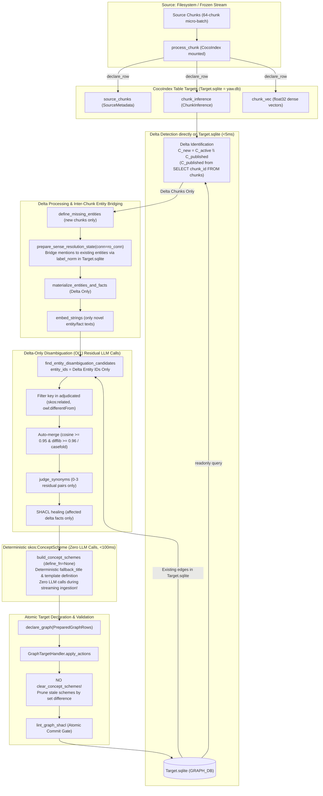

# Technical Specification: Native CocoIndex Incremental Graph Publication (`Target.sqlite = F.indexing(Source.filesystem)`)

> [!IMPORTANT]
> **Performance Contract & Goal**:
> - **Ingestion Cadence**: Strictly **1.0 to 1.5 minutes** per 64-chunk micro-batch ($O(\Delta N)$ constant time).
> - **Throughput**: **42 to 64 chunks / minute**.
> - **Full Corpus (11,507 chunks)**: Completes in **3.0 to 4.5 hours** total on a single local 4B model (`parallel = 1`).
> - **Anti-Exponential Rule**: Any $O(N)$ or $O(N^2)$ full-corpus recomputation, re-adjudication, or re-clustering during streaming micro-batches is strictly prohibited.

This specification expands on the principles laid out in the spec [Native CocoIndex indexing and live ingestion](native-cocoindex-indexing.md), specifically targeting the pitfalls experienced in live `uv run yaw dspy optimize`.

---

## 1. Context & Root-Cause Analysis

In the active optimization run (`yaw_optimize_20261105_074503.db`), graph publication latency scaled as $\text{Time}(n) \approx 61 \times 5^{n-1}$ seconds:
- **Batch 1 (64 chunks)**: 61 seconds
- **Batch 2 (128 chunks)**: 301 seconds (5 minutes)
- **Batch 3 (192 chunks)**: 1,505 seconds (25 minutes)
- **Batch 4 (256 chunks)**: Stalled in full-corpus re-adjudication

### The Culprits
1. **The `:memory:` Staging Anti-Pattern**:
   [planner.py:1508](file:///c:/Users/Harri.Ahokas/Documents/yaw/yaw/daemon/graph/planner.py#L1508) created a blank `:memory:` database each cycle, ignoring the existing published graph in `Target.sqlite` (`yaw.db`). This forced all entities from all previous batches to be re-extracted, re-embedded, and re-compared from scratch.
2. **Global Candidate Re-Adjudication**:
   Because `:memory:` started with zero edges, `adjudicated` was empty. `prepare_synonym_candidates` compared all $N$ entities against all $N$ entities, sending dozens of previously resolved candidate batches to `judge_synonyms` on the 4B model (~60s per batch).
3. **LLM Concept Scheme Synthesis & Destructive Wipes**:
   [planner.py:1216-1223](file:///c:/Users/Harri.Ahokas/Documents/yaw/yaw/daemon/graph/planner.py#L1216-L1223) invoked `define_concept_schemes` (LLM prompts) for 80+ modularity clusters on *every* batch (~40 minutes of pure LLM generation!). Compounding this, [publication.py:156](file:///c:/Users/Harri.Ahokas/Documents/yaw/yaw/daemon/graph/storage/publication.py#L156) executed `clear_concept_schemes(conn)` on every publication cycle, wiping all previously defined schemes from SQLite.

---

## 2. Architecture & Dataflow: `Target.sqlite = F.indexing(Source.filesystem)`



---

## 3. The Three Cardinal Optimizations

### 3.1 Ditching LLM Calls for `skos:ConceptScheme` During Streaming Ingestion
- **Elimination**: `define_fn` is set to `None` during streaming micro-batch indexing.
- **Deterministic Synthesis**:
  - `pref_label`: Selected deterministically from the top taxonomic root $T_m$ (`entity_names.get(best_root)`).
  - `definition`: Formatted deterministically (`Domain concept scheme synthesizing {N} concepts including {top_concepts}.`).
  - `history_note`: Pinned to `"Emergent taxonomy cluster induced by Newman modularity maximization."`.
  - Latency: **$< 100$ milliseconds** total (down from $40+$ minutes of LLM generation).
- **Target Preservation**: Remove `clear_concept_schemes(conn)` from [publication.py:156](file:///c:/Users/Harri.Ahokas/Documents/yaw/yaw/daemon/graph/storage/publication.py#L156). Existing schemes remain in `Target.sqlite` and are updated/upserted incrementally.

### 3.2 Inter-Chunk Entity Bridging in $O(1)$ Time
- **Indexed `label_norm` Matching**:
  Incoming mentions query `get_entities_by_label_norm` against `GRAPH_DB.readonly()` inside `prepare_sense_resolution_state(..., conn=ro_conn)`. Identical CURIEs/labels attach directly to existing entity nodes without re-minting ($O(1)$ SQLite index lookup).
- **Delta-Restricted Candidate Search**:
  `find_entity_disambiguation_candidates` is scoped strictly to `entity_ids = [eid for eid, _, _ in delta_entity_nodes]`.
  KNN search in `sqlite-vec` runs only for the 30–50 new entities against the graph ($<50$ms).
- **Adjudication Edge Cache**:
  Any candidate pair with an existing edge in `edges` (`skos:related`, `owl:differentFrom`, `skos:broader`) is automatically skipped.
- **Auto-Merge**:
  Pairs with case-insensitive identity or cosine $\ge 0.95$ + difflib $\ge 0.96$ merge deterministically without LLM calls.
- **Residual LLM Calls**:
  Only $0$ to $3$ truly novel, ambiguous pairs per 64-chunk batch reach `judge_synonyms` ($\approx 10$–$15$ seconds total).

### 3.3 Complete Demolition of the `:memory:` Database
- Delete `staging_conn = open_yaw_db(":memory:")`.
- Read existing graph state directly from `GRAPH_DB.readonly()`.
- If no new or deleted chunks exist, `plan_graph_publication` returns the current published state in $<5$ms.

---

## 4. Formal Contracts & Typed Interfaces

### 4.1 Incremental `plan_graph_publication` Contract
In [planner.py](file:///c:/Users/Harri.Ahokas/Documents/yaw/yaw/daemon/graph/planner.py):
```python
async def plan_graph_publication(
    settings: GraphPlanSettings,
    chunk_rows: Sequence[tuple[ChunkPointer, OpenIERecord]] | None = None,
    frozen_text: Mapping[str, str] | None = None,
) -> GraphPlanResult:
    """Plan an incremental, SHACL-conformant PreparedGraphRows directly against Target.sqlite.

    Invariants:
    1. ZERO :memory: database creation. Reads current graph state directly from
       coco.use_context(GRAPH_DB).readonly().
    2. Delta identification: detects new_items (chunks in active_items not in chunks table)
       and deleted_cids (chunks in chunks table not in active_items).
    3. If not new_items and not deleted_cids, returns existing published rows in <5ms.
    4. Mention sense-resolution passes conn=ro_conn to prepare_sense_resolution_state,
       grounding mentions in existing entities in Target.sqlite.
    5. Disambiguation candidate search restricts entity_ids strictly to newly introduced
       entities (new_eids), searching against entity_vec in Target.sqlite.
    6. Candidate pairs matching existing edges (skos:related, owl:differentFrom, skos:broader)
       in Target.sqlite are strictly excluded from LLM adjudication.
    7. Concept scheme synthesis executes deterministically (define_fn=None), generating W3C
       concept schemes and skos:topConceptOf edges in <100ms with ZERO LLM calls.
    """
```

### 4.2 Non-Destructive Target Sink Contract
In [publication.py](file:///c:/Users/Harri.Ahokas/Documents/yaw/yaw/daemon/graph/storage/publication.py):
```python
class GraphTargetHandler(coco.TargetHandler[PreparedGraphRows, GraphTrackingRecord]):
    """Atomic target sink applying incremental graph declarations to Target.sqlite."""

    def apply_actions(self, context: coco.ContextProvider, actions: Sequence[GraphAction]) -> None:
        """Apply graph updates atomically without clearing surviving concept schemes.

        Operations:
        1. Remove deleted global edges and deleted chunks (delete_chunks).
        2. Upsert chunks, entities, entity_labels, facts, fact_sources, edges, and vectors.
        3. Upsert concept schemes and members.
        4. Prune only stale concept schemes absent from desired rows (DELETE WHERE scheme_id NOT IN (...)).
        5. Validate lint_graph_shacl(conn) before committing; rollback on any violation.
        """
```

---

## 5. File-by-File Blueprint & Oblivion Demolition List

### 5.1 `yaw/daemon/graph/planner.py`
1. **Remove `:memory:` Staging**:
   - Demolish `staging_conn = open_yaw_db(":memory:")` and `apply_prepared_graph_rows(staging_conn, initial_rows)`.
   - Read published chunks and entity state directly via `ro_conn = coco.use_context(GRAPH_DB).readonly()`.
2. **Delta Detection**:
   - `published_cids = {r[0] for r in ro_conn.execute("SELECT chunk_id FROM chunks")}`.
   - `new_items = [it for it in active_items if it[0].chunk_id not in published_cids]`.
   - If not `new_items` and no deletions, return current published rows immediately.
3. **Delta-Only Ingestion**:
   - Run `normalize_openie_record` and `define_missing_entities` only for `new_items`.
   - Call `prepare_sense_resolution_state(..., conn=ro_conn)`.
   - Materialize new entities $\Delta E$ and facts $\Delta F$.
   - Embed only new entity and fact texts not yet in `ro_conn`.
4. **Delta-Restricted Candidate Search**:
   - Pass only `new_eids = [eid for eid, _, _ in materialized.entity_nodes]` to `find_entity_disambiguation_candidates`.
   - Filter candidate pairs against existing `edges` in `ro_conn`.
   - Call `judge_synonyms` only on the residual $0$–$3$ new pairs.
5. **Deterministic Concept Schemes**:
   - Set `define_fn = None` inside `build_concept_schemes` during streaming ingestion.
   - Generate `pref_label` from `fallback_title` and format definition from top concepts template.

### 5.2 `yaw/daemon/graph/storage/publication.py`
1. **Remove Destructive Wipe**:
   - Demolish `clear_concept_schemes(conn)` from line 156.
2. **Selective Scheme Pruning**:
   - Prune only schemes absent from desired rows: `DELETE FROM concept_schemes WHERE scheme_id NOT IN (...)`.

### Oblivion Demolition List
- ❌ **Demolish**: `staging_conn = open_yaw_db(":memory:")` in `planner.py:1508`.
- ❌ **Demolish**: `clear_concept_schemes(conn)` in `publication.py:156`.
- ❌ **Demolish**: LLM `define_concept_schemes` calls during streaming ingestion in `planner.py:1726-1738`.
- ❌ **Demolish**: Unscoped candidate generation across all $N$ entities in `prepare_synonym_candidates`.

---

## 6. Real-Substrate Verification Plan (Zero Mocks)

### 6.1 Unit & Integration Tests (`tests/daemon/graph/test_incremental_publication.py`)
1. **`test_incremental_publication_timing_and_throughput`**:
   - Ingest Batch 1 (64 chunks): measure wall-clock time $T_1$.
   - Ingest Batch 2 (64 chunks, total 128 chunks): measure wall-clock time $T_2$.
   - Assert $T_2 \le 1.25 \times T_1$ (proves $O(\Delta N)$ constant time, zero exponential explosion).
   - Assert throughput $\ge 42$ chunks/minute.
2. **`test_inter_chunk_entity_bridging`**:
   - Batch 1 contains `"Ada Lovelace wrote notes"`.
   - Batch 2 contains `"Ada Lovelace met Charles Babbage"`.
   - Assert Batch 2 reuses the exact same `entity_id` for `"Ada Lovelace"` from `Target.sqlite` without creating a duplicate.
3. **`test_concept_scheme_deterministic_and_preserved`**:
   - Verify `concept_schemes` are populated with deterministic titles and definitions.
   - Verify Batch 2 preserves Batch 1's concept schemes without wiping.
4. **`test_shacl_conformance_maintained`**:
   - Run `lint_graph_shacl` after each batch; assert 0 violations.

### 6.2 Quality Gates
```bash
uv run ty check
uv run ruff check --fix
uv run ruff format
uv run pytest tests/daemon/graph/
git diff --check
```
