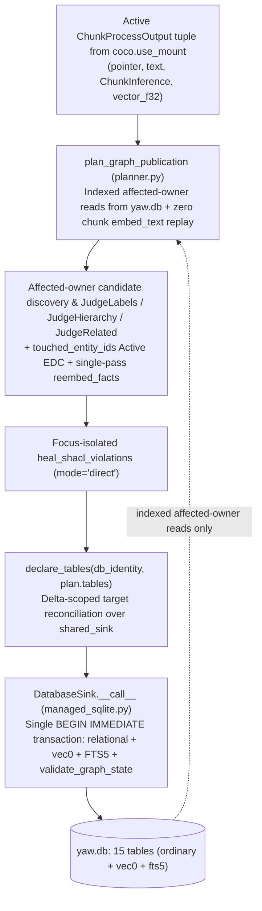

# Native CocoIndex graph: batch-independent incremental publication

Status: active, 2026-11-09. Pinned code: `28a1113`.

- Controls: [types.py](../yaw/core/types.py), [__init__.py](../yaw/core/__init__.py), [config.py](../yaw/core/config.py), [planner.py](../yaw/daemon/graph/planner.py), [normalization.py](../yaw/daemon/graph/normalization.py), [engine.py](../yaw/daemon/graph/engine.py), [ppr.py](../yaw/daemon/graph/ppr.py), [prompts.py](../yaw/daemon/graph/inference/prompts.py), [grammars.py](../yaw/daemon/graph/inference/grammars.py), [adapter.py](../yaw/daemon/graph/inference/adapter.py), [parsers.py](../yaw/daemon/graph/inference/parsers.py), [program.py](../yaw/daemon/graph/inference/program.py), [invariants.py](../yaw/daemon/graph/inference/invariants.py), [components.py](../yaw/daemon/graph/inference/components.py), [evidence.py](../yaw/daemon/graph/storage/evidence.py), [graph_ops.py](../yaw/daemon/graph/storage/graph_ops.py), [shacl.py](../yaw/daemon/graph/storage/shacl.py), [rows.py](../yaw/daemon/graph/storage/rows.py), [synonyms.py](../yaw/daemon/graph/storage/synonyms.py), [__init__.py](../yaw/daemon/graph/storage/__init__.py), [indexing.py](../yaw/daemon/indexing.py), [runtime.py](../yaw/daemon/runtime.py) ([test_architecture.py](../tests/core/test_architecture.py))
- Depends on: [FOUNDATIONAL.md](../FOUNDATIONAL.md), [AGENTS.md](../AGENTS.md), [graph-storage.md](../.agents/rules/graph-storage.md), [daemon.md](../.agents/rules/daemon.md), [inference.md](../.agents/rules/inference.md), [w3c-improvements.md](w3c-improvements.md), [epistemic-confidence-spec.md](epistemic-confidence-spec.md)
- Updated with: [w3c-improvements.md](w3c-improvements.md), [native-cocoindex-graph.md](native-cocoindex-graph.md), [epistemic-confidence-spec.md](epistemic-confidence-spec.md), [shacl-healer-publication.md](reviews/shacl-healer-publication.md), [incremental-publication-work.md](reviews/incremental-publication-work.md)

| Relation | Links |
| --- | --- |
| Governed by | [FOUNDATIONAL.md](../FOUNDATIONAL.md), [AGENTS.md](../AGENTS.md), [epic-1-hipporag-daemon.md](epic-1-hipporag-daemon.md) |
| Rules | [graph-storage.md](../.agents/rules/graph-storage.md): `yaw/daemon/graph/*.py`, `yaw/daemon/graph/storage/*.py`; [daemon.md](../.agents/rules/daemon.md): `yaw/daemon/*.py`; [inference.md](../.agents/rules/inference.md): `yaw/daemon/graph/inference/*.py`; [tests.md](../.agents/rules/tests.md): `tests/**/*.py`; [docs.md](../.agents/rules/docs.md): `docs/**/*.md` |
| Owns code | `yaw/daemon/graph/planner.py`, `yaw/daemon/graph/normalization.py`, `yaw/daemon/graph/engine.py`, `yaw/daemon/graph/ppr.py`, `yaw/daemon/graph/storage/chunks.py`, `yaw/daemon/graph/storage/db.py`, `yaw/daemon/graph/storage/evidence.py`, `yaw/daemon/graph/storage/graph_ops.py` (except `canonicalize_entity_labels_edc`), `yaw/daemon/graph/storage/hydration.py`, `yaw/daemon/graph/storage/managed_sqlite.py`, `yaw/daemon/graph/storage/rows.py`, `yaw/daemon/graph/storage/shacl.py`, `yaw/daemon/graph/storage/vectors.py`, `yaw/daemon/graph/inference/components.py` (`define_missing_entities`, `judge_synonyms`, `heal_shacl_violations`) |
| Peers | [native-cocoindex-indexing.md](native-cocoindex-indexing.md): owns `64`-chunk `[target]` micro-batch source scheduling (`FROZEN_CHUNKS`), `@coco.fn(memo=True, version=1)` mounted `process_file`/`process_frozen_chunk` components, `publish_graph` component mounting, shared `<state_dir>/coco_lmdb` lifecycle (`acquire_coco_environment`), and direct `ChunkProcessOutput` `coco.use_mount` handoff; [w3c-improvements.md](w3c-improvements.md): owns `yaw/daemon/graph/storage/synonyms.py` and `yaw/daemon/graph/storage/graph_ops.py:canonicalize_entity_labels_edc` (`§3.2`, `§§12–13`) and constrains SKOS/OWL/SHACL closed-world shapes (`W1`–`W5`); [epistemic-confidence-spec.md](epistemic-confidence-spec.md): constrains Bayesian confidence pooling and `1`-hop S27 healing; [dspy-improvements.md](dspy-improvements.md): constrains GBNF adapter and RLM healer architecture; [Epic 3](epic-3-performance.md): owns post-Epic 2 W3C symbolic distractor pruning, vectorized CSR construction, and full-corpus scaling under the `64+64` vs. `128` `[target]` invariance contract |
| References | [arxiv-2502.14802v1-hipporag2.md](arxiv-2502.14802v1-hipporag2.md): anchors HippoRAG 2 retrieval parity; [model-evaluation.md](model-evaluation.md): anchors local `llama.cpp` serving constraints (`parallel = 1` `[target]`) |
| Supersedes / superseded by | Supersedes all earlier `skos:ConceptScheme` / clustering proposals, the single-batch unconditional `canonicalize_fact_definitions` overwrite in [shacl-healer-publication.md](reviews/shacl-healer-publication.md) (`c6fa080`), the `§5.1/§9.1` per-chunk `chunk_vec` target declaration split (`c6fa080`), the `§9.1 C3` exemption retaining `CandidateStageCache` (`c6fa080`), the `2026-11-07` Tier 3 invalid-assertion `spo_def` fallback (`50be17d`, superseded on `2026-11-08` by Tier 3 deterministic synthesis `W4`), cross-module `target._provider` access in `rows.py` (`28a1113`), and `out.inference.extraction_json` coupling in `meta['graph_input_fingerprints']` (`28a1113`) |
| Records | [shacl-healer-publication.md](reviews/shacl-healer-publication.md), [incremental-publication-work.md](reviews/incremental-publication-work.md), [resource-vocabulary-boundary.md](reviews/resource-vocabulary-boundary.md), [concept-scheme-removal.md](reviews/concept-scheme-removal.md), [evaluation-graph-storage.md](evaluation-graph-storage.md), [evaluation-ingestion.md](evaluation-ingestion.md) |

## 1. Scope

In scope: Documentation contract for batch-independent canonical entity/fact/edge identity, resource-vs-literal W3C boundaries, focus-isolated SHACL repair (`heal_shacl_violations`), affected-owner incremental graph planning without `:memory:` cloning or full-table survivor `SELECT *` hydration, input-only `meta['graph_input_fingerprints']` digests (`fingerprint_object((settings, out.pointer, out.text)).hex()`), single-component atomic `DatabaseSink` target reconciliation (`RowHandler.tracks_value_fingerprint = True`, `ManagedTableTarget.delete_row`), `db_identity`-scoped target state tracking, `sqlite-vec` `vec0` virtual table storage (`chunk_vec`, `entity_vec`, `fact_vec`), retirement of `CandidateStageCache` / `candidate_stage_cache`, sparse CSR Personalized PageRank (PPR), and the paired `64 + 64` vs. `128` `[target]` acceptance gate.

Non-goals: Source file discovery, `localfs.walk_dir` scheduling, and runtime worker thread lifecycle (owned by [native-cocoindex-indexing.md](native-cocoindex-indexing.md)); `skos:ConceptScheme` nodes, tables, clustering, or traversal (permanently removed); adding new third-party dependencies beyond locked `cocoindex == 1.1.0` `[measured: uv.lock:330-331, 28a1113]` and `sqlite-vec == 0.1.9` `[measured: uv.lock:2221-2222, 28a1113]`; restarting live processes during this specification turn.

Depends on decisions: [2026-11-06: two-stage NER resource vocabulary & literal object boundary](#decisions), [2026-11-06: Step 4 atomic units](#decisions), [2026-11-07: validity-ordered repair-preserving fact definitions & focus-isolated SHACL healing](#decisions), [2026-11-07: direct pre-hydrated `shacl_repair` dispatch](#decisions), [2026-11-07: remedy gaps 1–5 across indexing and graph specs](#decisions), [2026-11-08: W3C ontology simplification](#decisions), [2026-11-09: ManagedTableTarget.delete_row & input-only graph_input_fingerprints](#decisions), [native-cocoindex-indexing.md decisions](native-cocoindex-indexing.md#decisions).

## 2. Problem, with evidence

Following the resolution of `50be17d` Gaps 1–5 (recorded in [incremental-publication-work.md](reviews/incremental-publication-work.md)), audit of pinned commit `28a1113` identified `2` `[observed: yaw/daemon/graph/storage/rows.py:333, yaw/daemon/graph/planner.py:853-856, 28a1113]` remaining graph-storage and planner defects (Anti-Pattern 6 and the planner half of Anti-Pattern 1; see [native-cocoindex-indexing.md §2](native-cocoindex-indexing.md#2-problem-with-evidence) for Anti-Patterns 1–5):

- **Anti-Pattern 6 (Cross-Module Private Attribute Breach — `target._provider`)**:
  - `yaw/daemon/graph/storage/rows.py:declare_tables` (`L333` at `28a1113`) executes `coco.declare_target_state(target._provider.target_state(key, DELETE_ROW))`, reaching directly into `sqlite.TableTarget`'s private `_provider` attribute across module boundaries `[observed: yaw/daemon/graph/storage/rows.py:333, 28a1113]`.
- **Anti-Pattern 1 Planner Coupling (`out.inference.extraction_json` inside `meta['graph_input_fingerprints']`)**:
  - `yaw/daemon/graph/planner.py:plan_graph_publication` (`L853–856` at `28a1113`) computes `input_fingerprints = {out.chunk_id: fingerprint_object((settings, out.pointer, out.text, out.inference.extraction_json)).hex() for out in ordered_outputs}` `[observed: yaw/daemon/graph/planner.py:853-856, 28a1113]`. Because `extract_text(OpenIEInput(chunk_id, passage, settings.program_identity))` is a deterministic function of `(text, settings.program_identity)`, including `out.inference.extraction_json` in `meta['graph_input_fingerprints']` forces `bind_native_indexing` (`yaw/daemon/indexing.py:452–475` at `28a1113`) to join `source_chunks` and `chunk_inference` from SQLite just to check whether a chunk is already published.

Historical `50be17d` Gaps 1–5 (resolved in Checkpoints `C1–C5`, `G4-VEC0`, `I2 & G3/G4/U5/P1`, `U3/P3–P4 & I4/G5–G6`):

- **Gap 1 (Contradiction between partial per-owner target declarations and single-component `TargetActionSink` atomicity + `chunk_vec` replay)**:
  - `yaw/daemon/graph/planner.py:plan_graph_publication` (`L1099–1127` at `50be17d`) rebuilds `EmbeddingRequest` via `_prepare_embed_req` and re-invokes `embed_text` for every active chunk to populate `chunk_vec` because `process_chunk` discarded `EmbeddedText.vector_f32` `[observed: yaw/daemon/indexing.py:316-319, yaw/daemon/graph/planner.py:1099-1127, 50be17d]`.
  - Earlier sections of this spec proposed moving `chunk_vec` declaration into `process_chunk` and having `publish_graph` omit unaffected survivor rows from `declare_tables`. In `cocoindex == 1.1.0`, target row ownership (`owner_component_path: StablePath`) is tracked per mounted component (`cocoindex/_internal/target_state.py:614–629`), and non-mounted `@coco.fn(memo=True)` cache hits only call `join_cached_target_provider_deps` without replaying child `declare_target_state` calls (`cocoindex/_internal/function.py:891–910, 1493–1512`) `[observed: cocoindex/_internal/target_state.py:614-629, function.py:1493-1512, cocoindex 1.1.0]`. Consequently, declaring only affected rows in `publish_graph` causes CocoIndex to reconcile every omitted survivor primary key as `coco.NON_EXISTENCE` (`target_state.py:324–335`) and delete all prior-batch rows, while moving `chunk_vec` to `process_chunk` commits `chunk_vec` outside `DatabaseSink.__call__`'s single SQLite transaction (`yaw/daemon/graph/storage/managed_sqlite.py:75–112` at `50be17d`).
- **Gap 2 (Unscoped `TABLES.target_state` table keys across candidate DBs)**:
  - `yaw/daemon/graph/storage/managed_sqlite.py:mount_table` (`L183–197` at `50be17d`) calls `TABLES.target_state(name, spec)` (`L195` at `50be17d`) keyed solely by `name: str` (e.g., `"chunks"`, `"entities"`) `[observed: yaw/daemon/graph/storage/managed_sqlite.py:180-197, 50be17d]`. When `2` `[target]` SQLite databases share a persistent CocoIndex `Environment` (`<state_dir>/coco_lmdb`), LMDB treats rows tracked for Database A as already present in Database B, skipping `INSERT`/`UPSERT` on unchanged fingerprints and issuing `DELETE` actions on Database B for keys absent from Database B's slice `[observed: cocoindex/_internal/target_state.py:310-335, cocoindex 1.1.0]`.
- **Gap 3 (Planner SQLite polling via `load_active_chunk_inferences` & full-graph `:memory:` cloning via `clone_graph_to_memory`)**:
  - `yaw/daemon/graph/planner.py:load_active_chunk_inferences` (`L203–263`, called at `L1026` at `50be17d`) executes `SELECT ... FROM source_chunks JOIN chunk_inference` from SQLite and re-hydrates all source passages on every batch instead of consuming typed `ChunkProcessOutput` records directly from `publish_graph` `[observed: yaw/daemon/graph/planner.py:203-263, 1026, 50be17d]`.
  - `yaw/daemon/graph/planner.py:clone_graph_to_memory` (`L266–301`, called at `L1233` at `50be17d`) copies all `12` `[observed: yaw/daemon/graph/storage/rows.py:121-134, 50be17d]` `GRAPH_TABLES` into a fresh `:memory:` SQLite connection on every incremental batch, and `yaw/daemon/graph/storage/rows.py:graph_tables` (`L137–162` at `50be17d`) runs `SELECT *` across all `12` `[observed: yaw/daemon/graph/storage/rows.py:137-162, 50be17d]` tables from `:memory:`.
- **Gap 4 (`chunk_vec`, `entity_vec`, and `fact_vec` implemented as ordinary `BLOB` tables instead of `sqlite-vec` `vec0` virtual tables)**:
  - `yaw/daemon/graph/storage/db.py` (`L147–163` at `50be17d`), `yaw/daemon/graph/storage/managed_sqlite.py:_create_table` (`L50–70` at `50be17d`), and `yaw/daemon/graph/storage/rows.py` (`L81–94, 129–131` at `50be17d`) create ordinary `CREATE TABLE IF NOT EXISTS ... (<pk> TEXT PRIMARY KEY, embedding BLOB NOT NULL)` tables with `0` `[observed: yaw/daemon/graph/storage/managed_sqlite.py:50-70, 50be17d]` `USING vec0(...)` branches.
  - `yaw/daemon/graph/storage/vectors.py:_search_knn` (`L105–128` at `50be17d`) and `yaw/daemon/graph/storage/graph_ops.py:find_entity_synonym_candidates` (`L104–117` at `50be17d`) execute full-table scalar scans (`SELECT ..., vec_distance_cosine(embedding, ?) AS dist FROM ...`), and `yaw/daemon/graph/storage/graph_ops.py:rekey_facts` (`L1018–1023` at `50be17d`) uses `ON CONFLICT(fact_id) DO UPDATE`, which SQLite virtual tables (`vec0`) reject `[observed: yaw/daemon/graph/storage/vectors.py:105-128, graph_ops.py:104-117, 1018-1023, 50be17d]`.
- **Gap 5 (Triple-redundant caching across CocoIndex LMDB, `CandidateStageCache` / `candidate_stage_cache`, and `.yaw/dspy_cache`)**:
  - `yaw/daemon/graph/storage/candidate_cache.py` (`L1–321` at `50be17d`) maintains a `256 MiB` (`256 * 1024 * 1024` bytes `[observed: yaw/daemon/graph/storage/candidate_cache.py:263, 50be17d]`) SQLite table `candidate_stage_cache` + `candidate_cache_size` (`L33–61` at `50be17d`), `CandidatePayloadCodec` (`L227–246` at `50be17d`), and `CandidateStageCache` (`L248–321` at `50be17d`) alongside CocoIndex LMDB (`TABLES.memoization`) and DSPy's `.yaw/dspy_cache` (`FanoutCache`). At `50be17d`, `CandidateStageCache` is only called for query-time `_text_vec_cache` (`yaw/daemon/graph/engine.py:211, 737, 747` at `50be17d`) and SIMBA `open_score_cache` / `open_checkpoint_cache` (`yaw/daemon/graph/engine.py:1573–1585`, `yaw/daemon/graph/inference/optimizer.py:203–204, 787–846` at `50be17d`, where active reflection state is already persisted in `yaw.db`'s `meta` table at `optimizer.py:826–865` at `50be17d`).
- **Remaining dead-code & migration debt (`C1`, `C2`, `C4`)**: `yaw/daemon/graph/engine.py` retains dead helpers (`_attempted_shacl_keys`, `_graph_cache_context`, `_encode_in_batches`, `_apply_shacl_repairs`); `yaw/daemon/graph/inference/program.py` (`L966, 1001–1002, 1098–1099, 1112, 1179, 1208, 1259` at `50be17d`) retains unused `stage_cache`/`stage_caches` arguments; and `yaw/daemon/graph/storage/db.py` retains legacy `ALTER TABLE` migration/backfill branches (`migrate_edges_reasoning`, `migrate_epistemic_confidence_columns`, `_entities_migrated`, `_facts_migrated`, `_edges_migrated`) `[observed: yaw/daemon/graph/storage/db.py, engine.py, program.py:966-1259, 50be17d]`.

## 3. Goals

### Goal A: Comparable cumulative compute for `64 + 64` vs. `128` chunks
- **Measure**: End-to-end wall time $T_I = T_{\text{first64}} + T_{\text{second64}} + T_{\text{outstanding\_semantics}}$ vs. $T_R = T_{\text{all128}}$, graph-planning-through-publication critical-path wall time $T_{\text{graph},I}$ vs. $T_{\text{graph},R}$ (excluding chunk extraction and chunk embedding), process CPU seconds, provider call/token counts, SQLite rows read and written per table, and whole-worker peak resident memory (RSS) across `>= 20` `[target]` paired fixed-evidence trials and `>= 5` `[target]` paired real-model trials with alternated arm order.
- **Reference**: Reference arm $R$ publishing the identical `128`-chunk `[target]` snapshot $S$ against the identical initial base graph $B$ in a single publication boundary, with identical `Semaphore(1)` (`parallel = 1` `[target]`) LLM admission and `<= 64` `[target]` embedding batch size.
- **Passes when**:
  - $0.80 \le R_{\text{time}} = \text{median}(T_I) / \text{median}(T_R) \le 1.25$ `[target]` and $0.80 \le R_{\text{graph}} = \text{median}(T_{\text{graph},I}) / \text{median}(T_{\text{graph},R}) \le 1.25$ `[target]` in both cold-memo and warm-memo scenarios (`R_time = 1.0909` `[measured: outputs/benchmarks/batch_equivalence_c4.xml, c6fa080, n=1, loopback deterministic fixture, warm memo]`, `R_time = 1.1270` `[measured: outputs/benchmarks/batch_equivalence_c4.xml, c6fa080, n=1, loopback deterministic fixture, restart-between-batches]`, and across the `20`-trial `[measured: outputs/benchmarks/g5_g6_acceptance.json, c98aebe]` paired acceptance suite: `R_time median = 1.1422` and `R_graph median = 1.0964` `[measured: outputs/benchmarks/g5_g6_acceptance.json, c98aebe, n=20]`).
  - Unchanged first-batch chunks (`S[0:64]`) incur `0` `[target]` additional `extract_text`, `embed_text`, or `define_missing_entities` calls and `0` `[target]` SQLite row writes during the second batch (`S[64:128]`), and unaffected base-graph ($B$) entities/facts are not hydrated via full-table `SELECT *` into Python.
  - Whole-worker peak resident memory stays `<= 1 GiB` `[target]`.
- **Fails if / does not count**:
  - Comparing only `T_second64` against `T_R`, or running $R$ cold and $I$ against $R$'s newly warmed memo.
  - Reference arm $R$ secretly delegates to `64 + 64` `[target]` internally.
  - Replacing `clone_graph_to_memory` / `sqlite3.Connection.backup()` with full-table `SELECT *` survivor hydration into Python lists/dicts (`rows.py:graph_tables`) so that every `64`-chunk `[target]` batch still reads and hashes all $O(|G|)$ existing graph rows.
  - Triggering a full-table snapshot re-plan inside `plan_graph_publication` when `incremental` is true.
  - Replaying `embed_text` for chunk vectors in `planner.py`, or allocating dense $N \times N$ (`100,000` $\times$ `100,000` float32 = `37.3 GiB` `[measured: arithmetic]`) score matrices.
  - Skipping or narrowing `lint_graph_shacl` validation without proving affected-closure equivalence.

### Goal B: Exact batch-independent canonical graph (`64 + 64` == `128`)
- **Measure**: Canonical entity count, fact count, counts by edge kind (`fact`, `skos:broader`, `skos:related`, `owl:differentFrom`), canonical sense ID sets, occurrence-to-entity bindings (`entity_mentions`), fact semantic keys and assertion bindings (`fact_assertions`), `entity_labels` (`skos:prefLabel`, `skos:altLabel`, `skos:hiddenLabel`), `vec0` keys/bytes (`chunk_vec`, `entity_vec`, `fact_vec`), FTS5 rowids (`chunk_fts`, `fact_fts`), and aggregated epistemic confidences.
- **Reference**: Canonical `15`-table `[target]` SQLite state produced by Reference arm $R$ (`canonical_graph(R(B, all128))`).
- **Passes when**:
  - **Fixed-evidence harness (including entity count $> \text{top\_k}$ `[target]`)**: `canonical_graph(I(B, first64, last64)) == canonical_graph(R(B, all128))` with `0` `[target]` difference in entity, fact, and per-kind edge counts, `100%` `[target]` exact set equality on canonical IDs, bindings, labels, vectors, and FTS rows, and `<= 1e-6` `[target]` numeric difference on pooled confidence floats.
  - **Live stochastic model trials (`>= 5` `[target]` paired runs)**: Entity, fact, and per-kind edge count differences `<= 2%` `[target]` relative to `max(1, reference_count)`, set Jaccard `>= 0.98` `[target]` for canonical entities, facts, and edges individually, and `0` `[target]` missing required bridge facts or false homograph merges.
- **Fails if / does not count**:
  - Executing a hidden full-corpus rebuild on the final batch to make outputs match, or triggering a full-table snapshot re-plan inside `plan_graph_publication` when `incremental` is true.
  - Executing raw `conn.execute("DELETE FROM ...")` in `rows.py` to bypass `target._provider` instead of declaring `DELETE_ROW` through `ManagedTableTarget.delete_row(key)`.
  - Testing candidate equivalence only on fixtures where total entities $\le \text{top\_k}$ (which hides asymmetric KNN top-$k$ eviction and reverse-neighbor invalidation).
  - Graph isomorphism up to renamed IDs (canonical IDs themselves must match).
  - Row-count equality alone while canonical sets or provenance bindings differ.

Thresholds are not loosened after seeing a run.

## 4. Semantics and invariants

<a id="52-batch-independent-identity-and-candidate-discovery"></a>
<a id="53-resource-vocabulary-and-statement-boundary"></a>

- **Equality and batch-independent identity**:
  - **Resource sense identity & single-surface `skos:prefLabel`**: Keyed deterministically by `(text_processing(label), resolved_definition)`. `clean_surface_label(raw: str) -> str` (`yaw/core/types.py`, exported in `yaw/core/__init__.py`) strips leading/trailing clause punctuation (`:;,`), and `preferred_surface` ranks display forms by `(text_processing(value) == label_norm, value != value.lower(), -len(value), value)`. `canonicalize_entity_labels_edc`, `upsert_entity_labels`, and `upsert_entities` align `raw_label = winning_raw` across all `skos:prefLabel` rows of an entity so every `skos:Concept` has `1` `[target]` distinct `skos:prefLabel` lexical string in `entity_labels` and W3C Turtle output. An accepted equivalence class selects its minimum surviving member sense ID (`MIN(sense_id)`) as the canonical representative, never first-seen arrival order. When a smaller representative arrives in a later batch, `bind_merged_evidence` and `rekey_facts` rewrite affected `entity_mentions`, `fact_assertions`, `facts`, `fact_sources`, `edges`, `edge_sources`, `entity_vec`, and `fact_vec` atomically while preserving raw occurrence fields (`raw_entity_id`, `raw_sub_id`, `raw_obj_id`).
  - **Same-norm pre-consolidation only (`W2`) & strict `JudgeLabels` equivalence (`W1`)**: `prepare_synonym_candidates` pre-consolidates $(A, B)$ before LLM adjudication if and only if $\text{text\_processing}(\text{name}_A) = \text{text\_processing}(\text{name}_B) \land d_{\text{sim}}(A, B) \ge \tau_{\text{syn}} \land \neg\text{is\_active\_fact\_pole}(A, B)$. Cross-label Python auto-merge gates (`auto_merge_cosine_gate`, `auto_merge_difflib_gate`) and post-hoc Python token overrides (`_is_acronym`, `is_modifier_head_specialization`, `_has_disjoint_non_acronym_tokens`) are retired from `planner.py`. Cross-label candidate pairs advance to `JudgeLabels` (`@coco.fn(memo=True, version=2)`, `gbnf_max_reasoning_chars = 360` `[target]`), which merges $(A, B)$ iff `equivalent: true` and routes all `equivalent: false` pairs to `JudgeHierarchy`.
  - **Reverse top-$k$ candidate completeness**: Candidate discovery across `find_entity_disambiguation_candidates` and `find_entity_synonym_candidates` must produce the identical candidate pair set for `64 + 64` `[target]` and `128` `[target]` even when total entities exceed `top_k` (`> 10` `[target]` entities in a shared subspace), accounting for new Batch 2 entities entering an existing Batch 1 entity's top-$k$ neighborhood or invalidating a prior neighborhood boundary.
  - **Fact semantic key & universal statement irreflexivity (`W3`)**: Derived from `(canonical_sub_id, original_predicate, obj_kind, canonical_obj_id_or_literal_value, literal_datatype, literal_lang)`. Equal lexical strings with different datatypes or languages remain distinct facts. `is_irreflexive_statement` (`yaw/core/types.py`, exported in `yaw/core/__init__.py`) enforces statement irreflexivity across both `entity` and `literal` objects ($\text{text\_processing}(\text{subj}) = \text{text\_processing}(\text{obj})$ or $\text{obj\_kind} = \text{'literal'} \land \text{text\_processing}(\text{pred}) = \text{text\_processing}(\text{subj\_def})$) across `build_evidence`, `materialize_entities_and_facts`, `rekey_facts`, `validate_stage_invariants("triples")`, `StatementShape/irreflexive`, and `auto_heal_deterministic_shacl`. Collapsed or pseudo-reflexive entity and literal assertions retain their raw `fact_assertions` row with `fact_id = NULL`.
  - **Validity-ordered, repair-preserving `canonicalize_fact_definitions` with Tier 3 deterministic synthesis (`W4`)**: For each fact $f$ with subject definition `es.definition` and (when `obj_kind == 'entity'`) object definition `eo.definition`, a candidate definition $d$ satisfies `valid_spo_def(d, f)` iff `trim(d) != ''`, `lower(trim(d)) != lower(trim(es.definition))`, and (when `obj_kind == 'entity'`) `lower(trim(d)) != lower(trim(eo.definition))`. `canonicalize_fact_definitions(conn, prior_definitions=prior_fact_definitions)` propagates `prior_fact_definitions` across `merged.fact_bindings` and selects $d^*(f)$ by `3`-tier `[target]` precedence (resolving endpoint-duplicating or empty `spo_def` values with `0` `[target]` `heal_shacl_violations` LLM calls while keeping `fact_assertions.raw_json` immutable):
    1. **Tier 1 (Valid Source Assertion)**: Closed-world valid `fact_assertions` row with `MIN(assertion_id)`.
    2. **Tier 2 (Valid Prior / Current Repair)**: Closed-world valid `prior_definitions[fact_id]` (or `f.definition` for newly created facts) tested against current `es.definition` and `eo.definition`.
    3. **Tier 3 (Deterministic Canonical Synthesis)**: `synth_def = f"{es.name} {f.pred} {eo.name if f.obj_kind == 'entity' else f.obj_literal_lex}.".strip()` when `valid_spo_def(synth_def, f)` holds (and `f"{synth_def[:-1]} (statement)."` if `synth_def` itself collides with `es.definition` or `eo.definition`).
  - **Non-transitive `1`-hop `skos:broader` S27 disjointness & post-repair auto-healing (`W5`)**: Under W3C SKOS (`03-SEMANTIC-RELATIONS.md:45-59`), `skos:broader` is strictly `1`-hop non-transitive (`query_broader_tc`, `broader_tc`, and `ConceptShape/broaderTransitiveCapExceeded` are retired). `ConceptShape/S27-disjointBroaderRelated` enforces direct `1`-hop disjointness between `skos:broader` and `skos:related`, `ConceptShape/broaderCycle` heals overlapping cycles via a bounded fixed-point loop (`for _ in range(16)`), and `plan_graph_publication` re-runs `auto_heal_deterministic_shacl(staging_conn)` immediately after `apply_shacl_repairs(staging_conn, repairs, merge_entities_fn=merge_repaired_entities)` so any post-merge cycle, `1`-hop S27, or irreflexive collision is deterministically healed before `validate_graph_state`.
  - **Three-layer resource vocabulary and statement boundary**:

| Rule | GBNF (prevents generation) | Parser (rejects, fail fast) | SHACL (rejects published state) |
| --- | --- | --- | --- |
| Resource label has lexical content (`>= 1` `[target]` letter; bounded `char{1,512}` `[target]`) | NER `label` rule & SHACL `set_pref_label` `label` rule | NER stage & `parse_shacl_repairs` raise `ValueError` | `ConceptShape/resourceLabel` & `ConceptShape/noScalarLiterals` |
| Property type matches object kind (`owl:ObjectProperty` vs. `owl:DatatypeProperty`) | `pred-obj` coupling | Statement parser raises `ValueError` | `StatementShape/closedWorld` |
| `rdf:subject` and resource `rdf:object` belong to chunk NER catalog (`<= 40` `[target]` entities/triples per chunk) | `known-entity` endpoints | Statement parser raises `ValueError` | `StatementShape/closedWorld` |
| Statements are strictly irreflexive per resource sense (and non-reflexive on literals, `W3`) | Per-subject object alternatives (entity slots) | Statement parser raises `ValueError` on entity self-loops; `build_evidence` / `materialize_entities_and_facts` filter literal self-loops (`fact_id = NULL`) | `StatementShape/irreflexive` (entity and literal objects) |

- **State and cache ownership**:

| State | Single owner |
| --- | --- |
| `12` `[target]` relational/vector `GRAPH_TABLES` (`chunks`, `entities`, `entity_labels`, `facts`, `fact_sources`, `edges`, `edge_sources`, `chunk_vec`, `entity_vec`, `fact_vec`, `entity_mentions`, `fact_assertions`) + `chunk_fts` + `fact_fts` + `meta` (`15` `[target]` tables total) | Single `publish_graph` component (`yaw/daemon/indexing.py`) writing via `shared_sink` (`DatabaseSink.__call__` in `yaw/daemon/graph/storage/managed_sqlite.py`) in `1` `[target]` SQLite transaction validated pre-commit by `validate_graph_state` (`yaw/daemon/graph/storage/rows.py`). |
| `chunk_vec`, `entity_vec`, `fact_vec` storage format | `sqlite-vec == 0.1.9` `[measured: uv.lock:2221-2222, 50be17d]` `vec0` virtual tables (`USING vec0(<pk_col> TEXT PRIMARY KEY, embedding float[N] distance_metric=cosine)` where `<pk_col>` is `chunk_id`, `entity_id`, `fact_id`), owned by `managed_sqlite.py` / `db.py` / `vectors.py`. |
| Target row fingerprint tracking (`TABLES.target_state`) | CocoIndex LMDB (`<state_dir>/coco_lmdb`) keyed by `TableKey(db_identity: str, name: str)` with `RowHandler.tracks_value_fingerprint = True` (`managed_sqlite.py`). |
| Indexing & graph-publication LLM/embedder memoization (`extract_text`, `embed_text`, `define_missing_entities`, `judge_synonyms`, `heal_shacl_violations`) | CocoIndex LMDB `TABLES.memoization` (`<state_dir>/coco_lmdb`), keyed by `(fn_version, model_identity, prompt_fingerprint, input_payload)`. |
| Non-CocoIndex DSPy LM completions (query-time QA, RLM query exploration, GEPA reflection prompts) | `.yaw/dspy_cache` (`dspy.cache` `FanoutCache` with `_UsageAccountingCache` rejecting `finish_reason == "length"`). |
| Query-time embedding reuse (`YawGraphEngine._encode_texts`) | Bounded in-memory `functools.lru_cache(maxsize=4096)` `[target]` on `YawGraphEngine`, replacing `CandidateStageCache` (`_text_vec_cache`). |
| Optimizer reflection checkpoints & SIMBA task scores | `yaw.db` `meta` table (`get_meta` / `set_meta`), replacing `CandidateStageCache` (`open_checkpoint_cache` / `open_score_cache`). |

- **Boundaries**:
  - **Single-Component Atomic Publication vs. Affected-Owner Planning (Gap 1 Resolution)**:
    - `publish_graph` is the sole component declaring rows to `shared_sink`. `process_chunk` never declares `chunk_vec` directly; instead, `process_chunk` returns `ChunkProcessOutput` (carrying `vector_f32`) to `publish_graph`, and `plan_graph_publication` emits `ChunkVector(chunk_id, pack_f32(out.vector_f32))` without calling `embed_text`.
    - `plan_graph_publication` executes candidate discovery, synonym adjudication (`JudgeLabels`, `JudgeHierarchy`, `JudgeRelated`), Active EDC (`canonicalize_entity_labels_edc` scoped to `entity_ids=sorted(touched_entity_ids)`), SHACL healing (`heal_shacl_violations`), and `reembed_facts` embedding **only for affected owners**, without cloning the existing database into `:memory:` or running `SELECT *` over unaffected survivor rows.
  - **SHACL Healing & Fail-Fast Validation**:
    - Violations are grouped by `focus_node` (`focus_node ASC`) into focus-isolated `SHACLHealInput` payloads (`heal_shacl_violations` `@coco.fn(memo=True, version=5)` `[observed: yaw/daemon/graph/inference/components.py:309, 50be17d]`) with deterministically ordered SQLite dossiers (`inspect_entity_or_fact`, `inspect_focus_node`). Pre-hydrated `focus_context` dispatches directly to `YawProgram.shacl_repair` (`mode="direct"`, GBNF-constrained `ProposeSHACLRepairs`).
    - `apply_shacl_repairs` records `set_pref_label` with `chunk_id = "__healed__"` provenance (filtered via `SUBSTR(el.chunk_id, 1, 2) != '__'` in `auto_heal_deterministic_shacl`) and updates `entity_mentions`/`fact_assertions` on destructive/merge repairs.
    - Before the `DatabaseSink` transaction commits, `validate_graph_state` runs `lint_graph_shacl(conn, auto_heal=False)` and structural binding checks. Any remaining violation rolls back the SQLite transaction and raises `FatalGraphPublicationError` (`BaseException`), aborting optimization immediately.

## 5. Design (current state)



Decided:

```python
@dataclass(frozen=True)
class VecSpec:
    column: str = "embedding"
    dim: int | None = None
    distance_metric: str = "cosine"


@dataclass(frozen=True)
class TableSpec:
    name: str
    schema: sqlite.TableSchema[Any]
    fts_unindexed: tuple[str, ...] | None = None
    indexes: tuple[tuple[str, ...], ...] = ()
    db_identity: str = ""
    vec: VecSpec | None = None
    is_delta: bool = False


class TableKey(NamedTuple):
    db_identity: str
    name: str


class ManagedTableTarget[RowT](sqlite.TableTarget[RowT]):
    def delete_row(self, key: tuple[Any, ...]) -> None:
        """Declare a DELETE_ROW target state for key without exposing _provider across modules."""
        coco.declare_target_state(self._provider.target_state(key, DELETE_ROW))


async def mount_table[RowT](
    name: str,
    row_type: type[RowT],
    primary_key: Sequence[str],
    *,
    fts_unindexed: tuple[str, ...] | None = None,
    indexes: tuple[tuple[str, ...], ...] = (),
    db_identity: str = "",
    vec: VecSpec | None = None,
    is_delta: bool = False,
) -> ManagedTableTarget[RowT]:
    """Mount a table target scoped by TableKey(db_identity, name) so shared
    <state_dir>/coco_lmdb never collides across distinct yaw.db files.
    """


async def plan_graph_publication(
    settings: GraphPlanSettings,
    chunk_outputs: Sequence[ChunkProcessOutput],
    *,
    db_identity: str = "",
) -> GraphPlanResult:
    """Compute affected-owner mutations across the 15 graph tables from in-memory
    chunk_outputs and indexed yaw.db lookups without calling
    load_active_chunk_inferences, clone_graph_to_memory, or embed_text on chunk texts.
    Persists input_fingerprints = {out.chunk_id: fingerprint_object((settings, out.pointer, out.text)).hex()}
    in meta['graph_input_fingerprints'].
    """
```

- **`sqlite-vec` `vec0` DDL, Upserts, and KNN Queries (`managed_sqlite.py`, `db.py`, `vectors.py`, `graph_ops.py`)**:
  - When `spec.vec is not None` (with `pk_col = spec.schema.primary_key[0]`, i.e., `"chunk_id"`, `"entity_id"`, `"fact_id"`), `create_table` delegates to `ensure_vec0_table`, which validates identifiers and executes (with unquoted column names inside `USING vec0(...)` because `sqlite-vec == 0.1.9` rejects double-quoted column names inside `USING vec0(...)`):
    ```sql
    CREATE VIRTUAL TABLE IF NOT EXISTS "{name}" USING vec0(
        {pk_col} TEXT PRIMARY KEY,
        {spec.vec.column} float[{spec.vec.dim}] distance_metric={spec.vec.distance_metric}
    )
    ```
  - Because `vec0` and `fts5` virtual tables do not support `INSERT ... ON CONFLICT DO UPDATE`, `DatabaseSink.__call__` (`managed_sqlite.py`) ensures the `vec0` table dimension matches `len(blob) // 4`, executes `DELETE FROM "{table}" WHERE "{pk_col}" = ?`, and then executes `INSERT INTO "{table}" ("{pk_col}", "embedding") VALUES (?, ?)` whenever `spec.fts_unindexed is not None or spec.vec is not None`. Likewise, `rekey_facts` (`graph_ops.py:1018–1023` at `50be17d`) replaces `ON CONFLICT(fact_id) DO UPDATE` on `fact_vec` with `DELETE` + `INSERT`.
  - `vectors.py:_search_knn` (`L105–128` at `50be17d`) executes `vec0` `MATCH` KNN queries with `k = min(int(top_k), 4096)` and deterministic tie-breaking via `WITH knn AS MATERIALIZED`, returning `(1.0 - distance) AS similarity` (while batch-time `find_entity_synonym_candidates` and `load_affected_neighborhood` in `graph_ops.py` use vectorized BLAS matrix passes per [epic-3-performance.md §1.2](epic-3-performance.md#12-baseline-already-in-place-from-epic-1-do-not-re-invent)):
    ```sql
    WITH knn AS MATERIALIZED (
        SELECT {id_col}, distance
        FROM {table}
        WHERE embedding MATCH ? AND k = ?
        ORDER BY distance
    )
    SELECT {id_col}, (1.0 - distance) AS similarity
    FROM knn
    ORDER BY distance ASC, {id_col} ASC
    ```
- **Single-Owner Cache Cutover (`engine.py`, `optimizer.py`, `candidate_cache.py`)**:
  - `yaw/daemon/graph/storage/candidate_cache.py` (`CandidateCacheStore`, `CandidateStageCache`, `CandidatePayloadCodec`, and its `candidate_stage_cache` / `candidate_cache_size` tables) is deleted completely.
  - `YawGraphEngine._encode_texts` caches query-time embeddings via an instance-scoped bounded LRU cache keyed by `(self._embedding_cache_namespace(), text)` (`maxsize=4096` `[target]`).
  - `GraphOptimizationHooks` stores SIMBA task scores and reflection checkpoints in `yaw.db`'s `meta` table via `get_meta` / `set_meta`.

- **Bounded Affected-Owner Planning, Input-Only `graph_input_fingerprints`, & `ManagedTableTarget.delete_row` Reconciliation (`planner.py`, `graph_ops.py`, `rows.py`, `managed_sqlite.py`)**:
  - `plan_graph_publication` computes `input_fingerprints = {out.chunk_id: fingerprint_object((settings, out.pointer, out.text)).hex() for out in ordered_outputs}` and stores `sorted(input_fingerprints.items())` in `meta['graph_input_fingerprints']`, enabling `bind_native_indexing` ([native-cocoindex-indexing.md §5](native-cocoindex-indexing.md#5-design-current-state)) to verify published chunk revisions without joining `source_chunks` or `chunk_inference`.
  - `load_affected_neighborhood(ro_conn, stage_conn, ...)` seeds `:memory:` `stage_conn` using only indexed `WHERE ... IN (...)`, length-pruned lexical cascade queries, and vectorized BLAS cosine passes on `ro_conn` (`0` `[target]` unindexed full-table `SELECT *` survivor scans) and snapshots `seeded_rows_by_table = snapshot_table_rows(stage_conn)`.
  - `graph_tables(..., seeded_rows_by_table=seeded_rows_by_table)` emits `DesiredTable(rows=changed_rows, deleted_keys=deleted_keys, is_delta=True)`; `declare_tables` calls `target.delete_row(key)` on each `ManagedTableTarget` for `deleted_keys`, while `RowHandler.reconcile` ignores `coco.NON_EXISTENCE` when `spec.is_delta=True` and emits `RowAction(spec, key, None)` for `DELETE_ROW`, committing all `15` `[target]` table upserts and deletions inside `1` `[target]` `DatabaseSink` transaction.

Open: None.

## 6. Capability gates

<a id="61-atomic-declarative-publication-capability-gate"></a>

| Behavior relied on | Locked version | Probe | Pass criterion | Stop rule |
| --- | --- | --- | --- | --- |
| `CG-GRAPH-1`: `sqlite-vec` `vec0` virtual tables with `TEXT PRIMARY KEY`, `distance_metric=cosine`, `DELETE`+`INSERT` upserts inside `ManagedConnection` transaction, rollback on `validate_graph_state` failure, and `WHERE embedding MATCH ? AND k = ?` KNN parity in `vectors.py` | `sqlite-vec == 0.1.9` `[measured: uv.lock:2221-2222, 28a1113]`, `cocoindex == 1.1.0` `[measured: uv.lock:330-331, 28a1113]` | `tests/daemon/graph/storage/test_vectors.py::test_vec0_managed_transaction_upsert_rollback_and_knn_parity` | `chunk_vec`, `entity_vec`, `fact_vec` report `USING vec0` in `sqlite_master`; `DatabaseSink` upserts/deletes/rekeys succeed and roll back atomically on SHACL failure; `MATCH` top-$k$ IDs and `(1.0 - distance)` similarity scores match exact cosine reference within `1e-6` `[target]` | Stop and amend this spec with the evidence |
| `CG-GRAPH-2`: Bounded affected-owner planning and `DatabaseSink` reconciliation without `clone_graph_to_memory` or full-table `SELECT *` survivor hydration preserves unaffected rows across `64 + 64` `[target]` batches within `<= 1 GiB` `[target]` worker RSS | `cocoindex == 1.1.0` `[measured: uv.lock:330-331, 28a1113]` | `tests/daemon/graph/test_batch_equivalence.py::test_incremental_publication_without_memory_clone_or_full_survivor_scan` | `clone_graph_to_memory` is absent; Batch 2 executes `0` `[target]` SQLite writes and `0` `[target]` unindexed full-table `SELECT *` survivor reads for unaffected Batch 1 rows; `canonical_graph(64+64) == canonical_graph(128)` | Stop and amend this spec with the evidence |
| `CG-GRAPH-3`: `ManagedTableTarget.delete_row(key)` encapsulates `DELETE_ROW` target state declaration inside `managed_sqlite.py` and `tests/core/test_architecture.py` enforces `0` `[target]` cross-object private attribute accesses across `yaw/daemon/graph/storage/*.py` (excluding `db.py`'s `managed._conn`), `yaw/daemon/indexing.py`, `yaw/daemon/ingestion/*.py`, and `yaw/daemon/graph/{planner,normalization,ppr}.py` (plus `0` `[target]` `._provider` accesses across all `yaw/**/*.py` outside `managed_sqlite.py`) | `cocoindex == 1.1.0` `[measured: uv.lock:330-331, 28a1113]` | `tests/core/test_architecture.py` & `tests/daemon/graph/storage/test_publication.py` | `rows.py` calls `target.delete_row(key)` (`0` `[target]` `_provider` references outside `managed_sqlite.py`); AST private-attribute check in `test_architecture.py` passes with `0` `[target]` violations | Stop and amend this spec with the evidence |

## 7. Removal inventory

<a id="91-remaining-cleanup-after-the-614-line-retirement"></a>

| Retired item | Location | Replacement or "none" | Exit check |
| --- | --- | --- | --- |
| Dead engine helpers (`C1`): `_attempted_shacl_keys`, `_graph_cache_context`, `_encode_in_batches`, `_apply_shacl_repairs` | `yaw/daemon/graph/engine.py` (`50be17d`) | Direct `EmbeddingEndpoint` batching and `publish_graph` SHACL healing | `git grep -n -e "_attempted_shacl_keys" -e "_graph_cache_context" -e "_encode_in_batches" -e "_apply_shacl_repairs" yaw/ scripts/ tests/` has `0` `[target]` matches |
| Dead judge-stage cache parameters (`C2`): `stage_cache` and `stage_caches` in `program.py` | `yaw/daemon/graph/inference/program.py:966, 1001–1002, 1098–1099, 1112, 1179, 1208, 1259` (`50be17d`) | `@coco.fn(memo=True)` on `judge_synonyms` in `<state_dir>/coco_lmdb` (retaining active `judge_stage_fingerprint` in `diagnostics.py` and `cache_identity` in `types.py`/`proposer.py`) | `git grep -n -w -e "stage_cache" -e "stage_caches" yaw/ scripts/ tests/` has `0` `[target]` matches |
| Legacy schema migrations & backfills (`C4`): `migrate_edges_reasoning`, `migrate_epistemic_confidence_columns`, `_entities_migrated`, `_facts_migrated`, `_edges_migrated`, `__legacy__` backfill | `yaw/daemon/graph/storage/db.py` (`50be17d`) | Declarative `sqlite.TableSchema.from_class` + explicit obsolete-schema rejection | `git grep -n -e "migrate_edges_reasoning" -e "migrate_epistemic_confidence_columns" -e "_entities_migrated" -e "_facts_migrated" -e "_edges_migrated" yaw/ scripts/ tests/` has `0` `[target]` matches |
| `CandidateStageCache` subsystem (`C3 + C5`): `candidate_cache.py`, `CandidateCacheStore`, `CandidateStageCache`, `CandidatePayloadCodec`, `candidate_stage_cache` / `candidate_cache_size` DDL, `_text_vec_cache`, `open_score_cache`, `open_checkpoint_cache` | `yaw/daemon/graph/storage/candidate_cache.py` (`L1–321`), `yaw/daemon/graph/storage/__init__.py` (`L14`), `yaw/daemon/graph/engine.py` (`L38, 206–233, 737, 747, 1538, 1573–1585`), `yaw/daemon/graph/inference/optimizer.py` (`L203–204, 787–846`) (`50be17d`) | Shared `<state_dir>/coco_lmdb` (`TABLES.memoization`), in-memory `lru_cache(maxsize=4096)` `[target]` for query embeddings, and `yaw.db` `meta` table (`get_meta`/`set_meta`) for optimizer state | `git grep -n -e "CandidateStageCache" -e "CandidateCacheStore" -e "CandidatePayloadCodec" -e "candidate_stage_cache" -e "_text_vec_cache" yaw/ scripts/ tests/` has `0` `[target]` active production matches |
| Planner SQLite polling & chunk `embed_text` replay (`Gap 1 & Gap 3`): `load_active_chunk_inferences` and `_prepare_embed_req` / `embed_text` chunk loop in `plan_graph_publication` | `yaw/daemon/graph/planner.py:203–263, 1026, 1099–1127` (`50be17d`) | Direct `Sequence[ChunkProcessOutput]` parameter (including `vector_f32`) passed from `publish_graph` | `git grep -n -e "load_active_chunk_inferences" -e "_prepare_embed_req" yaw/ scripts/ tests/` has `0` `[target]` matches |
| In-memory graph cloning & full-table survivor scans (`Gap 1 & P1`): `clone_graph_to_memory` and full-table `SELECT *` in `rows.py:graph_tables` | `yaw/daemon/graph/planner.py:266–301, 1233`, `yaw/daemon/graph/storage/rows.py:137–162` (`50be17d`) | Indexed affected-owner reads from `yaw.db` and delta-scoped target reconciliation (`CG-GRAPH-2`) | `git grep -n -e "clone_graph_to_memory" yaw/ scripts/ tests/` has `0` `[target]` matches |
| Ordinary `BLOB` vector tables & brute-force scalar `vec_distance_cosine` KNN (`Gap 4`): `CREATE TABLE IF NOT EXISTS chunk_vec/entity_vec/fact_vec` and `vec_distance_cosine` SQL queries | `yaw/daemon/graph/storage/db.py:147–163`, `managed_sqlite.py:50–70`, `vectors.py:105–128`, `graph_ops.py:104–117` (`50be17d`) | `CREATE VIRTUAL TABLE ... USING vec0(...)` and `WHERE embedding MATCH ? AND k = ?` (`CG-GRAPH-1`) | `git grep -n -e "vec_distance_cosine" -e "CREATE TABLE IF NOT EXISTS chunk_vec" -e "CREATE TABLE IF NOT EXISTS entity_vec" -e "CREATE TABLE IF NOT EXISTS fact_vec" yaw/` has `0` `[target]` matches |
| Cross-module `target._provider` access (`Anti-Pattern 6`) | `yaw/daemon/graph/storage/rows.py:declare_tables` (`L333` at `28a1113`) | `ManagedTableTarget.delete_row(key)` in `yaw/daemon/graph/storage/managed_sqlite.py` | `git grep -n "_provider" yaw/daemon/graph/storage/rows.py` has `0` `[target]` matches and `tests/core/test_architecture.py` AST private-attribute gate passes |
| `out.inference.extraction_json` coupling inside `meta['graph_input_fingerprints']` (`Anti-Pattern 1`) | `yaw/daemon/graph/planner.py:plan_graph_publication` (`L854` at `28a1113`) | `fingerprint_object((settings, out.pointer, out.text)).hex()` in `plan_graph_publication` | `git grep -n "out.inference.extraction_json" yaw/daemon/graph/planner.py` has `0` `[target]` matches in `input_fingerprints` |

Consumers updated in the same change: `yaw/daemon/graph/engine.py`, `yaw/daemon/graph/planner.py`, `yaw/daemon/graph/inference/{components,optimizer,program}.py`, `yaw/daemon/graph/storage/{__init__,db,graph_ops,managed_sqlite,rows,vectors}.py`, `yaw/daemon/indexing.py`, `yaw/daemon/runtime.py`, `scripts/watchdog.py`, `tests/core/test_architecture.py`, and `tests/daemon/graph/**`.

## 8. Checkpoints

<a id="92-performance-review-measured-implementation-units"></a>

Status is tracked in [incremental-publication-work.md](reviews/incremental-publication-work.md).

### Subagent Orchestration Protocol (Context Protection)

To keep the parent agent's context window lean across multi-slice execution, the parent agent never performs bulk file reads, multi-file edits, or full test-suite runs directly. Instead, each checkpoint unit is executed through a deterministic subagent pipeline (`Workspace="inherit"` for sequential code-writing units; parallel read-only `research`/`ontologist`/`critic` invocations where independent):

| Role | Subagent `TypeName` | `Model` | `Workspace` | Responsibility per Checkpoint |
| --- | --- | --- | --- | --- |
| Read-only caller & SDK discovery | `research` | `inherit` | `inherit` | Maps exact `path:symbol` call graphs, test fixtures, and `cocoindex == 1.1.0` / `sqlite-vec == 0.1.9` `[measured: uv.lock, 28a1113]` behaviors before code edits. |
| W3C SKOS/OWL/SHACL & identity verification | `ontologist` | `inherit` | `inherit` | Audits `vec0` + `fts5` + relational SHACL rollback invariants (`G4-VEC0`), affected-owner sense/fact rekeying (`G3/G4/U5/P1`), and reverse top-$k$ candidate completeness (`U3`). |
| Red-Green-Refactor TDD & atomic deletion | `simplifier` | `inherit` | `inherit` | Writes failing real-substrate tests first (`CG-GRAPH-1`, `CG-GRAPH-2`, `CG-GRAPH-3`), implements minimal code (`1` `[target]` checkpoint slice per invocation), runs all `5` `[target]` mandatory quality gates and §7 `git grep` exit checks, and records results in [incremental-publication-work.md](reviews/incremental-publication-work.md). |
| Pre-commit architectural & shortcut audit | `critic` | `flash` | `inherit` | Audits the diff after `simplifier` completes to reject verification shortcuts (e.g., hidden `SELECT *` survivor scans, relocated SQLite polling, unremoved dead symbols, or broken similarity orientation) before the parent commits. |

### Ordered Slices (Gaps 1–5 from `50be17d`)

- **C1–C2 (Dead engine & `program.py` `stage_cache` remnants)**:
  - *Orchestration*: `simplifier` deletes `_attempted_shacl_keys`, `_graph_cache_context`, `_encode_in_batches`, `_apply_shacl_repairs` in `engine.py` and unused `stage_cache`/`stage_caches` parameters in `program.py` (`L966–1259` at `50be17d`) and runs quality gates -> `critic (Model="flash")` verifies `0` `[target]` matches in §7 `git grep` checks while confirming active `judge_stage_fingerprint` and `cache_identity` remain intact.
  - *Artifact & exit gate*: `outputs/benchmarks/c1_c2_dead_code_removal.xml`; zero matches in `git grep` exit checks and full `pytest` pass.
- **C4 (Legacy schema migration & backfill removal)**:
  - *Orchestration*: `simplifier` deletes `migrate_edges_reasoning`, `migrate_epistemic_confidence_columns`, `_entities_migrated`, `_facts_migrated`, `_edges_migrated`, and legacy backfills in `db.py` while retaining explicit obsolete-schema rejection -> `critic (Model="flash")` verifies `0` `[target]` migration remnants and clean rollback tests.
  - *Artifact & exit gate*: `outputs/benchmarks/c4_schema_migration_removal.xml`; zero matches in `git grep` exit checks and `tests/daemon/graph/storage/test_db.py` pass.
- **C5 (Gap 5 — Retire `CandidateStageCache`, `candidate_stage_cache`, and `_text_vec_cache`)**:
  - *Orchestration*: `simplifier` replaces query-time `_text_vec_cache` with bounded in-memory `lru_cache(maxsize=4096)` `[target]`, routes SIMBA score/reflection checkpoints to `yaw.db` `meta`, deletes `yaw/daemon/graph/storage/candidate_cache.py`, and removes `candidate_stage_cache` SQL in `runtime.py:1240–1241` (`I3` in [native-cocoindex-indexing.md §8](native-cocoindex-indexing.md#8-checkpoints)) -> `critic (Model="flash")` verifies single-owner cache boundaries and `0` `[target]` active matches for `CandidateStageCache` / `candidate_stage_cache`.
  - *Artifact & exit gate*: `outputs/benchmarks/c5_candidate_cache_retirement.xml`; zero active matches for `CandidateStageCache` / `candidate_stage_cache` across `yaw/`, `scripts/`, and `tests/`.
- **G4-VEC0 (Gap 4 — `sqlite-vec` `vec0` virtual tables in `managed_sqlite.py`, `db.py`, `vectors.py`, `graph_ops.py`)**:
  - *Orchestration*: `ontologist` confirms `validate_graph_state` SHACL rollback invariants across `vec0` virtual tables -> `simplifier` writes and passes `CG-GRAPH-1` (`test_vec0_managed_transaction_upsert_rollback_and_knn_parity`), switches `chunk_vec`, `entity_vec`, and `fact_vec` to `USING vec0(<pk_col> TEXT PRIMARY KEY, embedding float[N] distance_metric=cosine)` with `DELETE`+`INSERT` upserts in `DatabaseSink` and `rekey_facts`, and switches `vectors.py:_search_knn` (`(1.0 - distance) AS similarity`) and `graph_ops.py:find_entity_synonym_candidates` to `WHERE embedding MATCH ? AND k = ?` -> `critic (Model="flash")` verifies `0` `[target]` matches for `vec_distance_cosine` in `yaw/` and exact similarity orientation.
  - *Artifact & exit gate*: `outputs/benchmarks/g4_vec0_cutover.xml`; `CG-GRAPH-1` probe, `0` `[target]` matches for `vec_distance_cosine` in `yaw/`, and full vector/storage suite pass.
- **G3/G4/U5/P1 (Gap 1, Gap 2 & Gap 3 — `TableKey(db_identity, name)`, direct `ChunkProcessOutput` input, and affected-owner planning without `clone_graph_to_memory` or `SELECT *` survivor scans)**:
  - *Orchestration*: After `I1` and `I2` ([native-cocoindex-indexing.md §8](native-cocoindex-indexing.md#8-checkpoints)), `research` and `ontologist` verify affected-owner closure queries and `TableHandler` reconciliation -> `simplifier` writes and passes `CG-GRAPH-2`, removes `load_active_chunk_inferences`, `_prepare_embed_req`/chunk `embed_text` replay, `clone_graph_to_memory`, and full-table `SELECT *` survivor scans from `planner.py`/`rows.py` -> `critic (Model="flash")` audits against Shortcut 2 (hidden $O(|G|)$ `SELECT *` survivor hydration in Python) and Shortcut 1 (relocated SQLite polling).
  - *Artifact & exit gate*: `outputs/benchmarks/u5_bounded_planner_cutover.xml`; `0` `[target]` matches for `load_active_chunk_inferences` and `clone_graph_to_memory`, and `64 + 64` vs. `128` `[target]` parity passes.
- **U3/P3–P4 & G5–G6 (Reverse top-$k$ candidate completeness, sparse CSR PPR caching, and paired live/scaling acceptance)**:
  - *Orchestration*: `ontologist` specifies the $> \text{top\_k}$ (`> 10` `[target]` entities) reverse-neighbor invalidation fixture -> `simplifier` implements `U3`/`P3` (reverse-neighbor candidate equivalence and tiled/`vec0` candidate search within `<= 1 GiB` `[target]` RSS), `P4` (sparse CSR topology caching keyed by committed semantic revision), `G5` (`>= 20` `[target]` fixed-evidence and `>= 5` `[target]` live-model paired trials reporting both `R_time` and `R_graph`), and `G6` (Tier 1 / Tier 2 benchmark parity gates) -> `critic (Model="flash")` audits raw benchmark artifacts and memory profiles.
  - *Artifact & exit gate*: `outputs/benchmarks/g5_g6_acceptance.json`; Goal A (`0.80 <= R_time, R_graph <= 1.25` `[target]`) and Goal B pass on real hardware.

### Ordered Slices (Anti-Patterns 1–6 Remediation from `28a1113`)

- **Checkpoint N1 (`ManagedTableTarget.delete_row` & AST Private-Attribute Gate — Anti-Pattern 6)**:
  - *Orchestration*: `simplifier (Model="flash")` -> `critic (Model="flash")`.
  - *Bounded inputs* (`3` `[target]` files): `yaw/daemon/graph/storage/managed_sqlite.py`, `yaw/daemon/graph/storage/rows.py`, `tests/core/test_architecture.py`.
  - *Exact implementation instructions*:
    1. In `yaw/daemon/graph/storage/managed_sqlite.py`, define `class ManagedTableTarget[RowT](sqlite.TableTarget[RowT]):` with `def delete_row(self, key: tuple[Any, ...]) -> None: coco.declare_target_state(self._provider.target_state(key, DELETE_ROW))`, and have `mount_table` return `ManagedTableTarget[RowT](TableHandler(spec))`.
    2. In `yaw/daemon/graph/storage/rows.py:333` (`28a1113`), replace `coco.declare_target_state(target._provider.target_state(key, DELETE_ROW))` with `target.delete_row(key)` and remove the unused `DELETE_ROW` import from `rows.py`.
    3. In `tests/core/test_architecture.py`, add an AST private-attribute test scanning `yaw/daemon/graph/storage/*.py` (excluding `db.py`'s `managed._conn`), `yaw/daemon/indexing.py`, `yaw/daemon/ingestion/*.py`, and `yaw/daemon/graph/{planner,normalization,ppr}.py` for `ast.Attribute` nodes where `node.attr.startswith("_") and not node.attr.startswith("__")` and `node.value` is neither `ast.Name(id in {"self", "cls"})` nor `ast.Call(func=ast.Name(id="super"))`, plus forbidding `node.attr == "_provider"` across all `yaw/**/*.py` outside `yaw/daemon/graph/storage/managed_sqlite.py`.
  - *Artifact & exit gate*: `outputs/benchmarks/n1_managed_table_target_gate.xml` `[target]`; `git grep -n "_provider" yaw/daemon/graph/storage/rows.py` returns `0` `[target]` matches; and all `5` `[target]` mandatory quality gates pass.
- **Checkpoint N2 (`chunk_file_memo` Text Memoization & Throwaway DB Elimination — Anti-Pattern 4)**: Owned by [native-cocoindex-indexing.md §8](native-cocoindex-indexing.md#8-checkpoints).
- **Checkpoint N3 (Shared `coco.Environment` & Named App Registry; Delete `_release_idle_coco_env` — Anti-Pattern 3)**: Owned by [native-cocoindex-indexing.md §8](native-cocoindex-indexing.md#8-checkpoints).
- **Checkpoint N4 (Planner `meta['graph_input_fingerprints']` Input-Only Digest, `@coco.fn(memo=True, version=1)` Mounted Components, & `FROZEN_CHUNKS` Context Keys — Anti-Patterns 1 & 2)**: Executed atomically with [native-cocoindex-indexing.md §8 Checkpoint N4](native-cocoindex-indexing.md#8-checkpoints) (`simplifier (Model="flash")` -> `critic (Model="flash")` across `yaw/daemon/indexing.py`, `yaw/daemon/graph/planner.py`, `tests/daemon/graph/test_indexing_overlap.py`, `tests/daemon/graph/test_evidence_revisions.py`, `tests/daemon/graph/test_batch_equivalence.py`; artifact `outputs/benchmarks/n4_component_memo_context_cutover.xml` `[target]`), updating `plan_graph_publication` (`yaw/daemon/graph/planner.py:854` at `28a1113`) to compute `input_fingerprints = {out.chunk_id: fingerprint_object((settings, out.pointer, out.text)).hex() for out in ordered_outputs}`.
- **Checkpoint N5 (Incremental `CorpusIndexingLiveComponent` Event Map — Anti-Pattern 5)**: Owned by [native-cocoindex-indexing.md §8](native-cocoindex-indexing.md#8-checkpoints).

## 9. Verification

| Fixture | Required result |
| --- | --- |
| Empty $B$, `64 + 64` vs. `128` `[target]` controlled evidence (same-process & restart-between-batches) | `100%` `[target]` canonical `15`-table `[target]` equality; `0` `[target]` entity/fact/edge count difference; confidence difference `<= 1e-6` `[target]`; $0.80 \le R_{\text{time}}, R_{\text{graph}} \le 1.25$ `[target]`. |
| Existing base graph $B$, `64 + 64` vs. `128` `[target]` addition (`CG-GRAPH-2`) | Unchanged $B$ owners incur `0` `[target]` provider calls, `0` `[target]` `DatabaseSink` row writes, and `0` `[target]` full-table `SELECT *` survivor reads; no `clone_graph_to_memory` execution. |
| Reverse top-$k$ neighborhood invalidation across batches (`> 10` `[target]` entities in shared subspace, `> top_k`) | Batch 2 entity entering a Batch 1 entity's top-$k$ neighborhood yields `100%` `[target]` identical candidate pairs and canonical merges in `64 + 64` `[target]` and `128` `[target]`. |
| Cross-batch entity merge & smaller canonical sense ID arriving in Batch 2 | Representative re-keys to `MIN(sense_id)`; `prior_fact_definitions` and `"__healed__"` `skos:prefLabel` survive across `merged.fact_bindings`; raw `entity_mentions` and `fact_assertions` preserved. |
| `vec0` virtual table transaction, rekey, rollback, and KNN parity (`CG-GRAPH-1`) | `chunk_vec`, `entity_vec`, `fact_vec` use `USING vec0`; SHACL failure rolls back all relational, `vec0`, and `fts5` mutations atomically; `MATCH` KNN in `vectors.py` (`1.0 - distance`) matches exact cosine top-$k$ within `1e-6` `[target]`. |
| `ManagedTableTarget.delete_row` & AST private-attribute gate (`CG-GRAPH-3`, `N1`) | `declare_tables` deletes keys via `target.delete_row(key)` with `0` `[target]` `_provider` accesses in `rows.py`; `tests/core/test_architecture.py` AST gate passes with `0` `[target]` cross-object private attribute violations. |
| Input-only `meta['graph_input_fingerprints']` digest (`N4`) | `plan_graph_publication` stores `[chunk_id, fingerprint_object((settings, out.pointer, out.text)).hex()]`, matching `bind_native_indexing` admission checks without joining `source_chunks` or `chunk_inference`. |
| Shared `<state_dir>/coco_lmdb` with `TableKey(db_identity, name)` across `2` `[target]` candidate DBs (`CG-INDEX-1`) | Second DB reuses `TABLES.memoization` (`0` `[target]` provider calls on overlapping inputs) while materializing all `15` `[target]` tables independently. |
| Single-owner cache cutover (`C5`) | `CandidateStageCache` and `candidate_stage_cache` are absent; query-time `_encode_texts` hits in-memory LRU cache; SIMBA reflection/score checkpoints round-trip via `yaw.db` `meta`. |
| Same-ID edit, deletion, and crash before/after commit acknowledgement | Withdrawn occurrences retract support; shared entities/facts survive; last-support deletion removes orphans; crash replay is idempotent without double confidence pooling. |
| Unresolved SHACL violation or parser boundary failure | Transaction rolls back preserving prior committed graph; `FatalGraphPublicationError` (`BaseException`) propagates immediately without fallback. |

Quality gates:
```powershell
uv sync --locked
uv run --locked ty check
uv run --locked ruff check --fix
uv run --locked ruff format
uv run --locked pytest
git diff --check
```

Measurements recorded in: [evaluation-graph-storage.md](evaluation-graph-storage.md) and [evaluation-ingestion.md](evaluation-ingestion.md). Work notes: [incremental-publication-work.md](reviews/incremental-publication-work.md) and [shacl-healer-publication.md](reviews/shacl-healer-publication.md).

## Decisions

- 2026-11-06: "Should stay literals, NER is only allowed to capture skos:Concept and owl:NamedIndividual, triple extraction can point the rdf:Statement to rdf:object = rdfs:Literal but never rdf:subject = rdfs:Literal! This is why it's two stage. NER creates the allowed rdf:subject vocabulary, with predicates able to point towards literals but never the other way around - that's the W3C ontology rules and should be in our allowed SHACL shapes." (User). Enforced across GBNF grammars, extraction/repair parsers, and closed-world SQLite SHACL shapes (§4).
- 2026-11-06: "Step 4 should be included in this unit, but obviously, you can implement one unit at a time according to whichever spec you write into @[docs/native-cocoindex-graph.md] or @[docs/native-cocoindex-indexing.md] , also sounds like you'll need to update our rules and tests to prevent these kinds of failures surfacing again." (User). Specs are promoted into `docs/native-cocoindex-graph.md` and `docs/native-cocoindex-indexing.md` and executed `1` `[target]` checkpoint unit at a time with regression tests.
- 2026-11-07: "Audit and review for root cause for batch indexing regressing back to exponential time behavior. Incremental indexing and graph publication was designed and tested to be near-constant time for 64 + 64 chunk batches vs 128 chunk batchless indexing." / "It’s a SHACL Violation CONSISTENCY_ERROR" / "you will need to /spec first." (User). Supersedes the single-batch unconditional `canonicalize_fact_definitions` overwrite from [shacl-healer-publication.md](reviews/shacl-healer-publication.md) (`c6fa080`) with validity-ordered (`3`-tier `[target]`), repair-preserving `canonicalize_fact_definitions`, `"__healed__"` label provenance, focus-isolated `SHACLHealInput` memoization (`heal_shacl_violations` `version=4` `[observed: commit c6fa080]`, `publish_graph` `version=8` `[observed: commit c6fa080]`), single-pass post-canonicalization fact embedding, and delta-scoped table updates (§4, §5).
- 2026-11-07: "SHACL healing is taking extremely long - what is the performance bottleneck here?" / "/spec please spec the remedy for your debug audit above." (User). Routes pre-hydrated focus-isolated `SHACLHealInput` payloads directly to `YawProgram.shacl_repair` (`mode="direct"`, `ProposeSHACLRepairs` with GBNF; `heal_shacl_violations` `version=5` `[observed: yaw/daemon/graph/inference/components.py:309, 50be17d]`, `publish_graph` `version=9` `[observed: yaw/daemon/indexing.py:403, 50be17d]`), aligns `STAGE_RLM_DELEGATION_RULES["shacl_repair"]`, `build_rlm_action_demos()["shacl_repair"]`, and `HealSHACLViolations` with single-step zero-argument `propose_repairs()` delegation and bound `self._focus_context` reuse, and wires `OpenIEEndpoint.progress_callback` from `YawGraphEngine.emit_indexing_progress` for intra-batch synonym adjudication and SHACL healing progress telemetry (§4, §5).
- 2026-11-07: "/spec remedy gaps 1-5 in @[docs/native-cocoindex-indexing.md] and @[docs/native-cocoindex-graph.md] - remember the separation of concerns, one is for indexing and the other is for graphing. Use subagents to protect your own context from bloat." (User). Remedies Gaps 1–5 in the graph specification: (1) resolves the per-owner declaration vs. single-component atomicity contradiction by keeping `publish_graph` (`DatabaseSink.__call__`) as the sole atomic producer for all `15` `[target]` graph tables (including `chunk_vec` populated from `ChunkProcessOutput.vector_f32` with `0` `[target]` planner `embed_text` calls) while `plan_graph_publication` retires `clone_graph_to_memory` and full-table `SELECT *` survivor scans (`CG-GRAPH-2`); (2) keys `managed_sqlite.py:mount_table` by `TableKey(db_identity, name)` so shared `<state_dir>/coco_lmdb` never collides across candidate DBs; (3) retires `load_active_chunk_inferences` in favor of direct `Sequence[ChunkProcessOutput]` input from `publish_graph`; (4) specifies `sqlite-vec == 0.1.9` `[measured: uv.lock:2221-2222, 50be17d]` `vec0` virtual tables (`USING vec0(<pk_col> TEXT PRIMARY KEY, embedding float[N] distance_metric=cosine)`), `DELETE`+`INSERT` virtual-table upserts, and `WHERE embedding MATCH ? AND k = ?` KNN queries in `vectors.py` and `graph_ops.py` (`CG-GRAPH-1`); and (5) supersedes the `C3` exemption to retire `CandidateStageCache`, `candidate_stage_cache`, and `_text_vec_cache` completely (`C5`).
- 2026-11-07: "Plan doesn’t take subagent orchestration into account, should be explicitly defined." (User). Defines the mandatory subagent orchestration pipeline (`research` -> `ontologist` -> `simplifier` -> `critic (Model="flash")`) across §8 Checkpoints so the parent agent orchestrates slices without context bloat.
- 2026-11-08: W3C ontology simplification & deterministic statement canonicalization ([w3c-improvements.md §§12–13](w3c-improvements.md#12-strict-judgelabels-identity-equivalence--canonical-gemma-4-3-stage-cascade-without-python-token-overrides-or-auto-merge-gates), [epistemic-confidence-spec.md §§1.3, 2.4](epistemic-confidence-spec.md#13-empirical-bayes-1-hop-shacl-s27-resolution-zero-magic-thresholds-invariant-w5), [shacl-healer-publication.md](reviews/shacl-healer-publication.md), [incremental-publication-work.md](reviews/incremental-publication-work.md)): (a) retires cross-label auto-merge gates (`auto_merge_cosine_gate`, `auto_merge_difflib_gate`) and Python token overrides (`_is_acronym`, `is_modifier_head_specialization`, `_has_disjoint_non_acronym_tokens`) in `planner.py`, keeping only same-norm sense consolidation (`text_processing(name_a) == text_processing(name_b) and d_sim >= synonymy_threshold and not _is_active_fact_pole(ea, eb)`, Invariant `W2`) and strict `JudgeLabels` equivalence (`merge(A, B) <=> equivalent(A, B) = true`, Invariant `W1`); (b) supersedes the `2026-11-07` Tier 3 invalid-assertion `spo_def` fallback in `canonicalize_fact_definitions` with Tier 3 deterministic synthesis (`f"{subj_name} {pred} {obj_surface}."`, Invariant `W4`), reserving `heal_shacl_violations` for entity-level semantic violations; (c) enforces universal statement irreflexivity (`is_irreflexive_statement`, Invariant `W3`) across entity and literal objects; (d) enforces single-surface `skos:prefLabel` and `clean_surface_label`; and (e) enforces non-transitive `1`-hop `skos:broader` S27 disjointness + post-repair `auto_heal_deterministic_shacl` in `plan_graph_publication` (Invariant `W5`, bumping `judge_synonyms` and `publish_graph` to `version=2` while keeping `extract_chunk` at `version=2`).
- 2026-11-09: "Review our cocoindex implementation against cocoindex skill and docs, are we inventing our own orchestration, caching, fingerprinting etc when cocoindex already provides it? Make a comprehensive audit." / "Please /spec these changes." (User). Remediates Anti-Pattern 6 (`ManagedTableTarget.delete_row(key)` in `yaw/daemon/graph/storage/managed_sqlite.py` replacing `target._provider.target_state(key, DELETE_ROW)` in `yaw/daemon/graph/storage/rows.py:333` at `28a1113`, plus the AST cross-object private attribute gate in `tests/core/test_architecture.py`) and updates `plan_graph_publication` (`yaw/daemon/graph/planner.py:854` at `28a1113`) to compute `input_fingerprints = {out.chunk_id: fingerprint_object((settings, out.pointer, out.text)).hex() for out in ordered_outputs}` in support of Anti-Pattern 1 ([native-cocoindex-indexing.md §5](native-cocoindex-indexing.md#5-design-current-state)).
