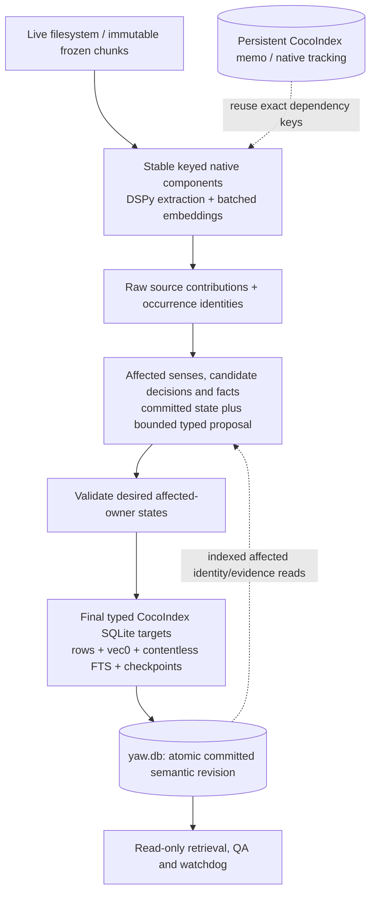

# Native CocoIndex graph: batch-independent incremental publication

Status: specification, 2026-11-05; implementation and acceptance remain open.

## 1. Mission and controlling decisions

For the same 128 source chunks, indexing and publishing 64 + 64 must cost roughly
as much total compute as indexing and publishing 128 together, and must produce
roughly the same entity, fact and typed-edge counts. These are the two acceptance
goals. Counts alone cannot prove the same graph, so compare canonical connections
and provenance as well. Sections 2 and 3 define the measurements and tolerances.

Remove `skos:ConceptScheme` completely from the active implementation: no scheme
nodes, tables, memberships, clustering, generated definitions, embeddings, PPR
seeds, traversal settings, QA blocks, telemetry or dormant feature switch. Do not
replace schemes with another clustering algorithm, universal hub or similarity
backbone. Shared identities and supported semantic relationships connect chunks.
Genuinely separate topics may remain disconnected.

Resource discovery belongs exclusively to NER: it identifies and defines named
individuals and general concepts. Triple extraction establishes statements from
those resources to other supplied resources or newly extracted literal values.
It must never create a missing resource or rewrite its definition. Homographs
require selecting an existing NER sense, not merging definitions by label.
The parser rejects resource endpoints outside that catalog; the grammar enforces
the same boundary. A statement set need not connect unrelated topics.

Schemes may return only through a separate experiment demonstrating Recall@N,
Exact Match (EM) or F1 improvement against this scheme-free baseline, without
unacceptable regressions in the other quality metrics, compute and memory.
No speculative scheme implementation belongs in this refactor.

This document owns graph semantics, publication and the paired acceptance gate.
[Native indexing](native-cocoindex-indexing.md) owns source scheduling and runtime
lifecycle. [W3C improvements](w3c-improvements.md) owns semantic guardrails;
[confidence](epistemic-confidence-spec.md) owns confidence aggregation.
[FOUNDATIONAL.md](../FOUNDATIONAL.md) governs architecture and failure policy.
This revision replaces all earlier scheme/clustering proposals in these plans.
The latest user decision supersedes the former mandatory scheme layer.

Scope now is documentation, not runtime modification or process restart. Existing
code is not declared conformant. Keep Epic 1 acceptance before Epic 2, preserve
sources/experiments and add no dependencies for this refactor.

## 2. Goal A: equal cumulative work, explicit timing comparison

### 2.1 Paired experiment

Let S be a frozen 128-chunk source revision, with stable document/occurrence IDs,
chunk boundaries, ordering and semantic/model/embedding profiles. Let B be the
identical initial graph, either empty or a specified existing corpus snapshot.

- **Incremental arm I:** apply S[0:64], publish, then apply S[64:128], publish and
  finish all semantic work affected by the complete S.
- **Reference arm R:** apply the same S through the same transforms, resolving
  against B plus all 128 proposed contributions, and publish once.

The reference is a test-harness publication boundary, not a second production
planner or a 128-chunk production preset. Extraction/embedding admission remains
bounded identically in both arms. Production still dispatches at most 64 changed
chunks per update cycle. The reference must not secretly call the 64+64 path
internally for semantic planning: it must expose all 128 contributions together,
otherwise this comparison cannot detect a batch-boundary defect.

Start timing before admitting the first chunk and stop after final validated
publication and completion of affected semantic work. Exclude only identical,
explicitly measured fixture/environment setup. Include source hydration,
inference waits, embeddings, candidate search, adjudication, repairs, target
reconciliation, validation, both incremental commits, and any deferred work.
There is no unmeasured finalization job. Record first-retrieval CSR construction
separately so it cannot be mistaken for ingestion cost.

`T_I = T_first64 + T_second64 + T_outstanding_semantics`

`R_time = median(T_I) / median(T_R)`

Initial acceptance band: **0.80 <= R_time <= 1.25**, in each predeclared scenario.
This operationalizes 'roughly the same'; it is a target, not measured evidence.
A ratio outside either boundary needs investigation, not silent threshold changes.
Two publications have real fixed overhead. Expose it instead of excluding it or
claiming exactly equal runtimes. Do not compare the second 64 alone with 128.

Apply the same band separately to cumulative graph planning-through-publication
time (`R_graph`), including entity/fact definition/embedding, adjudication, repair,
validation and commits, but excluding source extraction/chunk embeddings. Long
unchanged extraction must not mask a graph-publishing regression. Use phase
critical-path wall time rather than summing overlapping intervals; also report
process CPU seconds and provider-token work so a wall-time win cannot conceal
extra computation. Both `R_time` and `R_graph` must pass.

### 2.2 Work accounting prevents misleading timing wins

Record work by dependency key, not just callback count:

- Extraction and embedding cache misses, provider calls, input/output tokens and
  request payloads. Request batch counts may differ; semantic input work may not
  double merely because publication happened twice.
- Candidate queries, canonical candidate pairs, evidence revisions, judgments,
  unchanged decision reuse, affected older decisions and deterministic repairs.
- Rows read/declared/inserted/changed/deleted per table, validation scope/time,
  target reconciliation time, write-lock duration and peak process memory.
- Reused/recomputed source occurrences, entities/facts, and applied checkpoints.

Unchanged dependency keys incur zero additional provider work. A new chunk must
not re-extract/re-embed the first 64. A decision can legitimately change when new
support changes its evidence digest; count that extra work rather than treating
an outdated decision as reusable. First-half relations can be reconsidered, but
only through explicit affected dependencies. If that work breaks the timing
band, the implementation has not met Goal A even if the final graph is correct.

Cold and warm memo are separate paired scenarios. Clone equivalent initial graph
and target-tracking state from quiescent snapshots into isolated arms; never copy
a running SQLite/LMDB pair independently or run R cold and I against its
newly warmed memo. Keep endpoint admission, model settings and machine fixed.
Never clear the user's persistent cache to manufacture a cold experiment.

## 3. Goal B: equal semantic graph, not merely similar totals

For fixed chunk extraction artifacts, deterministic semantic policy and identical
adjudication results for identical evidence keys:

`canonical_graph(I(B, first64, last64)) == canonical_graph(R(B, all128))`

Require **zero difference** in entity count, fact count and counts by edge kind.
Also require exact sets of canonical bindings, fact semantic keys, typed edge
endpoints and source-support IDs. Numeric confidence values may differ by at most
1e-6 from floating aggregation order; presentation order, graph revision numbers,
transaction timestamps and trace scheduling are excluded. Canonical IDs themselves
must be stable; graph isomorphism cannot excuse first-seen ID selection.

Canonical comparison includes:

- Entity/sense identity, selected canonical ID and occurrence-to-entity bindings.
- Fact subject, original predicate, entity versus literal object, lexical value,
  datatype/language and source provenance; normalized display text alone is not
  a fact identity.
- Edge `(source, destination, kind)` with its supporting evidence and confidence;
  symmetric edges have a canonical storage orientation.
- Labels, shared evidence liveness, vector text/profile keys and FTS ownership.

For independent real-model runs, extraction/adjudication is stochastic. Keep the
exact fixed-evidence test mandatory, and additionally use initial live tolerances:
entity/fact/each-edge-kind count difference <=2% relative to `max(1, reference
count)`, and Jaccard >=0.98 for canonical entity, fact and edge sets individually.
Compare against source-derived semantic signatures as well as stored IDs to
separate ID instability from extraction differences. Report duplicate senses,
missing bridge facts and false merges explicitly. Any missing required bridge or
incorrect homograph merge fails regardless of favorable aggregate statistics.
These thresholds are predeclared acceptance targets, not claims of achieved
small-model reproducibility; do not loosen them after seeing a run.

### 3.1 Islands and document readiness

A 128-chunk document after its first publication is partial, not a complete
semantic island. Track source revision, completed enumeration, discovered chunk
IDs, published chunk revisions and outstanding affected semantic work through
native source/tracking plus minimal committed graph metadata. A document is
ready only at its completed semantic watermark, never merely after extraction
handles become ready. Edits invalidate readiness for the previous source revision.

All batches use the same document/occurrence namespace and existing sense state.
Candidate discovery spans both earlier documents and the current proposed batch.
Late evidence revisits affected older bindings/negative decisions. Same-document
membership is provenance, not an instruction to add a semantic PPR edge.

Disconnected components are allowed. Report 'no supported connection found under
policy P at corpus revision R', not 'proven unrelated'. Neither SHACL conformance
nor a closed-world vocabulary proves semantic discovery completeness. Do not add
links simply to reach one component. Retrieval can seed multiple components.

## 4. Starting point and why the current path fails these goals

Inspected `dev` worktree on 2026-11-05, including then-existing uncommitted work;
these are symbol references, not immutable line numbers or performance results.

| Current area | Defect to remove |
| --- | --- |
| `planner.py:plan_graph_publication` | Hydrates/fingerprints active corpus before reuse detection; additions fast path does not cover general replacement/deletion. |
| `planner.py:clone_graph_to_memory` | Clones all graph/vector tables for additions; otherwise starts blank `:memory:`. Both introduce work unrelated to the new 64 chunks. |
| `planner.py:prepare_sense_resolution_state` | Published senses are available only when the existing incremental branch is selected; identity must instead follow semantic dependencies. |
| `planner.py:prepare_synonym_candidates` | Changed endpoints are scoped, but similarity-driven merges and edge-presence decision reuse need evidence-sensitive review. |
| `storage/graph_ops.py:find_entity_disambiguation_candidates` | Lexical changed-to-all scans and scalar cosine/sort over ordinary vector tables still grow with corpus size. |
| `planner.py:build_concept_schemes` | Dense affinity, community merging, scheme LLM calls/embeddings and scheme rebuilding contribute no proven quality benefit. Remove entirely. |
| `storage/publication.py:GraphTargetHandler` | Whole-graph envelope, fingerprints, scheme clearing and imperative graph helpers reprocess survivors. Preserve atomicity while replacing ownership. |
| PPR, serializers, inference exports, watchdog | Still consume scheme IDs/metadata and traversal settings; removal must cover all consumers. |

Earlier 61/301/1,505-second observations and 3-4.5-hour forecasts are not acceptance
evidence. Original logs, phase boundaries, versions and cache states are required.
There is no absolute throughput promise in this revision: the primary performance
claim is the measured paired ratio, plus scaling/memory guards in section 8.

## 5. Target pipeline: final declarations, persistent semantic identity



All target tables are the destination of this computation, not intermediate
storage scanned by a second ETL planner. Persist source/inference artifacts only
as final provenance/memo outputs of the same native components. One runtime, app
per environment, writer and authoritative graph DB. Native tracking owns source
change/target reconciliation; no hand-rolled pending-work scheduler or journal.

### 5.1 Minimal state and ownership

Use stable source occurrence IDs distinct from content digests: identical text in
two locations has distinct provenance. Revision keys include content, source
pointer/AST bounds, parser/chunker, and semantic profile. Embeddings key exact
formatted text plus formatting/model/task/dimension. Inference keys exclude batch
number, pool name, publication time and transient experiment DB basename.

| Final state | Single logical owner |
| --- | --- |
| Chunk metadata, inference artifact, chunk vector and FTS row | Source occurrence/revision; one float32 vector copy and stable FTS rowid mapping. |
| Raw mentions/fact arguments and confidence signals | Stable occurrence-local evidence ID; retain original extraction for retraction. |
| Mention bindings, entity labels and entity/chunk support | Occurrence evidence, with explicit canonical entity/sense binding. |
| Entity metadata and vector | Entity aggregate, never competing declarations from multiple chunk components. |
| Reified facts, vectors and lexical rows | Fact aggregate with unambiguous entity/literal semantic key. |
| Fact/edge source contributions | Source evidence or explicitly identified inference decision. |
| Typed edge aggregates | `(src_id, dst_id, kind)`, derived once from surviving distinct evidence. |
| Positive/negative identity and relation judgments | Canonical endpoint/evidence/policy dependency key; explicit no-relation results are durable. |
| Applied source/profile digests and semantic revision/watermark | Publication owner, committed with affected graph rows. |

Named typed classes and `TableSchema.from_class` own ordinary schemas, vector
configuration owns `vec0`, and declarative attachments own FTS/index/constraint
setup. No manual schema compatibility migration stack. A fresh ignored `outputs/`
index is the cutover target; retain old experiment DBs. No scheme tables or
reserved scheme namespace in the new schema.

### 5.2 Batch-independent identity and candidate discovery

1. Preserve raw occurrence evidence before canonicalizing. Use a deterministic
   canonical representative of the accepted equivalence class, not 'first seen'
   or an ID minted from a batch. If the representative changes when an earlier
   canonical member arrives, rewrite the affected bindings/facts/edges atomically.
2. Lookup normalized labels against all persisted senses and current proposals.
   Exact spelling, casefold equality or high cosine alone is not semantic identity.
   Keep homographs/modifier-head distinctions; accepted unchanged identity and
   trusted validated identifiers can be reused deterministically.
3. Discover changed-to-existing and changed-to-changed candidates using the same
   versioned lexical/vector policy. Replace full lexical comparisons with indexed
   candidates and scalar-distance scans with typed `vec0` where supported. Do not
   claim KNN is O(1) or candidate limits prove semantic completeness.
4. Make final candidate coverage independent of arrival: top-k neighborhoods can
   change for old endpoints when new nodes arrive. Either propagate those reverse
   dependencies exactly or use a candidate rule whose incremental coverage is
   demonstrably identical to the reference. A new-endpoints-only top-k query is
   not proof. Resolve this with the candidate-equivalence fixture before tuning.
5. Judge canonical pairs against deterministic evidence dossiers, deduplicating
   pair/evidence keys across batches. Evidence includes relevant old/new supports
   and their revisions; it must not depend on request packet neighbors. Packing
   changes may alter request counts, never silently change semantic inputs.
6. Reuse decisions only while endpoint/evidence/program/policy digests match.
   Reopen affected earlier no-match/merge/relation judgments after new evidence.
   Existing `related`, `broader` or `differentFrom` edges alone are not decision
   receipts. No provisional merge is made irreversible for performance.
7. Aggregate confidence from surviving distinct evidence with existing operators;
   replay/memo hits do not add support. Re-embed only changed exact text/profile
   keys, including changed aggregate definitions.

Canonicalization, relation conflict resolution and SHACL repairs must converge
to the same supported state regardless of packet/arrival order. Test fixed points
on controlled fixtures; do not assume deterministic hashing alone makes history-
sensitive merging confluent. If this cannot be established for a rule, simplify
or replace that rule before claiming Goal B. Do not perform a full final-corpus
rebuild to make the equality test pass: its work belongs in Goal A.

## 6. Incremental publication, retraction and failures

Consume keyed native source transitions; same-ID edits require revision comparison,
not set difference on chunk IDs. Incomplete enumeration, parser failure or stopped
watching never implies all unseen chunks were deleted. Frozen callers supply
immutable text; missing text is an error, never a truthiness-based disk rehydrate.

Capture base semantic revision and indexed affected rows in a short read section,
release locks, then perform inference against a bounded typed read view overlaying
replacements/tombstones on committed state. No `:memory:`, graph clone, SQLite
backup staging, full survivor hydration or full-graph proposal/fingerprint payload.
RLM inspection reads that proposed view and returns typed repairs; it cannot write
the published graph. No database lock spans a provider call.

Each affected owner declares its complete desired state; absence means retirement
only inside that explicitly recomputed owner. Shared entities/facts survive until
their final support disappears. Remove withdrawn labels, sources, vectors and FTS
rows atomically and recompute aggregates from surviving evidence. Retain original
arguments and bindings so removing evidence can reverse a prior merge. A dependency
closure can exceed 64 chunks; report that cost rather than silently truncate it.

### 6.1 Atomic declarative publication capability gate

Independent per-table declarations do not prove multi-table atomicity. First probe
the locked CocoIndex SQLite connector for grouped ordinary-row, `vec0`, FTS and
checkpoint reconciliation with pre-commit validation. Verify actual public APIs,
action ordering and rollback; do not invent a transaction-group API or import
private connector internals. `uv.lock` currently pins CocoIndex 1.1.0; earlier
1.0.26 lifecycle observations are not proof of locked-version behavior.

The group buffers only keyed affected-owner diffs outside a transaction, reaches
an explicit publication barrier after dependent work, then uses one transaction:
check base revision, apply diffs, validate actual post-state, advance applied
checkpoints/revision/watermark and commit. Failed validation or stale base aborts;
serialized coordination prevents normal overlapping plans. No custom retry loop.
An unchanged replay must not advance semantic revision merely because a sink ran.

If the public connector lacks grouping, implement the smallest schema-driven
connector extension using public CocoIndex target interfaces before replacing the
working atomic sink. It must consume row declarations, not rename the whole-graph
`PreparedGraphRows` envelope or wrap legacy imperative graph upserts. Prove that
waiting for the barrier cannot deadlock components awaiting target completion.
If public APIs cannot satisfy it, stop this cutover and amend the design with
specific evidence; no visible partial graph or second writer is acceptable.

A final published flag after independently committed mutable tables cannot hide
partial rows from readers. Verify managed-connection lock behavior on Windows;
WAL alone does not prove concurrent shared-connection reads.

CocoIndex tracking/memo and SQLite are separate durability stores. Crash after DB
commit/before target acknowledgement must replay the same desired keys idempotently,
without duplicate support or another semantic revision. Crash before commit leaves
graph and checkpoints unchanged. Memoized inference can survive failure without
being counted as published evidence.

### 6.2 Validation scope

Unresolved SHACL violations abort. Source-local checks can be bounded, but hierarchy
cycles/disjointness may require reverse dependency and ancestor/descendant closure.
Until incremental validation is demonstrated equivalent to the full validator,
full post-state `lint_graph_shacl` remains mandatory. Measure its repeated cost
in both arms; do not call it delta-constant or hide it from the ratio. Replace it
only after affected-closure equivalence tests, not by skipping checks for speed.

SHACL validates configured constraints, not semantic completeness. Remove any shape
requiring scheme membership/top concepts; keep label, literal, provenance, sense
and supported hierarchy/relation constraints. Identity decisions cannot be inferred
from distinct IRIs alone: OWL does not make a unique-name assumption.

## 7. Complete scheme removal and consumer cutover

This is deletion, not `define_fn=None`, an empty-table mode, or a feature flag.
Remove each implementation with all callers/tests/telemetry in the same cutover.
Keep entity-definition inference, source facts and supported concept relations.

| Surface | Removal / retained behavior |
| --- | --- |
| `graph/planner.py` | Delete `build_concept_schemes`, clustering/affinity/centroid/root work, scheme inference/embedding calls and staged scheme extraction. Replace global staging and survivor serialization with affected-owner planning. |
| `storage/publication.py`, `graph_ops.py`, exports | Delete scheme row fields, clear/upsert/member helpers and single complete-graph tracking/envelope once grouped rows replace it. Retain one atomic writer. |
| `storage/db.py` | No scheme/member table or scheme relation in new schema. Explicitly reject obsolete schema/profile; preserve old DBs for comparison. |
| Inference `components.py`, `program.py`, `prompts.py`, `grammars.py`, `parsers.py`, exports | Remove `ConceptSchemeInput`, scheme outputs, `define_concept_schemes`, scheme grammar/parser/prompt branches and scheme trace handling. Keep ordinary missing-entity definitions. |
| `core/constants.py`, `core/types.py`, PPR | Remove scheme constants/types and `skos_top_concept_up/down` settings, scheme node priors/seeds and scheme edge dispatch. Supported passage/fact/semantic traversal remains. |
| `storage/shacl.py`, QA | Remove scheme shape/query/serializer blocks, membership requirements and scheme prompt framing. Keep MaxP source passages, retained seed facts, source provenance and existing supported subgraph formatting. No new path-explanation feature in this refactor. |
| `scripts/watchdog.py` and CLI | Remove scheme SQL, counts, node palettes/legend and edge rendering. Report current entity/fact/edge counts, semantic readiness and phase costs. Obsolete consumers must fail rather than show fabricated zeros. |
| Optimizer artifacts and memo identities | Bump affected program/schema/profile identities. Reject incompatible artifacts explicitly; no silent reuse of a program expecting scheme context. |
| Tests | Remove scheme behavior expectations in grammar/parser/program/confidence/watchdog suites; replace with absence, schema rejection and paired invariance coverage. |

Use `rg` to enumerate all `ConceptScheme`, `concept_scheme`, `scheme-`,
`topConceptOf`, `hasTopConcept`, scheme-specific `inScheme` and traversal setting
references in `yaw/`, `scripts/` and `tests/`. No active production path survives;
negative removal assertions and explicit obsolete-schema rejection are allowed
in tests/diagnostics. Inspect names and behavior, not just grep counts. Update
`FOUNDATIONAL.md`, `AGENTS.md`, native indexing, W3C and confidence plans together.
Historical papers may describe schemes; they do not govern this architecture.

## 8. Resource and scaling constraints

Peak resident memory for the whole YAW worker must be **<=1 GiB**, including Python,
native allocations, SQLite caches, proposal and retrieval state. External model
weights are measured separately. The graph remains sparse and vectors are loaded
only for needed work. No dense N-by-N arrays, corpus graph copy, custom community
heap, streamed centroid subsystem or new graph-clustering dependency.

This is an acceptance measurement, not a speculative 768/256-MiB accounting
framework. Record peak RSS and private/committed memory on Windows to expose
paging. Failure preserves prior valid graph; never discard candidates or replace
supported edges to meet a budget.

After the initial pair passes, repeat 128-chunk additions against larger fixed
base graphs and include high-degree updates. Separate candidate-search/validation
cost growth from accidental old-chunk inference or whole-graph publication. Exact
KNN/full validation may still scale with corpus size. The spec promises neither
O(1) updates nor universal runtime equality for arbitrary topology. Report measured
curves and reject acceptance if the designated corpus exceeds memory or paired
work targets. Tests cannot infer asymptotic behavior from two timings.

Provider settings stay native DSPy, default LLM `Semaphore(1)`, embedding batch
<=64, temperature >=0.3 (default 0.35, reflection up to 0.8), and retries solely
through `dspy.LM(num_retries=...)`. No lower retries or extra degraded path to
produce favorable timing.

## 9. Path to the two goals and restart checklist

Each checkpoint produces a reviewable artifact. An unchecked item is not complete.
Do not launch optimization or restart live workers as part of a documentation edit.

G1 execution: [scheme removal restart record](reviews/concept-scheme-removal.md).

Execution order update, 2026-11-05: [atomic incremental publication units](reviews/incremental-publication-work.md)
now governs the next implementation slices. Defer live diagnostic pairs and
baseline capture until fixed-evidence semantics and bounded publication pass.
The verified scheme-free code checkpoint remains `c01f4aa`; its tests do not
establish bounded incremental processing. G0-G6 below remain acceptance scope,
not a requirement to spend live-model compute before repairing known global work.

- [ ] **G0: capture the defect.** Build one paired harness with isolated B/tracking
  and frozen S. Record current counts, canonical graph diff, phase times and
  provider work. Add batch64/65 and final-chunk bridge fixtures before refactoring.
  Record this as legacy evidence, not the scheme-free baseline.
- [ ] **G1: delete schemes.** Remove the entire inventory in section 7, update every
  consumer and identity, retain source experiments, and establish the scheme-free
  baseline through the existing atomic path. A staging path at this checkpoint
  remains an explicit incomplete cutover, not accepted final architecture.
- [ ] **G2: make semantics independent of arrival.** Stable raw contributions,
  canonical bindings, cross-batch/new-to-new candidates, reverse candidate/evidence
  invalidation, negative decisions and deterministic conflict/repair ordering.
  Pass exact controlled graph equality before claiming counts are comparable.
- [ ] **G3: remove repeated work.** Replace full hydration, in-memory clone and
  survivor proposal with indexed affected-owner reads and native memo/tracking.
  Prove unchanged keys cause no inference or target mutations. Include replacement,
  deletion and late evidence, not just additions.
- [ ] **G4: declarative atomic cutover.** Pass locked-connector grouping/rollback/
  crash probes, then replace complete-graph sink with typed final targets. Do not
  remove the working atomic path before proving its replacement. Only one path
  survives this checkpoint; no compatibility layer or dual writer remains.
- [ ] **G5: prove the pair.** Run fixed-evidence equality/work tests and real-model
  paired trials in section 10, producing raw data and gate verdicts. Investigate
  any inflated phase or graph family; do not merely compare total row counts.
- [ ] **G6: broaden acceptance.** Larger-base scaling, source mutations, restart,
  Windows live lifecycle, all consumers and Tier 1/Tier 2 retrieval/QA gates.
  Document executed checks, limitations and actual active schema/profile.

Resume by checking branch/worktree, latest completed checkpoint, evidence artifact,
locked versions and unresolved gate. Update this checklist only from evidence.
Implementation commits are conventional and include only assigned changes after
required checks. A spec revision alone cannot close implementation checkpoints.

## 10. Verification matrix and evidence

### 10.1 Required real-substrate fixtures

Use on-disk SQLite, native CocoIndex tracking, sqlite-vec, files and subprocess
restart. Fixed typed extraction/judgment fixtures or loopback providers isolate
orchestration; they are not evidence of real-model semantic quality.

| Fixture | Required result |
| --- | --- |
| Empty B, 64+64 vs 128 | Exact controlled canonical graph and counts; equivalent source support/vector keys. |
| Existing B, same pair | Earlier B contributions stay unchanged unless explicit new evidence affects them; no old extraction replay. |
| One document spanning chunk64/65 | Reuse a supported entity/fact across the boundary; first64 is partial, final128 ready. |
| Last-chunk bridge / later document | Required prior-island connection appears in both arms after affected decisions settle. |
| Homographs/unrelated topics | No forced merge/bridge; legitimate isolation survives both arms. |
| New-to-new / reverse top-k | Same candidates/accepted bindings as reference, including new evidence changing an older neighborhood. |
| Same-ID edit / rename / deletion | Retire correct occurrences; shared support survives, last-support deletion removes orphans. |
| Merge reversal / order permutation | Canonical IDs, raw facts and supported relations converge; no first-seen or packet-position dependence. |
| Confidence replay | No duplicate evidence; confidence equals fresh aggregation within 1e-6. |
| No-op / fresh-process restart | Zero new provider work/graph mutations; stable revision and no drift from saved target tracking. |
| Crash before/after commit acknowledgement | Atomic rows/vector/FTS/checkpoints; idempotent replay without double confidence. |
| Failed parser/scan / stale plan / SHACL violation | Prior graph preserved; no unseen-source deletion or partial publication; original error propagated. |
| Runtime/benchmark/candidate/watchdog | Same committed schema/profile; no scheme consumers or query-time hidden indexing. |

### 10.2 Timing and live evidence

Use at least 20 paired fixed-evidence trials for timing distributions, with arm
order alternated. Use at least 5 paired real-model trials for median and range;
do not claim stable p95 from five samples. Measure cold and warm scenarios
separately, logging all results and failures. Predeclare chunk workloads, B, source
and profile digests, hardware and thresholds. Preserve endpoint state controls
and account for startup; do not assign all first-run costs to one arm.

Report `T_I`, `T_R`, `R_time`, `R_graph`, per-phase costs, CPU/provider-input work, final E/F/typed-edge
counts, count differences, semantic set hashes/Jaccard, required-bridge results,
peak memory and commit/readiness revisions. A fast run with false merges or
missing facts fails. A matching final graph obtained by a hidden global rebuild
fails the work/timing goal.

### 10.3 Quality and project gates

Run locked environment checks when implementing:

```powershell
uv sync --locked
uv run --locked ty check
uv run --locked ruff check --fix
uv run --locked ruff format
uv run --locked pytest
git diff --check
```

Run `benchmark.py` and `scripts/verify_paper_parity_gate.py` using the actual
configured `MONKEYPATCHED_HIPPORAG_BASELINES` and `PAPER_BASELINES` artifacts.
Record resolved paths/digests; AGENTS references historical consolidated outputs
while dataset code/plans also reference `data/benchmarks/baselines.json`. Never
silently substitute a baseline or dataset slice. Tier 1 is development evidence;
Tier 2 full-corpus acceptance remains mandatory. Report Recall@N, EM and F1
separately where the dataset supports them; unsupported metrics are omitted with
a reason, never fabricated. Compare scheme-free quality with prior evidence and
retain failures rather than force acceptance through graph-count equality.

Future scheme experiments must use this same source/model/slice, named baseline
and predeclared metric, with paired uncertainty estimates and runtime/memory/
token costs. Only repeatable held-out Recall@N, EM or F1 improvement with acceptable
other metrics/resources can justify a new design. No scheme toggle is retained
now for that hypothetical experiment.

Save machine-readable evidence under ignored `outputs/` with command, code
revision/dirty digest, versions, source/profile/baseline identities and raw samples.
Runtime logs use `yaw/core/logger.py` (500-line FIFO); result artifacts preserve
measurements beyond log rotation. Documentation checks do not pass runtime gates.

## 11. Primary constraints

- [CocoIndex programming model](https://cocoindex.io/docs/getting_started/overview/):
  native incremental transforms and declarative final targets; verify APIs with
  the locked package rather than assuming web documentation matches it.
- [SQLite connector source](https://github.com/cocoindex-io/cocoindex/blob/main/python/cocoindex/connectors/sqlite/_target.py):
  target/transaction behavior to probe before replacing the atomic sink.
- [W3C SKOS](https://www.w3.org/TR/skos-reference/): semantic relations and labeling
  do not require a globally connected scheme layer.
- [W3C SHACL](https://www.w3.org/TR/shacl/): conformance applies to declared shapes;
  it is not proof that discovery found every possible semantic relationship.
