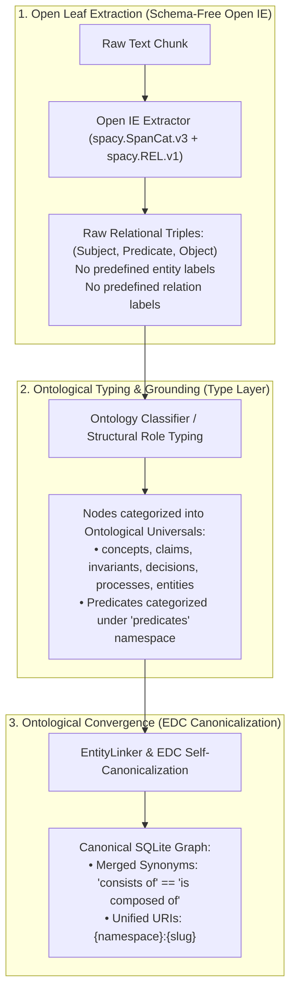

# Authoritative Source & Foundation: Open Information Extraction (Open IE) vs. Closed Ontology

**Document Status:** Authoritative Research Benchmark & Architectural SSOT  
**Location:** `docs/open-ie-authoritative-source.md`

---

## 1. The Authoritative Definition of Open IE

Open Information Extraction (Open IE) was introduced by Banko et al. (IJCAI 2007) and systematically surveyed by Niklaus et al. (COLING 2018), Liu et al. (ACL/EMNLP 2024), and Zhang & Soh (EDC, arXiv:2404.03868, 2024).

### Formal Definition
An Open IE system is a function from an unstructured natural language text $d$ to a set of relational tuples:
$$\langle \text{arg}_1; \text{rel}; \text{arg}_2 \rangle \quad \text{or} \quad \langle \text{arg}_1; \text{rel}; \text{arg}_2; \dots; \text{arg}_n \rangle$$
where:
1. **$\text{rel}$ is an unconstrained relational phrase** (verbal, prepositional, or adjectival) denoting the semantic relationship expressed in the text.
2. **$\text{arg}_1, \text{arg}_2, \dots$ are unconstrained argument phrases** (typically noun phrases or propositions) representing the entities, claims, or conditions participating in the relation.
3. **No Target Schema:** Neither $\text{rel}$ nor $\text{arg}_i$ are drawn from a predefined set of categories, labels, or relations.

### The Seminal Literature (Citations & Quotes)

1. **Banko et al. (IJCAI 2007) — *Open Information Extraction from the Web*:**
   > *"Traditional Information Extraction (IE) has focused on satisfying narrow, pre-specified requests over small, homogeneous corpora... Open IE is a novel extraction paradigm that is **relation-independent and schema-free**. It extracts all relations and entity arguments without human input or predefined categories, making a single data-driven pass over the corpus."*
   > *(Banko, Cafarella, Soderland, Broadhead, & Etzioni, 2007)*

2. **Niklaus et al. (COLING 2018) — *A Survey on Open Information Extraction*:**
   > *"Traditional approaches to IE focus on answering narrow, well-defined requests over a **predefined set of target relations**... In order to reduce the manual effort required by IE approaches, Banko et al. (2007) introduced a new extraction paradigm: Open IE. Unlike traditional IE methods, Open IE is not limited to a small set of target relations known in advance, but rather extracts all types of relations found in a text... **Furthermore, Named Entity Recognition (NER) is unsuitable to target the variety and complexity of entity types on the Web.** As Open IE systems are intended for domain-independent usage, such tools should be avoided in favor of shallow parsing methods."*

3. **Liu et al. (EMNLP 2024 / arXiv:2208.08690) — *A Survey on Open Information Extraction from Rule-based Model to Large Language Model*:**
   > *"Unlike standard IE, which relies on **predefined categories** to identify relationships and entities, OpenIE operates **without such constraints**, enabling the extraction of diverse and unforeseen relations. This flexibility makes OpenIE especially valuable for dynamic and unstructured data."*

4. **Zhang & Soh (arXiv:2404.03868, 2024) — *Extract, Define, Canonicalize: An LLM-based Framework for Knowledge Graph Construction (EDC)*:**
   > *"Standard (closed) information extraction requires the output triplets to follow a pre-defined schema, e.g. a list of relation or entity types to be extracted from. In contrast, open information extraction (OIE) does not have such a requirement... In Phase 1 (Extract), we leverage models for open information extraction to identify and extract relational triplets $([\text{Subject}, \text{Relation}, \text{Object}])$ from input texts, **independent of any specific schema**."*

---

## 2. The Core Conflict: Closed IE vs. Emergent Open IE

| Dimension | Traditional / Closed IE | Open IE (Open Information Extraction) |
| :--- | :--- | :--- |
| **Relation Set ($R$)** | Predefined closed set: $R = \{r_1, \dots, r_k\}$ (e.g. `is_a`, `partOf`, `employed_at`). | **Open-vocabulary:** Any textual predicate appearing in the sentence (e.g. `"is composed of"`, `"depends on"`, `"violates"`). |
| **Entity Set / Labels ($E$)** | Predefined category taxonomy: $E = \{e_1, \dots, e_m\}$ (e.g. `PER`, `ORG`, or `concepts`, `invariants`). | **Open-vocabulary / Schema-free:** Extracted directly as noun phrases or propositions from the text without predefined labels. |
| **Domain Dependence** | Narrow, domain-specific, requires per-class training data or schemas. | Domain-independent, universal. |
| **Failure Mode** | Blindness: ignores all valid knowledge that does not fit into the predefined schema. | Polysemy & fragmentation: surface drift (synonyms, phrasing variants). |

---

## 3. Resolving the YAW Paradox: How Does Open IE Reconcile with an Upper Ontology?

### The Pitfall
If the leaf extraction component is provided with a fixed list of 8 categories:
```python
# ANTI-OPEN-IE: This converts leaf extraction into Closed IE!
labels = [
    "entities",
    "concepts",
    "claims",
    "invariants",
    "decisions",
    "processes",
    "sources",
    "contexts",
]
```
**This is NOT Open IE.** It forces an artificial closed taxonomy onto the text during extraction, causing:
1. **Extraction Distortion:** The model forces arbitrary text spans into arbitrary ontological buckets (e.g., mislabeling code or sentences as `invariants` or `decisions`).
2. **Span Blindness:** Legitimate domain relationships that do not fit the 8 labels are discarded.
3. **Ontological Collusion:** It conflates the **Type Layer** (upper ontology) with the **Instance Extraction Layer** (Open IE).

### The Correct Three-Stage Architecture (EDC Pattern)

To achieve true Emergent Open IE while maintaining a structured Knowledge Graph, YAW separates extraction from typing:



### Architectural Rules for YAW:
1. **Leaf Extraction is Schema-Free:** The leaf extraction stage extracts open entities and open relational triples `(subject, predicate, object)` directly from chunk text without forcing tokens into predefined category buckets.
2. **The 9 Universals Govern the Type Layer, Not the Extraction Layer:** The 9 ontological categories (`entities`, `concepts`, `claims`, `invariants`, `decisions`, `processes`, `sources`, `contexts`, `predicates`) are assigned to nodes post-extraction (e.g. based on syntactic role, sentence modality, or `TextCat` classification of the entity definition).
3. **Canonicalization Prevents Fragmentation:** Because Open IE produces diverse surface expressions, the Ontological Convergence Protocol (EDC Phase 3) unifies synonymous entities and predicates into canonical graph nodes.
