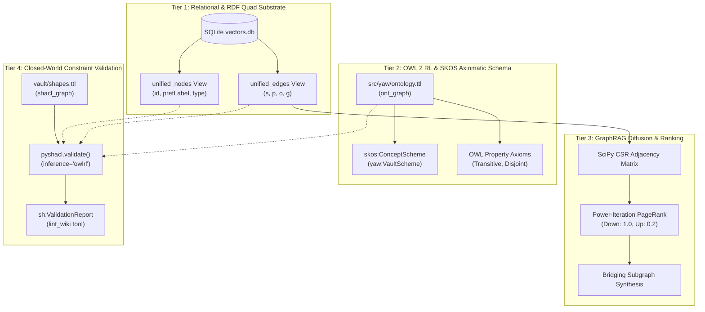
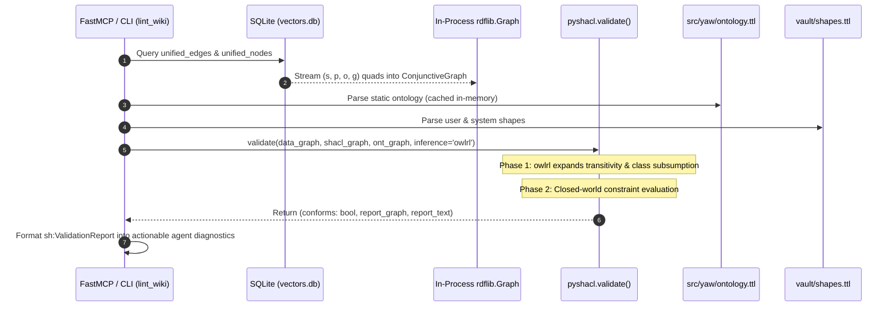
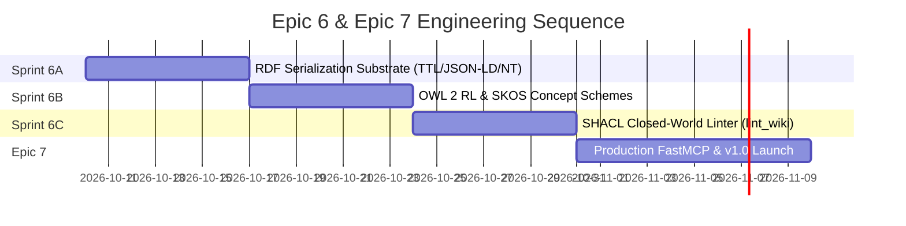

# RDF, OWL, and SHACL Specification & Integration Manual

**Document Status:** Authoritative Technical Manual  
**Location:** [`docs/rdf-owl-shacl.md`](file:///home/harri/yaw/docs/rdf-owl-shacl.md)  
**Governing Architecture:** [`FOUNDATIONAL.md §1, §2, §5.4`](file:///home/harri/yaw/FOUNDATIONAL.md), [`docs/adr/ADR-008.md`](file:///home/harri/yaw/docs/adr/ADR-008.md), [`docs/epics-alignment-roadmap.md`](file:///home/harri/yaw/docs/epics-alignment-roadmap.md)  
**Target Release:** Epic 6 (v0.9.0) & Epic 7 (v1.0.0)

---

## 1. Executive Summary & 4-Tier Architecture Overview

YAW combines relational speed, localized embedding retrieval, and formal W3C Semantic Web compliance into a unified, zero-daemon architecture. Obsidian Markdown note-takers author plain text and natural `[[wikilinks]]`. Under the hood, YAW treats this interconnected knowledge substrate as an authoritative RDF knowledge graph governed by formal OWL 2 axioms and validated by closed-world SHACL contracts.

To satisfy both high-throughput local GraphRAG retrieval (sub-millisecond PPR diffusion) and formal Semantic Web interoperability without spawning external JVM graph servers (e.g., Fuseki, Virtuoso, Blazegraph), YAW executes a **4-Tier Semantic Stack**:



### The 4-Tier Breakdown

| Tier | Layer Name | Technology & Location | Core Responsibility |
| :--- | :--- | :--- | :--- |
| **Tier 1** | **RDF Triple/Quad Substrate** | SQLite `unified_edges` & `unified_nodes` views | Zero-copy projection of relational nodes, edges, aliases, and source chunks into W3C `(s, p, o, g)` quads. |
| **Tier 2** | **OWL 2 RL & SKOS Axiomatic Schema** | `src/yaw/ontology.ttl` (`ont_graph`) | Static W3C taxonomy defining the 9 universal root classes, SKOS concept scheme, and OWL property characteristics. |
| **Tier 3** | **GraphRAG Diffusion & Ranking** | SciPy Power-Iteration PPR (`src/yaw/retrieval/`) | Ultra-fast numerical personalized PageRank over CSR matrices with asymmetric conductance ($1.0$ down, $0.2$ up). |
| **Tier 4** | **Closed-World Constraint Validation** | `pyshacl.validate()` (`src/yaw/ontology/shacl.py`) | In-process structural integrity verification, dialectical contradiction checks, and diagnostic report generation. |

---

## 2. RDF vs. OWL vs. SHACL: Clarification & Synergy

### The "Pick One?" Fallacy

A recurring point of confusion in knowledge engineering is the question: *"Should we use RDF, OWL, or SHACL?"*  
In the semantic architecture of YAW, this is recognized as a **false dichotomy**. RDF, OWL, and SHACL are not competing technologies or alternative graph representations; they are complementary, layered W3C standards operating at distinct phases of the graph lifecycle:

```
+-------------------------------------------------------------------------+
| SHACL (Shapes Constraint Language)                                      |
| Role: Closed-World Structural Validation & Data Contracts               |
| Syntax: RDF Triples                                                     |
+-------------------------------------------------------------------------+
                                 ▲ validates
                                 │
+-------------------------------------------------------------------------+
| OWL (Web Ontology Language - Profile: OWL 2 RL)                         |
| Role: Open-World Inferential Axioms & Semantic Entailment               |
| Syntax: RDF Triples                                                     |
+-------------------------------------------------------------------------+
                                 ▲ enriches
                                 │
+-------------------------------------------------------------------------+
| RDF (Resource Description Framework)                                    |
| Role: Graph Data Model & Quad Substrate                                 |
| Atoms: (Subject, Predicate, Object, NamedGraph)                         |
+-------------------------------------------------------------------------+
```

1. **RDF is the Data Model and Substrate:**
   - RDF defines the atomic data structure: directed labeled graph statements consisting of `(Subject, Predicate, Object)` triples and `(Subject, Predicate, Object, NamedGraph)` quads.
   - Every node, relation, alias, ontology axiom, and shape in YAW is fundamentally serialized and expressed as RDF triples.
2. **OWL is the Vocabulary of Inferential Axioms:**
   - OWL provides the formal mathematical semantics (Description Logics) to infer implicit knowledge from explicit assertions.
   - In YAW, OWL 2 RL rules (such as `rdfs:subClassOf`, `owl:TransitiveProperty`, and `owl:propertyDisjointWith`) declare that if `A subClassOf B` and `B subClassOf C`, then `A subClassOf C` logically holds.
3. **SHACL is the Closed-World Constraint Engine:**
   - SHACL defines structural, topological, and value constraints that an RDF graph *must satisfy* to be deemed valid.
   - Unlike OWL, which operates under the Open World Assumption (OWA) where missing data is simply "unknown", SHACL operates under the Closed World Assumption (CWA) where missing properties or malformed nodes produce deterministic validation violations.

### How pySHACL Unifies the Triad

The synergy of the three standards is materialized directly through `pyshacl.validate()`. The execution contract brings all three components together in a single call:

```python
conforms, report_graph, report_text = pyshacl.validate(
    data_graph=data_graph,  # 1. RDF Graph projected from SQLite unified_edges
    shacl_graph=shacl_graph,  # 2. SHACL Shapes defining structural contracts
    ont_graph=ont_graph,  # 3. OWL 2 RL Axioms defining class/property semantics
    inference="owlrl",  # 4. Pre-inference expansion engine
    abort_on_first=False,
    meta_shacl=False,
    advanced=True,
)
```

#### The Execution Lifecycle:
1. **Load Data Graph (`data_graph`):** Ingests explicit RDF triples extracted from the note vault via SQLite `unified_edges`.
2. **Bind Ontology (`ont_graph`):** Loads the static schema defining class hierarchies (`concepts:Root`, etc.) and property behaviors (`predicates:subClassOf a owl:TransitiveProperty`).
3. **Pre-Inference Phase (`inference='owlrl'`):** Before evaluating constraints, the in-process `owlrl` engine expands the data graph. Transitive chains are collapsed, sub-properties are inherited, and class types are expanded.
4. **Shape Evaluation (`shacl_graph`):** Evaluates closed-world shapes against the *inferred* graph. If an invariant shape requires that every `claims:*` node must have an evidential citation or link, SHACL validates this over the expanded graph, surfacing violations cleanly.

---

## 3. pySHACL Runtime Architecture & Integration Pattern

YAW rejects external graph server processes. Semantic graph operations execute strictly **in-process** via Python bindings (`rdflib` and `pyshacl`), ensuring deterministic unit testing, rapid startup, and zero deployment overhead.



### Ingestion Flow: SQLite to In-Memory ConjunctiveGraph

The relational views `unified_edges` and `unified_nodes` project SQLite rows into an `rdflib.ConjunctiveGraph`. Each edge preserves its origin chunk as an RDF Named Graph (Quad Context):

```python
import sqlite3
import rdflib
from rdflib import URIRef, Literal, RDF, RDFS, SKOS, OWL, Namespace

YAW_PREFIX = "http://yaw.local/"
NAMESPACES = {
    "concepts": Namespace("http://yaw.local/concepts/"),
    "entities": Namespace("http://yaw.local/entities/"),
    "predicates": Namespace("http://yaw.local/predicates/"),
    "claims": Namespace("http://yaw.local/claims/"),
    "invariants": Namespace("http://yaw.local/invariants/"),
    "decisions": Namespace("http://yaw.local/decisions/"),
    "processes": Namespace("http://yaw.local/processes/"),
    "sources": Namespace("http://yaw.local/sources/"),
    "contexts": Namespace("http://yaw.local/contexts/"),
}


def curie_to_uri(curie: str) -> URIRef:
    """Converts a SQLite CURIE ('concepts:entropy') to an RDF URIRef."""
    if ":" not in curie:
        return URIRef(f"http://yaw.local/concepts/{curie}")
    prefix, slug = curie.split(":", 1)
    if prefix in NAMESPACES:
        return NAMESPACES[prefix][slug]
    return URIRef(f"http://yaw.local/{prefix}/{slug}")


def build_data_graph(conn: sqlite3.Connection) -> rdflib.ConjunctiveGraph:
    """Streams SQLite unified_edges and unified_nodes into an rdflib ConjunctiveGraph."""
    graph = rdflib.ConjunctiveGraph()
    for prefix, ns in NAMESPACES.items():
        graph.bind(prefix, ns)
    graph.bind("yaw", Namespace(YAW_PREFIX))

    # 1. Project unified_nodes
    cur = conn.cursor()
    cur.execute("SELECT node_id, name, namespace, definition FROM unified_nodes")
    for node_id, name, ns, definition in cur.fetchall():
        s = curie_to_uri(node_id)
        if name:
            graph.add((s, SKOS.prefLabel, Literal(name)))
            graph.add((s, RDFS.label, Literal(name)))
        if definition:
            graph.add((s, SKOS.definition, Literal(definition)))
        if ns in NAMESPACES:
            graph.add((s, RDF.type, NAMESPACES[ns]["Root"]))

    # 2. Project unified_edges as quads
    cur.execute("SELECT src_id, rel_type, dst_id, source_chunk_id FROM unified_edges")
    for src_id, rel_type, dst_id, chunk_id in cur.fetchall():
        s = curie_to_uri(src_id)
        p = curie_to_uri(f"predicates:{rel_type}")
        o = curie_to_uri(dst_id)
        context_uri = (
            URIRef(f"http://yaw.local/sources/chunk#{chunk_id}") if chunk_id else None
        )

        if context_uri:
            named_context = graph.get_context(context_uri)
            named_context.add((s, p, o))
        else:
            graph.add((s, p, o))

    return graph
```

### Static Ontology vs. Dynamic Shapes

1. **Static Ontology (`src/yaw/ontology.ttl`):**
   - Bundled with the YAW Python package distribution.
   - Defines the immutable W3C foundation: the 9 top-level classes, the SKOS concept scheme (`yaw:VaultScheme`), and the 10 canonical seed predicates with their mathematical property axioms.
   - Loaded once during application startup and cached in memory.
2. **Dynamic Shapes (`vault/shapes.ttl`):**
   - Stored in the user's vault root, enabling user-defined domain integrity rules.
   - Automatically fall back to system defaults (`src/yaw/ontology/shapes/wiki_shapes.ttl`) if absent from the vault.
   - Defines `sh:NodeShape` and `sh:PropertyShape` definitions enforcing definition word limits ($\le 50$ words), dialectical contradiction detection, and valid URI naming.

### Conformance Report Handling for `lint_wiki`

`pyshacl.validate()` returns a boolean `conforms`, a detailed `rdflib.Graph` containing the W3C `sh:ValidationReport`, and a formatted string. YAW parses the `report_graph` to produce machine-actionable and human-readable diagnostic dictionaries:

```python
def parse_validation_report(report_graph: rdflib.Graph) -> list[dict]:
    """Transforms W3C sh:ValidationReport RDF graph into structured diagnostic dicts."""
    SH = Namespace("http://www.w3.org/ns/shacl#")
    violations = []

    for result in report_graph.subjects(RDF.type, SH.ValidationResult):
        focus_node = report_graph.value(result, SH.focusNode)
        path = report_graph.value(result, SH.resultPath)
        severity = report_graph.value(result, SH.resultSeverity)
        message = report_graph.value(result, SH.resultMessage)
        component = report_graph.value(result, SH.sourceConstraintComponent)
        val = report_graph.value(result, SH.value)

        sev_name = severity.split("#")[-1] if severity else "Violation"
        comp_name = component.split("#")[-1] if component else "ConstraintComponent"

        violations.append(
            {
                "focus_node": str(focus_node) if focus_node else "",
                "path": str(path) if path else "",
                "severity": sev_name,
                "constraint": comp_name,
                "message": str(message)
                if message
                else "Integrity constraint violation",
                "value": str(val) if val else "",
            }
        )

    return violations
```

---

## 4. The 9 Universal Root Classes & W3C Semantic Mapping (ADR-008 SSOT)

As established in [`ADR-008`](file:///home/harri/yaw/docs/adr/ADR-008.md), YAW enforces a strict, exhaustive 9-namespace taxonomy. All nodes extracted by spaCy-LLM map deterministically to one of these 9 root classes.

### W3C Alignment Matrix

| Root Namespace | Primary W3C Semantic Class | Secondary / Alignment Type | Semantic Role & Mapping Contract |
| :--- | :--- | :--- | :--- |
| `concepts:*` | `skos:Concept` (`http://www.w3.org/2004/02/skos/core#Concept`) | `owl:Class` | Abstract concepts, domains, methodologies, paradigms. |
| `entities:*` | `owl:NamedIndividual` (`http://www.w3.org/2002/07/owl#NamedIndividual`) | `schema:Thing` | Concrete named individuals, organizations, software artifacts, hardware. |
| `predicates:*` | `owl:ObjectProperty` (`http://www.w3.org/2002/07/owl#ObjectProperty`) | `rdf:Property` | Canonical relation types connecting subjects to objects. |
| `claims:*` | `schema:Claim` (`http://schema.org/Claim`) | `ibis:Position` (`http://purl.org/ibis#Position`) | Dialectical propositions, hypotheses, falsifiable assertions. |
| `invariants:*` | `sh:NodeShape` (`http://www.w3.org/ns/shacl#NodeShape`) | `owl:Axiom` | Universal physical, mathematical, or architectural rules and validation shapes. |
| `decisions:*` | `prov:Plan` (`http://www.w3.org/ns/prov#Plan`) | `ibis:Decision` (`http://purl.org/ibis#Decision`) | Architectural and design decisions, trade-offs, and rationale records. |
| `processes:*` | `prov:Activity` (`http://www.w3.org/ns/prov#Activity`) | `schema:Action` | Algorithmic workflows, pipeline executions, state transformations. |
| `sources:*` | `prov:Entity` (`http://www.w3.org/ns/prov#Entity`) | `schema:DigitalDocument` | Raw Markdown files, papers, literature chunks (`prov:wasDerivedFrom`). |
| `contexts:*` | `sd:NamedGraph` (`http://www.w3.org/ns/sparql-service-description#NamedGraph`) | `prov:Bundle` | Temporal epochs, domain scopes, contextual subgraphs. |

### CURIEs as Native W3C Identifiers

All SQLite primary keys conform to `{namespace}:{slug}`. These are not proprietary strings; they are RFC 3987 compliant **CURIEs** (Compact URIs). Under the standard 9-prefix Turtle map, they expand deterministically:

```turtle
@prefix concepts:   <http://yaw.local/concepts/> .
@prefix entities:   <http://yaw.local/entities/> .
@prefix predicates: <http://yaw.local/predicates/> .
@prefix claims:     <http://yaw.local/claims/> .
@prefix invariants: <http://yaw.local/invariants/> .
@prefix decisions:  <http://yaw.local/decisions/> .
@prefix processes:  <http://yaw.local/processes/> .
@prefix sources:    <http://yaw.local/sources/> .
@prefix contexts:   <http://yaw.local/contexts/> .
```

| SQLite CURIE | Resolved W3C URI | Description |
| :--- | :--- | :--- |
| `concepts:entropy` | `http://yaw.local/concepts/entropy` | Theoretical information concept |
| `entities:spacy-llm` | `http://yaw.local/entities/spacy-llm` | Named software component |
| `predicates:subClassOf` | `http://yaw.local/predicates/subClassOf` | Hierarchical specialization property |
| `claims:p-neq-np` | `http://yaw.local/claims/p-neq-np` | Dialectical computational complexity claim |
| `invariants:acidity` | `http://yaw.local/invariants/acidity` | Database transaction rule shape |
| `decisions:sqlite-vec` | `http://yaw.local/decisions/sqlite-vec` | Architecture design record |
| `processes:indexing` | `http://yaw.local/processes/indexing` | Pipeline workflow activity |
| `sources:notes-md` | `http://yaw.local/sources/notes-md` | Source document provenance entity |
| `contexts:distributed`| `http://yaw.local/contexts/distributed` | Contextual named graph scope |

### Full Static Ontology Definition (`src/yaw/ontology.ttl`)

```turtle
@prefix yaw:        <http://yaw.local/> .
@prefix concepts:   <http://yaw.local/concepts/> .
@prefix entities:   <http://yaw.local/entities/> .
@prefix predicates: <http://yaw.local/predicates/> .
@prefix claims:     <http://yaw.local/claims/> .
@prefix invariants: <http://yaw.local/invariants/> .
@prefix decisions:  <http://yaw.local/decisions/> .
@prefix processes:  <http://yaw.local/processes/> .
@prefix sources:    <http://yaw.local/sources/> .
@prefix contexts:   <http://yaw.local/contexts/> .
@prefix rdf:        <http://www.w3.org/1999/02/22-rdf-syntax-ns#> .
@prefix rdfs:       <http://www.w3.org/2000/01/rdf-schema#> .
@prefix owl:        <http://www.w3.org/2002/07/owl#> .
@prefix skos:       <http://www.w3.org/2004/02/skos/core#> .
@prefix schema:     <http://schema.org/> .
@prefix sh:         <http://www.w3.org/ns/shacl#> .
@prefix prov:       <http://www.w3.org/ns/prov#> .
@prefix sd:         <http://www.w3.org/ns/sparql-service-description#> .
@prefix xsd:        <http://www.w3.org/2001/XMLSchema#> .

# ----------------------------------------------------------------------
# Top-Level SKOS Concept Scheme
# ----------------------------------------------------------------------

yaw:VaultScheme a skos:ConceptScheme ;
    rdfs:label "YAW Universal Vault Knowledge Scheme"@en ;
    skos:prefLabel "YAW Universal Vault Knowledge Scheme"@en ;
    skos:definition "Top-level SKOS concept scheme organizing the 8 non-relational node roots of the YAW ontology."@en ;
    skos:hasTopConcept
        concepts:Root ,
        entities:Root ,
        claims:Root ,
        invariants:Root ,
        decisions:Root ,
        processes:Root ,
        sources:Root ,
        contexts:Root .

# ----------------------------------------------------------------------
# 8 Universal Node Root Classes (Subclasses of owl:Thing)
# ----------------------------------------------------------------------

concepts:Root a owl:Class , skos:Concept ;
    rdfs:label "Concepts Root"@en ;
    rdfs:comment "Abstract concepts, domains, methodologies, paradigms."@en ;
    rdfs:subClassOf owl:Thing ;
    owl:equivalentClass skos:Concept ;
    skos:topConceptOf yaw:VaultScheme ;
    skos:inScheme yaw:VaultScheme .

entities:Root a owl:Class , skos:Concept ;
    rdfs:label "Entities Root"@en ;
    rdfs:comment "Concrete named individuals, organizations, software artifacts, hardware."@en ;
    rdfs:subClassOf owl:Thing ;
    owl:equivalentClass owl:NamedIndividual ;
    skos:topConceptOf yaw:VaultScheme ;
    skos:inScheme yaw:VaultScheme .

claims:Root a owl:Class , skos:Concept ;
    rdfs:label "Claims Root"@en ;
    rdfs:comment "Dialectical propositions, hypotheses, falsifiable assertions."@en ;
    rdfs:subClassOf owl:Thing ;
    owl:equivalentClass schema:Claim ;
    skos:topConceptOf yaw:VaultScheme ;
    skos:inScheme yaw:VaultScheme .

invariants:Root a owl:Class , skos:Concept ;
    rdfs:label "Invariants Root"@en ;
    rdfs:comment "Universal physical, mathematical, or architectural rules and validation shapes."@en ;
    rdfs:subClassOf owl:Thing ;
    owl:equivalentClass sh:NodeShape ;
    skos:topConceptOf yaw:VaultScheme ;
    skos:inScheme yaw:VaultScheme .

decisions:Root a owl:Class , skos:Concept ;
    rdfs:label "Decisions Root"@en ;
    rdfs:comment "Architectural and design decisions, trade-offs, and rationale records."@en ;
    rdfs:subClassOf owl:Thing ;
    owl:equivalentClass prov:Plan ;
    skos:topConceptOf yaw:VaultScheme ;
    skos:inScheme yaw:VaultScheme .

processes:Root a owl:Class , skos:Concept ;
    rdfs:label "Processes Root"@en ;
    rdfs:comment "Algorithmic workflows, pipeline executions, state transformations."@en ;
    rdfs:subClassOf owl:Thing ;
    owl:equivalentClass prov:Activity ;
    skos:topConceptOf yaw:VaultScheme ;
    skos:inScheme yaw:VaultScheme .

sources:Root a owl:Class , skos:Concept ;
    rdfs:label "Sources Root"@en ;
    rdfs:comment "Raw Markdown files, papers, literature chunks, and provenance entities."@en ;
    rdfs:subClassOf owl:Thing ;
    owl:equivalentClass prov:Entity ;
    skos:topConceptOf yaw:VaultScheme ;
    skos:inScheme yaw:VaultScheme .

contexts:Root a owl:Class , skos:Concept ;
    rdfs:label "Contexts Root"@en ;
    rdfs:comment "Temporal epochs, domain scopes, contextual subgraphs, and named graphs."@en ;
    rdfs:subClassOf owl:Thing ;
    owl:equivalentClass sd:NamedGraph ;
    skos:topConceptOf yaw:VaultScheme ;
    skos:inScheme yaw:VaultScheme .

# ----------------------------------------------------------------------
# 1 Universal Predicate Property Root (owl:ObjectProperty)
# ----------------------------------------------------------------------

predicates:Root a owl:ObjectProperty ;
    rdfs:label "Predicates Root"@en ;
    rdfs:comment "Universal property root for all typed relational edges in YAW. Declared as owl:ObjectProperty, explicitly not an owl:Class or subclass of owl:Thing."@en .
```

---

## 5. Canonical Seed Predicates & OWL Axioms

To prevent open information extraction prompts from causing uncontrolled vocabulary explosion (e.g., mixing `subClassOf`, `is_a`, `child_of`, `kind_of`), YAW seeds spaCy-LLM extraction with an authoritative vocabulary partitioned into **4 Semantic Categories**:

```mermaid
graph TD
    PR[predicates:Root]
    
    subgraph SubsumptionMereology ["1. Subsumption & Mereology"]
        subClassOf["predicates:subClassOf\n(owl:TransitiveProperty)"]
        partOf["predicates:partOf\n(owl:TransitiveProperty)"]
        instanceOf["predicates:instanceOf\n(rdfs:subPropertyOf rdf:type)"]
    end

    subgraph DialecticalArgumentation ["2. Dialectical & Argumentation"]
        supports["predicates:supports\n(owl:propertyDisjointWith refutes)"]
        refutes["predicates:refutes\n(owl:propertyDisjointWith supports)"]
        contradicts["predicates:contradicts\n(owl:SymmetricProperty)"]
        supersedes["predicates:supersedes\n(owl:AsymmetricProperty)"]
    end

    subgraph DependencyProcess ["3. Dependency & Process"]
        dependsOn["predicates:dependsOn\n(owl:TransitiveProperty)"]
        causes["predicates:causes\n(Causal transformation)"]
        precedes["predicates:precedes\n(Temporal workflow ordering)"]
        produces["predicates:produces\n(Activity outcome)"]
    end

    subgraph ProvenanceGrounding ["4. Provenance & Grounding"]
        derivedFrom["predicates:derivedFrom\n(rdfs:subPropertyOf prov:wasDerivedFrom)"]
        cites["predicates:cites\n(Bibliographic attribution)"]
        manifestsIn["predicates:manifestsIn\n(Concrete realization)"]
    end

    PR --> subClassOf & partOf & instanceOf
    PR --> supports & refutes & contradicts & supersedes
    PR --> dependsOn & causes & precedes & produces
    PR --> derivedFrom & cites & manifestsIn
```



### Predicate Characteristics & Axiomatic Contract Table

| Seed Predicate | Primary OWL 2 Type | RDFS / W3C Super-Property | Property Characteristics & Axioms | GraphRAG Conductance Weight |
| :--- | :--- | :--- | :--- | :--- |
| `predicates:subClassOf` | `owl:TransitiveProperty` | `rdfs:subPropertyOf rdfs:subClassOf` | `rdfs:subPropertyOf predicates:Root` | Asymmetric: $1.0$ Downward / $0.2$ Upward |
| `predicates:partOf` | `owl:TransitiveProperty` | — | `rdfs:subPropertyOf predicates:Root` | Asymmetric: $1.0$ Downward / $0.2$ Upward |
| `predicates:instanceOf` | `owl:ObjectProperty` | `rdfs:subPropertyOf rdf:type` | `rdfs:subPropertyOf predicates:Root` | Directed: $1.0$ Downward |
| `predicates:supports` | `owl:ObjectProperty` | — | `owl:propertyDisjointWith predicates:refutes`<br>`owl:propertyDisjointWith predicates:contradicts` | Symmetric: $0.8$ Bidirectional |
| `predicates:refutes` | `owl:ObjectProperty` | — | `owl:propertyDisjointWith predicates:supports` | Directed: $0.5$ Asymmetric |
| `predicates:contradicts` | `owl:ObjectProperty`<br>`owl:SymmetricProperty` | — | `owl:propertyDisjointWith predicates:supports` | Symmetric: $0.9$ Bidirectional |
| `predicates:supersedes` | `owl:TransitiveProperty`<br>`owl:AsymmetricProperty` | — | `rdfs:subPropertyOf predicates:Root` | Directed: $1.0$ Forward (Older $\to$ Newer: $0.1$) |
| `predicates:dependsOn` | `owl:TransitiveProperty` | — | `rdfs:subPropertyOf predicates:Root` | Directed: $0.7$ Forward |
| `predicates:causes` | `owl:ObjectProperty` | — | `rdfs:subPropertyOf predicates:Root` | Directed: $0.8$ Forward |
| `predicates:precedes` | `owl:TransitiveProperty` | — | `rdfs:subPropertyOf predicates:Root` | Directed: $0.6$ Forward |
| `predicates:produces` | `owl:ObjectProperty` | — | `rdfs:subPropertyOf predicates:Root` | Directed: $0.7$ Forward |
| `predicates:derivedFrom` | `owl:ObjectProperty` | `rdfs:subPropertyOf prov:wasDerivedFrom` | `rdfs:subPropertyOf predicates:Root` | Directed: $0.9$ Provenance Link |
| `predicates:cites` | `owl:ObjectProperty` | — | `rdfs:subPropertyOf predicates:Root` | Directed: $0.5$ Forward |
| `predicates:manifestsIn` | `owl:ObjectProperty` | — | `rdfs:subPropertyOf predicates:Root` | Directed: $1.0$ Downward |

### Formal Seed Predicate Schema (Turtle)

```turtle
# ----------------------------------------------------------------------
# Canonical Seed Predicates (Axioms & Characteristics)
# ----------------------------------------------------------------------

predicates:subClassOf a owl:ObjectProperty , owl:TransitiveProperty ;
    rdfs:label "subClassOf"@en ;
    rdfs:comment "Ontological specialization between concepts or entity types."@en ;
    rdfs:subPropertyOf rdfs:subClassOf , predicates:Root .

predicates:partOf a owl:ObjectProperty , owl:TransitiveProperty ;
    rdfs:label "partOf"@en ;
    rdfs:comment "Mereological containment connecting components to composites."@en ;
    rdfs:subPropertyOf predicates:Root .

predicates:instanceOf a owl:ObjectProperty ;
    rdfs:label "instanceOf"@en ;
    rdfs:comment "Class instantiation relating concrete entities to abstract concept classes."@en ;
    rdfs:subPropertyOf rdf:type , predicates:Root .

predicates:supports a owl:ObjectProperty ;
    rdfs:label "supports"@en ;
    rdfs:comment "Dialectical or evidential corroboration of a claim or thesis."@en ;
    rdfs:subPropertyOf predicates:Root ;
    owl:propertyDisjointWith predicates:refutes , predicates:contradicts .

predicates:refutes a owl:ObjectProperty ;
    rdfs:label "refutes"@en ;
    rdfs:comment "Dialectical negation or empirical counter-evidence against a claim."@en ;
    rdfs:subPropertyOf predicates:Root ;
    owl:propertyDisjointWith predicates:supports .

predicates:contradicts a owl:ObjectProperty , owl:SymmetricProperty ;
    rdfs:label "contradicts"@en ;
    rdfs:comment "Mutual logical or empirical incompatibility between two claims or invariants."@en ;
    rdfs:subPropertyOf predicates:Root ;
    owl:propertyDisjointWith predicates:supports .

predicates:supersedes a owl:ObjectProperty , owl:TransitiveProperty , owl:AsymmetricProperty ;
    rdfs:label "supersedes"@en ;
    rdfs:comment "Temporal or architectural replacement of an older decision, claim, or entity."@en ;
    rdfs:subPropertyOf predicates:Root .

predicates:dependsOn a owl:ObjectProperty , owl:TransitiveProperty ;
    rdfs:label "dependsOn"@en ;
    rdfs:comment "Structural, conceptual, or execution prerequisite dependency."@en ;
    rdfs:subPropertyOf predicates:Root .

predicates:causes a owl:ObjectProperty ;
    rdfs:label "causes"@en ;
    rdfs:comment "Causal transformation or deterministic outcome link."@en ;
    rdfs:subPropertyOf predicates:Root .

predicates:precedes a owl:ObjectProperty , owl:TransitiveProperty ;
    rdfs:label "precedes"@en ;
    rdfs:comment "Temporal workflow sequencing."@en ;
    rdfs:subPropertyOf predicates:Root .

predicates:produces a owl:ObjectProperty ;
    rdfs:label "produces"@en ;
    rdfs:comment "Execution activity outcome generating a downstream artifact or claim."@en ;
    rdfs:subPropertyOf predicates:Root .

predicates:derivedFrom a owl:ObjectProperty ;
    rdfs:label "derivedFrom"@en ;
    rdfs:comment "Lossless lineage trace connecting nodes to prior entities or source chunks."@en ;
    rdfs:subPropertyOf prov:wasDerivedFrom , predicates:Root .

predicates:cites a owl:ObjectProperty ;
    rdfs:label "cites"@en ;
    rdfs:comment "Bibliographic or source attribution."@en ;
    rdfs:subPropertyOf predicates:Root .

predicates:manifestsIn a owl:ObjectProperty ;
    rdfs:label "manifestsIn"@en ;
    rdfs:comment "Concrete realization of an abstract concept or invariant in an observable entity or artifact."@en ;
    rdfs:subPropertyOf predicates:Root .
```

---

## 6. Closed-World Shape Validation Specifications (`wiki_shapes.ttl`)

Under Closed-World SHACL validation, graph shapes specify operational criteria that nodes and relations must meet. Violations are formatted directly into `lint_wiki` reports.

```turtle
@prefix sh:         <http://www.w3.org/ns/shacl#> .
@prefix xsd:        <http://www.w3.org/2001/XMLSchema#> .
@prefix skos:       <http://www.w3.org/2004/02/skos/core#> .
@prefix rdfs:       <http://www.w3.org/2000/01/rdf-schema#> .
@prefix yaw:        <http://yaw.local/> .
@prefix concepts:   <http://yaw.local/concepts/> .
@prefix claims:     <http://yaw.local/claims/> .
@prefix predicates: <http://yaw.local/predicates/> .
@prefix shapes:     <http://yaw.local/shapes/> .

# ----------------------------------------------------------------------
# 1. Concept Definition & Word Count Shape
# ----------------------------------------------------------------------
shapes:ConceptDefinitionShape a sh:NodeShape ;
    sh:targetClass concepts:Root ;
    sh:property [
        sh:path skos:definition ;
        sh:minCount 1 ;
        sh:maxCount 1 ;
        sh:datatype xsd:string ;
        sh:message "Every concept must have exactly one concise definition."@en ;
        sh:severity sh:Violation ;
    ] ;
    sh:property [
        sh:path skos:prefLabel ;
        sh:minCount 1 ;
        sh:datatype xsd:string ;
        sh:message "Every concept must have a human-readable skos:prefLabel."@en ;
        sh:severity sh:Violation ;
    ] .

# ----------------------------------------------------------------------
# 2. Dialectical Integrity Shape (No Concurrent Supports & Contradicts)
# ----------------------------------------------------------------------
shapes:DialecticalIntegrityShape a sh:NodeShape ;
    sh:targetClass claims:Root ;
    sh:sparql [
        a sh:SPARQLConstraint ;
        sh:message "Claim {?this} cannot simultaneously support and contradict target {?target} without qualification."@en ;
        sh:severity sh:Violation ;
        sh:select """
            SELECT ?this ?target
            WHERE {
                ?this <http://yaw.local/predicates/supports> ?target .
                ?this <http://yaw.local/predicates/contradicts> ?target .
            }
        """ ;
    ] .

# ----------------------------------------------------------------------
# 3. Canonical CURIE URI Syntax Shape
# ----------------------------------------------------------------------
shapes:NodeIdentifierShape a sh:NodeShape ;
    sh:targetNode concepts:Root, claims:Root, entities:Root ;
    sh:nodeKind sh:IRI ;
    sh:pattern "^http://yaw\\.local/(concepts|entities|predicates|claims|invariants|decisions|processes|sources|contexts)/[a-z0-9_-]+$" ;
    sh:message "Node URI does not conform to the canonical 9-namespace pattern."@en ;
    sh:severity sh:Warning .
```

---

## 7. Roadmap Implementation Matrix for Epic 6 & Epic 7

This matrix establishes the engineering contract, deliverable files, and verification targets for Sprint 6A, 6B, 6C, and Epic 7.



### Detailed Deliverable Contracts

#### Sprint 6A: RDF Serialization Substrate & Quad Projection
- **Prerequisite:** Delivered by [`Sprint 5.1`](file:///home/harri/yaw/docs/alignment-sprint-for-e5s2.md) (5-column `unified_edges` with `source_chunk_id`, 14 canonical predicates, `compiled_relations`).
- **Module:** `src/yaw/storage/rdf.py`
- **Scope & Deliverables:**
  - `to_rdflib_graph(conn: sqlite3.Connection) -> rdflib.ConjunctiveGraph`: Reads `unified_nodes` and `unified_edges` with zero external daemons.
  - `export_graph(conn: sqlite3.Connection, format: str = "turtle") -> str`: Serializes relational graphs to `"turtle"`, `"json-ld"`, `"nt"`, and `"nquads"`.
  - Attaches source chunk provenance to named graphs: `yaw:sources/{rel_path}#chunk:{chunk_id}`.
- **Verification Suite:** `tests/test_rdf_substrate.py`
  - Asserts exact triple count matching `COUNT(*) FROM unified_edges`.
  - Asserts valid CURIE expansion to W3C IRIs.
  - Round-trip parse test: SQLite $\to$ Turtle string $\to$ `rdflib.Graph` $\to$ triple count assertion.

#### Sprint 6B: OWL 2 RL & SKOS Concept Schemes
- **Module:** `src/yaw/ontology/owl.py`
- **Scope & Deliverables:**
  - `build_skos_concept_scheme() -> rdflib.Graph`: Projects nodes into `skos:Concept` hierarchy with `skos:prefLabel` and `skos:altLabel`.
  - `get_subclass_closure(node_id: str, conn: sqlite3.Connection) -> list[str]`: Computes transitive superclasses/subclasses using SQLite recursive Common Table Expressions (CTEs) combined with SciPy sparse matrix powers.
  - `validate_subsumption_dag(conn: sqlite3.Connection) -> bool`: Verifies zero directed cycles in `subClassOf` and `partOf` relations.
  - Asymmetric conductance mapping: $1.0$ downward, $0.2$ upward for GraphRAG spectral diffusion.
- **Verification Suite:** `tests/test_owl_ontology.py`
  - Asserts cyclic `subClassOf` insertions are flagged as DAG errors.
  - Asserts transitive inheritance query returns full ancestry path without external DL tableau reasoners.
  - Asserts active aliases project to `owl:sameAs` and distinct verdicts project to `owl:differentFrom`.

#### Sprint 6C: SHACL Closed-World Linter (`lint_wiki` Tool)
- **Module:** `src/yaw/ontology/shacl.py` & shapes in `src/yaw/ontology/shapes/wiki_shapes.ttl`
- **Scope & Deliverables:**
  - `validate_wiki_graph(conn: sqlite3.Connection, query: str | None = None) -> tuple[bool, list[dict]]`: Invokes `pyshacl.validate(data_graph, shacl_graph, ont_graph, inference='owlrl')`.
  - Implements `ConceptDefinitionShape`, `DialecticalIntegrityShape`, and `RelationIntegrityShape`.
  - Diagnostic formatting: Transforms W3C `sh:ValidationReport` into structured JSON dictionaries containing `focus_node`, `severity`, `constraint`, and `message`.
- **Verification Suite:** `tests/test_shacl_lint.py`
  - Asserts detection of definitions exceeding 50 words.
  - Asserts detection of concurrent `supports` and `contradicts` edges between identical nodes.
  - Asserts detection of orphaned relation edges and invalid namespace prefixes.

#### Epic 7: Production FastMCP Server & GitHub v1.0 Launch
- **Module:** `src/yaw/server/mcp.py` / `src/yaw/server/server.py`
- **Scope & Deliverables:**
  - Expose production `lint_wiki(query: str | None = None) -> list[dict]` over FastMCP.
  - Implement Karpathy LLM-Wiki materialization (`compile_wiki(force: bool = False)`):
    - Materializes Markdown pages strictly to `vault/wiki/` (Invariant 1: `vault/raw/` is untouched).
    - Frontmatter generated from `unified_nodes` (`definition`), body generated from `unified_edges` (`[[wikilinks]]`).
    - B-tree node oversaturation bisection when degree $> K_{\max} = 10$ using SciPy Ward's HAC.
  - Background CocoIndex continuous indexing under SQLite WAL journal mode.
- **Verification Suite:** `tests/test_wiki_materializer.py`, `tests/test_e2e_launch.py`
  - End-to-end FastMCP tool invocation over HTTP/SSE.
  - Complete vault compilation and linting verification.

---

## 8. Architectural Invariants Checklist

Engineering implementations of Epic 6 and Epic 7 must adhere to these inviolable system invariants:

- [x] **Invariant 1 (Substrate Mutation Isolation):** Raw markdown notes in `vault/raw/` are immutable sources. Materialization writes exclusively to `vault/wiki/`.
- [x] **Invariant 2 (Zero Daemon Architecture):** All RDF serialization, OWL 2 RL inference, and SHACL validation execute in-process via `rdflib` and `pyshacl`. No external JVM or background triple store processes are permitted.
- [x] **Invariant 3 (W3C SSOT Alignment):** Node and edge identifiers in SQLite (`{namespace}:{slug}`) are native W3C CURIEs that resolve deterministically against the 9-prefix map.
- [x] **Invariant 4 (Asymmetric Graph Conductance):** Taxonomic hierarchies (`subClassOf`, `partOf`) maintain directed asymmetry ($1.0$ downward broadcast, $0.2$ upward damping) for deterministic SciPy GraphRAG diffusion.
- [x] **Invariant 5 (Deterministic Shape Linting):** Structural linting via `lint_wiki` reports conform strictly to standard W3C `sh:ValidationReport` semantics.
