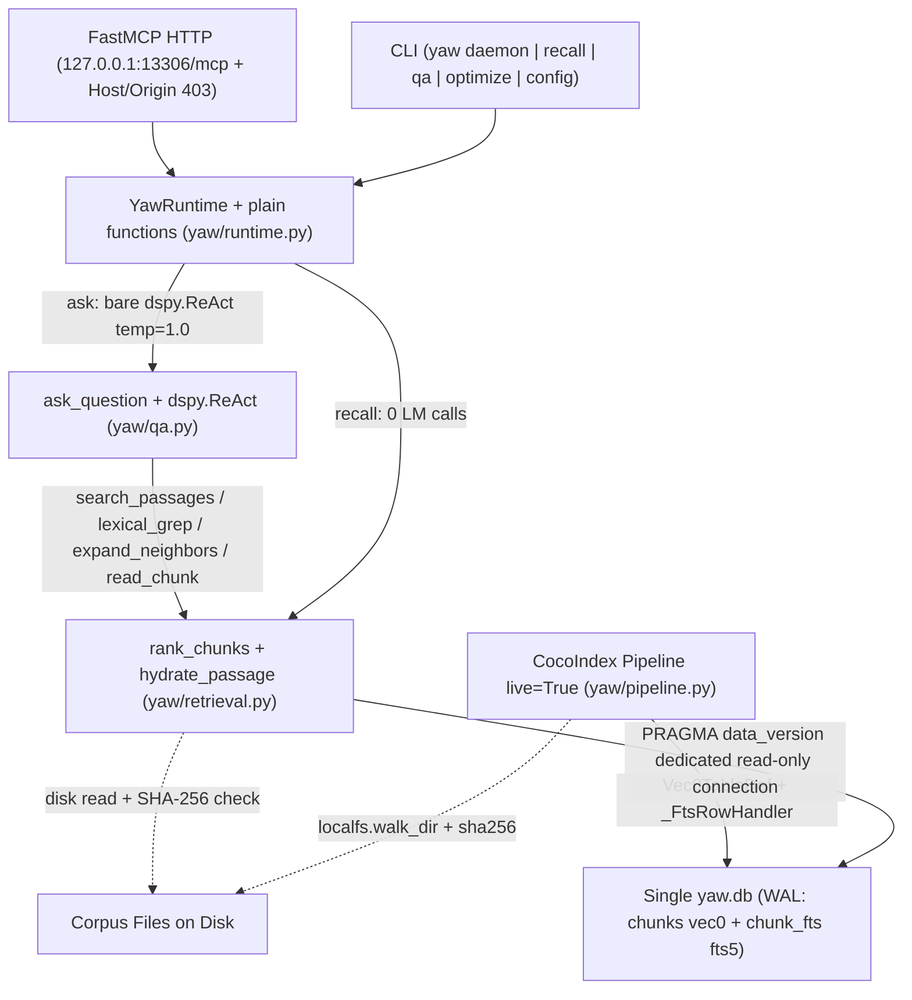

# Clean-Slate Zero-Wrapper YAW Replacement Sprint Specification

**Status:** Execution Active (`CS-0`..`CS-6`) | **Baseline Commit:** `63c9c00` (dirty checkout) | **Decisions:** [Epic 1 Decisions 17–20](../epic-1-hipporag-daemon.md#decisions), [Epic 2 Decisions](../epic-2-fastmcp-http.md#decisions), [Epic 3 Decisions](../epic-3-performance.md#decisions)

| Relation | Links |
| --- | --- |
| Governed by | [FOUNDATIONAL.md](../../FOUNDATIONAL.md), [AGENTS.md](../../AGENTS.md), [epic-1-hipporag-daemon.md](../epic-1-hipporag-daemon.md#decisions) (`Decisions 17–20`), [epic-2-fastmcp-http.md](../epic-2-fastmcp-http.md#decisions), [epic-3-performance.md](../epic-3-performance.md#decisions) |
| Rules | [yaw.md](../../.agents/rules/yaw.md), [daemon.md](../../.agents/rules/daemon.md), [graph-storage.md](../../.agents/rules/graph-storage.md), [inference.md](../../.agents/rules/inference.md), [tests.md](../../.agents/rules/tests.md), [canonical-files.md](../../.agents/rules/canonical-files.md), [docs.md](../../.agents/rules/docs.md) |
| Owns code `[target]` | `yaw/__init__.py`, `yaw/__main__.py`, `yaw/core/{__init__,config,logger,types}.py`, `yaw/pipeline.py`, `yaw/retrieval.py`, `yaw/qa.py`, `yaw/datasets.py`, `yaw/runtime.py`, `yaw/mcp_server.py`, `yaw/optimize.py`, `yaw/cli.py` |
| Peers | [native-cocoindex-indexing.md](../native-cocoindex-indexing.md) (defers live file ingestion), [native-cocoindex-graph.md](../native-cocoindex-graph.md) (supersedes OpenIE graph publication), [dspy-improvements.md](../dspy-improvements.md) (consumes bare `dspy.ReAct` and `dspy.GEPA`) |
| References | [HippoRAG (`2405.14831v3`)](../arxiv-2405.14831v3-hipporag.md), [HippoRAG 2 (`2502.14802v1`)](../arxiv-2502.14802v1-hipporag2.md), [model-evaluation.md](../model-evaluation.md) |
| Supersedes / superseded by | Supersedes all 21 legacy OpenIE/W3C/GBNF/SHACL/PPR/RLM/custom-sqlite modules, wrapper subclasses (`YawQA`, `ReflectionLM`, `DSPyEmbeddingAdapter`, `RLMInstructionProposer`), and the nested `yaw/daemon/graph/{storage,inference}` tree; defers `dspy.RLM` / Deno REPL over `>100K`-token raw docs to [epic-3-performance.md](../epic-3-performance.md) |
| Records | [substate-manifold-shootout.md](substate-manifold-shootout.md), [evaluation.md](../evaluation.md), [evaluation-graph-storage.md](../evaluation-graph-storage.md) |

---

## 1. Scope & Non-Goals

### In Scope
Clean-slate, zero-backward-compatibility, zero-wrapper replacement collapsing YAW into **`14` Python files** (`8` domain modules + `4` `yaw/core/` modules + `__init__.py` + `__main__.py`, totaling `<= 3,000` LOC `[target]`) across `4` decoupled layers:
1. **Native Declarative `CocoIndex` Indexing (`yaw/pipeline.py`):** Starts in continuous live mode when daemon starts (`localfs.walk_dir(..., live=True)`), mounts native `cocoindex.connectors.sqlite` `vec0` table (`chunks`) + `_FtsRowHandler(coco.TargetHandler)` registered via `coco.register_root_target_states_provider("yaw/fts5", ...)` sharing `SQLITE_DB` (`sqlite.ManagedConnection`) creating/updating `chunk_fts` (`fts5(title, body, content='', contentless_delete=1)`) inside `_apply` (`conn_mgr.transaction()`), using bare `dspy.Embedder` + pure formatting helpers in `yaw/core/types.py`, zero `DatabaseSink`, zero `manifold_epoch` / `meta` / `source_chunks` / `entities` / `facts` / `edges` tables, and zero generative LLM indexing calls.
2. **Bare `dspy.ReAct` QA Engine (`yaw/qa.py`):** Bare `dspy.ReAct(AnswerQuestion, tools=[search_passages, lexical_grep, expand_neighbors, read_chunk], max_iters=cfg.react_max_iters)` (`default 6` `[target]`) returned directly by `build_qa_agent(...) -> dspy.ReAct` (zero `YawQA(dspy.Module)` wrapper). Plain boundary helper `ask_question(...) -> QAResult` acquires `Semaphore(1)` for local Gemma 4 (`gemma-4-e4b`, `temperature=1.0` unconditionally), validates `termination_reason in ("submit", "forced_submit")` with non-empty history, and verifies cited `evidence_chunk_ids` against tool history and on-disk SHA-256 hashes (`stale_on_disk`).
3. **Verbatim Zero-LLM `Recall@N` & Disk Hydration (`yaw/retrieval.py`):** Hybrid zero-LLM ranker (ABTT Marchenko-Pastur isotropic nulling + CSLS hubness penalty + BM25/squared-IDF bigram overlap + spaCy noun-phrase 2-hop bridging + geometric-mean branch coalition + Submodular MMR) reading WAL `chunks` via `PRAGMA data_version` snapshot invalidation and hydrating 1-indexed `[start_line, end_line]` slices via `hydrate_passage` (`~40` LOC, SHA-256 verified, zero standalone `hydrate.py` module).
4. **Plain `YawRuntime`, `FastMCP` HTTP, Bare-`ReAct` Optimizer & Clean CLI (`yaw/runtime.py`, `yaw/mcp_server.py`, `yaw/optimize.py`, `yaw/cli.py`):**
   - `yaw/runtime.py`: Plain `@dataclass(slots=True) class YawRuntime` handle bundle + plain lifecycle/dispatch functions (`start_runtime`, `close_runtime`, `get_retrieval_index`, `recall`, `ask`, `get_status`, `wait_ready`), replacing OOP `YawEngine`.
   - `yaw/mcp_server.py`: `FastMCP("yaw")` on `127.0.0.1:13306/mcp` with pre-dispatch `Host`/`Origin` `403` guard, `/healthz`, `/readyz`, exposing exact `3` read-only tools (`recall`, `qa`, `daemon_status`).
   - `yaw/optimize.py`: Bare `dspy.LM(..., temperature=1.0)` + plain `make_react_instruction_proposer` (`ProposalFn`) driving bare `dspy.ReAct(ProposeInstruction, tools=[list_examples, inspect_example], max_iters=6)` for QA-only `dspy.GEPA` (`yaw optimize dspy`), plus lazy `import optuna` `[retrieval]` tuning (`yaw optimize optuna`). Zero `ReflectionLM(dspy.BaseLM)`, zero `RLMInstructionProposer`, zero `SIMBA`.
   - `yaw/cli.py`: `yaw daemon {run|start|stop|status}`, `yaw recall`, `yaw qa`, `yaw optimize {dspy|optuna}`, `yaw config`.

### Non-Goals
- Wrapper subclasses (`dspy.Module`, `dspy.BaseLM`, `dspy.Adapter`), backward compatibility shims, legacy OpenIE/W3C/SHACL/PPR/DatabaseSink retention, or dual-path flags.
- Retaining `dspy.RLM` or Deno WASM Pyodide REPL for tool-bounded QA or reflection (parked in [Epic 3](../epic-3-performance.md) for `>100K`-token raw docs).
- Full-corpus multi-day academic benchmarking runs (parked in [Epic 3](../epic-3-performance.md)).

---

## 2. Problem Statement & Measured Spaghetti Audit (`63c9c00, dirty`)

Measured repository inventory (`[measured: 63c9c00, dirty]`):
- `yaw/`: `53` Python files totaling `28,683` lines.
- `scripts/`: `8` Python files totaling `4,639` lines (`scripts/watchdog.py` alone is `2,120` lines).
- `tests/`: `99` Python files totaling `37,171` lines.

Layer-by-layer bloat verified directly in source code:
- **`hydration.py` (`1,133` lines `[measured: 63c9c00, dirty]`):** ~`900` lines of AST folding, upward scope climbing, JSON passage repair, `MutableSpan` state, and SQLite subgraph formatting vs ~`40` lines `[target]` needed inside `yaw/retrieval.py:hydrate_passage`.
- **`corpus.py` (`488` lines `[measured: 63c9c00, dirty]`):** ~`70%` `[observed: corpus.py:120-410]` custom regex/pattern AST projectors instead of `RecursiveSplitter` + minimal Markdown heading lookup + JSON doc loader.
- **Custom SQLite & CocoIndex Glue (`2,396` lines `[measured: 63c9c00, dirty]`):** `db.py` (`436`), `managed_sqlite.py` (`307`), `rows.py` (`418`), `vectors.py` (`262`), `source_targets.py` (`189`), `indexing.py` (`784`).
- **Inference, Proposer, Reflection & Engine Bloat (`12,491+` lines `[measured: 63c9c00, dirty]`):** `program.py` (`1,319`), `optimizer.py` (`1,695`), `proposer.py` (`766`), `reflection.py` (`237`), `chat.py` (`451`), `completions.py` (`199`), `adapter.py` (`160`), `grammars.py` (`434`), `rlm.py` (`113`), `engine.py` (`1,799`), `planner.py` (`1,402`), `graph_ops.py` (`1,884`), `shacl.py` (`1,983`), `ppr.py` (`286`).

Measured Pass-4 shootout baseline (`[measured: outputs/benchmarks/shootout_pass4_v3_4ds_10q.json, 63c9c00, dirty]`):
- Held-out `offset=0` (`40q`, `10` queries across `2wikimultihopqa`, `musique`, `hotpotqa`, `popqa`):
  - **Historical Optuna Retrieval:** Macro `R@1/2/5/10/20 = 0.4333 / 0.6583 / 0.8146 / 0.8938 / 0.9854`, `EM = 0.1250`, `F1 = 0.2482` (`45.4962 s`). Clears `PAPER_BASELINES` macro `R@5` (`0.8146 >= 0.7828` `[measured: outputs/benchmarks/consolidated_historical_baselines.json]`).
  - **Legacy `ppr.py` + OpenIE:** Macro `R@1/2/5/10/20 = 0.3396 / 0.5521 / 0.7021 / 0.8292 / 0.9250`, `EM = 0.0750`, `F1 = 0.1908` (`34.3296 s`). Paired gain: `+0.1125 R@5`.

---

## 3. Falsifiable Goals (`G1`–`G5`)

### G1: Clean-Slate Zero-Wrapper Flat Architecture
- **Measure:** Total LOC across `yaw/**/*.py`; table count in `yaw.db`; AST import & inheritance topology.
- **Reference:** `63c9c00, dirty` (`53` files / `28,683` LOC).
- **Passes when:** `yaw/` totals `<= 3,000` LOC across `14` Python files (`8` domain modules + `4` `yaw/core/` modules + `__init__.py` + `__main__.py`) `[target]`; `0` classes in `yaw/**/*.py` subclass `dspy.Module`, `dspy.BaseLM`, or `dspy.Adapter` `[target]`; exactly `2` virtual tables exist in `yaw.db` (`chunks` `vec0` and `chunk_fts` `fts5`) `[target]`; `0` symbols matching `manifold` or `hmm` exist in target modules, tables, TOML sections, or CLI options `[target]`; `test_architecture.py` passes `100%` `[target]`.
- **Fails if / does not count:** Wrapper subclasses (`YawQA`, `ReflectionLM`, `DSPyEmbeddingAdapter`) remain; dead OpenIE/PPR/W3C modules remain; relational `entities`/`facts`/`meta` tables remain; flags used instead of code deletion.

### G2: Native Declarative Live Indexing
- **Measure:** Live file updates under `localfs.walk_dir(..., live=True)`; LLM calls during indexing; row equivalence on `64+64` vs `128` chunk inputs.
- **Reference:** Continuous live ingestion contract ([native-cocoindex-indexing.md](../native-cocoindex-indexing.md)).
- **Passes when:** `0` LLM calls during indexing `[target]`; `64+64` and `128` micro-batch inputs yield bit-identical `chunks` and `chunk_fts` rows `[target]`; SQLite WAL allows concurrent reads during live updates `[target]`; edits/deletions on disk reconcile cleanly via `_FtsRowHandler` `[target]`.
- **Fails if / does not count:** Raw chunk text stored in `chunks`; `DatabaseSink` or custom retry wrappers re-introduced; watcher restarts per query; indexing stalls reader queries.

### G3: Verbatim Zero-LLM `Recall@N`
- **Measure:** LLM completion count inside `recall()`; query embedding count; held-out `[0, 10)` 4-dataset macro `R@5`.
- **Reference:** Pass-4 baseline `0.8146 R@5` `[measured: outputs/benchmarks/shootout_pass4_v3_4ds_10q.json, 63c9c00, dirty]`.
- **Passes when:** `0` `dspy.LM` calls during `recall()` `[target]`; `<= 1` query embedding call per query (`BoundedSemaphore(2)`) `[target]`; held-out `[0, 10)` macro `R@5 >= 0.8146` `[target]` cleanly reproduced on the declarative schema with `PRAGMA data_version` snapshot invalidation; 1-indexed `[start_line, end_line]` slices hydrated from disk `[target]`.
- **Fails if / does not count:** Routing `recall` through LLMs; falling back to DPR or legacy PPR; returning stale disk text without `stale_on_disk=True`; loosening thresholds after runs.

### G4: Bare `dspy.ReAct` Multi-Hop QA Engine
- **Measure:** Held-out `[0, 10)` 4-dataset macro `EM` and `F1` on local `gemma-4-e4b` (`temperature=1.0`); SQLite writes during QA; tool iterations.
- **Reference:** Single-pass Pass-4 baseline (`EM = 0.1250`, `F1 = 0.2482` `[measured]`).
- **Passes when:** Bare `dspy.ReAct` QA strictly improves over baseline (`EM > 0.1250` `[target]`, `F1 > 0.2482` `[target]`); `0` SQLite writes during QA `[target]`; tool iterations bounded by `default 6` `[target]`; citations grounded strictly in `pred.history` seen chunks with SHA-256 freshness `[target]`; `Semaphore(1)` around `dspy.LM` prevents GPU thrashing `[target]`.
- **Fails if / does not count:** Retaining `dspy.Module` QA wrappers, `dspy.RLM`, or Deno REPL; unbounded tool loops; mocked LLM responses counted as quality proof; ungrounded hallucinated citations; swallowing failed termination reasons.

### G5: `FastMCP` Streamable HTTP & Clean CLI
- **Measure:** ASGI loopback TCP & HTTP transport tests; `Host`/`Origin` `403` security; CLI command execution.
- **Reference:** [epic-2-fastmcp-http.md](../epic-2-fastmcp-http.md) transport specifications.
- **Passes when:** `FastMCP("yaw")` serves `127.0.0.1:13306/mcp`, `/healthz` (`200`), `/readyz` (`200` iff runtime ready, `503` otherwise); non-loopback binds and bad `Host`/`Origin` return `403` `[target]`; exposes exact `3` read-only tools (`recall`, `qa`, `daemon_status`) `[target]`; CLI commands `yaw daemon {run|start|stop|status}`, `yaw recall`, `yaw qa`, `yaw optimize {dspy|optuna}`, `yaw config` pass cleanly `[target]`; `mcp_server.py` imports only `yaw.runtime`, `yaw.core.*`, `fastmcp`, Starlette/ASGI, `uvicorn`, stdlib `[target]`.
- **Fails if / does not count:** Non-loopback access without auth; bypassing `403` checks; accepting non-integer `top_k`; retaining `yaw index` or `yaw graph` in CLI; stdio hacks used instead of Streamable HTTP.

---

## 4. Semantics, State Ownership & Concurrency



### State Ownership & Isolation

| Resource | Single Owner & Write Path | Concurrent Reader Access | Concurrency & Freshness Guarantee |
| --- | --- | --- | --- |
| `yaw.db` (`chunks`, `chunk_fts`) | `CocoIndex` `sqlite.connect(load_vec=True)` wraps a single connection for writes (`yaw/pipeline.py`). | Dedicated read-only SQLite connections (`open_readonly_db` using `mode=ro`, `busy_timeout=30000`, `sqlite_vec.load`) in `retrieval.py`. | SQLite WAL mode configured in autocommit (`conn_mgr.readonly()`) outside `.transaction()`. Readers check `PRAGMA data_version` under `RLock` and NEVER share `ManagedConnection._conn`. |
| Declarative FTS5 Target (`chunk_fts`) | `_FtsRowHandler(coco.TargetHandler)` registered via `coco.register_root_target_states_provider("yaw/fts5", ...)`. | Read-only BM25 queries via dedicated read-only connections. | Created/updated inside `_apply` (`conn_mgr.transaction()`), guaranteeing zero triggers on virtual tables and zero imperative SQL writes outside target sinks. |
| In-Memory `RetrievalIndex` | Guarded by `YawRuntime.index_lock` (`threading.RLock`). | Shared immutable `RetrievalIndex` read concurrently by `recall` and `qa`. | When `PRAGMA data_version` increments, rebuilds isotropic basis and postings, then swaps `YawRuntime.index` under `index_lock`. |
| CocoIndex LMDB Feature Cache | Persistent `<state_dir>/coco_lmdb` cache directory. | Shared across daemon runs. | `@coco.fn(memo=True)` stores embeddings, token hashes, and spaCy entities keyed by content digest. |
| Local GPU Endpoint (`127.0.0.1:8888/v1`) | Bare `dspy.Embedder` and bare `dspy.LM` (`gemma-4-e4b`). | Shared across embedding and generation calls. | Embedding calls acquire `BoundedSemaphore(2)`. Generative `dspy.LM` calls acquire `Semaphore(1)` with `temperature=1.0` unconditionally. |
| Corpus Files on Disk | External file system watched by `localfs.walk_dir(..., live=True)`. | `hydrate_passage` in `yaw/retrieval.py` reads 1-indexed lines on demand. | Compares `source_hash` SHA-256; if mutated or missing, returns `stale_on_disk=True` with empty body (zero raw fallbacks). |

---

## 5. Clean-Slate 14-File Package Design & Exact Contracts

### Target Module Line Budgets (14 Files, `<= 3,000` LOC `[target]`)

| Target File | Target LOC | Role & Public API |
| --- | ---: | --- |
| `yaw/__init__.py` | `0` | Empty intermediate package file (`test_architecture.py`). |
| `yaw/__main__.py` | `8` | CLI entry point (`yaw.cli:main`). |
| `yaw/core/__init__.py` | `~25` | Leaf facade exporting core types, config, and formatters. |
| `yaw/core/config.py` | `~220` | `RetrievalParams`, `YawConfig`, `load_config`, `get_config_value`, `set_config_value`, `write_retrieval_section`, `resolve_coco_state_root`. |
| `yaw/core/logger.py` | `~144` | 500-line FIFO rotating handler (`FIFOLineRotatingHandler`, `configure_logging`, `get_logger`). |
| `yaw/core/types.py` | `~160` | `ErrorCode`, `YawRuntimeError`, `ChunkPointer`, `HydratedPassage`, `QAResult`, `DaemonStatus`, `compute_chunk_int_id`, `format_query_for_embedding`, `format_doc_for_embedding`, `resolve_corpus_path`. |
| `yaw/pipeline.py` | `~230` | Declarative CocoIndex pipeline: `Vec0TableDef` (`chunks`) + `_FtsRowHandler` (`chunk_fts`) + bare `dspy.Embedder` under `live=True`. |
| `yaw/retrieval.py` | `~490` | Zero-LLM ranker (`RetrievalIndex`, `EvidenceHop`, `RetrievalTrace`, `open_readonly_db`, `hydrate_passage`, `build_retrieval_index`, `query_external_hints`, `rank_chunks`). |
| `yaw/qa.py` | `~180` | `AnswerQuestion`, `make_qa_tools`, `build_qa_agent` (returns bare `dspy.ReAct`), `ask_question` (termination + citation verification). |
| `yaw/datasets.py` | `~210` | Dataset registry, bundle prep, slice builders, and metrics (`RetrievalRecall`, `QAExactMatch`, `QAF1Score`). |
| `yaw/runtime.py` | `~130` | Plain `YawRuntime` dataclass + plain functions (`start_runtime`, `close_runtime`, `get_retrieval_index`, `recall`, `ask`, `get_status`, `wait_ready`). |
| `yaw/mcp_server.py` | `~180` | `FastMCP("yaw")` on `127.0.0.1:13306/mcp`, `/healthz`, `/readyz`, `Host`/`Origin` `403`, exposing exact `3` tools (`recall`, `qa`, `daemon_status`). |
| `yaw/optimize.py` | `~260` | QA-only `dspy.GEPA` (`make_react_instruction_proposer` using bare `dspy.ReAct` over stripped trace tools) + Optuna `[retrieval]` tuner (`optimize_optuna`, lazy `import optuna`). |
| `yaw/cli.py` | `~260` | Unified CLI (`daemon`, `recall`, `qa`, `optimize`, `config`). |
| **Total** | **`~2,497`** | **Zero wrapper classes; strictly below `<= 3,000` LOC ceiling (`>= 90%` reduction from `28,683` LOC).** |

### Exact Contracts

```python
# 1. Pure Core Embedding Formatters (yaw/core/types.py — zero dspy wrapper)
def format_query_for_embedding(query: str, task_mode: str = "distinct-titled") -> str: ...
def format_doc_for_embedding(text: str, title: str = "", task_mode: str = "distinct-titled") -> str: ...

# 2. Retrieval Parameters & Kernel Interface (yaw/core/config.py + yaw/retrieval.py)
@dataclass(frozen=True, slots=True)
class RetrievalParams:
    peclet: float = 0.3375533823900754
    alpha_sprt: float = 0.07953934952508675
    redundancy_curvature: float = 0.834659004285133
    coalition_coupling: float = 0.3887505167779042
    external_trust: float = 0.26842185514853145

def open_readonly_db(db_path: Path) -> sqlite3.Connection: ...
def hydrate_passage(corpus_root: Path, ptr: ChunkPointer, score: float = 0.0, *, max_chars: int = 4000) -> HydratedPassage: ...
def build_retrieval_index(conn: sqlite3.Connection, params: RetrievalParams | None = None) -> RetrievalIndex: ...
def rank_chunks(index: RetrievalIndex, query_vec: NDArray[np.float32], query_text: str, *, top_k: int = 5, fts_scores: Mapping[int, float] | None = None, vec_scores: Mapping[int, float] | None = None, params: RetrievalParams | None = None) -> RetrievalTrace: ...

# 3. Bare dspy.ReAct QA (yaw/qa.py — zero dspy.Module subclass)
def build_qa_agent(tools: list[Callable[..., Any]], max_iters: int = 6) -> dspy.ReAct:
    return dspy.ReAct(AnswerQuestion, tools=tools, max_iters=max_iters)

def ask_question(agent: dspy.ReAct, question: str, *, corpus_root: Path, index: RetrievalIndex, lm: dspy.LM, lm_sem: threading.Semaphore) -> QAResult: ...

# 4. Bare dspy.ReAct GEPA ProposalFn (yaw/optimize.py — zero ReflectionLM / BaseLM subclass)
def make_react_instruction_proposer(*, max_chars: int = 1500, max_iters: int = 6, lm_sem: threading.Semaphore | None = None) -> ProposalFn: ...
```

---

## 6. Phased Execution Checkpoints (`CS-0`..`CS-6`)

| Checkpoint | Bounded Scope & Deliverables | Exit Gate (`[target]`) |
| --- | --- | --- |
| **`CS-0` Clean-Slate Spec & Plan Alignment** | Update `epic-1-hipporag-daemon.md` (`Decision 20` item 8), `epic-3-performance.md`, `evaluation.md`, `bare-bones-replacement-sprint.md`, and `implementation_plan.md` for zero wrappers (`14` files, `<= 3,000` LOC). | `test_architecture.py` doc checks & `git diff --check` pass cleanly; `0` `file:///` links in `docs/`. |
| **`CS-1` Core Primitives & Declarative Pipeline** | Add `RetrievalParams`, `QAResult`, `compute_chunk_int_id`, and pure embedding formatters in `yaw/core/*`; implement `yaw/pipeline.py` (2-table `chunks` `vec0` + `chunk_fts` `fts5` under `live=True`). | Unmocked `tests/test_pipeline.py` proves WAL concurrency, edit/delete reconciliation, `64+64==128` row invariance, and zero LLM calls. |
| **`CS-2` Datasets, Zero-LLM Retrieval & Bare `ReAct` QA** | Implement `yaw/datasets.py`, `yaw/retrieval.py` (including `hydrate_passage` & `open_readonly_db`), and `yaw/qa.py` (bare `dspy.ReAct` + plain `ask_question`). | `tests/test_retrieval.py` and `tests/test_qa.py` pass unmocked SQLite/disk mutation tests; zero wrapper subclasses. |
| **`CS-3` Runtime, FastMCP HTTP, Bare-`ReAct` Optimizer & CLI** | Run `uv add fastmcp && uv sync --locked`; implement `yaw/runtime.py`, `yaw/mcp_server.py`, `yaw/optimize.py` (`make_react_instruction_proposer` + Optuna), and `yaw/cli.py`. | `tests/test_mcp_server.py`, `tests/test_optimize.py`, and `tests/test_cli.py` verify HTTP `3` tools, `403` guard, stripped GEPA inputs, and Optuna tuning. |
| **`CS-4` Atomic Purge, Governance & AST No-Wrapper Ratchet** | Delete `yaw/core/constants.py`, `yaw/daemon/**`, `scripts/calibrate_candidates.py`, legacy `tests/daemon/**`; update `yaw.toml`, `pyproject.toml`, `README.md`, `benchmark.py`, `scripts/*`, governance docs, `.agents/rules/*.md`, and `tests/core/test_architecture.py`. | `yaw/` `14` files `<= 3,000` LOC; `0` wrapper subclasses (`Module`/`BaseLM`/`Adapter`); `0` `manifold`/`hmm`; `test_architecture.py` `100%` green. |
| **`CS-5` Live Silicon Parity & LOC Audit** | Run live `gemma-4-e4b` + `embeddinggemma-2` held-out `[0, 10)` 4-dataset retrieval + QA parity evaluation and 2-query GEPA smoke test; verify LOC counts. | `R@5 >= 0.8146` (`0` LM calls), `EM > 0.1250`, `F1 > 0.2482` (`temp=1.0`), `yaw/ <= 3,000` LOC, `watchdog.py <= 350` LOC. |
| **`CS-6` Evaluation Ledger & Final Whole-Repo Gates** | Update `docs/evaluation.md` and `docs/reviews/bare-bones-replacement-sprint.md`; run full `ty check`, `ruff check`, `ruff format --check`, `pytest --no-testmon`, `git diff --check`, and final Critic audit. | All mandatory repository quality gates `100%` green; zero findings from Critic. |

---

## 7. Implementation Checkpoint Ledger

*(Updated per checkpoint commit only with verified gate evidence.)*

- [x] **CS-0 (Clean-Slate Spec & Plan Alignment):** Reconciled [epic-1-hipporag-daemon.md](../epic-1-hipporag-daemon.md), [epic-3-performance.md](../epic-3-performance.md), [evaluation.md](../evaluation.md), and this sprint spec to the 14-file zero-wrapper architecture (`<= 3,000` LOC target). Verified via `tests/core/test_architecture.py` (`16 passed`) and `git diff --check`.
- [x] **CS-1 (Core Primitives & Declarative Pipeline):** Extended [types.py](../../yaw/core/types.py), [config.py](../../yaw/core/config.py), and [__init__.py](../../yaw/core/__init__.py) (`RetrievalParams`, `QAResult`, `compute_chunk_int_id`, embedding formatters); implemented [pipeline.py](../../yaw/pipeline.py) (2-table `chunks` `vec0` + `chunk_fts` `fts5` under CocoIndex, 64-chunk batching, fail-fast `INDEXING_ERROR_SINK` + `num_errors` checks, `AsyncGenerator.aclose()` stream cleanup) and 7 unmocked integration tests in [test_pipeline.py](../../tests/test_pipeline.py) (edit/delete reconciliation, `64+64==128` row invariance, live WAL concurrency, loopback `dspy.Embedder` L2 norm, batch/live/incremental failure propagation), plus temporary `str(p.chunk_id)` compatibility in [hmm.py](../../yaw/daemon/graph/hmm.py). Namespaced CocoIndex keys under `yaw/pipeline/*` until `CS-4` removes legacy indexing. Verified: `ty check` (`All checks passed!`), `ruff check` / `ruff format --check`, `pytest --no-testmon --no-cov tests/test_pipeline.py tests/core/` (`83 passed in 10.73s`, zero warnings), `git diff --check`, and unguided `critic (Model="flash")` re-audit (`ZERO FINDINGS`).
- [ ] **CS-2 (Datasets, Zero-LLM Retrieval & Bare `ReAct` QA):** Pending.
- [ ] **CS-3 (Runtime, FastMCP HTTP, Bare-`ReAct` Optimizer & CLI):** Pending.
- [ ] **CS-4 (Atomic Purge, Governance & AST No-Wrapper Ratchet):** Pending.
- [ ] **CS-5 (Live Silicon Parity & LOC Audit):** Pending.
- [ ] **CS-6 (Evaluation Ledger & Final Whole-Repo Gates):** Pending.
