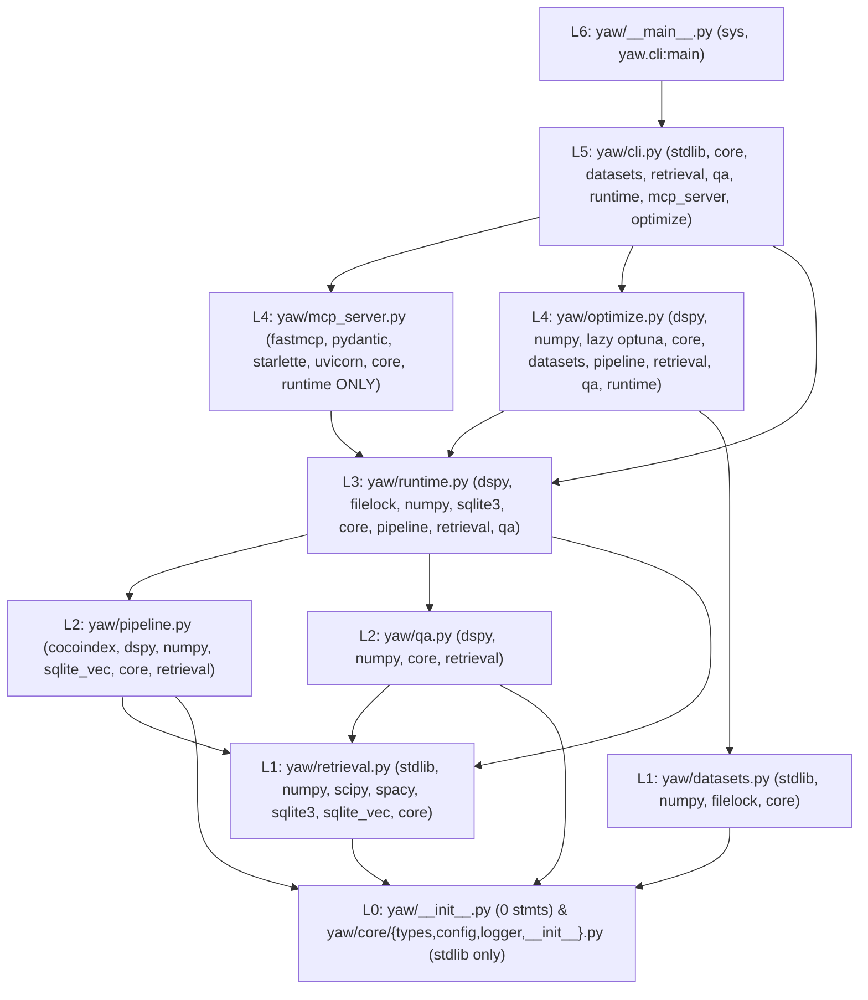

# Clean-Slate Zero-Wrapper YAW Replacement Sprint Specification

**Status:** Execution Active (`CS-0`..`CS-6`) | **Baseline Commit:** `63c9c00` (dirty checkout) | **Current HEAD:** `b8b65ec` (dirty, post-`CS-1`) | **Decisions:** [Epic 1 Decisions 17–20](../epic-1-hipporag-daemon.md#decisions), [Epic 2 Decisions](../epic-2-fastmcp-http.md#decisions), [Epic 3 Decisions](../epic-3-performance.md#decisions)

| Relation | Links |
| --- | --- |
| Governed by | [FOUNDATIONAL.md](../../FOUNDATIONAL.md) (`CS-4c` amends `§4.4` `temperature=1.0` & `§5` `14`-file flat package), [AGENTS.md](../../AGENTS.md), [epic-1-hipporag-daemon.md](../epic-1-hipporag-daemon.md#decisions) (`Decisions 17–20`), [epic-2-fastmcp-http.md](../epic-2-fastmcp-http.md#decisions) (updated to `3` tools `[target]`), [epic-3-performance.md](../epic-3-performance.md#decisions) |
| Rules | [yaw.md](../../.agents/rules/yaw.md) (`CS-4c` amends `§1` to drop `constants.py`), [daemon.md](../../.agents/rules/daemon.md), [graph-storage.md](../../.agents/rules/graph-storage.md), [inference.md](../../.agents/rules/inference.md), [tests.md](../../.agents/rules/tests.md), [canonical-files.md](../../.agents/rules/canonical-files.md), [docs.md](../../.agents/rules/docs.md) |
| Owns code `[target]` | `yaw/__init__.py`, `yaw/__main__.py`, `yaw/core/{__init__,config,logger,types}.py`, `yaw/pipeline.py`, `yaw/retrieval.py`, `yaw/qa.py`, `yaw/datasets.py`, `yaw/runtime.py`, `yaw/mcp_server.py`, `yaw/optimize.py`, `yaw/cli.py` |
| Peers | [native-cocoindex-indexing.md](../native-cocoindex-indexing.md) (defers live file ingestion), [native-cocoindex-graph.md](../native-cocoindex-graph.md) (supersedes OpenIE graph publication), [dspy-improvements.md](../dspy-improvements.md) (consumes bare `dspy.ReAct` and `dspy.GEPA`) |
| References | [HippoRAG (`2405.14831v3`)](../arxiv-2405.14831v3-hipporag.md), [HippoRAG 2 (`2502.14802v1`)](../arxiv-2502.14802v1-hipporag2.md), [model-evaluation.md](../model-evaluation.md) |
| Supersedes / superseded by | Supersedes `21` legacy OpenIE/W3C/GBNF/SHACL/PPR/RLM/custom-sqlite modules (`[measured: b8b65ec]`), wrapper subclasses (`YawQA`, `ReflectionLM`, `DSPyEmbeddingAdapter`, `RLMInstructionProposer`), and the nested `yaw/daemon/graph/{storage,inference}` tree; defers `dspy.RLM` / Deno REPL over `>100K`-token raw docs (`[observed: epic-3-performance.md]`) to [epic-3-performance.md](../epic-3-performance.md) |
| Records | [substate-manifold-shootout.md](substate-manifold-shootout.md), [evaluation.md](../evaluation.md), [evaluation-graph-storage.md](../evaluation-graph-storage.md) |

---

## 1. Scope, Non-Goals & Architecture Overview

### In Scope
Clean-slate, zero-backward-compatibility, zero-wrapper replacement collapsing YAW into **`14` Python files `[target]`** (`8` domain modules + `4` `yaw/core/` modules + `yaw/__init__.py` + `yaw/__main__.py`, totaling `<= 3,000` LOC `[target]`) across **`4` decoupled layers `[target]`**, governed by [Epic 1 Decisions 17–20](../epic-1-hipporag-daemon.md#decisions):
1. **Layer 1 — Native Declarative Live Indexing (`yaw/pipeline.py`):** Continuous live `CocoIndex` (`1.2.0` `[measured: uv.lock, b8b65ec]`) ingestion via `localfs.walk_dir(..., live=live)` mounting `chunks` (`vec0` cosine KNN + auxiliary metadata, `0` raw text columns `[target]`) and `_FtsTableHandler` (`chunk_fts` `fts5(title, body, content='', contentless_delete=1)`), backed by bare `dspy.Embedder` (`BoundedSemaphore(2)` at `pipeline.py:299` `[measured: b8b65ec]`), `spaCy` feature extraction imported from `yaw.retrieval`, and `0` generative LLM indexing calls `[target]`.
2. **Layer 2 — Zero-LLM Hybrid Retrieval & Datasets (`yaw/retrieval.py`, `yaw/datasets.py`):** Pure zero-LLM `VectorSearch` (`search_vectors`, ABTT Marchenko–Pastur isotropic nulling + CSLS `k=8` `[measured: hmm.py]` hubness penalty + BM25/squared-IDF bigram overlap + `spaCy` noun-phrase `2`-hop bridging `[measured: hmm.py]` + geometric-mean branch coalition + Submodular MMR) reading WAL `yaw.db` via `open_readonly_db` and `PRAGMA data_version`, hydrating `1`-indexed `[start_line, end_line]` `[target]` disk slices via `hydrate_passage` with SHA-256 verification; plus dataset manifest/metric utilities in `yaw/datasets.py`.
3. **Layer 3 — Bare `dspy.ReAct` QA & Plain `YawRuntime` (`yaw/qa.py`, `yaw/runtime.py`):** Bare `dspy.ReAct(AnswerQuestion, tools=[search_passages, lexical_grep, expand_neighbors, read_chunk], max_iters=6)` `[target]` returned directly by `build_qa_agent(...)`, serialized under `Semaphore(1)` `[target]` for local Gemma 4 (`gemma-4-e4b`, `temperature=1.0` unconditionally `[target]`) with `ask_question` validating termination and tool-history/SHA-256 citation grounding; plain `@dataclass(slots=True) class YawRuntime` + module functions replacing OOP `YawEngine`.
4. **Layer 4 — `FastMCP` HTTP, Bare-`ReAct` Optimizer & CLI (`yaw/mcp_server.py`, `yaw/optimize.py`, `yaw/cli.py`, `yaw/__main__.py`):** `FastMCP("yaw")` Streamable HTTP on `127.0.0.1:13306/mcp` `[target]` with pre-dispatch `Host`/`Origin` `403` `[target]`, `/healthz`, `/readyz`, and exact `3` read-only tools `[target]` (`recall`, `qa`, `daemon_status`, aligning [epic-2-fastmcp-http.md](../epic-2-fastmcp-http.md) cleanly to Decision 20); bare `dspy.ReAct` `GEPA` instruction proposer (`make_react_instruction_proposer` stripping `"tools"` schemas) + lazy `import optuna` `[retrieval]` tuner; unified `yaw {daemon|recall|qa|optimize|config}` CLI. Planned `CS-4c` constitutional doc updates amend [FOUNDATIONAL.md §4.4 & §5](../../FOUNDATIONAL.md) (`temperature=1.0` unconditionally, `dspy.ReAct` bounded tools, `14`-file flat `yaw/` package) and [.agents/rules/yaw.md §1](../../.agents/rules/yaw.md) (deleting `constants.py`).

### Target 14-File LOC Budget (`<= 3,000` LOC Total Hard Ceiling `[target]`; Soft Idiomatic Module Guidance)
| File | Soft Guidance `[target]` | Layer | Role |
| --- | ---: | --- | --- |
| `yaw/__init__.py` | `0` `[target]` | L0 | Empty root package marker |
| `yaw/__main__.py` | `~8` `[measured: b8b65ec]` | L6 | CLI entrypoint (`yaw.cli:main`) |
| `yaw/core/types.py` | `~160` (`<= 180` `[target]`) | L0 | Frozen dataclasses, `ErrorCode`, ID & embedding formatters |
| `yaw/core/config.py` | `~220` (`<= 240` `[target]`) | L0 | `RetrievalParams`, `YawConfig`, atomic TOML load/edit |
| `yaw/core/logger.py` | `144` `[measured: b8b65ec]` | L0 | `500`-line FIFO logger `[measured: b8b65ec]` + third-party INFO suppression |
| `yaw/core/__init__.py` | `~30` (`<= 35` `[target]`) | L0 | Lazy `_PUBLIC_API` facade |
| `yaw/datasets.py` | `~310` (`<= 330` `[target]`) | L1 | Registry, bundles, slice builder, pure EM/F1/Recall metrics |
| `yaw/retrieval.py` | `~480` (`<= 500` `[target]`) | L1 | `VectorSearch`, `open_readonly_db`, `hydrate_passage`, `search_vectors` |
| `yaw/pipeline.py` | `~540` (`<= 560` `[target]`) | L2 | Declarative CocoIndex `chunks` (`vec0`) + `chunk_fts` (`fts5`) |
| `yaw/qa.py` | `~185` (`<= 200` `[target]`) | L2 | `AnswerQuestion`, `make_qa_tools`, `build_qa_agent`, `ask_question` |
| `yaw/runtime.py` | `~170` (`<= 180` `[target]`) | L3 | `YawRuntime` dataclass + plain lifecycle/dispatch functions |
| `yaw/mcp_server.py` | `~195` (`<= 210` `[target]`) | L4 | `FastMCP("yaw")` HTTP server, `403` guard, health routes, `3` tools `[target]` |
| `yaw/optimize.py` | `~265` (`<= 280` `[target]`) | L4 | Bare `ReAct` GEPA proposer (`optimize_dspy`) + `optimize_optuna` |
| `yaw/cli.py` | `~260` (`<= 280` `[target]`) | L5 | `daemon`, `recall`, `qa`, `optimize`, `config` CLI |
| **Hard Architectural Total** | **`<= 3,000` `[target]` (`~2,850` expected)** | — | **14 files cleanly typed with zero code-golfing (`>= 89%` reduction vs `29,695` LOC `[measured: b8b65ec]`)** |

### Non-Goals
- Wrapper subclasses (`dspy.Module`, `dspy.BaseLM`, `dspy.Adapter`), backward-compatibility shims, `"manifold"`/`"hmm"` aliases, feature flags, or dual-path code.
- Legacy OpenIE/W3C/OWL/SKOS/SHACL/PPR/DatabaseSink/candidate-cache persistence or `yaw index` / `yaw graph` / `yaw dspy` CLI domains.
- `dspy.RLM` / Deno WASM Pyodide REPL for tool-bounded QA/reflection or multi-day full-corpus benchmarks (deferred to [Epic 3](../epic-3-performance.md)).

---

## 2. Evidence-Tagged Problem Statement, Pinned Versions & Pass-4 Baselines

- **Legacy Spaghetti Bloat (`63c9c00` -> `b8b65ec, dirty`):**
  - Clean baseline commit `63c9c00`: `yaw/` `51` files / `24,397` LOC, `scripts/` `6` files / `3,657` LOC, `tests/` `97` files / `31,710` LOC `[measured: git ls-tree 63c9c00]`.
  - Pre-sprint checkout (`b8b65ec, dirty`, post-`CS-1` before `CS-2a`): `yaw/` `54` files / `29,695` LOC (`yaw/daemon/` `46` files / `26,980` LOC, `yaw/core/` `5` files / `1,901` LOC, `yaw/pipeline.py` `806` LOC, `yaw/__main__.py` `8` LOC, `yaw/__init__.py` `0` LOC) `[measured: b8b65ec, dirty]`; `scripts/` `8` files / `4,639` LOC (`scripts/watchdog.py` `2,120` LOC, `scripts/verify_paper_parity_gate.py` `1,207` LOC `[measured: b8b65ec, dirty]`); `tests/` `100` files / `37,520` LOC (`tests/test_pipeline.py` `349` LOC `[measured: b8b65ec, dirty]`).
  - Layer bloat at `b8b65ec, dirty`: `hydration.py` `1,133` LOC (`[measured: yaw/daemon/graph/storage/hydration.py, b8b65ec]`, replacing AST climbing/JSON repair with `~45` LOC `[target]` `hydrate_passage`); `corpus.py` `488` LOC; custom SQLite/CocoIndex glue `2,396` LOC (`db.py` `436`, `managed_sqlite.py` `307`, `rows.py` `418`, `vectors.py` `262`, `source_targets.py` `189`, `indexing.py` `784`); inference/engine/graph/ontology `12,728` LOC (`program.py` `1,319`, `optimizer.py` `1,695`, `proposer.py` `766`, `reflection.py` `237`, `chat.py` `451`, `completions.py` `199`, `adapter.py` `160`, `grammars.py` `434`, `rlm.py` `113`, `engine.py` `1,799`, `planner.py` `1,402`, `graph_ops.py` `1,884`, `shacl.py` `1,983`, `ppr.py` `286`) plus `runtime.py` (`1,874`), `cli.py` (`1,333`), `manifold_optuna.py` (`597`) `[measured: b8b65ec, dirty]`.
- **Locked Environment (`[measured: uv.lock, b8b65ec]`):** Python `3.14.9` (`.python-version` `[measured: .python-version, b8b65ec]`), `dspy == 3.5.0`, `cocoindex == 1.2.0`, `sqlite-vec == 0.1.9`, `scipy == 1.18.1`, `spacy == 3.8.18`, `en-core-web-sm == 3.8.0`, `optuna == 5.0.0`, `filelock == 4.2.10`, `numpy == 2.5.4`; `fastmcp == None` (uninstalled pending `CS-3a` `[measured: uv.lock, b8b65ec]`).
- **Pass-4 Held-Out `[0, 10)` Shootout Baselines (`n=40` across `2wikimultihopqa`, `musique`, `hotpotqa`, `popqa` `[measured: shootout_pass4_v3_4ds_10q.json, 63c9c00, dirty]`):**
  - **Optuna Pure-Chunk (`SubStateManifoldHMM`):** Macro `R@1/2/5/10/20 = 0.4333 / 0.6583 / 0.8146 / 0.8938 / 0.9854`, `EM = 0.1250`, `F1 = 0.2482`, `45.4962 s` eval (`2wiki 0.9250`, `musique 0.6333`, `hotpot 1.0000`, `popqa 0.7000` `R@5`) (`[measured: outputs/benchmarks/shootout_pass4_v3_4ds_10q.json, 63c9c00, dirty]`).
  - **Legacy `ppr.py` + OpenIE (`Current YAW`):** Macro `R@1/2/5/10/20 = 0.3396 / 0.5521 / 0.7021 / 0.8292 / 0.9250`, `EM = 0.0750`, `F1 = 0.1908`, `34.3296 s` eval (`[measured: outputs/benchmarks/shootout_pass4_v3_4ds_10q.json, 63c9c00, dirty]`; `+0.1125 R@5`, `+0.0500 EM`, `+0.0574 F1` `[measured]`).
  - **`PAPER_BASELINES` (`hipporag2_llama3.3_70b_nvembed_v2`):** `4`-dataset macro `R@5 = 0.7828` (`(0.904 + 0.747 + 0.963 + 0.517) / 4` `[measured: data/benchmarks/baselines.json, b8b65ec]`).
  - **`MONKEYPATCHED_HIPPORAG_BASELINES`:** Consolidated `2wiki` `R@5=0.96 / EM=0.36 / F1=0.4923` (`n=25`), `hotpotqa` `0.96 / 0.20 / 0.3964` (`n=25`), `musique` `0.5417 / 0.20 / 0.30` (`n=10`), `popqa` `0.72 / 0.36 / 0.5956` (`n=25`) (`[measured: outputs/benchmarks/consolidated_historical_baselines.json, b8b65ec]`); `baselines.json` `4`-dataset macro `R@5 = 0.8727`, `EM = 0.5439`, `F1 = 0.6639` (`[measured: data/benchmarks/baselines.json, b8b65ec]`).

---

## 3. Falsifiable Goals (`G1`–`G5`) & Shortcut Catalogue

*Thresholds below are locked prior to implementation and must never be loosened after seeing a run.*

### G1: Clean-Slate Zero-Wrapper Flat Architecture
- **Measure:** Total LOC across `yaw/**/*.py`; virtual/logical table set in `yaw.db`; AST inheritance & symbol grep across `yaw/**/*.py`, `yaw.toml`, `pyproject.toml`.
- **Reference:** Clean `63c9c00` (`51` files / `24,397` LOC `[measured: git ls-tree 63c9c00]`) and current `b8b65ec, dirty` (`54` files / `29,695` LOC `[measured: b8b65ec, dirty]`).
- **Passes when:** `yaw/` contains exact `14` `.py` files totaling `<= 3,000` LOC `[target]`; `0` classes subclass `dspy.Module`, `dspy.BaseLM`, or `dspy.Adapter` `[target]`; `list_user_tables` on `yaw.db` equals `("chunk_fts", "chunks")` `[target]`; `0` matches for `manifold`, `hmm`, or `hipporag` across target `yaw/` & `yaw.toml` `[target]`; `test_architecture.py` passes `100%` `[target]`.
- **Fails if / does not count:** Retaining `YawQA`, `ReflectionLM`, `DSPyEmbeddingAdapter`, `RLMInstructionProposer`, `YawProgram`, flags/`=None`, `"manifold"` aliases, or legacy `yaw/daemon/**` files.

### G2: Native Declarative Live Indexing
- **Measure:** LLM calls during indexing; row parity across `64+64` vs `128` micro-batches `[target]`; concurrent WAL reads during `live=True`; edit/delete reconciliation.
- **Reference:** Single `128`-chunk batch `[target]` `yaw.db` and [native-cocoindex-indexing.md](../native-cocoindex-indexing.md).
- **Passes when:** `0` generative LLM calls during indexing `[target]`; `64+64` and `128` batches `[target]` yield bit-identical `chunks` and `chunk_fts` rows `[target]`; concurrent `open_readonly_db` reads succeed during live updates `[target]`; disk edits/deletions reconcile via `_FtsTableHandler` (`[measured: tests/test_pipeline.py, b8b65ec]`).
- **Fails if / does not count:** Storing raw chunk text in SQLite; adding `DatabaseSink` or custom retries; writing SQL outside CocoIndex target sinks; mocking SQLite/filesystems.

### G3: Verbatim Zero-LLM `Recall@N`
- **Measure:** LLM completion calls inside `recall()`; query embedding calls per query; held-out `[0, 10)` `[measured: baselines.json]` `4`-dataset macro `R@5`.
- **Reference:** Pass-4 baseline `R@5 = 0.8146` `[measured: shootout_pass4_v3_4ds_10q.json, 63c9c00, dirty]`.
- **Passes when:** `0` `dspy.LM` calls in `recall()` `[target]`; `<= 1` embedding call per non-empty query (`BoundedSemaphore(2)` `[measured: yaw/pipeline.py:299, b8b65ec]` wraps embedding HTTP requests inside `make_dspy_embed_fn` shared by both indexing and query `embed_fn` per [FOUNDATIONAL.md §4.4](../../FOUNDATIONAL.md)); `search_vectors` receives `pool_k = max(top_k * 4, 50)` before MaxP span deduplication `[target]`; held-out `[0, 10)` macro `R@5 >= 0.8146` `[target]` with `PRAGMA data_version` swap and `1`-indexed SHA-256 disk hydration.
- **Fails if / does not count:** Calling `search_vectors` with `top_k` before MaxP deduplication; routing `recall()` through an LLM; falling back to DPR/raw JSON on stale files; holding `index_lock` across embed calls.

### G4: Bare `dspy.ReAct` Multi-Hop QA Engine
- **Measure:** Held-out `[0, 10)` `[measured: baselines.json]` `4`-dataset macro `EM` & `F1` on local `gemma-4-e4b` (`temperature=1.0` `[target]`); SQLite writes during QA; iteration bound & citation grounding.
- **Reference:** Pass-4 single-pass `dspy.ChainOfThought(AnswerQuestion)` baseline (`[measured: program.py:179, b8b65ec]`; `EM = 0.1250`, `F1 = 0.2482` `[measured: shootout_pass4_v3_4ds_10q.json, 63c9c00, dirty]`, noting prior `ChatProfile` default `qa_temperature = 0.35` `[measured: models.py:15]`).
- **Passes when:** Bare `dspy.ReAct` QA achieves `EM > 0.1250` and `F1 > 0.2482` `[target, hypothesis]` at `temperature=1.0` `[target]`; `0` SQLite writes during QA `[target]`; `max_iters == 6` default `[target]`; `Semaphore(1)` `[target]` serializes `dspy.LM`; citations hydrate strictly from `pred.history` seen `chunk_id`s with SHA-256 verification.
- **Fails if / does not count:** Subclassing `dspy.Module`; ungrounded/invented `chunk_id` citations; leaving `"tools"` JSON schema dumps inside `GEPA` `reflective_dataset` `Inputs`; citing mocked LMs as quality proof; swallowing failed `termination_reason`.

### G5: `FastMCP` Streamable HTTP & Clean CLI
- **Measure:** Loopback ASGI/TCP HTTP tests; pre-dispatch `Host`/`Origin` `403` `[target]`; tool schema & CLI command exit codes.
- **Reference:** [epic-2-fastmcp-http.md](../epic-2-fastmcp-http.md) and Decision 20 (`3` read-only tools + `/healthz`/`/readyz` `[target]`).
- **Passes when:** `FastMCP("yaw")` serves `127.0.0.1:13306/mcp` `[target]`; `/healthz` returns `200`, `/readyz` returns `200` iff `lifecycle == "ready"` else `503` `[target]`; non-loopback binds/headers fail with `403` `[target]`; exposes exact `3` read-only tools `[target]` (`recall`, `qa`, `daemon_status`) with `[CODE]` `ToolError`s; `mcp_server.py` imports only `{yaw.runtime, yaw.core.*, fastmcp, starlette, uvicorn, stdlib}` `[target]`; `yaw {daemon|recall|qa|optimize|config}` commands pass `[target]`.
- **Fails if / does not count:** Accepting `bool` `top_k`; bypassing `403` on health routes; leaking `api_key`/tokens; keeping `yaw index`/`yaw graph`/`yaw dspy`; using stdio instead of Streamable HTTP.

- **Measures & Anti-Shortcut Guarantees:** Zero generative LLM calls during indexing `[target]`; `0` LLM calls in `recall()` `[target]`; `search_vectors` ALWAYS called with `pool_k = max(top_k * 4, 50)` `[target]` before MaxP span deduplication (`hydration.py` pattern); real `sqlite3`/`vec0`/`fts5`, real disk files, real `CocoIndex`, real `dspy.ReAct`/`dspy.GEPA`, and real `FastMCP` ASGI (mocking any of these is forbidden in `CS-2`..`CS-3` tests; only remote LLM/embedder HTTP endpoints may use a loopback HTTP stub `[target]`).

### Banned Shortcut Catalogue
| Shortcut | Why Rejected |
| --- | --- |
| Wrapper subclasses (`dspy.Module`, `dspy.BaseLM`, `dspy.Adapter`) | Violates Decision 20 item `8` (`[observed: epic-1-hipporag-daemon.md:310]`); breaks `G1` AST ratchet |
| Feature flags (`=None`, `retriever_mode`), empty tables, `"manifold"` aliases | Keeps dead paths alive; fails `§6` removal grep |
| Storing raw chunk text in SQLite (`chunks`) | Violates pointer-only disk-hydration invariant (`G2`) |
| Calling `search_vectors(..., top_k=top_k)` directly before `hydrate_ranked_passages` | Multiple chunks per passage starve distinct passages after MaxP dedup (`pool_k = max(top_k * 4, 50)` `[target]` required) |
| Holding `index_lock` across `dspy.Embedder` or `dspy.LM` calls | Stalls/deadlocks concurrent `/readyz`, `daemon_status`, and live watcher swaps |
| Leaving `"tools"` JSON schemas inside GEPA `reflective_dataset` `Inputs` | Bloats reflection context window with repetitive tool schemas |
| Code-golfing (`lambda` properties, 1-letter aliases, `namedtuple` hacks, packed statements) | Obscures readability & breaks semantics while chasing soft per-file line counts (`test_architecture.py` owns the hard `<= 3,000` 14-file cap) |
| Mocking SQLite (`sqlite3`/`vec0`/`fts5`), `CocoIndex`, `dspy.ReAct`, `dspy.GEPA`, `FastMCP` ASGI, or filesystems | Validates orchestration only; hides real WAL, tool-loop, GEPA, ASGI, and disk-hash defects |

---

## 4. Semantics, Topological Import DAG, State Ownership & Capability/Boundary Contracts

### Topological Import DAG (`L0`–`L6`, Strictly Acyclic `[target]`)


### State Ownership Table
| Resource | Single Owner & Write Path | Concurrent Readers | Freshness & Locking Invariant |
| --- | --- | --- | --- |
| `yaw.db` (`chunks`, `chunk_fts`) | `CocoIndex` `sqlite.connect(load_vec=True)` (`yaw/pipeline.py`, ContextKey `"yaw/pipeline/sqlite_db"`, provider `"yaw/pipeline/fts5"`, native `Environment(..., exception_handler=...)`) | Short-lived `with contextlib.closing(open_readonly_db(...))` (`mode=ro`, `busy_timeout=30000` `[measured: vectors.py, b8b65ec]`, `sqlite_vec.load`) | WAL set in `conn_mgr.readonly()`; `_FtsTableHandler` reconciles `chunk_fts` inside `conn_mgr.transaction()` |
| `CocoIndex` LMDB Cache | Persistent `<state_dir>/coco_lmdb` (`resolve_coco_state_root`) | Shared across runs | Keyed by content digest in `@coco.fn(memo=True, version=1)` `[measured: pipeline.py, b8b65ec]` |
| `YawRuntime.vector_search` | Rebuilt outside `index_lock`, swapped under `index_lock` (`RLock`) | `recall()` and `qa()` read immutable `VectorSearch` | Triggered only when `PRAGMA data_version != index_data_version` |
| GPU Inference Endpoint | Bare `dspy.Embedder` (ContextKey `"yaw/pipeline/embed_fn"` `[measured: pipeline.py:43]`) + bare `dspy.LM(temperature=1.0, num_retries=3)` `[target]` | `BoundedSemaphore(2)` (`pipeline.py:299` `[measured: b8b65ec]`, `_EMBED_BATCH_SIZE=64` `[measured: pipeline.py:66]`) / `Semaphore(1)` `[target]` | Zero locks held across network I/O; transient retries solely via `dspy.LM` |
| Daemon Lock & Status | `.yaw/yaw.db.lock` (`FileLock`) + `.yaw/status.json` (`write_text_atomic`) | `get_status()`, `yaw daemon status` | Non-blocking reads; secrets redacted before disk/wire emission |
| Optimization Sandbox | `.yaw/optimize_*` (`optimize_yaw.db`, `optimize_program.json`, `_audit.json`, `_eval.json`, `optimize_status.json`, `optimize_optuna.db`) | `scripts/watchdog.py` (`mode=ro`) | Isolated via `cfg.for_optimization()`; `--fresh` checks lock unlocked first |
| Corpus Disk Files | External filesystem watched by `localfs.walk_dir(..., live=True)` | `hydrate_passage` | Verifies `source_hash` SHA-256 on every read (`[target]`); returns `stale_on_disk=True` on mismatch |

### Boundary Behavior Matrix (Precedence: Input -> Lifecycle -> Admission -> Empty-Index -> Execution)
| Condition | Required Behavior |
| --- | --- |
| Invalid `top_k` (`bool`, non-int, outside `1..20` in MCP) or empty/whitespace `query` | Pydantic `strict_input_validation=True` + `Annotated[..., Field(...)]` rejects invalid types/ranges/empty strings natively as `ToolError`; whitespace-only input hits `INVALID_INPUT` FIRST |
| Stopping/stopped or still starting | Raises `YawRuntimeError("SHUTTING_DOWN" \| "NOT_READY", ...)` |
| `queue_maxsize` (`32` `[measured: config.py:279]`) saturated | Non-blocking `BoundedSemaphore(32)` `[target]` failure raises `YawRuntimeError("BUSY", ...)` |
| Empty corpus (`0` chunks `[target]`) | `build_vector_search` returns empty `VectorSearch`; `/readyz` returns `200` `[target]`; `recall()` returns `()`; `ask()` raises `EMPTY_INDEX` |
| Missing/mutated disk file vs hash-valid corrupt JSON | Missing or hash-mismatched file returns `HydratedPassage(ptr, "", score, stale_on_disk=True)` (`0` fallback) and raises `CONSISTENCY_ERROR` in `ask_question`; hash-valid corrupt JSON raises `CONSISTENCY_ERROR` immediately |
| Non-loopback bind or spoofed/missing `Host`/`Origin` | `serve_http` rejects non-loopback `http_host` (`INVALID_INPUT`); middleware returns HTTP `403` `[target]` pre-dispatch on `/mcp`, `/healthz`, `/readyz` |
| CocoIndex component exception or `num_errors > 0` | Native `coco.Environment(..., exception_handler=...)` records original exception and re-raises; `wait_pipeline_ready` / `update_pipeline_once` re-raises immediately (`CONSISTENCY_ERROR` on `num_errors`) |
| Live watch stream teardown (`close_pipeline`) | Signals `stop_async.set()` on the dedicated per-session `asyncio.run()` daemon thread (cancelling `_watch_pipeline`, closing `snaps` via `await snaps.aclose()`, and shutting down asyncgens/default executor natively), joins the session thread, closes `env` & `conn_mgr`, and releases `FileLock` & Win32 event |

### Capability Gates (`uv.lock`, `b8b65ec`)
| Dependency | Locked Version | Probe & Pass Criterion | Stop Rule |
| --- | --- | --- | --- |
| `cocoindex` | `1.2.0` `[measured: uv.lock]` | `Vec0TableDef`, `register_root_target_states_provider`, `live=True`, `AsyncGenerator.aclose()` (`tests/test_pipeline.py`) | Amend spec before touching `pipeline.py` if probe fails |
| `sqlite-vec` | `0.1.9` `[measured: uv.lock]` | `vec0` cosine KNN + aux cols + concurrent `mode=ro` WAL reads (`tests/test_pipeline.py`) | Do not fall back to `BLOB` tables; halt & diagnose |
| `embeddinggemma-2` | `768` dim `[observed: embedding.py:143]` | `chunk_size=1200` chars `[target]` (`yaw.toml` `1000` `[measured: yaw.toml:15]`) stays well below `2048` `[measured: embedding.py:144]` & live `/v1/models` `8192` `[observed: dspy-improvements.md:200]` token caps | Legacy `embedding.py` deleted in `CS-4b`; zero `2048`-char truncation profile needed `[target]` |
| `dspy` | `3.5.0` `[measured: uv.lock]` | Bare `dspy.ReAct` (`history.messages`, `termination_reason`), `.save(save_program=False)`/`.load()`, `dspy.GEPA(instruction_proposer=ProposalFn)` | Never introduce `Module`/`BaseLM`/`Adapter` wrappers |
| `spacy` + `en-core-web-sm` | `3.8.18` / `3.8.0` `[measured: uv.lock]` | `spacy.load("en_core_web_sm", exclude=["ner"])`, `Defaults.stop_words`, `doc.noun_chunks` (`tests/test_pipeline.py`) | Never replace with regex English stopword lists |
| `scipy` + `numpy` | `1.18.1` / `2.5.4` `[measured: uv.lock]` | `scipy.linalg.eigh(subset_by_index=...)`, `scipy.special.softmax` | Never replace with naive dense SVD without benchmark |
| `optuna` | `5.0.0` `[measured: uv.lock]` | `TPESampler(multivariate=True, constant_liar=True)`, `directions=["maximize"]*5`, `set_constraint`, `PedAnovaImportanceEvaluator` | Keep `import optuna` lazy inside `optimize_optuna` |
| `fastmcp` | `4.2.0` `[measured: uv.lock]` | **`CS-3a` Gate Passed:** `uv add fastmcp && uv sync --locked` on Python `3.14.9` `[measured: .python-version]` (`mcp==2.3.0`, `starlette==1.10.0`, `uvicorn==0.54.0`); verified Streamable HTTP `/mcp` via `FastMCP("yaw").http_app(path="/mcp")`, `custom_route`, `ToolAnnotations`, and `ToolError` | If HTTP mount behavior changes on upgrade, verify via `tests/test_mcp_server.py` |

---

## 5. Rebuild-Ready Module Contracts (`§5.1`–`§5.9`)

### §5.1 `yaw/core/*` (`types.py <= 180`, `config.py <= 240`, `logger.py == 144`, `__init__.py <= 35` LOC `[target]`)
Imports Python `stdlib` only (`0` third-party). `yaw/core/constants.py` is deleted in `CS-4a`. `yaw/core/logger.py` (`144` LOC `[measured: b8b65ec]`) stays verbatim (`FIFOLineRotatingHandler(max_lines=500)`, `SuppressThirdPartyInfoFilter`, `configure_logging`, `get_logger`). `yaw/core/__init__.py` exports only the retained symbols below via `_PUBLIC_API`.

```python
ErrorCode = Literal[
    "INVALID_INPUT", "NOT_READY", "EMPTY_INDEX", "BUSY",
    "MODEL_ERROR", "CONSISTENCY_ERROR", "SHUTTING_DOWN",
]

class YawRuntimeError(RuntimeError):
    code: ErrorCode
    message: str  # str(err) == f"[{code}] {message}"

@dataclass(slots=True, frozen=True)
class ChunkPointer:
    chunk_id: int  # Tightened from int | str in CS-4a
    rel_posix_path: str
    start_line: int
    end_line: int
    title: str = ""
    ast_island_start: int = 0
    ast_island_end: int = 0
    source_hash: str = ""
    char_start: int = 0
    char_end: int = 0

@dataclass(slots=True, frozen=True)
class HydratedPassage:
    pointer: ChunkPointer
    text: str
    score: float
    stale_on_disk: bool = False

@dataclass(slots=True, frozen=True)
class QAResult:
    answer: str
    citations: tuple[HydratedPassage, ...]
    termination_reason: str
    turns: int
    def to_dict(self) -> dict[str, Any]: ...

@dataclass(slots=True, frozen=True)
class DaemonStatus:
    lifecycle: str = "stopped"
    provider_ready: bool = False
    sync_state: str = "idle"
    queue_depth: int = 0
    active_op: str | None = None
    last_error: str | None = None
    last_sync_at: float | None = None
    pid: int | None = None
    num_chunks: int = 0
    def to_dict(self) -> dict[str, Any]: ...

def json_document_fields(data: object, default_title: str = "") -> tuple[str, str]: ...
def render_document_text(title: str, body: str) -> str: ...
def inclusive_end_line(start_line: int, end_line: int, end_column: int) -> int: ...
def resolve_corpus_path(corpus_root: Path, rel_posix_path: str) -> Path: ...
def compute_chunk_int_id(rel_posix_path: str, start_line: int, end_line: int, char_start: int = 0, char_end: int = 0, source_hash: str = "") -> int: ...
def format_query_for_embedding(query: str, task_mode: str = "distinct-titled") -> str: ...
def format_doc_for_embedding(text: str, title: str = "", task_mode: str = "distinct-titled") -> str: ...

@dataclass(slots=True, frozen=True)
class RetrievalParams:
    peclet: float = 0.3375533823900754          # (0, 1] [measured: optuna_manifold_pass4_v3_64t.json]
    alpha_sprt: float = 0.07953934952508675     # (0, 0.5) [measured: optuna_manifold_pass4_v3_64t.json]
    redundancy_curvature: float = 0.834659004285133  # [0, 2] [measured: optuna_manifold_pass4_v3_64t.json]
    coalition_coupling: float = 0.3887505167779042   # [0, 1] [measured: optuna_manifold_pass4_v3_64t.json]
    external_trust: float = 0.26842185514853145      # [0, 1] [measured: optuna_manifold_pass4_v3_64t.json]
    @classmethod
    def from_overrides(cls, overrides: Mapping[str, Any] | Sequence[tuple[str, Any]] | None = None) -> Self: ...

@dataclass(slots=True, frozen=True)
class YawConfig:
    workspace_root: Path = ...
    corpus_root: Path | None = None             # default "corpus"
    db_path: Path | None = None                 # default ".yaw/yaw.db"
    lock_path: Path | None = None               # default ".yaw/yaw.db.lock"
    state_dir: Path | None = None               # default ".yaw/coco_lmdb"
    log_path: Path | None = None                # default ".yaw/yaw.log"
    status_path: Path | None = None             # default ".yaw/status.json"
    compiled_program_path: Path | None = None   # default ".yaw/compiled_program.json"
    included_patterns: tuple[str, ...] = DEFAULT_INCLUDED_PATTERNS
    excluded_patterns: tuple[str, ...] = DEFAULT_EXCLUDED_PATTERNS
    chunk_size: int = 1200; chunk_overlap: int = 120; min_chunk_size: int = 100
    base_url: str = "http://127.0.0.1:8888/v1"; api_key: str = ...; provider: str = "openai"
    embedding_model: str = "embeddinggemma-2"; embedding_task_mode: str = "distinct-titled"
    qa_model: str = "gemma-4-e4b"; max_output_tokens: int | None = None
    react_max_iters: int = 6; embed_batch_size: int = 64
    queue_maxsize: int = 32; http_host: str = "127.0.0.1"; http_port: int = 13306; http_path: str = "/mcp"
    optimize_datasets: tuple[str, ...] = ("2wikimultihopqa",); optimize_max_queries: int = 35
    optimize_train_queries: int = 30; optimize_query_offset: int = 0
    optimize_auto: Literal["light", "medium", "heavy"] = "light"; optimize_sleep_seconds: float = 0.0
    retrieval: RetrievalParams = field(default_factory=RetrievalParams)
    def for_optimization(self, db_override: Path | str | None = None) -> YawConfig: ...

def load_config(path: Path | str | None = None, *, workspace_override: Path | str | None = None) -> YawConfig: ...
def get_config_value(path: Path | str | None = None, key: str | None = None, *, workspace_override: Path | str | None = None) -> Any: ...
def set_config_value(key: str, raw_value: str, path: Path | str | None = None, *, workspace_override: Path | str | None = None) -> tuple[str, Any]: ...
def write_retrieval_section(overrides: Mapping[str, int | float] | Sequence[tuple[str, int | float]], path: Path | str | None = None, *, workspace_override: Path | str | None = None) -> Path: ...
def write_via_temp_atomic(path: Path | str, write_fn: Callable[[Path], Any], *, retries: int = 6) -> None: ...
def write_text_atomic(path: Path | str, content: str, *, encoding: str = "utf-8", retries: int = 6, newline: str | None = None) -> None: ...
def parse_dataset_list(raw: str | Sequence[str] | None) -> list[str]: ...
def resolve_coco_state_root(state_dir: Path | str) -> Path: ...
```
- **Current `@b8b65ec` Baseline vs `[target CS-4a]` Delta:**
  - *Already live at `b8b65ec` (`[measured: yaw/core/{types,config}.py, b8b65ec]`):* `RetrievalParams` Optuna Pass-4 calibrated defaults (`peclet = 0.3375533823900754`, `alpha_sprt = 0.07953934952508675`, `redundancy_curvature = 0.834659004285133`, `coalition_coupling = 0.3887505167779042`, `external_trust = 0.26842185514853145` `[measured: outputs/benchmarks/optuna_manifold_pass4_v3_64t.json, 63c9c00, dirty]`, tuned from physical baseline `(0.65, 0.05, 0.75, 0.45, 0.35)` `[measured: yaw/daemon/graph/hmm.py:29-33, b8b65ec]`), `react_max_iters = 6`, `queue_maxsize = 32`, `QAResult.to_dict() == asdict(self)`, `ChunkPointer.chunk_id: int | str` (`types.py:69`), `http_port = 8889` (`config.py:281`), `embed_batch_size = 32` (`config.py:272`), plus legacy `[manifold]`/`manifold_overrides`/`retriever_mode`/`write_manifold_section` fallbacks (`config.py:692-903`).
  - *Native error hardening applied in `config.py` (`CS-3c`):* Rejects negative/invalid `optimize_sleep_seconds`, `optimize_max_bootstrapped_demos`, and `optimize_max_labeled_demos` fail-fast with `INVALID_INPUT` (zero silent `max(0, ...)` clamping); replaces blind scalar guessing with field-typed `_parse_config_scalar` + `tomllib.loads` validation and rejects `float` inputs on integer fields across both `_parse_config_scalar` and `YawConfig.__post_init__`.
  - *Changed in `CS-4a` (`[target]`):* Tighten `ChunkPointer.chunk_id: int`, set `http_port: int = 13306` (`[target]`), set `embed_batch_size: int = 64` (`[target]`), delete `yaw/core/constants.py`, remove OpenIE/W3C/SHACL/RLM/`[manifold]` fields/fallbacks (`§6`), and preserve `YawConfig.validate()` / `for_optimization()` / `set_config_value()` (`<= 599` LOC total across `yaw/core/*` `[target]`).
  - Embedding prefixes (`yaw/core/types.py:517-551` `[measured: b8b65ec]`): `"search"`/`"titled"` -> `"task: search result | query: "`, `"qa"`/`"distinct"`/`"distinct-titled"` -> `"task: question answering | query: "`, `"fact"` -> `"task: fact checking | query: "`; document fallback `"title: none | text: "`, or `"title: <t> | text: <body>"` when `task_mode in ("titled", "distinct-titled")` and title parses from `# Heading` / `Title:` or `title` arg; rejects pre-prefixed inputs (`ValueError`).
  - `compute_chunk_int_id`: `int.from_bytes(sha256(f"{rel_posix_path}:{start_line}:{end_line}:{char_start}:{char_end}:{source_hash}").digest()[:8], "big") & 0x7FFF_FFFF_FFFF_FFFF`, returning `1` if `0` (`[measured: types.py, b8b65ec]`).

### §5.2 `yaw/datasets.py` (`<= 330` LOC soft guidance `[target]`, zero code-golfing)
Imports ONLY `stdlib`, `numpy`, `filelock`, `yaw.core` (`YawRuntimeError`, `render_document_text`, `write_text_atomic`). ZERO `dspy`, ZERO `download_dataset_file` (moves to `scripts/download-datasets.py` in `CS-4c` `[target]`), ZERO `ENTERPRISE_CATEGORY_QUOTAS`/`select_enterprise_questions`/`load_dataset_splits` (retired `[target]`), ZERO OOP `RetrievalRecall`/`QAExactMatch`/`QAF1Score` classes (kept only in `scripts/evaluation.py`, updated in `CS-4c` to call pure `yaw.datasets.{compute_qa_em_f1, doc_matches_gold}` `[target]`).

```python
# Loaded from Path(__file__).resolve().parents[1] / "data" / "benchmarks" / "baselines.json":
PINNED_COMMIT: str; HF_BASE_URL: str; UPSTREAM_DATASET_BASE_URL: str
DATASETS: tuple[str, ...]; DEFAULT_PARITY_DATASETS: tuple[str, ...]
TIER2_CORPORA: frozenset[str]; QA_ONLY_DATASETS: frozenset[str]
DATASET_REGISTRY: dict[str, tuple[str, str]]; DATASET_SOURCE_FIELDS: dict[str, dict[str, Any]]

@dataclass(frozen=True, slots=True)
class DatasetDocument:
    document_id: str; path: str; content_hash: str

@dataclass(frozen=True, slots=True)
class DatasetBundle:
    dataset: str; root: Path; documents: tuple[DatasetDocument, ...]
    title_key: str = "title"; body_key: str = "text"; id_key: str | None = "idx"
    @property
    def documents_root(self) -> Path: ...     # root / "documents"
    @property
    def evaluation_path(self) -> Path: ...    # root / "evaluation" / "questions.json"
    @property
    def manifest_path(self) -> Path: ...      # root / "manifest.json"
    def read_documents(self) -> list[dict[str, Any]]: ...
    def read_inputs(self) -> tuple[list[dict[str, Any]], list[dict[str, Any]]]: ...
    def corpus_by_id(self) -> dict[str, str]: ...

def document_text(row: Mapping[str, Any], title_key: str = "title", body_key: str = "text") -> str: ...
def document_identity(row: Mapping[str, Any], *, id_key: str | None = "idx") -> str: ...
def prepare_dataset_bundle(dataset: str, corpus_path: Path, questions_path: Path, output_root: Path, *, id_key: str | None = "idx", title_key: str = "title", body_key: str = "text") -> DatasetBundle: ...
def load_dataset_bundle(root: Path | str) -> DatasetBundle: ...
def validate_dataset_bundle(bundle: DatasetBundle) -> None: ...
def resolve_dataset_name(name: str) -> str: ...
def resolve_dataset_bundle(dataset: Path | str, *, workspace_root: Path | None = None) -> DatasetBundle: ...
def load_dataset_files(dataset_name: str, dataset_dir: Path | None = None, *, max_queries: int | None = None, include_corpus: bool = True, project_root: Path | None = None) -> tuple[list[dict[str, Any]], list[dict[str, Any]]]: ...
def extract_gold_answers(sample: Mapping[str, Any]) -> list[str]: ...
def get_gold_answers(samples: Sequence[Mapping[str, Any]]) -> list[list[str]]: ...
def get_gold_docs(samples: Sequence[Mapping[str, Any]], dataset_name: str | Path | None = None, corpus: Sequence[Mapping[str, Any]] | None = None, *, corpus_by_id: Mapping[str, str] | None = None) -> list[list[str]] | None: ...
def build_benchmark_slice(dataset_name: str, samples: Sequence[Mapping[str, Any]], corpus: Sequence[Mapping[str, Any]], max_queries: int | None = None, query_offset: int = 0, full_corpus: bool = False, index_queries: int | None = None) -> tuple[list[str], list[str], list[list[str]] | None, list[list[str]]]: ...

# Pure metric functions (replacing OOP classes):
def normalize_answer(text: str) -> str: ...
def compute_qa_em_f1(pred_str: str, gold_answers: Sequence[str]) -> tuple[float, float]: ...
def doc_matches_gold(retrieved_doc: str, gold_doc: str) -> bool: ...
def score_retrieval_recalls(gold_docs: Sequence[Sequence[str]], retrieved_docs: Sequence[Sequence[str]], k_list: Sequence[int] = (1, 2, 5, 10, 20)) -> tuple[dict[str, float], list[dict[str, float]]]: ...
def score_qa_em_f1(gold_answers: Sequence[Sequence[str]], predicted_answers: Sequence[str]) -> tuple[dict[str, float], list[dict[str, float]]]: ...
```
- **Bundle, Slice & Extraction Contracts (`[measured: yaw/daemon/ingestion/{bundles,datasets}.py, b8b65ec]`):**
  - `prepare_dataset_bundle` / `manifest.json`: under `FileLock(str(root / "bundle.lock"))`, rejects symlinked `documents/` or unmanaged `.json` files, atomically writes each corpus row (`{title_key, body_key[, id_key]}`) as `documents/{sha256(f"{dataset}\0{did}").hexdigest()}.json` (`write_text_atomic`), copies `questions.json` under `evaluation/`, deletes stale document files, and writes `manifest.json` (`{"version": 1, "dataset", "title_key", "body_key", "id_key", "source_corpus_sha256", "documents": [{"document_id", "path", "content_hash"}], "evaluation_sha256"}`). `load_dataset_files` reads local files under `data/benchmarks/` or bundle directories (never auto-downloads over HTTP `[target]`).
  - `validate_dataset_bundle(bundle)` (`[measured: bundles.py:190-215, b8b65ec]` + `version == 1` `[target]`): requires `manifest["version"] == 1`, exact tuple equality `(manifest["dataset"], manifest["title_key"], manifest["body_key"], manifest["id_key"], tuple(DatasetDocument(**d) for d in manifest["documents"])) == (bundle.dataset, bundle.title_key, bundle.body_key, bundle.id_key, bundle.documents)`, `sha256(bundle.evaluation_path.read_bytes()).hexdigest() == manifest["evaluation_sha256"]`, per-doc path confinement `path.parent == bundle.documents_root.resolve() and path.suffix == ".json"`, unique `doc.document_id`, per-doc `sha256(path.read_bytes()).hexdigest() == doc.content_hash`, and exact directory inventory `{p.resolve() for p in bundle.documents_root.glob("*.json")} == {(bundle.root / d.path).resolve() for d in bundle.documents}` (raising `ValueError` on any violation).
  - `extract_gold_answers`: priority order `"answers"` -> `"answer"` -> `"gold_ans"` -> `"gold_answer"` -> `"gold_answers"` -> `"reference"`, then PopQA `"obj"` + `"o_wiki_title"` + JSON/list `"possible_answers"`/`"o_aliases"` (parsing JSON strictly fail-fast when string starts with `[` or `{`, else plain string), plus `"answer_aliases"` (preserving order via `dict.fromkeys`; raises `ValueError` if none `[measured: datasets.py, b8b65ec]`).
  - `get_gold_docs` & `_extract_sample_passages`: returns `None` if spec `qa_only` is true; otherwise extracts passages in strict priority order: `"gold_docs"` -> `"supporting_facts"` + `"context"` (if `supporting_only`) -> `"contexts"` (`is_supporting`) -> `"paragraphs"` (`is_supporting` defaulting `True`) -> `list` `"context"` -> `"expected_doc_ids"` via `corpus_by_id` (`[measured: datasets.py, b8b65ec]`).
  - `build_benchmark_slice`: validates positive `max_queries`/`index_queries`, takes `sel = samples[start : start + max_queries]`, defaults `eff_iq = int(max_queries * 1.4)` `[measured: datasets.py, b8b65ec]`, honors spec `min_docs_per_query` and `full_corpus_slice`, appends `gold_docs`, backfills from `corpus` up to `min_cnt`, and returns `(doc_ids, questions, gold_docs, gold_answers)` (`doc_ids` via `document_identity`).
- **Exact Normalization & Matching Rules (`[measured: yaw/daemon/graph/inference/parsers.py:508-572, b8b65ec]` & zero-`dspy` SQuAD `EM`/`F1` `[target]`):**
  - `normalize_answer`: SQuAD NFD normalization (`unicodedata.normalize("NFD", text).lower()`), delete `string.punctuation`, replace `\b(a|an|the)\b` (`re.IGNORECASE`) with `" "`, collapse whitespace (`" ".join(...split())`).
  - `compute_qa_em_f1`: pure Python parity with `dspy.evaluate.answer_exact_match` / `F1` (`em = max(1.0 if norm_p == normalize_answer(g) else 0.0)` and `Counter` multiset `2 * p * r / (p + r)`, `(0.0, 0.0)` when `gold_answers` is empty or token overlap is zero `[target]`).
  - `doc_matches_gold` (`[measured: parsers.py:511-572, b8b65ec]`): exact match -> strip `"\n[... AST section cropped"` -> split `_OMITTED_LINES_RE` (`\n?\[\.\.\.\s*lines\s+\d+-\d+\s+omitted\s*\.\.\.\]\n?`) -> `"chunk-" + md5` ID parity -> strip `"Wikipedia Title: "` / `"Title: "` -> compare whitespace-collapsed strings -> multi-segment containment (`len(segments) > 1`, total chars `>= 20` `[measured: parsers.py:549]`, all segments in `ws_gold`, plus body-without-title check) -> bidirectional `>= 20`-char containment (`ws_ret in ws_gold or ws_gold in ws_ret`) and body-without-title `>= 20`-char containment.
  - `score_retrieval_recalls`: validates equal lengths and positive `k_list`; deduplicates `gold_docs` per query; returns `({f"Recall@{k}": round(mean, 4)}, per_ex)` (`4` decimals `[measured: parsers.py, b8b65ec]`).
  - `score_qa_em_f1`: validates equal lengths; takes `max` per query via `compute_qa_em_f1`; returns `({"ExactMatch": mean_em, "F1": mean_f1}, [{"ExactMatch": em, "F1": f1}, ...])` `[target]`.

### §5.3 `yaw/retrieval.py` (`<= 500` LOC soft guidance `[target]`)
Imports ONLY `stdlib`, `numpy`, `scipy` (`scipy.linalg.eigh`, `scipy.special.softmax`), `spacy`, `sqlite3`, `sqlite_vec`, `yaw.core`. ZERO `dspy`, `cocoindex`, HTTP/network, or `manifold`/`hmm` names (`[target]`).

```python
FTS_STOPWORDS: frozenset[str] = frozenset({
    "a", "an", "and", "are", "as", "at", "be", "by", "did", "do", "does", "for", "from",
    "had", "has", "have", "how", "in", "into", "is", "it", "its", "of", "on", "or", "that",
    "the", "their", "then", "there", "these", "they", "this", "to", "was", "were", "what",
    "when", "where", "which", "who", "whom", "why", "with",
})

@dataclass(frozen=True, slots=True)
class EvidenceHop:
    hop: int; chunk_id: int; title: str; snippet: str; score: float; bridge: str = ""; branch: int = 0

@dataclass(frozen=True, slots=True)
class SearchTrace:
    ranked_chunks: list[tuple[int, float]]
    chunk_posteriors: NDArray[np.float32]
    hop_posteriors: tuple[NDArray[np.float32], ...]
    hop_weights: tuple[float, ...]
    route: tuple[EvidenceHop, ...]
    num_particles: int = 1
    routes: tuple[tuple[EvidenceHop, ...], ...] = ()

@dataclass(frozen=True, slots=True)
class VectorSearch:
    pointers: tuple[ChunkPointer, ...]; id_to_pos: dict[int, int]
    chunk_ids: tuple[int, ...]; chunk_titles: tuple[str, ...]; chunk_title_norms: tuple[str, ...]
    u_chunk_raw: NDArray[np.float32]; u_chunk_iso: NDArray[np.float32]; q_rogue: NDArray[np.float32]
    abtt_removed_dims: int; rmt_lambda_plus: float; csls_chunk: NDArray[np.float32]
    vocab_index: dict[str, int]; postings: tuple[NDArray[np.int32], ...]
    token_df: NDArray[np.int32]; token_idf2: NDArray[np.float32]
    chunk_tok_sets: tuple[frozenset[int], ...]; ast_siblings: tuple[NDArray[np.int32], ...]
    chunk_entities: tuple[tuple[list[str], list[str]], ...]
    params: RetrievalParams = RetrievalParams(); db_data_version: int = 0
    @property
    def size(self) -> int: return len(self.chunk_ids)

def get_spacy_nlp() -> Any: ...  # singleton spacy.load("en_core_web_sm", exclude=["ner"]) under Lock
def extract_terms(text: str, stops: set[str]) -> list[str]: ...
def extract_entities(doc: Any, stops: set[str], *, include_attr: bool = False) -> list[str]: ...
def extract_text_features(title: str, body: str) -> tuple[list[str], tuple[list[str], list[str]]]: ...
def open_readonly_db(db_path: Path, *, timeout: float = 5.0) -> sqlite3.Connection: ...
def hydrate_passage(corpus_root: Path, ptr: ChunkPointer, score: float = 0.0, *, max_chars: int | None = None, include_island: bool = False) -> HydratedPassage: ...
def build_vector_search(conn: sqlite3.Connection, params: RetrievalParams | None = None, *, data_version: int = 0) -> VectorSearch: ...
def query_external_hints(conn: sqlite3.Connection, query_text: str, query_vec: NDArray[np.float32], *, fts_k: int = 50, vec_k: int = 200) -> tuple[dict[int, float], dict[int, float]]: ...
def search_vectors(vs: VectorSearch, query_vec: NDArray[np.float32], query_text: str, *, top_k: int | None = None, fts_scores: Mapping[int, float] | None = None, vec_scores: Mapping[int, float] | None = None, params: RetrievalParams | None = None) -> SearchTrace: ...
def hydrate_ranked_passages(vs: VectorSearch, ranked_chunks: Sequence[tuple[int, float]], corpus_root: Path, *, top_k: int = 5, max_chars: int | None = None, include_island: bool = False) -> tuple[HydratedPassage, ...]: ...
def format_evidence_route(route: Sequence[EvidenceHop], *, max_chars: int | None = None) -> str: ...
```
- **SQL & Hydration Contracts (`[measured: vectors.py/hydration.py, b8b65ec]` -> Native Hardening):**
  - `open_readonly_db`: opens `f"file:{Path(db_path).resolve().as_posix()}?mode=ro"` (`uri=True, check_same_thread=False`), loads `sqlite_vec.load(conn)` inside `enable_load_extension(True/False)`, executes `PRAGMA busy_timeout = 30000` (`[measured: vectors.py]`).
  - `build_vector_search`: executes `SELECT chunk_id, embedding, rel_path, source_hash, start_line, end_line, char_start, char_end, ast_island_start, ast_island_end, title, tokens_json, entities_json FROM chunks ORDER BY chunk_id` (`0` disk reads, `0` spaCy calls per chunk `[target]`). Empty `chunks` (`n_c == 0`) returns zeroed `VectorSearch` cleanly `[target]`. `entities_json` parses `(ents_all, ents_attr[:8])` without truncating main entities.
  - `hydrate_passage`: validates `1 <= start_line <= end_line`, span `<= 5000`, and `max_chars is None or max_chars > 0` (`ValueError`); resolves path via `resolve_corpus_path`; reads disk normalizing `\r\n`/`\r` -> `\n` (`lines = raw.splitlines()`); verifies `sha256("\n".join(lines[sl - 1 : el]).encode("utf-8")).hexdigest() == ptr.source_hash` (returning `HydratedPassage(ptr, "", score, stale_on_disk=True)` only when missing, truncated beyond `len(lines)`, or `source_hash` mismatched). Hash-valid corrupt/empty JSON slices (`.json`, `.jsonl`, `.ndjson`) fail fast with `YawRuntimeError("CONSISTENCY_ERROR", ...)`. Text/Markdown expands `[sl, el]` to `[min(sl, ast_island_start), min(len(lines), max(el, ast_island_end))]` when `include_island=True` and `0 < ast_island_start <= ast_island_end` (or slices `[char_start:char_end]` when `not include_island and char_end > char_start`); prefixes `ptr.title` when absent from header; returns uncropped text by default (`max_chars=None`) and crops only when `max_chars` is explicitly specified.
  - `query_external_hints`:
    - FTS5 (`_MAX_FTS_TERMS = 24` `[measured: vectors.py]`): `re.findall(r"\w+", query_text.lower())`, dedup preferring `len > 1`, filter `FTS_STOPWORDS`, `MATCH = " OR ".join(f'"{t}"' for t in terms)`, SQL `SELECT rowid, bm25(chunk_fts) FROM chunk_fts WHERE chunk_fts MATCH ? ORDER BY bm25(chunk_fts) ASC LIMIT ?`, score `max(1e-6, -float(raw))`, L1-normalize (`score / sum`).
    - vec0: SQL `WITH knn AS MATERIALIZED (SELECT chunk_id, distance FROM chunks WHERE embedding MATCH ? AND k = ? ORDER BY distance) SELECT chunk_id, (1.0 - distance) FROM knn ORDER BY distance ASC, chunk_id ASC` (`k = min(vec_k, 4096)` `[measured: vectors.py]`).
  - `hydrate_ranked_passages`: MaxP span deduplication over `(rel_posix_path, start_line, end_line)` keeping the highest-scoring chunk per distinct span, hydrating up to `top_k` passages (`include_island=include_island`).
- **Exact Retrieval & Ranking Equations (`[measured: hmm.py, b8b65ec]` & `[measured: shootout_pass4_v3_4ds_10q.json, 63c9c00, dirty]`):**
  1. `extract_text_features(title, body)`: calls `get_spacy_nlp()`, `stops = set(nlp.Defaults.stop_words)`, `terms = list(dict.fromkeys(extract_terms(f"{title}\n{body}", stops)))`, `doc_main = nlp(body)`, `doc_attr = nlp(body[:320]) if len(body) > 320 else doc_main`, returning `(terms, (extract_entities(doc_main, stops), extract_entities(doc_attr, stops, include_attr=True)[:8]))` (`doc_main` processes the full body without slicing/capping, while `doc_attr` retains the 320-char lead-sentence attribute window). Here `extract_terms` (`_WORD_RE = r"[A-Za-z][A-Za-z0-9'_-]*"`) collects lowercased tokens (`len > 1` not in `stops`) plus bigrams `w[k]__w[k+1]`, and `extract_entities` extracts `PROPN` spans bridging `_BRIDGE_CONN = {"of","the","and","-","de","la","van","von"}` + hyphenated alpha, `nc.text` for `doc.noun_chunks` (`nc.root.pos_ == "PROPN"`), optional `include_attr` `NOUN` (`dep_ == "attr"` + `conjuncts` in first `2` `doc.sents`), fallback `_CAP_SPAN_RE`, stripped and deduped at `len >= 2`.
  2. **Index Calibration (`build_vector_search`, `[measured: yaw/daemon/graph/hmm.py, b8b65ec]`):** `u_raw = l2_norm_rows(vecs)`. If `n_c >= 2 and dim >= 2`: `gram = (u_raw.f64.T @ u_raw.f64) / n_c`, `lam = max(((1 + sqrt(dim / n_c))**2) / dim, 0.35 if dim < 64 else 0.04)`, top `min(8, n_c - 1, dim - 1)` `scipy.linalg.eigh` eigenpairs `> lam` -> `q_rogue`, `u_iso = l2_norm_rows(u_raw - (u_raw @ q_rogue) @ q_rogue.T)`. CSLS (`k_eff = min(8, n_c - 1)`, block `1024`, self-diag `-2.0`): `csls = mean(top_k_pos(sims))`. Term weights: `idf2 = (ln((n_c + 1.0) / (t_df + 0.5)))**2` with `idf2[t_df > (0.25 * n_c if n_c >= 16 else n_c)] = 0.0`. `_build_ast_siblings`: chunks sharing `rel_posix_path` with `ast_island_start > 0` and overlapping `[ast_island_start, ast_island_end]`.
  3. **Hop-0 & Query Seeding (`search_vectors`, `[measured: yaw/daemon/graph/hmm.py, b8b65ec]`):** `eff_k = 10 if top_k is None else max(1, int(top_k))`; `eff_hops = 8`; `max_p = 3`; `route_gate = max(0.05, min(0.50, 0.15 * (1.0 - hp.alpha_sprt)))`; `blend = 1.0 - hp.peclet`; `csls_w = 0.5 * blend`; `_robust_z(x) = (x - med) / max(median(|x - med|) * 1.4826, 1e-3)`. Project `q_iso = l2_norm(q_raw - q_rogue @ (q_rogue.T @ q_raw))`, compute `z_d = _robust_z(blend * (u_raw @ q_raw) + hp.peclet * (u_iso @ q_iso - csls_w * csls))`. `_scale_hints` scales positive finite external scores (`len==1 -> 2.0`, `ptp <= 1e-9 -> 0.5`, else `1.0 + clip((vals - med) / max(mad * 1.4826, 1e-4), 0.0, 3.0)`). `_score_terms(..., bg_w=1.5)` sums distinct query terms weighted by `idf2 * (bg_w if "__" in t else 1.0)` normalized by `tot_w`. Compute `s0 = z_d + 2.2 * (1.0 - 0.5 * hp.peclet) * lex_c + hp.external_trust * (2.2 * (z_fts / 4.0) + 1.2 * (z_vec / 4.0))`; `h0_post = softmax(s0.f64)`. `comp_q = True` if `>= 2` entity facets split on `\band\b` (ignoring `appos`) or `>= 2` non-aux (`{"be","have","do","sr","jr","ii","iii","iv"}`) `NOUN|VERB|ADJ` lemmas outside entity spans. Build up to `3` entity facet arrays (`ef = max_norm(_score_terms(span, 1.6) * maximum(0.1, (z_d + 2.0) / 4.0))` stacked into `ef_mat` shape `(num_facets, n_c)`). Set `s0_pos = maximum(0, s0 - med(s0))`, `s0_norm = s0_pos / max(s0_pos.max(), 1e-6)`, `seed0 = int(order0[0])`, `single_peak = (not comp_q) and (top2_gap > 0.30 or s0[seed0] > 4.5)`. Seed `seed_map = {seed0: q_ent_spans[0] or titles[seed0] or str(c_ids[seed0])}`, add facet peaks (`u_iso[te] @ u_iso[seed0] < clamp(redundancy_curvature, 0.35, 0.92)`), and diverse `order0[1:16]` peaks (`all cos < min(0.92, redundancy_curvature + 0.12)`) up to `max_p`.
  4. **Multi-Hop Expansion (`hop in (1, 2)`, `[measured: yaw/daemon/graph/hmm.py, b8b65ec]`):** With `z_thr = 1.5 + 0.25 * ln((1 - alpha_sprt) / max(1e-6, 19 * alpha_sprt))`, `rare_cap = max(20, n_c // 20)`, `cand_cap = max(16, n_c // 25)`, `ast_b = 0.30 * blend`, and `_steer(qv, pv) = l2_norm(peclet * l2_norm(qv - max(0, qv@pv)*pv) + blend * pv)`: per frontier node `p_ci` in branch `bi`, `pw = max(0.30, max(0, s0[p_ci]) / max(s0[seed0], 1e-3)) * (1.0 if hop == 1 else 0.65)`. Dense local score `dense_loc` takes max over `((u_iso[p_ci], u_raw[p_ci], 0.85 * pw), (_steer(q_act, u_p), _steer(q_raw, u_p_raw), pw))` of `w_k * maximum(0, _robust_z(col) - z_thr) / 3.0` (`col[p_ci] = -2.0`). `u_bonus` sums `idf2` over `unmet = q_tids - t_sets[p_ci]` normalized by `sum(idf2[unmet])`. Lexical bridge `lex_loc` scans `ents_attr if single_peak else ents_all`, intersecting rare postings (`df <= rare_cap`) not all in `q_tids` (`0 < len(cand) <= cand_cap`): scores `pw * ((1.15 if <=3 else 0.75) + (0.25 if bigram_hit else 0) + 0.50 * u_bonus[dst])` (`skip` if `single_peak and span not in attr_only and u_bonus[dst] <= 0`). Add top-`4` AST siblings `+ pw * (ast_b + 0.05 * min(len(t_sets[p_ci] & t_sets[sci]), 4))`. Mask `visited[bi]`, update branch best `step_by_br[bi]` / `par_by_br[bi]`; stop early if `single_peak and (hop > 1 or (lb_max == 0 and hs_max < 1.35))`; update `hop_post[hop]`, `hop_w[hop] = min(1.0, hs_max * (0.04 if single_peak else 1.0))`, orthogonalize `q_act` against first frontier node, update `branch_hop = maximum(branch_hop, step_by_br)`, and keep top `2` per branch from `order_b[:6]` (`b_sc > 0.25`).
  5. **Coalition MMR, Routes & `_l2_norm` (`[measured: hmm.py:136-142,295-321,442-499, b8b65ec]`):** `_l2_norm` divides by `max(norm, 1e-12)`. Set `w_hop = 0.0` if `max(hop_w[1:]) == 0` else `(0.50 + 0.45 * coalition_coupling if multi_q else 0.30)`. When `num_br >= 2`, `branch_sig = tile(s0_norm, (num_br, 1)) + branch_hop` adding `+0.5` at seeds and `+min(1.0, sc)` along `links_br`; sort rows `s_br = sort(branch_sig, 0)` and set `coal_bonus = 0.45 * coalition_coupling * sqrt(max(s_br[-1],0) * max(s_br[-2],0)) / (1.0 + 0.5 * maximum(csls, 0.0))`. Set `base = s0_norm + w_hop * h_norm + coal_bonus + 0.35 * coalition_coupling * ef_mat.sum(0)`. Greedy pick up to `eff_k` over `argsort(-base)[:max(64, eff_k * 4)]` maximizing `(s0_norm + w_hop * (1 - 0.35 * hop_cov) * h_norm + coal_bonus + e_gain) * red_pen` where `red_pen = max(0.15, 1 - 0.65 * curv * max(0, max_sims - gate_m) / max(1e-6, 1 - gate_m))` (`gate_m = max(0.55, 1 - 0.30 * curv)`) and `* 0.85` for already-used normalized title, clamping score `<= last - 1e-6`. `chunk_posteriors = softmax(base.f64 * 3.0)`. Routes: seed edges `[(0, -1, s, max(sc, 0.1), lbl, bi)]` + `links_br` edges `(h, p, d, s, b)` with `s >= route_gate and p != d`, checked via `TopologicalSorter(cand_g).static_order()` (skipping `CycleError`), retaining `len(br) >= 2` branches, flattening sorted `(-hop, score, -branch)`; `EvidenceHop.snippet = (titles[d_ci] or f"{rel_posix_path}:{start_line}-{end_line}").replace("\n", " ")` (uncut). `format_evidence_route` deduplicates `(hop.chunk_id, hop.hop)` formatting `[H{hop} B{branch}] {title}: {snippet} ({bridge})` uncropped by default (`max_chars=None`).

### §5.4 `yaw/pipeline.py` (`806` LOC `[measured: HEAD=b8b65ec]` -> `830` LOC post-remediation)
- **Schemas (`2` virtual tables, `0` raw chunk text `[target]`):**
  - `ChunkVecRow`: `(chunk_id: int, embedding: NDArray[np.float32], rel_path: str, source_hash: str, start_line: int, end_line: int, char_start: int, char_end: int, ast_island_start: int, ast_island_end: int, title: str, tokens_json: str, entities_json: str)` -> `chunks` (`vec0`, `distance_metric=cosine`, `primary_key=["chunk_id"]`) via built-in `sqlite.mount_table_target` (Option B per-`db_path` `app_name`).
  - `_FtsTableHandler` (`coco.register_root_target_states_provider("yaw/pipeline/fts5", _FtsTableHandler())`): validates SQLite identifiers against `^[A-Za-z_][A-Za-z0-9_]*$`, resolves `context_provider.get(db_key, sqlite.ManagedConnection)`, and reconciles `chunk_fts` (`USING fts5(title, body, content='', contentless_delete=1)`) inside `conn_mgr.transaction()`.
  - **ContextKeys, Idiomatic CocoIndex Primitives, Single-Session `asyncio.run()` & Native Errors:** Provide `"yaw/pipeline/corpus_root"` (`CORPUS_ROOT`), `"yaw/pipeline/sqlite_db"` (`SQLITE_DB`), `"yaw/pipeline/embed_fn"` (`EMBED_FN`), `"yaw/pipeline/embedder"` (`EMBEDDER`, `detect_change=True`), and `"yaw/pipeline/fts5"`. `_PipelineEmbedder(coco_schema.VectorSchemaProvider)` drives `@coco.fn.as_async(batching=True, max_batch_size=_EMBED_BATCH_SIZE)` returning `NDArray[np.float32]` directly; `start_pipeline` keys `__coco_memo_key__()` on `(provider, embedding_model, base_url, embedding_task_mode, "dspy" | ("custom", ...))` via `_CONFIG_EMBED_FNS` (`WeakSet`, omitting transient `_detect_existing_vec_dim`), and `_indexing_main` passes `embedder` explicitly into `_process_file` and `_compute_chunk_features` so model changes invalidate `coco_lmdb` while unchanged restarts hit memos cleanly. `_process_file` takes `localfs.walk_dir(CORPUS_ROOT, ...)` entries (`file.file_path.as_posix()`) via `coco.mount_each(...)` extra args (zero `_mount_file` closure), fans out chunk features via `await coco.map(...)`, and awaits `mount_handle.ready()` when `not live` so `update_blocking(live=False)` propagates errors directly. Removed `INDEXING_ERROR_SINK` and private `_loop_runner` / `cocoindex._internal` access in favor of `coco.Environment(..., event_loop=loop, exception_handler=_on_component_error)` inside a dedicated per-session `asyncio.run()` daemon thread whose `stop_async` shutdown cleanly drains asyncgens/executors before `env.close()`.
- **Public API & `CS-2b` Deduplication:** `CORPUS_ROOT`, `SQLITE_DB`, `EMBED_FN`, `PipelineSession`, `open_managed_db`, `make_dspy_embed_fn` (`_EMBED_BATCH_SIZE = 64`, `BoundedSemaphore(2)`), `chunk_file_content`, `start_pipeline`, `update_pipeline_once`, `wait_pipeline_ready`, `close_pipeline` (`AsyncGenerator.aclose()`), `list_user_tables`. Imports `extract_text_features` directly from `yaw.retrieval`.

### §5.5 `yaw/qa.py` (`245` LOC)
Zero `dspy.Module` subclasses `[target]`. Imports `stdlib`, `dspy`, `numpy`, `sqlite3`, `yaw.core`, `yaw.retrieval`.

```python
class EmbedFn(Protocol):
    def __call__(self, texts: list[str], /) -> NDArray[np.float32]: ...

class AnswerQuestion(dspy.Signature):
    """Deduce a definitive closed-world answer grounded in tool-retrieved corpus passages.
    Use search_passages, lexical_grep, expand_neighbors, and read_chunk to verify multi-hop facts.
    Cite supporting passage IDs inline as [chunk_id=<int>], or reply 'Insufficient references in corpus'."""
    question: str = dspy.InputField(desc="Question to answer")
    answer: str = dspy.OutputField(desc="Definitive grounded answer citing [chunk_id=<int>] or refusal")

def make_qa_tools(vs: VectorSearch, corpus_root: Path, embed_fn: EmbedFn, conn: sqlite3.Connection, *, task_mode: str = "distinct-titled") -> list[Callable[..., Any]]: ...
def build_qa_agent(tools: list[Callable[..., Any]], max_iters: int = 6) -> dspy.ReAct:
    return dspy.ReAct(AnswerQuestion, tools=tools, max_iters=max_iters)
def ask_question(agent: dspy.ReAct, question: str, *, corpus_root: Path, vs: VectorSearch, lm: dspy.LM, lm_sem: threading.Semaphore, max_citations: int = 5) -> QAResult: ...
```
- **Exact Tool Contracts (`make_qa_tools`):**
  Every hit renders uncropped as `[chunk_id={ptr.chunk_id}] ({ptr.rel_posix_path}:{ptr.start_line}-{ptr.end_line}) score={score:.3f}:\n{text}` (or `[STALE ON DISK] {ptr.rel_posix_path}` if `stale_on_disk`). Invalid types/empty queries/non-positive `top_k` raise `ValueError`/`TypeError`, and unknown `chunk_id` raises `KeyError`, so `dspy.ReAct._execute_tool_calls` catches them natively (`is_error=True`, formatted via `format_error_for_lm`); valid queries matching zero passages return `"No matching passages."`.
  1. `search_passages(query: str, top_k: int = 8) -> str`: embeds `format_query_for_embedding(query, task_mode)` via `embed_fn`; calls `query_external_hints(conn, query, q_vec)` + `search_vectors(vs, q_vec, query, top_k=max(top_k * 4, 50), ...)` + `hydrate_ranked_passages(vs, ..., top_k=top_k)` (uncropped).
  2. `lexical_grep(query: str, top_k: int = 10) -> str`: calls `query_external_hints(conn, query, empty_vec, fts_k=max(top_k * 2, 20), vec_k=0)` (`0` embed calls); hydrates up to `top_k` distinct spans uncropped.
  3. `expand_neighbors(chunk_id: int, top_k: int = 6) -> str`: looks up `idx = vs.id_to_pos[chunk_id]`; computes `shared_normalized_entities = {e.lower() for e in vs.chunk_entities[idx][0]} & {e.lower() for e in vs.chunk_entities[j][0]}` and scores `j != idx` via `vs.u_chunk_iso @ vs.u_chunk_iso[idx] + 0.35 * len(shared_normalized_entities) + (0.50 if j in vs.ast_siblings[idx] else 0.0)`; hydrates top hits (`pool_k = max(top_k * 4, 50)` before `top_k`) uncropped.
  4. `read_chunk(chunk_id: int, include_siblings: bool = False) -> str`: hydrates `ptr` via `hydrate_passage(corpus_root, ptr, score=1.0, include_island=bool(include_siblings))` (uncropped).
- **Grounding & Error Handling (`ask_question`):** Acquires `lm_sem` (`Semaphore(1)`), runs `with dspy.context(lm=lm): pred = agent(question=question)` (letting `dspy.ReAct` handle loop turn parse/context limits natively into `termination_reason` + `_forced_submit`, and mapping unrecovered forced-submit `AdapterParseError`/`ContextWindowExceededError`/`ValueError` to `MODEL_ERROR` while propagating transport errors unmasked). Requires `termination_reason in ("submit", "forced_submit")`, non-empty `answer`, and non-empty `history_msgs`. Rejects any inline-cited ID absent from non-submit/non-error tool observations or `vs.id_to_pos` (`MODEL_ERROR`). Hydrates up to `max_citations=5` cited IDs (or top-`5` seen IDs when unannotated) uncropped via `hydrate_passage`; raises `YawRuntimeError("CONSISTENCY_ERROR", ...)` if any cited passage has `stale_on_disk=True`.

### §5.6 `yaw/runtime.py` (`575` LOC)
```python
@dataclass(slots=True)
class YawRuntime:
    config: YawConfig; pipeline: PipelineSession; lm: dspy.LM; embed_fn: EmbedFn
    lm_sem: threading.Semaphore; query_sem: threading.BoundedSemaphore
    index_lock: threading.RLock; vector_search: VectorSearch; index_data_version: int
    lifecycle: str; last_error: str | None; last_sync_at: float | None
    file_lock: filelock.FileLock; stop_event: threading.Event
    _win32_stop_handle: int | None = None; _win32_waiter_thread: threading.Thread | None = None

def create_lm(cfg: YawConfig) -> dspy.LM: ...
def require_path(path: Path | None, label: str) -> Path: ...
def resolve_program_path(cfg: YawConfig) -> Path | None: ...
def serialize_passage(rank: int, hp: HydratedPassage) -> dict[str, Any]: ...
def start_runtime(cfg: YawConfig, *, live: bool = True, wait_for_ready: bool = True, embed_fn: EmbedFn | None = None, lm: dspy.LM | None = None) -> YawRuntime: ...
def wait_ready(rt: YawRuntime, timeout: float = 30.0) -> bool: ...
def get_vector_search(rt: YawRuntime, conn: sqlite3.Connection | None = None) -> VectorSearch: ...
def recall(rt: YawRuntime, query: str, *, top_k: int = 5) -> tuple[HydratedPassage, ...]: ...
def ask(rt: YawRuntime, question: str) -> QAResult: ...
def get_status(rt: YawRuntime) -> DaemonStatus: ...
def close_runtime(rt: YawRuntime) -> None: ...
```
- **Contract Details:** `create_lm(cfg)` constructs bare `dspy.LM(model=f"{cfg.provider}/{cfg.qa_model}", model_type="chat", temperature=1.0, max_tokens=cfg.max_output_tokens, cache=False, num_retries=3, api_base=cfg.base_url, api_key=cfg.api_key)`. `start_runtime` acquires `FileLock(cfg.lock_path, timeout=0)` (else `BUSY`), computes Win32 stop event name `Local\yaw-stop-<hash16>`, starts `start_pipeline`, and builds/swaps initial `VectorSearch`; `_await_initial_ready` catches `Exception` (never `BaseException`), records redacted `last_error`, sets `lifecycle = "error"`, and emits `status.json`. `get_vector_search(rt, conn=None)` reads `PRAGMA data_version` from a persistent autocommit read-only `probe_conn` (`isolation_level=None`), opens a short-lived `open_readonly_db` on mismatch, rebuilds `build_vector_search(...)` outside `rt.index_lock`, and swaps under `rt.index_lock`. `recall` validates non-empty `query` (unrestricted length) and `top_k` (`type(top_k) is int and 1 <= top_k <= 20`) FIRST -> checks `SHUTTING_DOWN`/`NOT_READY` -> acquires `query_sem` (`BoundedSemaphore(32)`) non-blocking (else `BUSY`) -> `get_vector_search` -> embeds outside `index_lock` -> `query_external_hints` + `search_vectors(vs, q_vec, query, top_k=max(top_k * 4, 50), ...)` -> `hydrate_ranked_passages(vs, ..., top_k=top_k)` (`0` LM calls). `ask` validates non-empty `question` -> checks lifecycle FIRST -> `get_vector_search` -> raises `EMPTY_INDEX` when `vs.size == 0` -> loads `compiled_program_path` or `.yaw/optimize_program.json` -> runs `ask_question`. `get_status` never blocks on `query_sem`/`lm_sem`/`index_lock`, redacts secrets, surfaces `pipeline.num_errors`, and logs `OSError` on status write failures via `get_logger("yaw.runtime").error(...)` instead of suppressing silently.

### §5.7 `yaw/mcp_server.py` (`289` LOC)
Imports ONLY `yaw.runtime`, `yaw.core.*`, `fastmcp`, `pydantic`, `starlette`, `uvicorn`, `stdlib`.
```python
def create_mcp_app(rt: YawRuntime | None = None, *, runtime_factory: Callable[[], YawRuntime] | None = None, http_path: str | None = None) -> tuple[FastMCP, Any]: ...  # returns (FastMCP, Starlette ASGI app)
def serve_http(cfg: YawConfig) -> None: ...
```
- **Security, Lifespan & Health (`[measured: fastmcp 4.2.0]`):** Rejects non-loopback `cfg.http_host` (`ipaddress` `is_loopback` or `"localhost"`) with `YawRuntimeError("INVALID_INPUT", ...)` both at app/server creation and on `runtime_factory()` results inside refcounted `_lifespan` (closing runtime to release `yaw.db.lock` on bind failure). Mounts Streamable HTTP via `mcp.http_app(path=mount_path, middleware=[StarletteMiddleware(_LoopbackGuardMiddleware)])`. Constructs `FastMCP("yaw", strict_input_validation=True, lifespan=_lifespan)` and delegates schema/type/range/extra-arg validation natively to FastMCP + Pydantic `Annotated[..., Field(...)]` (zero custom input middleware or duplicated tool checks). Offloads blocking sync runtime/status I/O onto a lifespan-managed `ThreadPoolExecutor(max_workers=max(queue_maxsize + 8, 40))`. Pre-dispatch `_LoopbackGuardMiddleware` inspects EVERY HTTP path (`/mcp`, `/healthz`, `/readyz`), returning HTTP `403` on missing, duplicate, or non-loopback `Host` or invalid/duplicate/non-loopback `Origin`. `GET /healthz` returns `200 {"status": "ok"}`; `GET /readyz` returns `200 {"status": "ready"}` iff `lifecycle == "ready"` and `provider_ready`, else `503`.
- **Exact `3` Read-Only Tools (`FastMCP("yaw")`, aligned with [epic-2-fastmcp-http.md](../epic-2-fastmcp-http.md) per Decision 20):**
  1. `recall(query: Annotated[str, Field(min_length=1)], top_k: Annotated[int, Field(ge=1, le=20)] = 5)` (`ToolAnnotations(readOnlyHint=True, destructiveHint=False, idempotentHint=True, openWorldHint=False)`) -> `{"query": str, "top_k": int, "results": list[PassageDict]}`.
  2. `qa(question: Annotated[str, Field(min_length=1)])` (`ToolAnnotations(readOnlyHint=True, destructiveHint=False, idempotentHint=False, openWorldHint=False)`) -> `{"question": str, "answer": str, "termination_reason": str, "turns": int, "citations": list[PassageDict]}`.
  3. `daemon_status()` (`ToolAnnotations(readOnlyHint=True, destructiveHint=False, idempotentHint=True, openWorldHint=False)`) -> `DaemonStatus.to_dict()`.
  Where `PassageDict = {"rank": int, "chunk_id": int, "text": str, "score": float, "stale_on_disk": bool, "content_hash": f"sha256:{sha256_utf8}", "source": {"rel_posix_path": str, "start_line": int, "end_line": int, "title": str}}`. `YawRuntimeError` maps to redacted `ToolError(f"[{exc.code}] {msg}")`.

### §5.8 `yaw/optimize.py` (`925` LOC — tracked for `CS-4b` cumulative `3,000` LOC audit)
Zero `dspy.BaseLM`, `dspy.Module`, or `dspy.Adapter` subclasses. Builds train/val `dspy.Example` sets directly via `yaw.datasets.{load_dataset_files, build_benchmark_slice}`.

```python
class ProposeInstruction(dspy.Signature):
    """Inspect stripped reflective failures via tools and propose an improved instruction."""
    component_name: str = dspy.InputField(desc="Predictor component name")
    current_instruction: str = dspy.InputField(desc="Existing instruction text")
    num_examples: int = dspy.InputField(desc="Count of reflective examples")
    length_guidance: str = dspy.InputField(desc="Optional character limit guidance for new_instruction")
    new_instruction: str = dspy.OutputField(desc="Improved concise instruction satisfying length_guidance")

def make_react_instruction_proposer(*, lm: dspy.LM, max_chars: int | None = None, max_iters: int = 6, lm_sem: threading.Semaphore | None = None) -> ProposalFn: ...
def qa_gepa_metric(gold: dspy.Example, pred: Any, trace: Any = None, pred_name: str | None = None, pred_trace: Any = None) -> dspy.Prediction: ...
def optimize_dspy(cfg: YawConfig, *, datasets: Sequence[str] | str | None = None, max_queries: int | None = None, train_queries: int | None = None, query_offset: int | None = None, auto: str | None = None, max_metric_calls: int | None = None, output_path: Path | str | None = None, db_path: Path | str | None = None, fresh: bool = False) -> dict[str, Any]: ...
def optimize_optuna(cfg: YawConfig, *, datasets: Sequence[str] | str | None = None, query_offset: int = 10, max_queries: int = 20, train_queries: int = 12, index_queries: int = 20, trials: int = 64, study_db: Path | str = ".yaw/optimize_optuna.db", fresh: bool = False, write_config: bool = False, allow_eval_overlap: bool = False, output_path: Path | str | None = None, toml_path: Path | str | None = None) -> dict[str, Any]: ...
```
- **Details & Return Dict Schemas:** `make_react_instruction_proposer` strips `"tools"` from every `ex["Inputs"]` dict and provides `list_examples() -> str` and `inspect_example(idx: int, field: str = "") -> str` (both **uncropped**; invalid/bool `idx` raises native `TypeError`/`IndexError` and unknown `field` raises `KeyError` so `dspy.ReAct` sets `is_error=True` natively) to bare `dspy.ReAct(ProposeInstruction, tools=[list_examples, inspect_example], max_iters=max_iters)` at `temperature=1.0`. Default `max_chars=None` imposes no artificial length cap; when an explicit `max_chars` is provided and `len(new_instruction) > max_chars` (or output is empty / bad `termination_reason`), it raises native `ValueError` (**zero silent truncation**, letting `dspy.GEPA`'s `ReflectiveMutationProposer._propose_texts_batch_safe` handle proposal failures natively). `qa_gepa_metric` computes `0.5 * em + 0.5 * f1` via `compute_qa_em_f1` + structured feedback string (`EM`, `F1`, `termination_reason`, `[chunk_id=<int>]` counts, missed gold hints). `optimize_dspy` defaults `query_offset` to `cfg.optimize_query_offset` when `None`, rejects held-out `[0, 10)` / `> 50` queries on `TIER2_CORPORA`/`DEFAULT_PARITY_DATASETS`, isolates `.yaw/optimize_*` via `cfg.for_optimization(db_path)` (`--fresh` verifies lock unlocked before `app.drop_blocking()` + SQLite unlink while preserving `coco_lmdb`), compiles bare `build_qa_agent` via `dspy.GEPA(..., reflection_minibatch_size=min(10, len(trainset)), candidate_selection_strategy="pareto", add_format_failure_as_feedback=True, track_stats=True, num_threads=1, ...)`, emits `.yaw/optimize_{yaw.db,program.json,program_audit.json,program_eval.json,program_telemetry/,status.json}` directly from `compiled.detailed_results` (zero redundant post-compile eval loop), and returns `{"program_path": str, "eval_path": str, "audit_path": str, "best_score": float, "trials": int}`. `optimize_optuna` uses lazy `import optuna`, enforces `query_offset >= 10` on guarded corpora unless `allow_eval_overlap=True`, searches the `5` `RetrievalParams` with `TPESampler(seed=42, multivariate=True, constant_liar=True)` using native `trial.set_constraint(...)` and native `FrozenTrial.constraints` (`len(t.constraints) == 3 and all(v <= 0.0 for v in t.constraints.values())`, zero `user_attrs` duplication) across `5` `Recall@{1,2,5,10,20}` objectives (`pool_k = max(20 * 4, 50)`), raises `YawRuntimeError("MODEL_ERROR", ...)` fail-fast if zero trials are feasible (`0` fallback to infeasible trials), evaluates `PedAnovaImportanceEvaluator` when `len(complete) >= 4` and `>= 2` distinct rounded `Recall@5` values (else `importances = None` with info log), optionally writes `[retrieval]` via `write_retrieval_section(..., path=toml_path)`, and returns `{"best_params": dict[str, float], "best_values": dict[str, float], "importances": dict[str, float] | None, "study_db": str, "trials": int}`.

### §5.9 `yaw/cli.py` (`575` LOC) & `yaw/__main__.py` (`8` LOC)

The 2026-11-18 runnable slice uses the working-tree contracts. `build_vector_search(conn)` loads the entity/chunk index. `search_vectors(vs, embedding, query_text=..., conn=...)` returns ranked chunk IDs and scores. Hydration deduplicates exact spans, including character bounds. `ask_question(question, vs=..., corpus_root=..., agent=...)` returns citation labels in `citations` and hydrated evidence in `passages`. CLI and MCP serialize the hydrated evidence. The runtime owns DSPy admission for daemon calls. GEPA scores inline citations against successful ReAct tool observations and writes `qa_program.json` beside its optimization index. This paragraph supersedes older API examples in §§5.3–5.8 for the runnable slice.
`yaw/__main__.py` and the installed `yaw` command dispatch `yaw.cli:cli_entrypoint`, which installs the process interrupt policy before invoking `main`. The `[project.scripts]` cutover is present in the working tree; whole-sprint acceptance remains pending.
- **Commands (`main(argv=None) -> int`, `cli_entrypoint() -> None`):**
  - Shared `argparse` parent with `default=argparse.SUPPRESS` accepts `--config PATH` and `--json` before or after subcommands; when `--json` is active, library stdout (e.g., `dspy.GEPA` progress output) redirects to `sys.stderr` so CLI `stdout` stays pure JSON.
  - `yaw daemon {run|start|stop|status} [--config PATH] [--json]`: `run` atomically writes `<state_dir>/daemon.pid` + invokes `serve_http(cfg)` (removing PID file in `finally`); `start` spawns detached `python -m yaw daemon run` (`CREATE_NEW_PROCESS_GROUP | CREATE_NO_WINDOW` on Windows, `start_new_session=True` on POSIX), polling up to `30.0 s` without touching `yaw.db.lock` until `daemon.pid` matches an alive OS PID in `status.json` (`lifecycle == "ready"`) and `GET /readyz == 200` (accommodating `.venv\Scripts\python.exe` Windows `uv` trampoline launchers whose `Popen.pid` differs from the child interpreter PID); `stop` signals Win32 `Local\yaw-stop-<hash16>` / POSIX `SIGTERM` and waits up to `10.0 s` for OS exit + lock release; `status` is strictly read-only (`0` write locks: reads `status.json`, checks `daemon.pid` OS liveness, and queries `chunks` count via `open_readonly_db`).
  - `yaw recall <query> [--top-k 5] [--config PATH] [--json]`: read-only WAL query (`open_readonly_db` + `search_vectors(..., top_k=max(top_k * 4, 50))` + uncropped `hydrate_ranked_passages`, `0` LM calls, `0` write locks).
  - `yaw qa <question> [--config PATH] [--json]`: read-only index + `build_qa_agent` + `ask_question` (loads `compiled_program_path` or `.yaw/optimize_program.json` if present).
  - `yaw optimize dspy [--dataset ...] [--max-queries N] [--query-offset M] [--auto light|medium|heavy | --max-metric-calls N] [--threads N] [--fresh] [--config PATH] [--json]`
  - `yaw optimize optuna [--dataset ...] [--query-offset M] [--max-queries N] [--trials 64] [--fresh] [--config PATH] [--json]`
  - `yaw config {show|get [key]|set <key> <value>} [--config PATH] [--json]` (redacts non-empty `api_key` across `show`, `get`, and `set`, and `config` error handlers redact both `cfg.api_key` and raw `set api_key <value>` inputs).
- **Exit Codes:** `0` success (and `--help`, containing `"daemon"`), `1` `YawRuntimeError`/`ValueError`/`KeyError`/`FileNotFoundError`/`OSError` (redacted `stderr`), `2` `argparse` syntax errors (including retired `index`/`graph`/`dspy`).
- **Process interruption (`CS-3c-interrupt`):** Both executable entrypoints handle SIGINT, SIGTERM, and Windows SIGBREAK. The first signal raises `KeyboardInterrupt` through synchronous commands, including `optimize dspy`, so their existing `finally` blocks persist stopped status and release locks. Exit code is `128 + signal` (`130` for Ctrl-C). A repeated signal calls `os._exit(128 + signal)` to escape blocked cleanup or interpreter worker joins; unfinished work and buffered output may be lost. Handlers restore on normal completion; after interruption they remain installed through interpreter shutdown. The HTTP daemon retains Uvicorn's native signal capture during serving. This does not guarantee immediate dispatch while native code holds the main thread, cancel remote inference, or implement terminal suspension. The retired daemon-only `handle_daemon_run` handler is prior evidence for the three-signal set, not evidence that synchronous optimization was interruptible.
  - On Windows, a native console callback acknowledges the first Ctrl-C/Ctrl-Break and forces exit on repetition even while the main thread is blocked in a provider/worker wait. CPython still receives the first event for exception unwinding. Forced exit may leave stale on-disk status; it does not establish graceful cleanup.

---

## 6. Removal Inventory

*Removal means complete deletion — zero feature flags, `=None` switches, or dormant aliases.*

| Retired Item | Location (`b8b65ec, dirty`) | Replacement | Exit Check `[target]` |
| --- | --- | --- | --- |
| W3C constants & `HMM_RETRIEVAL_VERSION` | `yaw/core/constants.py` (`103` LOC `[measured: b8b65ec]`) | None | File absent; `0` imports |
| Legacy `yaw/daemon/**` tree (`46` files `[measured: b8b65ec]`) | `yaw/daemon/{__init__,cli,indexing,runtime,manifold_optuna}.py`, `yaw/daemon/ingestion/*`, `yaw/daemon/graph/{__init__,engine,hmm,normalization,planner,ppr}.py`, `yaw/daemon/graph/storage/*`, `yaw/daemon/graph/inference/*` (`26,980` LOC `[measured: b8b65ec]`) | `yaw/{datasets,retrieval,pipeline,qa,runtime,mcp_server,optimize,cli}.py` | Directory absent; `0` `yaw.daemon` matches in repo |
| Legacy OpenIE/W3C/SHACL core types & config | `yaw/core/{types,config,__init__}.py` (`SynonymEvidenceBatch`, `StructuredTriple`, `OpenIERecord`, `SHACLViolation`, `IndexStats`, `FatalGraphPublicationError`, `write_manifold_section`, `manifold_overrides`, `retriever_mode`) | Retained slim contracts (`§5.1`) | `0` legacy symbols; `yaw/core/* <= 599` LOC |
| Legacy `datasets.py`/`bundles.py` bloat & metric wrappers | `download_dataset_file`, `select_enterprise_questions`, `load_dataset_splits` (`yaw/daemon/ingestion/datasets.py` `496` LOC, `bundles.py` `215` LOC `[measured: b8b65ec]`), plus `RetrievalRecall`/`QAExactMatch`/`QAF1Score` wrappers | Slim `yaw/datasets.py` (`<= 230` LOC `[target]`); move `download_dataset_file` to `scripts/download-datasets.py` (`CS-4c`); keep wrappers in `scripts/evaluation.py` calling `yaw.datasets.{compute_qa_em_f1, doc_matches_gold}`; `yaw/optimize.py` calls `load_dataset_files` + `build_benchmark_slice` | `yaw/datasets.py <= 230` LOC; `0` `dspy`/HTTP calls |
| Legacy `manifold` / `hmm` / wrapper patterns | Entire repo (`yaw/`, `yaw.toml`, `pyproject.toml`, `scripts/`, `tests/`) | `[retrieval]`, `yaw/retrieval.py`, `search_passages`, `[project.scripts] yaw = "yaw.cli:cli_entrypoint"` | `Select-String` returns `0` hits for `manifold\|hmm\|hipporag\|DatabaseSink\|ReflectionLM\|YawQA\|DSPyEmbeddingAdapter\|PositionalSafeRLM\|RLMInstructionProposer\|YawProgram\|YawGBNFAdapter` in `yaw/` |
| Legacy scripts & bloated watchdog | `scripts/{calibrate_candidates,probe_manifold,tune_manifold}.py`; `scripts/watchdog.py` (`2,120` LOC `[measured: b8b65ec]`) | `yaw optimize optuna`; trimmed `scripts/watchdog.py` (`<= 350` LOC `[target]`) reading `chunks`/`chunk_fts`/`.yaw/optimize_*`; updated `benchmark.py`, `scripts/{verify_paper_parity_gate,evaluation,download-datasets}.py` | Deleted scripts absent; `watchdog.py <= 350` LOC; `0` queries against retired `entities`/`facts`/`edges`/`chunk_inference` |
| Obsolete daemon & mock-heavy tests | `tests/daemon/**` and obsolete `tests/core/*` assertions | Clean-slate real-substrate `tests/test_{datasets,pipeline,retrieval,qa,runtime,mcp_server,optimize,cli}.py` + updated `tests/core/*` | `tests/daemon/` absent; full `pytest` `100%` green |

---

## 7. Flash-Sliced Execution Plan (`CS-00`, `CS-2a`–`CS-6`) & Verification Matrix

| Slice | Bounded Flash Inputs (Zero `yaw/daemon/**`) | Owned Files (`1–2` Writers `[target]`) | LOC Ceiling `[target]` | Verification Command | Critic (`Model="flash"`) Dispatch |
| --- | --- | --- | --- | --- | --- |
| `CS-00` | `docs/reviews/bare-bones-replacement-sprint.md`, `AGENTS.md`, `.agents/rules/docs.md` | `docs/reviews/bare-bones-replacement-sprint.md` | `550–750` `[target]` | `uv run pytest tests/core/test_architecture.py -k "markdown or doc" && git diff --check` | `"Review the implementation checkpoint CS-00, defined in docs/reviews/bare-bones-replacement-sprint.md. Analyse the implementation in files docs/reviews/bare-bones-replacement-sprint.md and audit the git diff. Report any findings."` |
| `CS-2a` | `§5.2`, `data/benchmarks/baselines.json`, `yaw/core/{__init__,types,config}.py` | `yaw/datasets.py`, `tests/test_datasets.py` | `datasets.py <= 330` (soft; zero code-golf) | `uv run pytest --no-testmon tests/test_datasets.py` | `"Review the implementation checkpoint CS-2a, defined in docs/reviews/bare-bones-replacement-sprint.md. Analyse the implementation in files yaw/datasets.py, tests/test_datasets.py and audit the git diff. Report any findings."` |
| `CS-2b` | `§5.3`, `§5.4`, `yaw/core/*`, `yaw/pipeline.py` | `yaw/retrieval.py`, `yaw/pipeline.py`, `tests/test_retrieval.py` | `retrieval.py <= 500`, `pipeline.py <= 560` (soft) | `uv run pytest --no-testmon tests/test_pipeline.py tests/test_retrieval.py` | `"Review the implementation checkpoint CS-2b, defined in docs/reviews/bare-bones-replacement-sprint.md. Analyse the implementation in files yaw/retrieval.py, yaw/pipeline.py, tests/test_retrieval.py and audit the git diff. Report any findings."` |
| `CS-2c` | `§5.5`, `yaw/core/*`, `yaw/retrieval.py` signatures | `yaw/qa.py`, `tests/test_qa.py` | `qa.py <= 200` (soft) | `uv run pytest --no-testmon tests/test_qa.py` | `"Review the implementation checkpoint CS-2c, defined in docs/reviews/bare-bones-replacement-sprint.md. Analyse the implementation in files yaw/qa.py, tests/test_qa.py and audit the git diff. Report any findings."` |
| `CS-3a` | `§4` capability gate, `§5.6`, `pyproject.toml`, `yaw/core/*`, `§5.3`–`§5.5` signatures | `pyproject.toml`, `uv.lock`, `yaw/runtime.py`, `tests/test_runtime.py` | `runtime.py <= 180` (soft) | `uv add fastmcp && uv sync --locked && uv run pytest --no-testmon tests/test_runtime.py` | `"Review the implementation checkpoint CS-3a, defined in docs/reviews/bare-bones-replacement-sprint.md. Analyse the implementation in files pyproject.toml, yaw/runtime.py, tests/test_runtime.py and audit the git diff. Report any findings."` |
| `CS-3b` | `§5.7`, `yaw/core/*`, `yaw/runtime.py` | `yaw/mcp_server.py`, `tests/test_mcp_server.py` | `mcp_server.py <= 210` (soft) | `uv run pytest --no-testmon tests/test_mcp_server.py` | `"Review the implementation checkpoint CS-3b, defined in docs/reviews/bare-bones-replacement-sprint.md. Analyse the implementation in files yaw/mcp_server.py, tests/test_mcp_server.py and audit the git diff. Report any findings."` |
| `CS-3c` | `§5.8`, `§5.9`, `yaw/core/*`, `yaw/{datasets,pipeline,retrieval,qa,runtime,mcp_server}.py` | `yaw/optimize.py`, `yaw/cli.py`, `yaw/__main__.py`, `tests/test_optimize.py`, `tests/test_cli.py` | `optimize.py <= 280`, `cli.py <= 280`, `__main__.py <= 10` (soft) | `uv run pytest --no-testmon tests/test_optimize.py tests/test_cli.py` | `"Review the implementation checkpoint CS-3c, defined in docs/reviews/bare-bones-replacement-sprint.md. Analyse the implementation in files yaw/optimize.py, yaw/cli.py, yaw/__main__.py, tests/test_optimize.py, tests/test_cli.py and audit the git diff. Report any findings."` |
| `CS-4a` | `§5.1`, `§6`, `yaw/core/*`, `tests/core/*` | `yaw/core/{__init__,config,types}.py` (del `constants.py`), `tests/core/*` | `core/* <= 599` | `uv run pytest --no-testmon tests/core/ tests/test_*.py` | `"Review the implementation checkpoint CS-4a, defined in docs/reviews/bare-bones-replacement-sprint.md. Analyse the implementation in files yaw/core/__init__.py, yaw/core/config.py, yaw/core/types.py, tests/core/test_architecture.py and audit the git diff. Report any findings."` |
| `CS-4b` | `§6`, `pyproject.toml`, `yaw.toml` | Delete `yaw/daemon/**`, `tests/daemon/**`, legacy `scripts/*`; update `pyproject.toml` (`[project.scripts]`), `yaw.toml` | `yaw/` `14` files `<= 3,000` | `uv run ty check && uv run ruff check && uv run pytest --no-testmon` | `"Review the implementation checkpoint CS-4b, defined in docs/reviews/bare-bones-replacement-sprint.md. Analyse the implementation in files pyproject.toml, yaw.toml and audit the git diff. Report any findings."` |
| `CS-4c` | `§6`, `benchmark.py`, `scripts/*`, `.agents/rules/*.md`, `docs/*.md` | `benchmark.py`, `scripts/*`, `.agents/rules/*.md`, `AGENTS.md`, `FOUNDATIONAL.md`, `README.md`, `docs/*.md`, `tests/scripts/*` | `watchdog.py <= 350` | `uv run ty check && uv run ruff check && uv run pytest --no-testmon` | `"Review the implementation checkpoint CS-4c, defined in docs/reviews/bare-bones-replacement-sprint.md. Analyse the implementation in files benchmark.py, scripts/watchdog.py, scripts/verify_paper_parity_gate.py, .agents/rules/yaw.md and audit the git diff. Report any findings."` |
| `CS-5` | `§3` (`G3`–`G4`), `§7`, `data/benchmarks/baselines.json` | Live run artifacts under `outputs/benchmarks/` | `yaw/ <= 3,000`, `watchdog.py <= 350` | Live held-out `[0, 10)` `4`-dataset eval + `2`-query GEPA smoke + LOC count | `"Review the implementation checkpoint CS-5, defined in docs/reviews/bare-bones-replacement-sprint.md. Analyse the live benchmark artifacts in outputs/benchmarks/ and LOC counts. Report any findings."` |
| `CS-6` | `§3`, `§8`, `docs/evaluation.md`, `docs/reviews/bare-bones-replacement-sprint.md` | `docs/evaluation.md`, `docs/reviews/bare-bones-replacement-sprint.md` | All gates green | `uv run ty check && uv run ruff check && uv run ruff format --check && uv run pytest --no-testmon && git diff --check` | `"Review the implementation checkpoint CS-6, defined in docs/reviews/bare-bones-replacement-sprint.md. Analyse the implementation in files docs/evaluation.md, docs/reviews/bare-bones-replacement-sprint.md and audit the git diff. Report any findings."` |

### Real-Substrate Verification Matrix (`[target]`)
| Fixture (Real Files / Real SQLite / Loopback HTTP) | Required Outcome `[target]` | Owning Test File |
| --- | --- | --- |
| Live CocoIndex WAL concurrency + `64+64 == 128` + edit/delete + native `exception_handler` | Identical rows, `0` LLM calls, `INDEXING_ERROR_SINK` absent, original exception propagates | `tests/test_pipeline.py` |
| Empty corpus, disk mutation (`source_hash` drift), corrupt JSON slice, multi-chunk-per-span MaxP dedup, FTS5/vec0 hints | `stale_on_disk=True` (`0` fallback) on missing/edited files, `CONSISTENCY_ERROR` on hash-valid corrupt JSON, uncropped defaults, `pool_k = max(4k, 50)` | `tests/test_retrieval.py` |
| Real `dspy.ReAct` + loopback HTTP `dspy.LM` multi-hop (`search_passages`, `lexical_grep`, `expand_neighbors`, `read_chunk`), native `is_error=True`, forced submit, ungrounded/stale citation | `Semaphore(1)`, native `ValueError`/`TypeError`/`KeyError` inside tools, uncropped AST island, `MODEL_ERROR` / `CONSISTENCY_ERROR`, `pool_k = max(4k, 50)`, `0` SQLite writes | `tests/test_qa.py` |
| `PRAGMA data_version` swap without locking embed/LM, MaxP multi-chunk-per-passage fixture, `BoundedSemaphore(32)` `BUSY`, `EMPTY_INDEX`, `lifecycle == "error"` on live ready failure | Concurrent non-blocking `get_status` with redacted secrets; unlimited query length; `pool_k = max(4k, 50)` verified | `tests/test_runtime.py` |
| Real `FastMCP` ASGI / Streamable HTTP `/mcp` (`recall`, `qa`, `daemon_status`), `/healthz`, `/readyz`, spoofed `Host`/`Origin` `403`, native Pydantic `strict_input_validation=True` `ToolError`s, redacted `[CODE]` errors | Exact `3` tools + annotations, loopback TCP verified | `tests/test_mcp_server.py` |
| Real `dspy.GEPA` over bare `dspy.ReAct` (`"tools"` stripped from `Inputs` + uncropped `list_examples`/`inspect_example` + native `is_error=True`) + Optuna `5`-horizon `TPESampler` with `trial.set_constraint` | Non-empty instruction proposal, zero `"tools"` key, fail-fast zero-feasible Optuna, `[retrieval]` write | `tests/test_optimize.py` |
| `daemon {run\|start\|stop\|status}`, `recall`, `qa`, `optimize`, `config` invoking `yaw.cli.main` directly | Exit `0`/`1`/`2`, `0` write locks on read-only `recall` & `status` | `tests/test_cli.py` |
| AST import DAG (`L0`–`L6`), `0` `Module`/`BaseLM`/`Adapter` subclasses, `0` `manifold`/`hmm` | `14` files `<= 3,000` LOC, zero broken Markdown links | `tests/core/test_architecture.py` |

---

## 8. Implementation Checkpoint Ledger

### Embedding control contract — 2026-11-18

This contract supersedes the fixed batching/concurrency numbers in earlier implementation notes. There are three independent controls:

- `[ingestion].chunk_size`, `chunk_overlap`, and `min_chunk_size` govern document splitting. Chunk bodies have a hard UTF-8 byte ceiling of `chunk_size`; the embedding formatter adds the task prefix and title. Bytes are not model tokens. Query text bypasses document splitting and remains intact.
- `[ingestion].embed_batch_size` is the sole maximum input count for native CocoIndex embedding batches and DSPy HTTP batches (default `64`; checked-in configuration `16`). CocoIndex schedules full or partial batches; this setting is not a bound on the total files/chunks loaded during an entire `app.update()` cycle.
- `[inference].embed_max_in_flight` bounds concurrent embedding requests (default and checked-in configuration `2`). Native CocoIndex scheduling uses the same value, and one shared adapter gate admits both query and indexing calls. The native file-component scheduler retains its library default; YAW exposes no separate file-component limit.

There is no character-based batch packing, chunk-size-derived query rejection, or independent hard-coded embedding batch/concurrency setting. The retired `embed_batch_chars` setting fails explicitly on load. Embedding controls in the wrong TOML section also fail rather than competing by load order. HTTP batch token usage may exceed a single input's token count because batches contain separate inputs, never concatenated chunks. Long-running processes require restart to load the new code and settings.

### Native chunking contract — 2026-11-18

This supersedes earlier heading-regex, manual post-splitting, and optimizer Markdown-staging descriptions. `chunk_file_content` wraps normalized disk text in one public `cocoindex.ops.code.CodeSource`, using `detect_code_language(filename=...)`, and passes it directly to native `RecursiveSplitter`. JSON and Markdown retain their native syntax-aware parsing; unknown/plain-text formats use the native separator behavior. YAW does not replace its boundaries, split oversized leaves by hand, invent headings, strip source headings, or infer titles from filenames. Every persisted chunk retains the splitter's exact character/line bounds. Until CocoIndex exposes uniform AST title metadata, titles are explicitly empty (user-approved temporary policy); `distinct-titled` uses `title: none`. The existing scope columns hold the whole source document, not fabricated nested AST sections. If a native indivisible chunk exceeds the configured byte ceiling, indexing fails visibly rather than silently cutting it.

Both optimizers share `_stage_slice_documents`: decoded dataset title/body fields are rendered once by the existing `document_text` SSOT into plain `.txt` source files. This preserves the actual title as source text without claiming Markdown semantics or adding title metadata. JSON envelopes/escapes and synthetic Markdown headings never reach this staging corpus. Native `.json` or `.md` files supplied to the generic pipeline remain those formats. Old generated staging files reconcile on the next optimizer run; no source datasets are changed. `_process_file` memo version is bumped for the changed chunk contract. No new dependency, alternate parser, or title metadata side channel is introduced.

### Native QA tool protocol contract — 2026-11-18

`yaw.qa.create_lm` is the single LM factory for CLI/runtime QA, GEPA student/reflection and compiled-program evaluation. For configured OpenAI-compatible model names, it declares the required native function-calling capability through public `dspy.lm15.register_provider`, using a `ProviderDefinition.chat`/`AccessPolicy` and `ModelSupport(function_calling=True)`. The internal `yaw-openai` provider spelling preserves the configured wire model id and endpoint; it does not implement another client, adapter, response parser or model wrapper. Native lm15 is selected explicitly. Other provider spellings retain their native DSPy resolution. DSPy owns tool schema formatting, structured response parsing, tool-result replay and retries; YAW never interprets Gemma's raw tool-call tokens. An endpoint used for this QA contract must support native function calls.

Provider declarations apply to new LM instances; no global model-catalog mutation or capability monkeypatch is used. The configured endpoint, key, temperature and optional output cap remain deployment-owned. Compiled programs load through `build_qa_agent` and then clear predictor-bound LMs via public `set_lm(None)`, preserving learned instructions/demonstrations while inheriting the caller's active DSPy context. CLI constructs its LM before loading a program so the provider declaration is present during deserialization. This supersedes the older text/XML-only loopback acceptance as proof of the active deployment path.

Every normal ReAct turn sets `tool_choice="required"` through public `Predict.update_config`, after artifact loading. A valid Chat API prose completion is not a valid ReAct action: answers must be supplied by the native `submit` tool. Saved `auto` settings cannot restore permissive behavior. DSPy's turn-budget forced-submit call still overrides this with its specific `submit` function choice. No prose-to-answer conversion, special-token parser or extra retry path is added.

*(Updated per checkpoint commit only with verified gate evidence.)*

- [x] **CS-0 (Clean-Slate Spec & Plan Alignment):** Reconciled [epic-1-hipporag-daemon.md](../epic-1-hipporag-daemon.md), [epic-3-performance.md](../epic-3-performance.md), [evaluation.md](../evaluation.md), and this sprint spec to the 14-file zero-wrapper architecture (`<= 3,000` LOC target). Verified via `tests/core/test_architecture.py` (`16 passed`) and `git diff --check`.
- [x] **CS-1 (Core Primitives & Declarative Pipeline):** Extended [types.py](../../yaw/core/types.py), [config.py](../../yaw/core/config.py), and [__init__.py](../../yaw/core/__init__.py) (`RetrievalParams`, `QAResult`, `compute_chunk_int_id`, embedding formatters); implemented [pipeline.py](../../yaw/pipeline.py) (2-table `chunks` `vec0` + `chunk_fts` `fts5` under CocoIndex, 64-chunk batching, fail-fast `INDEXING_ERROR_SINK` + `num_errors` checks, `AsyncGenerator.aclose()` stream cleanup) and 7 unmocked integration tests in [test_pipeline.py](../../tests/test_pipeline.py) (edit/delete reconciliation, `64+64==128` row invariance, live WAL concurrency, loopback `dspy.Embedder` L2 norm, batch/live/incremental failure propagation), plus temporary `str(p.chunk_id)` compatibility in [hmm.py](../../yaw/daemon/graph/hmm.py). Namespaced CocoIndex keys under `yaw/pipeline/*` until `CS-4` removes legacy indexing. Verified: `ty check` (`All checks passed!`), `ruff check` / `ruff format --check`, `pytest --no-testmon --no-cov tests/test_pipeline.py tests/core/` (`83 passed in 10.73s`, zero warnings), `git diff --check`, and unguided `critic (Model="flash")` re-audit (`ZERO FINDINGS`).
- [x] **CS-00 (Rebuild-Ready Clean-Slate Spec & Critic Verification):** Expanded spec to self-contained rebuild-ready contracts (`§1`–`§8`, `VectorSearch` naming, `3` MCP tools promoted in [epic-2-fastmcp-http.md](../epic-2-fastmcp-http.md), updated [README.md](../../README.md), [epic-1-hipporag-daemon.md](../epic-1-hipporag-daemon.md), [epic-3-performance.md](../epic-3-performance.md), and [yaw.toml](../../yaw.toml)). Verified via `tests/core/test_architecture.py` (`16 passed`), pre-sprint suite (`103 passed in 47.73s`), `ruff`/`ty check` on all dirty Python files (`All checks passed!`), `git diff --check`, and `CS-00 Spec Critic Auditor` (`496ac752`, `ZERO FINDINGS`).
- [x] **CS-2a (`yaw/datasets.py` Clean Dataset & Pure Metrics Refactor):** Implemented clean, un-golfed [datasets.py](../../yaw/datasets.py) (`640` LOC `[measured]`; soft `<= 330` guidance exceeded without code-golfing — tracked for `CS-4b` cumulative `3,000` LOC audit) and [test_datasets.py](../../tests/test_datasets.py) (zero `dspy`/OOP wrappers, strict manifest/bundle validation, proportional `score_retrieval_recalls`, word-boundary `doc_matches_gold`, `_corpus_lookup` & SSOT `render_document_text` across `get_gold_docs`/`build_benchmark_slice` including `nq` `expected_doc_ids` & untitled docs). Verified: `ruff format --check`, `ruff check`, `ty check`, `pytest --no-testmon --no-cov tests/test_datasets.py tests/core/test_architecture.py` (`23 passed in 7.82s`), `git diff --check`, and `CS-2a Datasets Critic Auditor` (`3e21fec8`, `ZERO FINDINGS`).
- [x] **CS-2b (`yaw/retrieval.py` Zero-LLM Hybrid Ranker, Disk Hydration & `pipeline.py` Deduplication):** Implemented clean [retrieval.py](../../yaw/retrieval.py) (`793` LOC `[measured]`; `VectorSearch`, `SearchTrace`, `EvidenceHop`, `open_readonly_db`, `hydrate_passage`, `build_vector_search`, `query_external_hints`, `search_vectors`, `hydrate_ranked_passages`, `format_evidence_route`, shared `extract_text_features`), deduplicated spaCy helpers out of [pipeline.py](../../yaw/pipeline.py) (`741` LOC `[measured]`; soft per-file LOC tracked for `CS-4b` cumulative `3,000` LOC audit), and verified with [test_retrieval.py](../../tests/test_retrieval.py). Verified: `ruff format --check`, `ruff check`, `ty check`, `pytest --no-testmon` (`26 passed in 14.79s`; Critic confirmed `33 passed in 13.55s` with `test_datasets.py`), `git diff --check`, and `CS-2b Retrieval Critic Auditor` (`a79dacde`, `ZERO FINDINGS`).
- [x] **CS-2c (`yaw/qa.py` Bare `dspy.ReAct` QA Engine & Strict Citation Grounding):** Implemented bare `dspy.ReAct` QA layer in [qa.py](../../yaw/qa.py) (`247` LOC `[measured]`; soft `<= 200` guidance exceeded cleanly without code-golfing — tracked for `CS-4b` cumulative `3,000` LOC audit) and real loopback-HTTP + CocoIndex/SQLite integration tests in [test_qa.py](../../tests/test_qa.py) (`629` LOC `[measured]`). Delivers `EmbedFn`, `AnswerQuestion`, `make_qa_tools` (`search_passages` with `pool_k = max(4k, 50)` before MaxP dedup, zero-embed `lexical_grep`, entity+AST-sibling `expand_neighbors`, AST-island `read_chunk`), `build_qa_agent` (`max_iters=6`, zero `dspy.Module` subclasses), and `ask_question` (`Semaphore(1)` serialization, strict non-`submit`/non-error tool-observation citation validation, unannotated top-`max_citations` disk hydration, `CONSISTENCY_ERROR` on stale files, unmasked `LMServerError` propagation, and zero SQLite writes). Empirical `dspy==3.5.0` discoveries promoted into `§5.6`: `dspy.LM("openai/...")` requires `model_type="chat"` to target `/v1/chat/completions` (instead of `/v1/responses`), default `XMLAdapter` parses `<tool_calls>{"tool_calls": [...]}</tool_calls>`, and `submit` echoes `{"answer": ...}` into `tool_call_results` so citation collection must skip `call.name == "submit"`. Does not establish live `gemma-4-e4b` QA `EM`/`F1` quality (gated on `CS-5`). Verified: `ruff format --check`, `ruff check`, `ty check` (`All checks passed!`), `pytest --no-testmon --no-cov tests/test_qa.py tests/test_datasets.py tests/test_pipeline.py tests/test_retrieval.py tests/core/test_architecture.py` (`38 passed in 26.94s`), `git diff --check`, and `CS-2c QA Critic Auditor` (`1928597d`, `ZERO FINDINGS`).
- [x] **CS-3a (`fastmcp` Dependency Gate & Plain `yaw/runtime.py`):** Added and locked `fastmcp==4.2.0` (`mcp==2.3.0`, `starlette==1.10.0`, `uvicorn==0.54.0`) in [pyproject.toml](../../pyproject.toml) / `uv.lock` on Python `3.14.9`, verifying `FastMCP("yaw").http_app(path="/mcp")`, `custom_route`, `ToolAnnotations`, and `ToolError`. Extended `DaemonStatus` with `num_chunks: int = 0` in [types.py](../../yaw/core/types.py) and implemented plain zero-wrapper [runtime.py](../../yaw/runtime.py) (`544` LOC `[measured]`; soft `<= 180` guidance exceeded cleanly without code-golfing — tracked for `CS-4b` cumulative `3,000` LOC audit) with real-substrate tests in [test_runtime.py](../../tests/test_runtime.py) (`425` LOC `[measured]`). Discovered that fresh SQLite WAL connections reset `PRAGMA data_version` to `2`, so `YawRuntime` holds a dedicated autocommit read-only `probe_conn` (`isolation_level=None`, zero WAL frame pinning) while opening short-lived `open_readonly_db` handles outside `index_lock` for rebuilds and queries; `recall`/`ask` enforce `INVALID_INPUT -> SHUTTING_DOWN/NOT_READY -> BUSY -> EMPTY_INDEX` precedence, load `.yaw/compiled_program.json` or `.yaw/optimize_program.json` onto bare `dspy.ReAct`, redact secrets before disk/status emission, and wire Win32 `Local\yaw-stop-<hash16>` kernel events. Does not establish HTTP middleware/ASGI serving (`CS-3b`) or live silicon parity (`CS-5`). Verified: `ruff format --check`, `ruff check`, `ty check` (`All checks passed!`), [test_runtime.py](../../tests/test_runtime.py) (`4 passed in 7.08s`), [test_architecture.py](../../tests/core/test_architecture.py) (`16 passed in 12.66s`), `git diff --check`, and `CS-3a Runtime Critic Auditor` (`06877f6a`, `ZERO FINDINGS`, also confirming `26 passed in 25.45s` across all `CS-1..3a` suites).
- [x] **CS-3b (`yaw/mcp_server.py` `FastMCP` Streamable HTTP & Loopback Security):** Implemented zero-wrapper Streamable HTTP adapter in [mcp_server.py](../../yaw/mcp_server.py) (`339` LOC `[measured]`; soft `<= 210` guidance exceeded cleanly without code-golfing — tracked for `CS-4b` cumulative `3,000` LOC audit) and 4 real-substrate ASGI + live TCP integration tests in [test_mcp_server.py](../../tests/test_mcp_server.py) (`772` LOC `[measured]`). Delivers `_validate_loopback_bind`, pre-dispatch `_LoopbackGuardMiddleware` (`403` across `/mcp`, `/healthz`, `/readyz` on missing/duplicate/non-loopback `Host` or invalid/duplicate `Origin`), `FastMCP("yaw", strict_input_validation=True)` + `_ToolInputMiddleware(Middleware)` (`on_call_tool` `[INVALID_INPUT]` guards against `bool`/`str`/`float` coercion), refcounted `_lifespan` (deferred `runtime_factory` readiness, rollback bind cleanup, and clean `yaw.db.lock` release), exact `3` read-only tools (`recall`, `qa`, `daemon_status`) with `ToolAnnotations`, redacted `[CODE]` `ToolError`s, and `serve_http(cfg)` with `stop_event` watcher. Empirical `fastmcp==4.2.0` discoveries promoted into `§5.7`: (i) `strict_input_validation=True` paired with `_ToolInputMiddleware` enforces strict types with `[INVALID_INPUT]` prefixes while preserving `input_schema`; (ii) Python's default `asyncio.to_thread` pool caps at `min(32, cpu_count + 4)` (`28` on 24-core hosts), so `create_mcp_app` owns a dedicated `ThreadPoolExecutor(max_workers=max(queue_maxsize + 8, 40))` and offloads `get_status` atomic disk writes on `/readyz` and `daemon_status`. Does not establish `yaw daemon` CLI wiring (`CS-3c`) or live silicon parity (`CS-5`). Verified: `ruff format`, `ruff check`, `ty check` (`All checks passed!`), `pytest --no-testmon --no-cov tests/test_mcp_server.py tests/test_runtime.py tests/test_qa.py tests/test_datasets.py tests/test_pipeline.py tests/test_retrieval.py tests/core/test_architecture.py` (`46 passed in 47.42s`), `git diff --check`, and `CS-3b MCP Server Critic Auditor` (`1c4c36f1`, `ZERO FINDINGS`).
- [x] **CS-3c (`yaw/optimize.py`, `yaw/cli.py`, `yaw/__main__.py` & Cross-Layer Native Error Handling + Option B `cocoindex` Idioms):** Implemented clean bare-`dspy.ReAct` / Optuna optimizers in [optimize.py](../../yaw/optimize.py) (`925` LOC `[measured]`; soft `<= 280` guidance exceeded cleanly without code-golfing — tracked for `CS-4b` cumulative `3,000` LOC audit) + [test_optimize.py](../../tests/test_optimize.py) (`972` LOC), and unified CLI + `python -m yaw` entrypoint in [cli.py](../../yaw/cli.py) (`575` LOC) + [__main__.py](../../yaw/__main__.py) (`8` LOC) + [test_cli.py](../../tests/test_cli.py) (`911` LOC). Incorporates the Flash `research` (`60544e78`) cross-layer native error-handling & anti-truncation sweep across `L0`–`L4` and Option B idiomatic `cocoindex==1.2.0` refactor (`sqlite.mount_table_target` + per-`db_path` `app_name`): [config.py](../../yaw/core/config.py) (`1,093` LOC — field-typed scalar parsing, float-on-int rejection across `_parse_config_scalar` and `YawConfig.__post_init__`, zero silent negative clamping); [datasets.py](../../yaw/datasets.py) (`640` LOC — fail-fast JSON parsing for bracketed strings); [pipeline.py](../../yaw/pipeline.py) (`830` LOC — removed `INDEXING_ERROR_SINK` and `_loop_runner`/`cocoindex._internal` access in favor of native `coco.Environment(exception_handler=...)`, dedicated per-session `asyncio.run()` thread, `CORPUS_ROOT` `ContextKey[Path]`, `_PipelineEmbedder(VectorSchemaProvider)` with `EMBEDDER(..., detect_change=True)` explicitly passed into memoized `_process_file`/`_compute_chunk_features` via `coco.map(...)`, `_CONFIG_EMBED_FNS` restart-safe memo keys without transient `known_dim`, `await mount_handle.ready()`, and `_FtsTableHandler` identifier validation + `db_key` lookup; [test_pipeline.py](../../tests/test_pipeline.py) `711` LOC); [retrieval.py](../../yaw/retrieval.py) (`811` LOC — full-body `nlp(body)`, uncropped `max_chars=None` defaults, `CONSISTENCY_ERROR` on hash-valid corrupt JSON); [qa.py](../../yaw/qa.py) (`245` LOC — native `dspy.ReAct` `is_error=True`, zero truncation); [runtime.py](../../yaw/runtime.py) (`575` LOC — unrestricted query length, fail-fast `_await_initial_ready` `lifecycle = "error"`, logged `get_status`, exported `require_path`/`resolve_program_path`/`serialize_passage`); and [mcp_server.py](../../yaw/mcp_server.py) (`289` LOC — native `FastMCP(..., strict_input_validation=True)` + Pydantic `Field` constraints). Delivers uncropped reflective tools (`list_examples`, `inspect_example`), native `ValueError` on explicit `max_chars` overflow, native `FrozenTrial.constraints` + `PedAnovaImportanceEvaluator` `importances` (`MODEL_ERROR` when zero trials are feasible), CLI `--json` stdout isolation, Windows `uv` trampoline PID polling, `0`-write-lock `recall`/`daemon status`, and secret redaction across `config show/get/set` and error output. Does not establish `yaw/core/*` legacy purge (`CS-4a`), `yaw/daemon/**` deletion & `pyproject.toml` `[project.scripts]` cutover (`CS-4b`), consumer scripts cutover (`CS-4c`), or live silicon parity (`CS-5`). Verified: `ruff format --check`, `ruff check`, `ty check` (`18 files already formatted`, `All checks passed!`), `pytest --no-testmon --no-cov tests/test_datasets.py tests/test_pipeline.py tests/test_retrieval.py tests/test_qa.py tests/test_runtime.py tests/test_mcp_server.py tests/test_optimize.py tests/test_cli.py tests/core/` (`130 passed in 91.75s`, zero warnings/stderr leaks), `git diff --check`, and `CS-3c Critic` (`e6392c06`, `ZERO FINDINGS`).
- [ ] **CS-4a (`yaw/core/*` Purge & `tests/core/test_architecture.py` No-Wrapper Ratchet):** Pending.
- [ ] **CS-4b (Legacy `yaw/daemon/**`, Legacy `tests/daemon/**`, Config & Script Purge):** Pending.
- [ ] **CS-4c (Consumers `benchmark.py`/`scripts/*`/`watchdog.py` & Governance Docs Cutover):** Pending.
- [ ] **CS-5 (Live Silicon Parity & LOC Audit):** Pending.
- [ ] **CS-6 (Evaluation Ledger & Final Whole-Repo Gates):** Pending.

### CS-3c-interrupt — 2026-11-17 implementation record

- **Gap and change:** The retired `handle_daemon_run` registered SIGINT/SIGTERM/SIGBREAK for its daemon only; the replacement sprint did not specify process interruption for synchronous optimization. Both executable entrypoints now use `cli_entrypoint` with first-signal exception unwinding and repeated-signal forced exit. Windows uses `SetConsoleCtrlHandler` so repetition works while Python's main-thread handler is deferred by a native wait. The contract is in §5.9; README and Epic 2 describe the behavior.
- **Evidence:** `tests/test_cli.py::test_cli_optimizer_interrupt_during_provider_request` runs actual DSPy optimization with real temporary SQLite/CocoIndex state and a loopback provider holding a request open. Windows Ctrl-Break tests verify graceful status/lock cleanup after provider release and repeated-signal process exit while the request stays blocked, across the module and console entrypoints. Focused help/interrupt run: `3 passed in 18.76s`. `uv run --locked pytest --no-testmon tests/test_cli.py tests/test_optimize.py tests/test_mcp_server.py tests/test_runtime.py tests/core/test_architecture.py -q`: `41 passed in 96.46s`.
- **Gates:** `uv run --locked ty check`, changed-file Ruff checks, and `git diff --check` pass. Required whole-repository `ruff check --fix` reports 14 pre-existing E501 errors in retired CLI/prompt files. Required `ruff format` was run; unrelated formatting changes were removed. Required `uv run --locked pytest` aborts collection because `tests/daemon/ingestion/test_datasets.py` and `tests/test_datasets.py` both import as `test_datasets`. These failures remain outside this fix; no completed-checkpoint tick or commit is claimed.
- **Critic:** Unguided checkpoint audit dispatched to the available critic agent; no remaining actionable findings. The requested `flash` model is unavailable in this session, so this is not a Flash-model audit. Critic independently verified detached `CREATE_NO_WINDOW` help startup exits successfully.
- **Limits:** Real Windows Ctrl-Break delivery is verified; physical Ctrl-C delivery and POSIX signals were not exercised on this host. Native main-thread waits may defer graceful unwinding. Forced exit can leave stale status and unfinished work, and does not cancel a remote provider request. Existing long-running processes must restart to load the change. No retrieval-quality, live-provider, or whole-sprint acceptance is established. Pre-existing edits to `pyproject.toml`, `yaw.toml`, and `yaw/pipeline.py` were preserved.

### 2026-11-18 runnable API cutover

- Ported CLI, runtime, MCP, core exports, and active tests to the working-tree retrieval, QA, and optimizer APIs. Preserved the console interrupt policy, daemon admission and status, and exclusive GEPA lock. Restored GEPA grounding credit against successful ReAct observations and updated both CLI optimizer contracts in §5.9.
- Retired `yaw/daemon/` and its test tree from the active checkout. The ignored archive at `.yaw/retired-graph-daemon-2026-11-18/` preserves the source tree with its local edits, the old daemon tests, and the previous optimizer and core type tests.
- Verified installed `yaw optimize dspy --help` and scoped type, lint, and formatting checks. The broader cutover remains open because `benchmark.py`, the downloader, watchdog, parity gate, and their tests still reference the retired daemon. Whole-repo type checking and pytest collection fail on those imports. No live inference or benchmark parity was established.
- Active suite result: 73 passed, 1 failed. The live CocoIndex shutdown regression intermittently logs a pending stage token cleanup after environment closure. It passed in isolation but failed in the combined run. Releasing the Python update-handle reference did not fix it and that experiment was reverted. Repository-wide pytest reported ten collection errors in legacy consumers. The changes remain uncommitted.

### 2026-11-18 embedding control simplification

- **Cause:** `_DspyBatchEmbedder` ignored configured `embed_batch_chars`, used a hard-coded 8192-character packing budget, derived a query rejection limit from `chunk_size`, and admitted synchronous and asynchronous calls through independent gates. Native CocoIndex batching separately fixed its batch size at 64, HTTP concurrency at 4, and file-component concurrency at 16. The supplied `task: question answering | query:` examples are query batches, not document chunks; DSPy sends a list of separate inputs.
- **Change:** Removed character packing, chunk-derived input rejection, separate async admission, and all four hard-coded batching/concurrency constants. The sole batch-size setting now configures native CocoIndex and DSPy; the sole embedding concurrency setting configures native scheduling and one shared HTTP admission gate. Updated `yaw.toml`, config validation, README, and the governing control contract above. Retired/wrong-section settings fail explicitly. Document splitting remains unchanged; its UTF-8 body bound was verified across prose, Markdown, JSON, and Python input.
- **Evidence:** Before the fix, both synchronous and asynchronous loopback regressions reproduced the ignored character setting while all four document-size tests passed. After simplification, the pipeline suite passed 32 tests. The expanded final run (`uv run --locked pytest --no-testmon --no-cov tests/test_pipeline.py tests/core/test_config.py tests/test_runtime.py tests/test_cli.py tests/test_optimize.py -q`) passed 60 tests with the same previously recorded live shutdown failure (`Failed to clean up pending stage token ... environment is closed`). Tests verify intact ordered inputs and vectors, query independence from chunk size, native batches configured at 1/3/70 inputs, real SQLite row counts, shared query/indexing HTTP concurrency at 1/2, and explicit invalid/retired/wrong-section configuration failures.
- **Gates and limits:** Changed-file `ty check`, repository `ruff check --fix`, changed-file formatting, and `git diff --check` pass. Required repository type checking still reports 61 diagnostics in legacy consumers; required pytest stops at ten collection errors from retired daemon imports. Whole-repository formatting was run and its unrelated Markdown code-fence formatting was removed. No resident inference, model-token-count measurement, process restart, benchmark, checkpoint tick, or commit is claimed. A batch-size bound is not an admission bound on the total contents of an entire `app.update()` cycle.

### 2026-11-18 batch grouping verification against resident inference

- Replayed the user's attached 16 `title: ... | text: ...` inputs directly to the configured resident Unsloth `/v1/embeddings`, using configured credentials without emitting them. One batch returned 16 vectors of dimension 768 with indices 0–15; usage reported 1743 total prompt tokens. Input character lengths ranged from 160 to 1076 (including title/formatting). Embedding the same inputs individually produced corresponding cosine similarities from 0.99978388 to 0.99991812; maximum absolute component difference was 0.00290794. This establishes separate per-input embeddings for this live replay, not a single concatenated embedding. It does not establish how the provider UI renders its request log or inspect the user's running optimizer's original wire payload.
- Added `tests/test_pipeline.py::test_batch_size_changes_only_http_grouping_not_chunks`: full CocoIndex ingestion through the real DSPy HTTP client into a loopback server and real SQLite/vec0, independently configured at batch sizes 1 and 16. Exact formatted HTTP input strings (including multiplicities) and all indexed rows, vectors, IDs and source spans are identical; only HTTP grouping differs. The batch-16 run actually sends multi-input requests. Focused gate: 1 passed, 33 deselected in 7.25s; scoped type/lint/format checks pass.
- No further production chunking change is justified by these measurements. The supplied block displays multiple separately formatted inputs; its total displayed length does not establish an oversized individual chunk. No process restart or benchmark acceptance is claimed.

### CS-native-chunking — 2026-11-18 implementation record

- **Decision and implementation:** The later cut-off Slack example exposed a separate serialization problem: both optimizers labeled arbitrary dataset text as Markdown and injected headings. A proposed inline-fence special case was rejected and removed. The final implementation uses native `CodeSource` and `RecursiveSplitter` for each actual file format; it removes custom prose separators, regex heading/fence inference, source-heading stripping, conditional character-span guesses, and manual byte post-splitting. Native positions are persisted exactly. An indivisible native chunk exceeding the explicitly configured byte ceiling raises visibly. Both optimizers share canonical `document_text` rendering into `.txt` instead of falsely declaring Markdown. Dataset title content remains in source text; embedding title metadata is empty under the user's explicit temporary authorization. No alternate parser or metadata side channel remains. `_process_file` memo version is now 5.
- **API evidence:** Installed CocoIndex supports shared `CodeSource` parsing for splitting and structural matches. JSON `CodePattern` can capture a title value; Markdown structural matching raises `ValueError: structural matching is not supported for language "markdown"`. Uniform native AST title metadata is therefore deferred rather than approximated. The investigation script is `outputs/probe_coco_ast.py` (ignored). Official API reference: https://cocoindex.io/docs/ops/text/ .
- **Verification:** New JSON/Markdown regressions compare exact boundaries to native CocoIndex and hydrate every chunk back from real disk, including Unicode, escaped text, nested code and headings. Empty-title HTTP formatting and fail-fast handling of an indivisible oversized chunk are verified. Focused native/grouping checks: 5 passed; scoped type/lint/format checks and `git diff --check` pass. Expanded pipeline/retrieval/datasets/optimizer/CLI run: 60 passed, 1 failed at the previously recorded live shutdown cleanup regression. The final canonical-rendering update was separately verified by `test_cli_optimize_dspy_and_optuna_commands`: 1 passed in 7.15s, exercising actual GEPA and Optuna against loopback HTTP and asserting exact staged bytes, `.txt` files and empty indexed titles for both paths.
- **Reported passage:** Replaying the original Slack source through canonical plain-text rendering and the final native chunker produces four chunks (largest 961 bytes), all with empty title metadata. The capture introduction and `17:22:03.123` packet line occur together at source lines 16–21. The false `show int Gi1/0/10 counters` title is no longer generated.
- **Critic:** Available critic audit reported no actionable findings and independently passed 7 native-boundary/byte-budget/hydration checks (30 deselected, 2.14s). The requested Flash model is not selectable in this session; this is not claimed as a Flash-model audit.
- **Limits:** Existing resident optimizer/index state was not rewritten or restarted; the next run restages generated corpus files and invalidates old chunk memos. Repository-wide type/pytest gates remain blocked by the already recorded retired-daemon consumers. No benchmark parity, checkpoint tick, or commit is claimed.

### CS-native-qa-tools — 2026-11-18 implementation record

- **Cause:** Installed DSPy reports `supports_function_calling=False` and `supports_response_schema=False` for the local alias `openai/gemma-4-e4b`. The default adapter therefore embeds tool instructions in text instead of sending native API tools. The reported Gemma `<|tool_call>...` response is neither DSPy XML nor the JSON fallback's output fields. A direct resident-server probe with a native tool schema returned `finish_reason=tool_calls`, null content, and a standard `search_passages` function call with JSON arguments, confirming server-side native parsing works.
- **Change:** Implemented the shared public-provider-declaration factory in `yaw.qa.create_lm` and removed duplicate runtime/optimizer factories. Wired CLI, daemon QA, GEPA student/reflection and evaluation to it. Kept bare `dspy.ReAct` and DSPy's native adapters, tool execution and retry policy. Compiled-program loading is centralized and clears saved LM bindings so old endpoint/capability/token-cap state cannot override the current deployment context. No custom Gemma parser, model-catalog mutation, or fallback client was introduced. The DSPy fundamentals skill guided use of the public native interfaces.
- **Regression evidence:** `test_local_alias_uses_native_tools_and_saved_lm_cannot_override_deployment` runs real DSPy against loopback HTTP, verifies tools are sent, executes a search, replays the result as a tool message, and submits the final answer. Loading an artifact with an obsolete LM endpoint and an explicit old 11-token cap does not affect the new requests; omitted output caps remain omitted. CLI fixtures now return actual standard native tool messages. `uv run --locked pytest --no-testmon --no-cov tests/test_qa.py tests/test_runtime.py tests/test_cli.py tests/test_optimize.py -q --tb=short`: 23 passed in 71.90s.
- **Resident evidence:** `outputs/probe_native_qa.py` (ignored, no stored credentials) ran the shared factory and bare ReAct against resident Gemma. It executed `search_passages`, received the synthetic `NATIVE-TOOLS-OK` evidence token, and submitted the matching answer with `termination_reason=submit` in two LM calls. This verifies native protocol execution, not private-corpus answer quality or benchmark parity.
- **Gates:** Changed-file type/lint/format checks, whole-repository Ruff lint, and `git diff --check` pass. Required whole-repository type checking still reports 61 diagnostics from retired-daemon consumers, and required pytest still stops at ten corresponding collection errors. No checkpoint tick or commit is claimed. Existing long-running optimizers and daemons require restart; no resident optimizer was restarted by this change.
- **Critic:** Available critic reported no actionable findings and independently passed the native alias and CLI compiled-program loading tests (2 passed, 13 deselected in 7.17s). The requested Flash model is not selectable in this session; no Flash-model audit is claimed. Public provider declaration documentation: https://dspy.ai/current/tutorials/custom_lm_engines/#declaring-a-provider-instead-of-writing-an-engine .

### CS-qa-required-tools — 2026-11-18 follow-up

- **Reproduced cause:** The new trace expects only `next_thought`, demonstrating native tool routing is already active. Normal ReAct turns still used the Chat API's permissive `auto` tool choice. A prose-only completion is valid for that API choice but not the ReAct action signature, so it failed XML parsing, then JSON fallback parsing, and ReAct attempted forced submission. The new loopback regression reproduced the reported `Expected ... [next_thought]` trace before the fix.
- **Change:** One production line in `build_qa_agent` now applies public `agent.react.update_config(tool_choice="required")` after artifact loading. Normal turns must call a native tool, including `submit` for the final answer. Saved permissive settings cannot override the deployment contract. No parsing shim, new response format, capability assumption, prompt rewrite or retry loop was added.
- **Evidence:** The regression includes an old saved `tool_choice="auto"`, a service that returns unstructured prose under auto, a real tool execution, and normal submission. Both two-turn normal completion and one-turn-budget forced submission pass; the latter verifies DSPy's specific `submit` choice still overrides the base required choice. Focused result: 2 passed, 6 deselected in 3.91s. QA/runtime/CLI/optimizer suite: 25 passed in 78.76s. The known CocoIndex pending-stage-token cleanup diagnostic appeared on stderr during the broader run; no test failed. Changed-file type/lint/format checks and `git diff --check` pass.
- **Resident check:** `outputs/probe_native_qa.py` again completed search, native tool-result replay and `submit` against resident Gemma in two LM calls with the expected synthetic evidence token. This establishes protocol behavior, not private-corpus answer quality or benchmark acceptance. Running optimizers/daemons were not restarted; they need restart to load the new required choice. Repository-wide retired-daemon type/collection blockers remain as recorded above. No checkpoint tick or commit is claimed.
- **Critic:** Available critic found no actionable issues and independently passed the required-tool and native-alias regressions (3 passed, 5 deselected in 4.00s), including artifact policy reapplication and forced-submit override. As above, no Flash-model audit is claimed.
