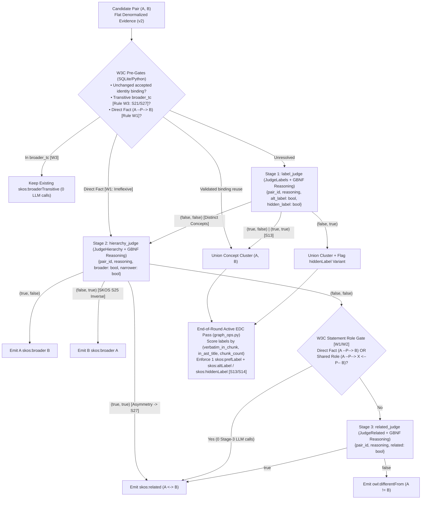

# Technical Specification: W3C Semantic Cascade & Active EDC Canonicalization (`docs/w3c-improvements.md`)

Current scope, 2026-11-05: section 13 replaces the former scheme phase and governs
batch-independent identity/relations. The graph plan owns the paired 64+64/128
time and graph gates. Sections 1-12 retain earlier analysis/proposals, not proof
of current runtime behavior; graph-wide staging or similarity-only identity
instructions there are superseded by the native graph contract.

## 1. Context & Root-Cause Problem Statement

In [`benchmark_mobile_report.md`](file:///C:/Users/Harri.Ahokas/.gemini/antigravity/brain/705b1f4b-1f82-432f-af64-b480ab176de5/benchmark_mobile_report.md), the 4B model (`gemma-4-E4B-it-qat-q4_0`) systematically mixes semantic relations during Stage 3 synonym/ontology adjudication—classifying taxonomic subtypes as `skos:related` (e.g., `pilot tenants` $\leftrightarrow$ `tenants`, `telemetry points` $\leftrightarrow$ `telemetry`) and classifying both subtypes and domain-coupled concepts as `owl:differentFrom` (e.g., `seat` $\neq$ `consumption`, `Consumption price` $\neq$ `consumption`, `Finance` $\neq$ `Finance-Legal`). Because [`build_transition_matrix`](file:///c:/Users/Harri.Ahokas/Documents/yaw/yaw/daemon/graph/ppr.py#L168-L183) treats `owl:differentFrom` as an active negative inhibitor ($\alpha_{\text{diff}} = 0.5$) that subtracts Personalized PageRank mass, false `owl:differentFrom` edges actively suppress relevant neighbors during multi-hop retrieval.

Four concrete architectural defects cause this failure mode:
1. **Pointer-Table Cognitive Overload (`synonym-evidence-v1`)**: [`_Packet`](file:///c:/Users/Harri.Ahokas/Documents/yaw/yaw/daemon/graph/storage/synonyms.py#L19-L197) splits pair context across four separate lookup tables (`pairs`, `entities`, `facts`, `sources`) connected by synthetic pointer aliases (`e0`, `f0`, `s0`), forcing the 4B model to dereference multi-hop JSON pointers across batches of up to 64 pairs ([`planner.py`](file:///c:/Users/Harri.Ahokas/Documents/yaw/yaw/daemon/graph/planner.py#L1086-L1094)).
2. **Zero-Scratchpad 5-Way Single-Shot Ask**: [`JudgeSynonyms`](file:///c:/Users/Harri.Ahokas/Documents/yaw/yaw/daemon/graph/inference/prompts.py#L266-L313) and [`build_dspy_synonym_judge_grammar`](file:///c:/Users/Harri.Ahokas/Documents/yaw/yaw/daemon/graph/inference/grammars.py#L195-L237) force token `#1` of each decision to select one of five relations (`skos:altLabel`, `skos:hiddenLabel`, `skos:broader`, `skos:related`, `owl:differentFrom`) with zero thinking/reasoning tokens and an overloaded `"canonical"` string slot.
3. **Ontological Conflation of `owl:differentFrom` and `skos:semanticRelation`**: OWL does not infer `owl:differentFrom` merely from different IRIs. Entity distinctness and a supported SKOS relationship are separate assertions; a pair can be distinct and still related. Presenting `owl:differentFrom` alongside `skos:broader` and `skos:related` in a single-shot prompt causes the model to emit `owl:differentFrom` whenever $A \neq B$.
4. **Missing End-of-Round Active EDC Canonicalization**: [`prepare_synonym_candidates`](file:///c:/Users/Harri.Ahokas/Documents/yaw/yaw/daemon/graph/planner.py#L618-L626) and [`apply_synonym_adjudication`](file:///c:/Users/Harri.Ahokas/Documents/yaw/yaw/daemon/graph/planner.py#L740-L755) select the surviving `skos:prefLabel` during pairwise merges using either LLM-emitted `"canonical"` strings or naive string-length tuples `(len(def_a), -len(name_a), ea)`, allowing 1-off extraction typos to usurp `skos:prefLabel`.

---

## 2. Architecture, Dataflow & Domain Containment



### Domain Containment Check
All modifications strictly obey the domain containment tree enforced by [`tests/test_architecture.py`](file:///c:/Users/Harri.Ahokas/Documents/yaw/tests/test_architecture.py):
- `yaw.core.*` ([`yaw/core/types.py`](file:///c:/Users/Harri.Ahokas/Documents/yaw/yaw/core/types.py)) imports only Python standard library modules.
- `yaw.daemon.graph.storage.*` ([`synonyms.py`](file:///c:/Users/Harri.Ahokas/Documents/yaw/yaw/daemon/graph/storage/synonyms.py), [`graph_ops.py`](file:///c:/Users/Harri.Ahokas/Documents/yaw/yaw/daemon/graph/storage/graph_ops.py)) imports only `yaw.daemon.graph.storage.*` and `yaw.core.*`.
- `yaw.daemon.graph.inference.*` ([`prompts.py`](file:///c:/Users/Harri.Ahokas/Documents/yaw/yaw/daemon/graph/inference/prompts.py), [`grammars.py`](file:///c:/Users/Harri.Ahokas/Documents/yaw/yaw/daemon/graph/inference/grammars.py), [`parsers.py`](file:///c:/Users/Harri.Ahokas/Documents/yaw/yaw/daemon/graph/inference/parsers.py), [`adapter.py`](file:///c:/Users/Harri.Ahokas/Documents/yaw/yaw/daemon/graph/inference/adapter.py), [`invariants.py`](file:///c:/Users/Harri.Ahokas/Documents/yaw/yaw/daemon/graph/inference/invariants.py), [`diagnostics.py`](file:///c:/Users/Harri.Ahokas/Documents/yaw/yaw/daemon/graph/inference/diagnostics.py), [`program.py`](file:///c:/Users/Harri.Ahokas/Documents/yaw/yaw/daemon/graph/inference/program.py), [`optimizer.py`](file:///c:/Users/Harri.Ahokas/Documents/yaw/yaw/daemon/graph/inference/optimizer.py)) imports only `yaw.daemon.graph.inference.*` and `yaw.core.*`.
- `yaw.daemon.graph.*` ([`planner.py`](file:///c:/Users/Harri.Ahokas/Documents/yaw/yaw/daemon/graph/planner.py), [`engine.py`](file:///c:/Users/Harri.Ahokas/Documents/yaw/yaw/daemon/graph/engine.py)) orchestrates `storage` and `inference` within `yaw.daemon.graph`.

---

## 3. Formal Contracts & Typed Interfaces

### 3.1 Denormalized Evidence Packet (`yaw/daemon/graph/storage/synonyms.py` & `yaw/core/types.py`)

```python
# JSON schema emitted by iter_synonym_evidence ("format": "synonym-evidence-v2"):
# {
#   "format": "synonym-evidence-v2",
#   "pairs": [
#     {
#       "pair_id": "e0|e1",
#       "dense_sim": 0.88,
#       "lexical_sim": 0.72,
#       "shared_documents": ["docs/pricing.md"],
#       "shared_islands": [["docs/pricing.md", 10, 45]],
#       "direct_facts": [["pilot tenants", "participate in", "initial testing phase"]],
#       "shared_role_facts": [["pilot tenants", "billed via", "invoices"], ["tenants", "billed via", "invoices"]],
#       "broader_tc": "",  # "a_under_b" | "b_under_a" | ""
#       "entity_a": {
#         "name": "tenants",
#         "definition": "Customer organizations provisioned on the platform.",
#         "type": "skos:Concept",
#         "labels": {"skos:prefLabel": ["tenants"], "skos:altLabel": []},
#         "facts": [["tenants", "own", "subscriptions"]],
#         "sources": [{"path": "docs/pricing.md", "title": "Tenants", "text": "..."}]
#       },
#       "entity_b": {
#         "name": "pilot tenants",
#         "definition": "A group of low-volume tenants used for the initial testing phase.",
#         "type": "skos:Concept",
#         "labels": {"skos:prefLabel": ["pilot tenants"], "skos:altLabel": []},
#         "facts": [["pilot tenants", "participate in", "initial testing phase"]],
#         "sources": [{"path": "docs/pricing.md", "title": "Pilot Phase", "text": "..."}]
#       }
#     }
#   ]
# }
```

### 3.2 End-of-Round Active EDC Canonicalizer (`yaw/daemon/graph/storage/graph_ops.py`)

```python
def canonicalize_entity_labels_edc(
    conn: sqlite3.Connection | YawConnection,
    corpus_root: Path | str | None = None,
    *,
    entity_ids: Sequence[str] | None = None,
    hidden_label_norms_by_entity: Mapping[str, set[str]] | None = None,
) -> int:
    """Run deterministic end-of-round Active EDC label canonicalization over entity_labels and entities.

    For each candidate entity:
    1. Demotes any label norm in `hidden_label_norms_by_entity` or absent verbatim from its hydrated
       source chunk on disk (when `corpus_root` is available and chunk is non-stale) to `skos:hiddenLabel`.
    2. Scores all eligible (`skos:prefLabel` / `skos:altLabel`) label norms by provenance tuple:
       `(verbatim_in_source, in_ast_title, chunk_count, is_cased_or_multiword, -len(raw_label), label_norm)`.
    3. Promotes the single winning norm to `skos:prefLabel` and updates `entities.name` to its best
       surface `raw_label`; demotes all other non-hidden norms to `skos:altLabel` (enforcing SKOS S13 & S14).
    Returns the number of entities whose canonical `skos:prefLabel` or `entities.name` was updated.
    """
```

### 3.3 3-Stage Paired-Boolean Signatures & Grammars (`yaw/daemon/graph/inference/prompts.py` & `grammars.py`)

```python
SYNONYM_JUDGE_STAGE_NAMES: tuple[str, str, str] = (
    "label_judge",
    "hierarchy_judge",
    "related_judge",
)


class JudgeLabels(dspy.Signature):
    """Evaluate Stage 1 W3C SKOS lexical identity (`skos:altLabel` and `skos:hiddenLabel`) for each candidate pair in `candidate_pairs`."""

    candidate_pairs: str = dspy.InputField(
        desc="JSON object (`synonym-evidence-v2`) containing candidate entity pairs with inline definitions, facts, and source excerpts."
    )
    decisions: list[dict[str, Any]] = dspy.OutputField(
        desc='List of {"pair_id": "e0|e1", "reasoning": "...", "alt_label": bool, "hidden_label": bool} objects.'
    )


class JudgeHierarchy(dspy.Signature):
    """Evaluate Stage 2 W3C SKOS taxonomic/partitive hierarchy (`skos:broader` and `skos:narrower`) for distinct concept pairs in `candidate_pairs`."""

    candidate_pairs: str = dspy.InputField(
        desc="JSON object (`synonym-evidence-v2`) containing distinct candidate entity pairs with inline definitions, facts, and source excerpts."
    )
    decisions: list[dict[str, Any]] = dspy.OutputField(
        desc=(
            'List of {"pair_id": "e0|e1", "reasoning": "...", "broader": bool, "narrower": bool} objects '
            "where broader=True iff entity_a is a narrower subtype/part/instance of broader concept entity_b (`A skos:broader B`), "
            "and narrower=True iff entity_b is a narrower subtype/part/instance of broader concept entity_a (`A skos:narrower B`)."
        )
    )


class JudgeRelated(dspy.Signature):
    """Evaluate Stage 3 W3C SKOS associative relation (`skos:related` vs `owl:differentFrom`) for distinct, non-hierarchical pairs in `candidate_pairs`."""

    candidate_pairs: str = dspy.InputField(
        desc="JSON object (`synonym-evidence-v2`) containing distinct, non-hierarchical entity pairs with inline definitions, facts, and source excerpts."
    )
    decisions: list[dict[str, Any]] = dspy.OutputField(
        desc='List of {"pair_id": "e0|e1", "reasoning": "...", "related": bool} objects.'
    )


def build_dspy_label_judge_grammar(
    max_decisions: int | None = None,
    *,
    pair_ids: Sequence[str] | None = None,
    max_reasoning_chars: int | None = 240,
) -> str:
    """Build pure-JSON GBNF grammar for JudgeLabels (`{"decisions": [{"pair_id": ..., "reasoning": ..., "alt_label": bool, "hidden_label": bool}]}`)."""


def build_dspy_hierarchy_judge_grammar(
    max_decisions: int | None = None,
    *,
    pair_ids: Sequence[str] | None = None,
    max_reasoning_chars: int | None = 240,
) -> str:
    """Build pure-JSON GBNF grammar for JudgeHierarchy (`{"decisions": [{"pair_id": ..., "reasoning": ..., "broader": bool, "narrower": bool}]}`)."""


def build_dspy_related_judge_grammar(
    max_decisions: int | None = None,
    *,
    pair_ids: Sequence[str] | None = None,
    max_reasoning_chars: int | None = 240,
) -> str:
    """Build pure-JSON GBNF grammar for JudgeRelated (`{"decisions": [{"pair_id": ..., "reasoning": ..., "related": bool}]}`)."""
```

### 3.4 Complete Replacement of Legacy `synonym_*` Predictors, Fingerprints, Caches, Audit Trails & Token Counters
1. **First-Class Predictors on `YawProgram` (`yaw/daemon/graph/inference/program.py`)**:
   - **Removes** `self.synonym_judge = dspy.Predict(JudgeSynonyms)`.
   - **Replaces** it with three first-class predictors on `YawProgram`:
     - `self.label_judge = dspy.Predict(JudgeLabels)`
     - `self.hierarchy_judge = dspy.Predict(JudgeHierarchy)`
     - `self.related_judge = dspy.Predict(JudgeRelated)`
   - Binds all three to `worker` LM in `_bind_predictor_lms`. Because they are `dspy.Predict` attributes on `YawProgram`, `program.named_predictors()` automatically exposes `"label_judge"`, `"hierarchy_judge"`, and `"related_judge"` to `dspy.GEPA`, `dspy.MIPROv2`, `ActiveTraceComponentSelector`, and `RLMInstructionProposer`.
2. **Replacement of `synonym_audit_trail` with Per-Stage Audit Trails (`program.py` & `diagnostics.py`)**:
   - **Removes** `self.synonym_audit_trail`.
   - **Replaces** it with three stage-specific `DiagnosticHistory` trails on `YawProgram`:
     - `self.label_judge_audit_trail = DiagnosticHistory()`
     - `self.hierarchy_judge_audit_trail = DiagnosticHistory()`
     - `self.related_judge_audit_trail = DiagnosticHistory()`
   - Updates `dump_audit_trails` ([`program.py:260-280`](file:///c:/Users/Harri.Ahokas/Documents/yaw/yaw/daemon/graph/inference/program.py#L260-L280)) and `trim_diagnostics` ([`diagnostics.py:21-34`](file:///c:/Users/Harri.Ahokas/Documents/yaw/yaw/daemon/graph/inference/diagnostics.py#L21-L34)) to serialize and bound `label_judge_audit_trail`, `hierarchy_judge_audit_trail`, and `related_judge_audit_trail`.
3. **Replacement of `synonym_fingerprint` & `_synonym_fp_cache` with Per-Stage Fingerprints & Caches (`optimizer.py` & `engine.py`)**:
   - **Why Replace Instead of Update**: During GEPA optimization, [`ActiveTraceComponentSelector`](file:///c:/Users/Harri.Ahokas/Documents/yaw/yaw/daemon/graph/inference/optimizer.py#L762-L813) mutates **one** predictor per iteration (`label_judge`, OR `hierarchy_judge`, OR `related_judge`). If all three judges shared a single `synonym_fingerprint`, mutating `related_judge` (Stage 3) would invalidate cached decisions and traces for Stage 1 (`label_judge`) and Stage 2 (`hierarchy_judge`).
   - **Removes** `synonym_fingerprint(program)` and `self._synonym_fp_cache`.
   - **Replaces** them with:
     - `judge_stage_fingerprint(program: YawProgram, stage_name: Literal["label_judge", "hierarchy_judge", "related_judge"]) -> str` (plus convenience functions `label_judge_fingerprint`, `hierarchy_judge_fingerprint`, `related_judge_fingerprint`) in [`optimizer.py`](file:///c:/Users/Harri.Ahokas/Documents/yaw/yaw/daemon/graph/inference/optimizer.py#L300-L330).
     - Three stage-isolated `CandidateStageCache` instances in [`HippoRAGEngine.__init__`](file:///c:/Users/Harri.Ahokas/Documents/yaw/yaw/daemon/graph/engine.py#L246-L252):
       - `self._label_judge_fp_cache` (stage `"label_judge"`)
       - `self._hierarchy_judge_fp_cache` (stage `"hierarchy_judge"`)
       - `self._related_judge_fp_cache` (stage `"related_judge"`)
     - Each stage caches `(stage_fp, stage_pairs_fp) -> (stage_decisions, stage_traces, stage_tokens)` independently so mutating Stage 3 (`related_judge`) reuses 100% of Stage 1 (`label_judge`) and Stage 2 (`hierarchy_judge`) cache entries!
     - `extraction_fingerprint(program)` in [`optimizer.py:333-368`](file:///c:/Users/Harri.Ahokas/Documents/yaw/yaw/daemon/graph/inference/optimizer.py#L333-L368) replaces `"synonym_judge"` in `graph_stage_keys` with `"label_judge"`, `"hierarchy_judge"`, and `"related_judge"`.
4. **Replacement of `synonym_judge_tokens` with Per-Stage Token Counters (`engine.py`, `optimizer.py`, `parsers.py`)**:
   - **Removes** `synonym_judge_tokens` from [`HippoRAGEngine._empty_graph_rlm_stats`](file:///c:/Users/Harri.Ahokas/Documents/yaw/yaw/daemon/graph/engine.py#L510), [`_hydrate_chunk_traces_and_stats_from_db`](file:///c:/Users/Harri.Ahokas/Documents/yaw/yaw/daemon/graph/engine.py#L486), [`optimizer.py`](file:///c:/Users/Harri.Ahokas/Documents/yaw/yaw/daemon/graph/inference/optimizer.py#L1338), and [`compute_task_quality_score`](file:///c:/Users/Harri.Ahokas/Documents/yaw/yaw/daemon/graph/inference/parsers.py#L1058).
   - **Replaces** it with `label_judge_tokens`, `hierarchy_judge_tokens`, and `related_judge_tokens`.
5. **`STAGE_SCHEMA_CONTRACTS`, `validate_stage_invariants` & `YawGBNFAdapter` (`invariants.py`, `adapter.py`)**:
   - Removes `"synonym_judge"` from `STAGE_SCHEMA_CONTRACTS` and replaces it with contracts for `"label_judge"`, `"hierarchy_judge"`, and `"related_judge"` so `InstructionSynthesizerWorker` (`proposer.py:98`) injects the exact schema contract for each judge during GEPA/SIMBA instruction evolution.
   - Updates `validate_stage_invariants` to validate `"label_judge"`, `"hierarchy_judge"`, and `"related_judge"` predictions (checking non-empty `"reasoning"` and exact boolean keys per `pair_id`).
   - Updates `YawGBNFAdapter` to remove `JudgeSynonyms` and wire `JudgeLabels` $\to$ `build_dspy_label_judge_grammar`, `JudgeHierarchy` $\to$ `build_dspy_hierarchy_judge_grammar`, and `JudgeRelated` $\to$ `build_dspy_related_judge_grammar`.
6. **Trace Capture for GEPA (`yaw/daemon/graph/engine.py`)**:
   - Updates `extract_named_trace_entries` at [`engine.py:1594-1598`](file:///c:/Users/Harri.Ahokas/Documents/yaw/yaw/daemon/graph/engine.py#L1594-L1598) to capture per-stage traces for `{"label_judge"}`, `{"hierarchy_judge"}`, and `{"related_judge"}` so GEPA's `ActiveTraceComponentSelector` receives live execution trajectories for each individual judge stage.

---

## 4. Invariants & Explicit Non-Goals

### Non-Negotiable Invariants
1. **Short-Circuit Funnel Invariant**: Every pair resolved by a deterministic W3C pre-gate or an earlier LLM stage is immediately filtered out and **never** sent to subsequent LLM stages.
2. **2×2 Truth-Table Determinism**:
   - Stage 1 `(alt_label, hidden_label)`:
     - `(True, False)` $\to$ `relation="skos:altLabel"`
     - `(False, True)` $\to$ `relation="skos:hiddenLabel"`
     - `(True, True)` (SKOS S13 overlap) $\to$ `relation="skos:altLabel"` (with Active EDC enforcing S13 disjointness)
     - `(False, False)` $\to$ distinct concepts; advance to Stage 2.
   - Stage 2 `(broader, narrower)`:
     - `(True, False)` $\to$ `relation="skos:broader"`, `source_id=entity_a`, `target_id=entity_b` (`A skos:broader B`)
     - `(False, True)` $\to$ by SKOS S25 (`owl:inverseOf`), `relation="skos:broader"`, `source_id=entity_b`, `target_id=entity_a` (`B skos:broader A`)
     - `(True, True)` (SKOS hierarchy asymmetry conflict on distinct concepts) $\to$ by SKOS S27, `relation="skos:related"`
     - `(False, False)` $\to$ non-hierarchical; if `direct_facts` (Rule W1) or `shared_role_facts` (Rule W2) is non-empty, resolve deterministically to `relation="skos:related"`, else advance to Stage 3.
   - Stage 3 `(related)`:
     - `True` $\to$ `relation="skos:related"`
     - `False` $\to$ `relation="owl:differentFrom"`.
3. **Active EDC SKOS S13/S14 Invariant**: At the end of every adjudication round, every entity in `stage_conn` has at most one `skos:prefLabel` norm, zero overlap between `skos:prefLabel`, `skos:altLabel`, and `skos:hiddenLabel`, and `entities.name` matches the highest-provenance non-hidden label.
4. **Full GEPA Visibility & Zero Old Judges/Trails**: `self.synonym_judge`, `JudgeSynonyms`, `synonym_fingerprint`, `_synonym_fp_cache`, `synonym_audit_trail`, and `synonym_judge_tokens` are completely removed and replaced with stage-explicit equivalents for `label_judge`, `hierarchy_judge`, and `related_judge`.

### Explicit Non-Goals (Anti-Invention Contract)
- **Zero SQLite Schema Migrations**: Do not add new tables or columns to `yaw.db`.
- **Zero Disjoint-Document `owl:differentFrom` Heuristics**: Never infer `owl:differentFrom` merely because two concepts reside in different documents; cross-document pairs that pass Stage 1 and Stage 2 without shared facts must be adjudicated by Stage 3 (`JudgeRelated`).
- **Zero Legacy Compatibility Shims**: Do not keep `synonym_judge`, `JudgeSynonyms`, `build_dspy_synonym_judge_grammar`, `synonym_fingerprint`, `synonym_audit_trail`, or `synonym_judge_tokens` as fallback aliases.

---

## 5. Superslim Implementation Slices & Oblivion Protocol

Each slice below is scoped to 1–3 production files so a `flash` model can implement it atomically, followed by a mandatory **Critic Round**, **Simplification Round**, and **Deprecated Code Removal Gate**.

---

### Slice 1: Denormalized Pair Evidence (`synonym-evidence-v2`) & W3C Structural Queries {#slice-01}

- **Files**:
  - `[MODIFY]` [`yaw/daemon/graph/storage/synonyms.py`](file:///c:/Users/Harri.Ahokas/Documents/yaw/yaw/daemon/graph/storage/synonyms.py#L19-L254)
  - `[MODIFY]` [`yaw/core/types.py`](file:///c:/Users/Harri.Ahokas/Documents/yaw/yaw/core/types.py#L180-L245)
  - `[MODIFY]` [`tests/daemon/graph/storage/test_storage.py`](file:///c:/Users/Harri.Ahokas/Documents/yaw/tests/daemon/graph/storage/test_storage.py)
- **Scope**:
  1. Refactor [`_Packet`](file:///c:/Users/Harri.Ahokas/Documents/yaw/yaw/daemon/graph/storage/synonyms.py#L19-L197) in `yaw/daemon/graph/storage/synonyms.py` to emit `"format": "synonym-evidence-v2"` containing only `"pairs": [...]` with inline `entity_a`, `entity_b`, `direct_facts` (Rule W1), `shared_role_facts` (Rule W2: shared `(pred, obj_id)` or `(subj_id, pred)` in `facts`), and `broader_tc` (Rule W3: `"a_under_b"` or `"b_under_a"` via recursive `skos:broader` check).
  2. Update [`SynonymEvidenceBatch.resolve_decisions`](file:///c:/Users/Harri.Ahokas/Documents/yaw/yaw/core/types.py#L204-L242) to resolve alias IDs (`e0`, `e1`) into real `entity_id` values directly from `source_id`/`target_id` or `pair_id` without requiring a `"canonical"` field, and add `SynonymEvidenceBatch.subset(pair_ids)` so downstream cascade stages receive filtered `SynonymEvidenceBatch` packets containing only unresolved pairs.
  3. Default `iter_synonym_evidence` micro-batch size to `batch_size: int = 6` so each stage prompt stays compact.
- **Verifiable Goal**:
  - `uv run --no-sync pytest tests/daemon/graph/storage/test_storage.py -k "synonym" --no-testmon -q` passes 100%, verifying that `"synonym-evidence-v2"` contains zero top-level `"entities"`, `"facts"`, or `"sources"` pointer tables and populates `direct_facts`, `shared_role_facts`, and `broader_tc`.
- **Critic Round**:
  - Delegate to `critic`: verify zero N+1 SQLite queries inside `_Packet` when computing `shared_role_facts` and `broader_tc`, and verify context-budget halving in `iter_synonym_evidence` preserves all pair fields.
- **Simplification Round**:
  - Delegate to `simplifier`: remove `_Packet.fact()`, `_Packet.source()`, `_Packet.facts`, `_Packet.sources`, and `_Packet.spans` indirection methods.
- **Deprecated Code Removal**:
  - `git grep -w "synonym-evidence-v1"` returns `0` matches across `yaw/` and `tests/`.

---

### Slice 2: End-of-Round Active EDC Label Canonicalizer {#slice-02}

- **Files**:
  - `[MODIFY]` [`yaw/daemon/graph/storage/graph_ops.py`](file:///c:/Users/Harri.Ahokas/Documents/yaw/yaw/daemon/graph/storage/graph_ops.py#L630-L752)
  - `[MODIFY]` [`yaw/daemon/graph/storage/__init__.py`](file:///c:/Users/Harri.Ahokas/Documents/yaw/yaw/daemon/graph/storage/__init__.py)
  - `[MODIFY]` [`tests/daemon/graph/storage/test_storage.py`](file:///c:/Users/Harri.Ahokas/Documents/yaw/tests/daemon/graph/storage/test_storage.py)
- **Scope**:
  1. Implement `canonicalize_entity_labels_edc` in [`yaw/daemon/graph/storage/graph_ops.py`](file:///c:/Users/Harri.Ahokas/Documents/yaw/yaw/daemon/graph/storage/graph_ops.py) and export it in [`yaw/daemon/graph/storage/__init__.py`](file:///c:/Users/Harri.Ahokas/Documents/yaw/yaw/daemon/graph/storage/__init__.py).
  2. Compute provenance scores per `(entity_id, label_norm)` using:
      - `verbatim_in_source`: `1` if any `raw_label` for `(entity_id, label_norm)` appears case-insensitively in its hydrated chunk text on disk (or when `corpus_root is None` / chunk is synthetic `__*__`), `0` if the chunk exists on disk and `raw_label` is absent from the source span (demoting such extraction typos to `skos:hiddenLabel`).
      - `in_ast_title`: `1` if `raw_label` appears case-insensitively in `chunks.title` for any provenance chunk.
      - `support_count`: `COUNT(DISTINCT chunk_id)` in `entity_labels`. Canonical fact text is an output of label selection, so matching it would create a circular score that depends on earlier publication boundaries.
  3. Enforce SKOS S13 & S14: any label norm in `hidden_label_norms_by_entity` or failing verbatim grounding is set to `skos:hiddenLabel`; the highest-ranked eligible norm becomes `skos:prefLabel` (and updates `entities.name`), and all remaining eligible norms become `skos:altLabel`.
- **Verifiable Goal**:
  - `uv run --no-sync pytest tests/daemon/graph/storage/test_storage.py -k "edc or merge_entities" --no-testmon -q` passes, proving that a 1-chunk typo (`"Neccessary"`) merged into or onto a multi-chunk/heading-backed entity (`"Necessary"`) is demoted to `skos:hiddenLabel`, `entities.name` becomes `"Necessary"`, and `lint_graph_shacl(conn)` reports `0` label violations.
- **Critic Round**:
  - Delegate to `critic`: verify `canonicalize_entity_labels_edc` runs inside `write_tx(conn)`, handles entities with only 1 label safely (never leaving an entity with 0 `skos:prefLabel` rows), and introduces zero SHACL S13 regressions.
- **Simplification Round**:
  - Delegate to `simplifier`: streamline SQL aggregation of `chunk_count` and `chunks.title` into a single batched query.
- **Deprecated Code Removal**:
  - Remove redundant post-merge label fixup branches superseded by `canonicalize_entity_labels_edc`.

---

### Slice 3: 3-Stage Paired-Boolean Signatures, GBNF Grammars, Adapter & Invariants {#slice-03}

- **Files**:
  - `[MODIFY]` [`yaw/daemon/graph/inference/prompts.py`](file:///c:/Users/Harri.Ahokas/Documents/yaw/yaw/daemon/graph/inference/prompts.py#L266-L313)
  - `[MODIFY]` [`yaw/daemon/graph/inference/grammars.py`](file:///c:/Users/Harri.Ahokas/Documents/yaw/yaw/daemon/graph/inference/grammars.py#L195-L237)
  - `[MODIFY]` [`yaw/daemon/graph/inference/parsers.py`](file:///c:/Users/Harri.Ahokas/Documents/yaw/yaw/daemon/graph/inference/parsers.py#L315-L380)
  - `[MODIFY]` [`yaw/daemon/graph/inference/adapter.py`](file:///c:/Users/Harri.Ahokas/Documents/yaw/yaw/daemon/graph/inference/adapter.py#L48-L100)
  - `[MODIFY]` [`yaw/daemon/graph/inference/invariants.py`](file:///c:/Users/Harri.Ahokas/Documents/yaw/yaw/daemon/graph/inference/invariants.py#L45-L82)
  - `[MODIFY]` [`yaw/daemon/graph/inference/__init__.py`](file:///c:/Users/Harri.Ahokas/Documents/yaw/yaw/daemon/graph/inference/__init__.py)
  - `[MODIFY]` [`tests/daemon/graph/inference/test_grammars.py`](file:///c:/Users/Harri.Ahokas/Documents/yaw/tests/daemon/graph/inference/test_grammars.py)
  - `[MODIFY]` [`tests/daemon/graph/inference/test_parsers.py`](file:///c:/Users/Harri.Ahokas/Documents/yaw/tests/daemon/graph/inference/test_parsers.py)
- **Scope**:
  1. Remove `JudgeSynonyms` from [`prompts.py`](file:///c:/Users/Harri.Ahokas/Documents/yaw/yaw/daemon/graph/inference/prompts.py#L266-L313) and replace it with `JudgeLabels`, `JudgeHierarchy`, and `JudgeRelated`.
  2. Remove `DSPY_SYNONYM_JUDGE_GBNF_GRAMMAR` and `build_dspy_synonym_judge_grammar` from [`grammars.py`](file:///c:/Users/Harri.Ahokas/Documents/yaw/yaw/daemon/graph/inference/grammars.py#L195-L237) and replace with `build_dspy_label_judge_grammar`, `build_dspy_hierarchy_judge_grammar`, and `build_dspy_related_judge_grammar` backed by a shared helper `_build_pair_boolean_grammar(pair_ids, bool_fields, max_decisions=None, max_reasoning_chars=240)`.
  3. Replace `parse_synonym_decisions` in [`parsers.py`](file:///c:/Users/Harri.Ahokas/Documents/yaw/yaw/daemon/graph/inference/parsers.py) with `parse_label_decisions`, `parse_hierarchy_decisions`, and `parse_related_decisions` implementing the exact 2×2 truth tables from Section 4, and replace `synonym_judge_tokens` in [`compute_task_quality_score`](file:///c:/Users/Harri.Ahokas/Documents/yaw/yaw/daemon/graph/inference/parsers.py#L1058) with `label_judge_tokens`, `hierarchy_judge_tokens`, and `related_judge_tokens`.
  4. Update [`YawGBNFAdapter.resolve_grammar`](file:///c:/Users/Harri.Ahokas/Documents/yaw/yaw/daemon/graph/inference/adapter.py#L48-L100) and [`STAGE_SCHEMA_CONTRACTS` / `validate_stage_invariants`](file:///c:/Users/Harri.Ahokas/Documents/yaw/yaw/daemon/graph/inference/invariants.py#L45-L82) to replace `JudgeSynonyms` / `"synonym_judge"` with `JudgeLabels` (`"label_judge"`), `JudgeHierarchy` (`"hierarchy_judge"`), and `JudgeRelated` (`"related_judge"`).
- **Verifiable Goal**:
  - `uv run --no-sync pytest tests/daemon/graph/inference/test_grammars.py tests/daemon/graph/inference/test_parsers.py --no-testmon -q` passes 100%.
- **Critic Round**:
  - Delegate to `critic`: verify that the GBNF grammars strictly constrain `"reasoning"` before the boolean fields, reject empty reasoning strings (`char{1,240}`), and wire all three signatures cleanly in `YawGBNFAdapter` and `invariants.py`.
- **Simplification Round**:
  - Delegate to `simplifier`: ensure all three GBNF functions share `_build_pair_boolean_grammar` (~25 lines total) and all three parser functions share common `pair_id` + `reasoning` validation.
- **Deprecated Code Removal**:
  - Remove `JudgeSynonyms`, `DSPY_SYNONYM_JUDGE_GBNF_GRAMMAR`, `build_dspy_synonym_judge_grammar`, `parse_synonym_decisions`, and `synonym_judge_tokens` from `prompts.py`, `grammars.py`, `parsers.py`, `adapter.py`, `invariants.py`, and `__init__.py`.

---

### Slice 4: Short-Circuiting Cascade, Per-Stage Trails/Caches & GEPA Wiring in `program.py`, `diagnostics.py`, `optimizer.py`, `planner.py` & `engine.py` {#slice-04}

- **Files**:
  - `[MODIFY]` [`yaw/daemon/graph/inference/diagnostics.py`](file:///c:/Users/Harri.Ahokas/Documents/yaw/yaw/daemon/graph/inference/diagnostics.py#L21-L34)
  - `[MODIFY]` [`yaw/daemon/graph/inference/program.py`](file:///c:/Users/Harri.Ahokas/Documents/yaw/yaw/daemon/graph/inference/program.py#L200-L285)
  - `[MODIFY]` [`yaw/daemon/graph/inference/optimizer.py`](file:///c:/Users/Harri.Ahokas/Documents/yaw/yaw/daemon/graph/inference/optimizer.py#L300-L368)
  - `[MODIFY]` [`yaw/daemon/graph/planner.py`](file:///c:/Users/Harri.Ahokas/Documents/yaw/yaw/daemon/graph/planner.py#L674-L820)
  - `[MODIFY]` [`yaw/daemon/graph/engine.py`](file:///c:/Users/Harri.Ahokas/Documents/yaw/yaw/daemon/graph/engine.py#L246-L260)
  - `[MODIFY]` [`tests/daemon/graph/inference/test_program.py`](file:///c:/Users/Harri.Ahokas/Documents/yaw/tests/daemon/graph/inference/test_program.py)
  - `[MODIFY]` [`tests/daemon/graph/test_planner.py`](file:///c:/Users/Harri.Ahokas/Documents/yaw/tests/daemon/graph/test_planner.py)
  - `[MODIFY]` [`tests/daemon/graph/inference/test_prompts.py`](file:///c:/Users/Harri.Ahokas/Documents/yaw/tests/daemon/graph/inference/test_prompts.py)
- **Scope**:
  1. **Replace predictor & audit trail in `program.py` and `diagnostics.py`**:
     - Remove `self.synonym_judge` and `self.synonym_audit_trail` from [`YawProgram.__init__`](file:///c:/Users/Harri.Ahokas/Documents/yaw/yaw/daemon/graph/inference/program.py#L204-L216), [`dump_audit_trails`](file:///c:/Users/Harri.Ahokas/Documents/yaw/yaw/daemon/graph/inference/program.py#L260-L280), [`_bind_predictor_lms`](file:///c:/Users/Harri.Ahokas/Documents/yaw/yaw/daemon/graph/inference/program.py#L282-L300), and [`trim_diagnostics`](file:///c:/Users/Harri.Ahokas/Documents/yaw/yaw/daemon/graph/inference/diagnostics.py#L21-L34).
     - Register `self.label_judge = dspy.Predict(JudgeLabels)`, `self.hierarchy_judge = dspy.Predict(JudgeHierarchy)`, `self.related_judge = dspy.Predict(JudgeRelated)` and `self.label_judge_audit_trail`, `self.hierarchy_judge_audit_trail`, `self.related_judge_audit_trail`.
  2. **Replace `synonym_fingerprint` & `_synonym_fp_cache` with Per-Stage GEPA Fingerprints, Caches & Token Counters in `optimizer.py` and `engine.py`**:
     - Replace `synonym_fingerprint` in [`optimizer.py:300-330`](file:///c:/Users/Harri.Ahokas/Documents/yaw/yaw/daemon/graph/inference/optimizer.py#L300-L330) with `judge_stage_fingerprint(program, stage_name)` (`label_judge_fingerprint`, `hierarchy_judge_fingerprint`, `related_judge_fingerprint`) and update `extraction_fingerprint` (`graph_stage_keys`) to hash `"label_judge"`, `"hierarchy_judge"`, and `"related_judge"`.
     - Replace `self._synonym_fp_cache` in [`engine.py:246-252`](file:///c:/Users/Harri.Ahokas/Documents/yaw/yaw/daemon/graph/engine.py#L246-L252) with `self._label_judge_fp_cache`, `self._hierarchy_judge_fp_cache`, and `self._related_judge_fp_cache`, and replace `synonym_judge_tokens` with `label_judge_tokens`, `hierarchy_judge_tokens`, and `related_judge_tokens` in `_empty_graph_rlm_stats`, `_hydrate_chunk_traces_and_stats_from_db`, and `optimizer.py`.
  3. **Implement the short-circuiting cascade with per-stage caching and trace capture**:
     - Pre-resolve pairs with non-empty `broader_tc` (Rule W3).
     - Route pairs with non-empty `direct_facts` (Rule W1) directly to Stage 2 (`hierarchy_judge`), skipping Stage 1 (`label_judge`).
     - Run Stage 1 (`label_judge`, cached via `_label_judge_fp_cache` keyed by `(label_judge_fingerprint(program), stage1_batch.cache_identity)`) on remaining pairs; record in `label_judge_audit_trail` and `label_judge_tokens`; short-circuit matches (`skos:altLabel`, `skos:hiddenLabel`) and pass `(False, False)` pairs to Stage 2.
     - Run Stage 2 (`hierarchy_judge`, cached via `_hierarchy_judge_fp_cache` keyed by `(hierarchy_judge_fingerprint(program), stage2_batch.cache_identity)`) on unresolved pairs; record in `hierarchy_judge_audit_trail` and `hierarchy_judge_tokens`; short-circuit `skos:broader` (including SKOS S25 inverse when `narrower=True`) and `(True, True)` $\to$ `skos:related`.
     - Route Stage 2 `(False, False)` pairs with non-empty `direct_facts` (Rule W1) or `shared_role_facts` (Rule W2) deterministically to `skos:related` (0 Stage-3 LLM calls).
     - Run Stage 3 (`related_judge`, cached via `_related_judge_fp_cache` keyed by `(related_judge_fingerprint(program), stage3_batch.cache_identity)`) on the residual unresolved pairs; record in `related_judge_audit_trail` and `related_judge_tokens` to classify `skos:related` vs `owl:differentFrom`.
  4. **Update `apply_synonym_adjudication` in `planner.py`**:
     - Apply directed `skos:broader` (`source_id` $\to$ `target_id`), track `hidden_label` norms on merged entities, and call `canonicalize_entity_labels_edc(stage_conn, corpus_root)` at the end of the round.
- **Verifiable Goal**:
  - `uv run --no-sync pytest tests/daemon/graph/inference/test_program.py tests/daemon/graph/test_planner.py --no-testmon -q` passes 100%, including asserting that:
    1. `dict(program.named_predictors())` exposes `"label_judge"`, `"hierarchy_judge"`, and `"related_judge"` (and not `"synonym_judge"`).
    2. Mutating only `program.related_judge.signature.instructions` hits 100% cache on `_label_judge_fp_cache` and `_hierarchy_judge_fp_cache` (0 Stage-1 or Stage-2 LLM calls re-executed).
  - Live Gemma-4-E4B verification (`uv run --no-sync pytest tests/daemon/graph/inference/test_prompts.py -m live --no-testmon -q`) passes 100%, verifying `pilot tenants` $\to$ `skos:broader` `tenants`, `seat` $\to$ `skos:broader` `consumption`, and `Consumption price` $\leftrightarrow$ `skos:related` `consumption`.
- **Critic Round**:
  - Delegate to `critic`: audit the end-to-end cascade in `program.py`, `diagnostics.py`, `optimizer.py`, `engine.py`, and `planner.py` for short-circuit completeness, per-stage cache isolation, GEPA predictor registration, per-stage audit trails/tokens, and domain boundary compliance.
- **Simplification Round**:
  - Delegate to `simplifier`: remove all legacy `"canonical"` string matching branches and unify per-stage execution/caching into a single clean helper.
- **Deprecated Code Removal**:
  - Verify `git grep -w` returns `0` matches across the entire repository (`yaw/`, `tests/`, `scripts/`) for all retired symbols in the Oblivion Demolition Table below.

---

### Oblivion Demolition Table

| Retired Symbol / Format | Previous Location | Replacement | Verification Gate |
| :--- | :--- | :--- | :--- |
| `"synonym-evidence-v1"` | [`yaw/daemon/graph/storage/synonyms.py`](file:///c:/Users/Harri.Ahokas/Documents/yaw/yaw/daemon/graph/storage/synonyms.py#L187) | `"synonym-evidence-v2"` (inline denormalized pair evidence) | `git grep -w "synonym-evidence-v1"` $\to$ `0` matches |
| `_Packet.fact` / `_Packet.source` | [`yaw/daemon/graph/storage/synonyms.py`](file:///c:/Users/Harri.Ahokas/Documents/yaw/yaw/daemon/graph/storage/synonyms.py#L47-L97) | Inline pair facts and sources in `_Packet.add` | `git grep -E "def (fact|source)\(" yaw/daemon/graph/storage/synonyms.py` $\to$ `0` matches |
| `JudgeSynonyms` | [`yaw/daemon/graph/inference/prompts.py`](file:///c:/Users/Harri.Ahokas/Documents/yaw/yaw/daemon/graph/inference/prompts.py#L266) | `JudgeLabels`, `JudgeHierarchy`, `JudgeRelated` | `git grep -w "JudgeSynonyms"` $\to$ `0` matches |
| `self.synonym_judge` | [`yaw/daemon/graph/inference/program.py`](file:///c:/Users/Harri.Ahokas/Documents/yaw/yaw/daemon/graph/inference/program.py#L211) | `self.label_judge`, `self.hierarchy_judge`, `self.related_judge` | `git grep -w "synonym_judge" yaw/` $\to$ `0` matches |
| `synonym_audit_trail` | [`yaw/daemon/graph/inference/program.py`](file:///c:/Users/Harri.Ahokas/Documents/yaw/yaw/daemon/graph/inference/program.py#L204) | `label_judge_audit_trail`, `hierarchy_judge_audit_trail`, `related_judge_audit_trail` | `git grep -w "synonym_audit_trail"` $\to$ `0` matches |
| `synonym_fingerprint` | [`yaw/daemon/graph/inference/optimizer.py`](file:///c:/Users/Harri.Ahokas/Documents/yaw/yaw/daemon/graph/inference/optimizer.py#L300) | `judge_stage_fingerprint`, `label_judge_fingerprint`, `hierarchy_judge_fingerprint`, `related_judge_fingerprint` | `git grep -w "synonym_fingerprint"` $\to$ `0` matches |
| `_synonym_fp_cache` | [`yaw/daemon/graph/engine.py`](file:///c:/Users/Harri.Ahokas/Documents/yaw/yaw/daemon/graph/engine.py#L246) | `_label_judge_fp_cache`, `_hierarchy_judge_fp_cache`, `_related_judge_fp_cache` | `git grep -w "_synonym_fp_cache"` $\to$ `0` matches |
| `synonym_judge_tokens` | [`yaw/daemon/graph/engine.py`](file:///c:/Users/Harri.Ahokas/Documents/yaw/yaw/daemon/graph/engine.py#L510) | `label_judge_tokens`, `hierarchy_judge_tokens`, `related_judge_tokens` | `git grep -w "synonym_judge_tokens"` $\to$ `0` matches |
| `DSPY_SYNONYM_JUDGE_GBNF_GRAMMAR` | [`yaw/daemon/graph/inference/grammars.py`](file:///c:/Users/Harri.Ahokas/Documents/yaw/yaw/daemon/graph/inference/grammars.py#L51) | `DSPY_LABEL_JUDGE_GBNF_GRAMMAR`, `DSPY_HIERARCHY_JUDGE_GBNF_GRAMMAR`, `DSPY_RELATED_JUDGE_GBNF_GRAMMAR` | `git grep -w "DSPY_SYNONYM_JUDGE_GBNF_GRAMMAR"` $\to$ `0` matches |
| `build_dspy_synonym_judge_grammar` | [`yaw/daemon/graph/inference/grammars.py`](file:///c:/Users/Harri.Ahokas/Documents/yaw/yaw/daemon/graph/inference/grammars.py#L195) | `build_dspy_label_judge_grammar`, `build_dspy_hierarchy_judge_grammar`, `build_dspy_related_judge_grammar` | `git grep -w "build_dspy_synonym_judge_grammar"` $\to$ `0` matches |
| `parse_synonym_decisions` | [`yaw/daemon/graph/inference/parsers.py`](file:///c:/Users/Harri.Ahokas/Documents/yaw/yaw/daemon/graph/inference/parsers.py#L319) | `parse_label_decisions`, `parse_hierarchy_decisions`, `parse_related_decisions` | `git grep -w "parse_synonym_decisions"` $\to$ `0` matches |

---

## 6. Real-Substrate Verification Strategy

### Per-Slice TDD & Subagent Workflow
For each slice (`Slice 1` $\to$ `Slice 2` $\to$ `Slice 3` $\to$ `Slice 4`):
1. **Implementer (`flash` subagent)**: Writes real-substrate tests (`tmp_path`, real SQLite `yaw.db`) and minimal implementation for that slice's files.
2. **Critic (`critic` subagent)**: Audits the slice against W3C SKOS/OWL invariants, GEPA predictor registration, per-stage cache/trail isolation, domain boundaries, and zero fallbacks.
3. **Simplifier (`simplifier` subagent)**: Resolves all Critic findings, removes dead code, and verifies the slice's Oblivion Gate (`git grep -w` == 0).

### Mandatory Quality Gates (End of Each Slice & Final Completion)
```powershell
uv run --no-sync ty check
uv run --no-sync ruff check --fix
uv run --no-sync ruff format
uv run --no-sync pytest -m "not live" --no-testmon -q
uv run --no-sync pytest tests/daemon/graph/inference/test_prompts.py -m live --no-testmon -q
git diff --check
```

---

# Epistemic Confidence Calculus & Bayesian Markov Graph Engine (Slice 5)

## 7. Context & Root-Cause Problem Statement

While Slices 1–4 resolve Stage 3 synonym/ontology decision cascades and Active EDC, edge traversal and fact representation across `yaw.db` still suffer from heuristic and fragile weighting:
1. **Unbounded Linear Fact Weighting & Modulo Fragility**:
   - `yaw/daemon/graph/storage/graph_ops.py` assigns hardcoded `1.0` (object property) or `0.5` (datatype property) multiplied linearly by `COUNT(edge_sources)`.
   - `yaw/daemon/graph/ppr.py` guesses datatype properties via `abs((base_w % 1.0) - 0.5) < 1e-6`, silently misclassifying every datatype property mentioned an even number of times ($2 \times 0.5 = 1.0$).
2. **Clamped & Token-Blind Taxonomic Weights**:
   - `yaw/daemon/graph/planner.py` sets `skos:broader` and `skos:related` weights to `max(0.5, sim)`, ignoring inference-time token probability confidences and flattening low-similarity distinctions.
3. **Blind SHACL S27 & Cycle Resolution (`CONSISTENCY_ERROR`)**:
   - Because `skos:broader` and `skos:related` on a pair $(A, B)$ receive the exact same `max(0.5, sim)` weight, SHACL S27 (`ConceptShape/S27-disjointBroaderRelated`) and cycle (`ConceptShape/noBroaderCycles`) healing lacks an empirical tie-breaker.
   - Combined with unexposed `remove_scalar_entity` repairs for `ConceptShape/noScalarLiterals`, `yaw/daemon/graph/engine.py` raises `YawRuntimeError: [CONSISTENCY_ERROR]`, zeroing out affected GEPA evaluations.
4. **Hub Siphoning in PPR**:
   - `ppr.py` normalizes only by raw node degree without destination node epistemic priors.

---

## 8. Unified Probability Mathematics (Strictly Two Canonical Operators)

To make probability calculations **100% scale-invariant in $(0, 1)$**, every operation is governed by **two canonical operators** with **zero magic threshold constants**:

```mermaid
flowchart LR
    subgraph Op1["Operator 1: pool_confidences (Logarithmic Opinion Pool)"]
        P1["Extraction Atomic Confidence\ngeomean(p_llm, s_vec)"]
        P2["Markov Step Transition\npi(k) * geomean(w_edge, p_node)"]
        P3["Query Seed Prior p_0\ngeomean(s_vec(q, x), p_item)"]
        P4["k-Hop Broader Chain Confidence\ngeomean(w_1, ..., w_k)"]
    end

    subgraph Op2["Operator 2: bayesian_noisy_or (Independent Evidence)"]
        N1["Multi-Chunk Entity/Fact Prior\n1 - prod(1 - c_i)"]
        N2["Multi-Fact / Parallel Edge Pooling\n1 - prod(1 - w_m)"]
    end

    subgraph S27["Empirical Bayes S27 & Cagle Resolution (Zero Magic Numbers)"]
        B1["Compare w_chain vs w_rel\nBayes Factor BF = 1 Boundary"]
        B2["Cagle Gate from yaw.db Stats\nw >= AVG(weight) in stage_conn"]
    end

    Op1 --> Op2 --> S27
```



### 8.1 Operator 1: `pool_confidences` — Logarithmic Opinion Pool (Geometric Mean)
Whenever we combine $K$ confidence measurements $x_1, \dots, x_K \in (0, 1]$ of a **single assertion, state transition, query seed, or serial chain**, we use the **Logarithmic Opinion Pool** (geometric mean over the non-`None` known values $\mathcal{S} = \{x_k \mid x_k \neq \text{None}\}$):
$$\text{pool\_confidences}(x_1, \dots, x_K) = \begin{cases} \exp\left(\frac{1}{|\mathcal{S}|} \sum_{x \in \mathcal{S}} \log x\right) = \left(\prod_{x \in \mathcal{S}} x\right)^{1 / |\mathcal{S}|} & \text{if } |\mathcal{S}| \ge 1 \\ \text{None} & \text{if } |\mathcal{S}| = 0 \end{cases}$$

1. **Extraction-Time Mention Confidence ($c_i$)**:
   $$c_i = \text{pool\_confidences}\big(p_{\text{llm}, i}, \, s_{\text{vec}, i}\big)$$
   When `logprobs` are absent (`p_llm = None`), $c_i = s_{\text{vec}, i}$ remains on the exact same $(0, 1]$ scale as when both signals are present ($\sqrt{0.8 \times 0.8} = 0.80$).
2. **Markov Transition Step ($u \xrightarrow{k} v$ in `ppr.py`)**:
   $$A_{v, u}^{(k)} = \pi(k) \cdot \text{pool\_confidences}\big(w_{\text{edge}}(u, v, k), \, p_{\text{node}}(v)\big)$$
   Keeps every Markov step calibrated on $(0, 1]$ without square-penalizing nodes with known priors.
3. **Query Restart Seeding ($p_0$ in `retrieve_with_seeds`)**:
   $$p_0(x) = \text{pool\_confidences}\big(s_{\text{vec}}(q, x), \, p_{\text{item}}(x)\big)$$
4. **Serial $k$-Hop `skos:broader` Chain Confidence ($A \to^+ C$ in `shacl.py`)**:
   $$w_{\text{chain}}(A \to^+ C) = \text{pool\_confidences}\big(w(e_1), \dots, w(e_k)\big) = \left(\prod_{e \in P} w_{\text{broader}}(e)\right)^{1/k}$$
   Length-normalized log-probability puts a $k$-hop chain and a 1-hop edge on the exact same per-step probability scale.

### 8.2 Operator 2: `bayesian_noisy_or` — Additive Shannon Evidence
Whenever $m$ **independent parallel observations** $\{c_1, \dots, c_m\}$ corroborate the same entity, fact statement, or directed node pair $(u, v)$:
$$P(\text{true} \mid c_1, \dots, c_m) = 1 - \prod_{i=1}^{m} (1 - c_i) \in (0, 1)$$
Computes `entities.confidence`, `facts.confidence`, `edges.weight`, and parallel edge aggregation in `build_transition_matrix`.

---

## 9. Empirical Bayes SHACL S27 Resolution & Cagle Reification

When `ConceptShape/S27-disjointBroaderRelated` detects that concept pair $(A, C)$ has both a `skos:broader` chain $P = (e_1, \dots, e_k)$ ($A \to^+ C$) with chain confidence $w_{\text{chain}} = \text{pool\_confidences}(w(e_1), \dots, w(e_k))$ and a direct `skos:related(A, C)` edge with confidence $w_{\text{rel}}(A, C)$:

1. **Step 1: Check for Existing Reified Fact in `facts` (Deterministic Cagle Short-Circuit)**:
   - Query `facts` for any existing `rdf:Statement` between $A$ and $C$.
   - If a `fact` row already links $A$ and $C$, delete `skos:related(A, C)` (`remove_conflicting_related`) immediately with zero topological loss.
2. **Step 2: Empirical Database Means Gate for Cagle Reification (`reify_related_to_fact`)**:
   - Query live empirical means from `stage_conn`: $\bar{w}_{\text{broader}} = \text{AVG}(\text{weight})$, $\bar{w}_{\text{rel}} = \text{AVG}(\text{weight})$, $\bar{w}_{\text{fact}} = \text{AVG}(\text{confidence})$.
   - Cagle Reification triggers if and only if:
     - $w_{\text{chain}} \ge \bar{w}_{\text{broader}}$ and $w_{\text{rel}} \ge \bar{w}_{\text{rel}}$ (both have positive empirical Z-score in `stage_conn`).
     - $A$ and $C$ co-occur in at least one shared chunk $c^* \in \mathcal{C}(A) \cap \mathcal{C}(C)$.
     - The reified triple $f_{\text{new}} = (A, p, C)$ achieves atomic confidence $c(f_{\text{new}}, c^*) \ge \bar{w}_{\text{fact}}$.
   - When all three hold, insert `rdf:Statement` $(A, p, C)$ with `prov:value` into `facts` and delete `skos:related(A, C)`.
3. **Step 3: Direct Bayes Factor Comparison ($w_{\text{chain}}$ vs. $w_{\text{rel}}$)**:
   - **Case A: $w_{\text{chain}} \ge w_{\text{rel}}$**: Delete `skos:related(A, C)` and `skos:related(C, A)` (`remove_conflicting_related`).
   - **Case B: $w_{\text{rel}} > w_{\text{chain}}$**: Keep `skos:related(A, C)` intact at $w_{\text{rel}}$, delete `(u, v, 'skos:broader')` at the weakest link $e^* = \arg\min_{e \in P} w_{\text{broader}}(e)$, and if $k \ge 2$, convert $e^*$ to `skos:related(u, v)` preserving its calibrated weight $w(e^*)$.

---

## 10. Minimal Standard W3C Prefix Header

Zero custom `yaw:` or `dct:` namespaces:
```python
W3C_PREFIX_HEADER: str = (
    "@prefix : <urn:graph:> .\n"
    "@prefix rdf: <http://www.w3.org/1999/02/22-rdf-syntax-ns#> .\n"
    "@prefix rdfs: <http://www.w3.org/2000/01/rdf-schema#> .\n"
    "@prefix owl: <http://www.w3.org/2002/07/owl#> .\n"
    "@prefix skos: <http://www.w3.org/2004/02/skos/core#> .\n"
    "@prefix prov: <http://www.w3.org/ns/prov#> .\n"
    "@prefix xsd: <http://www.w3.org/2001/XMLSchema#> .\n"
)
```

---

## 11. Oblivion Demolition Table (Slice 5)

| Retired Symbol / Parameter | Previous Location | Replacement | Verification Gate |
| :--- | :--- | :--- | :--- |
| `datatype_property_weight` | `planner.py`, `engine.py` | Deleted; literals live exclusively in `facts` with `prov:value` | `git grep -w "datatype_property_weight"` $\to$ `0` matches |
| `datatype_property`, `parallel_aggregation`, `parallel_cap` | `types.py`, `config.py` | Deleted; parallel edges aggregate via `bayesian_noisy_or` | `git grep -E "(parallel_aggregation|parallel_cap)" yaw/` $\to$ `0` matches |
| `.5` modulo hack on edge weights | `ppr.py:149-150` | Deleted; single 4-tuple typed transition matrix | `git grep "base_w % 1.0" yaw/` $\to$ `0` matches |
| `base_w * COUNT(*)` linear weight inflation | `graph_ops.py:1459-1479, 1929-1955` | `bayesian_noisy_or` complement aggregation | `git grep "COUNT(\*)" yaw/daemon/graph/storage/graph_ops.py` $\to$ `0` edge weight matches |
| `get_graph_topology(typed=False)` | `graph_ops.py:1703-1731` | Single typed `(chunks, entities, typed_edges, entity_priors)` | `git grep "get_graph_topology(typed=" yaw/` $\to$ `0` matches |
| `is_literal_node` (`a rdfs:Literal`) on `entities` | `shacl.py:250-255, 287-291` | Deleted; `entities` are strictly `skos:Concept` | `git grep "is_literal_node" yaw/` $\to$ `0` matches |

---

## 12. The Four W3C Semantic Guardrails (Preventing Empirical Graph Pathologies)

1. **Guardrail 1: Homograph-Only `owl:differentFrom` (`apply_synonym_adjudication` in `planner.py`)**
   - Under W3C OWL 2 RL (`owl:differentFrom`) and `ConceptShape/homographDifferentFrom`, `owl:differentFrom` is strictly a **polysemy / homograph disambiguation axiom** between two distinct concepts that share a normalized surface label (`text_processing(name_a) == text_processing(name_b)`) or have confusable lexical overlap at or above the empirical mean lexical similarity of accepted `skos:altLabel` pairs on `stage_conn` (`lexical_sim >= avg_alt_label_sim`).
   - When Stage 3 (`related_judge`) returns `related: false` for a candidate pair $(A, B)$ that does **not** share a normalized surface label or meet the empirical homograph lexical boundary, emit **no edge** instead of polluting the graph with `owl:differentFrom`.

2. **Guardrail 2: Head-Noun & Proper-Noun Modifier Invariant Against Mega-Hub `skos:altLabel` Collapse (`is_modifier_head_specialization` in `planner.py`)**
   - Given normalized token sequences $T_a = \text{text\_processing}(A).\text{split}()$ and $T_b = \text{text\_processing}(B).\text{split}()$, if $T_a \neq T_b$ and one token sequence is a strict prefix of the other (`["redwood"]` vs. `["redwood", "router"]` or `["redwood", "secrets"]`) or a PascalCase/camelCase compound prefix (`Redwood` vs. `RedwoodTenant`), the longer phrase has a **distinct head noun** modified by the shorter proper noun.
   - Similarly, if $T_a \cap T_b = \emptyset$ and neither is an acronym/initialism of the other (`Redwood` vs. `CRDs` or `missing CRDs`), they do not share lexical identity.
   - Pairs where `is_modifier_head_specialization(name_a, name_b)` is `True` or where $T_a \cap T_b = \emptyset$ without acronym correspondence are forbidden from merging via `skos:altLabel` or `skos:hiddenLabel`; if Stage 1 (`JudgeLabels`) proposes an equivalence/label merge on a modifier-head specialization, `apply_synonym_adjudication` routes the edge to `skos:broader` (`Redwood Router skos:broader Redwood`) with weight `pool_confidences(dec_llm_prob, sim)`.

3. **Guardrail 3: Evidence-based identity across batches**
   - Case/normalized-label and dense-similarity matches are candidates, not automatic identity. Reuse an unchanged accepted binding or obtain an evidence-keyed adjudication, preserving homographs and modifier/head distinctions.
   - Canonical representatives and surviving support must be independent of batch/packet arrival. Later evidence reopens affected earlier decisions; no first-seen merge is permanent merely because it was previously published.

4. **Guardrail 4: Genus-Species & Part-Whole Falsification in `JudgeHierarchy` (`prompts.py`)**
   - Emit `broader=True` (`A skos:broader B`) *only* if every `A` is necessarily a subtype/kind of `B` (`skos:broaderG`: *"Every A is a kind of B"*), an individual instance of class/role `B` (`skos:broaderI`: e.g., individual `Priya` is narrower than role `Frontend SWE`, **never** `Frontend SWE skos:broader Priya`), or an architectural component/part of whole system `B` (`skos:broaderP`).
   - Never assert `skos:broader` across incompatible ontological categories (infrastructure cluster vs. cache metric/event, role/class vs. person, or comparative/temporal states like `'Improved X'` vs. `'Original X'`). Cross-category pairs must emit `broader=False, narrower=False` to advance to Stage 3 (`skos:related`).

---

## 13. Current scope: scheme-free, batch-independent semantics

The former emergent ConceptScheme phase is removed, not postponed behind a runtime
switch. [Native graph publication](native-cocoindex-graph.md) is the controlling
implementation and acceptance path. Remove clustering, scheme definitions and
embeddings, scheme/member tables, top-concept membership, scheme PPR/QA integration
and all schema/telemetry consumers together. Retain ordinary entity definitions,
source-supported facts, labels, identity decisions and supported semantic edges.

The semantic acceptance invariant is: for fixed evidence and adjudications,
64+64 chunks and 128 chunks together yield identical canonical bindings, fact
keys, typed edges, source supports and entity/fact/edge counts. Floating aggregate
confidence may differ by at most 1e-6. The graph plan owns live-model tolerances
and cumulative timing measurement; this document does not define another gate.

Necessary semantic changes:

1. Batch/document boundaries do not scope identities or candidates. Normalize
   occurrences consistently, reuse persisted accepted senses and include both
   new-to-existing and new-to-new candidates. Late evidence invalidates affected
   earlier negative decisions and merges.
2. Candidate coverage and evidence dossiers must be independent of arrival.
   A new endpoint can alter an old top-k neighborhood; handle its reverse
   dependencies instead of assuming only new endpoints ever need a query.
3. Pair/evidence/policy keys own decisions, including no-relation outcomes.
   Merely finding a related/broader/different edge is not proof that a decision
   remains applicable after evidence changes.
4. Choose canonical identity deterministically from accepted equivalence, never
   from arrival order or string similarity alone. Preserve raw arguments/supports
   so a merge can be revised without losing source assertions. Label/cosine
   matches generate candidates; they do not prove equivalence or distinctness.
5. Apply relation conflicts and deterministic repairs in canonical order and
   verify convergence on the same fixed evidence. Do not make packet composition
   or first-seen judgment an irreversible semantic input.
6. Retain provenance, literal typing, label consistency, supported hierarchy and
   relation constraints. Validate their affected closure transactionally. Remove
   scheme-membership constraints rather than inventing empty schemes to pass them.

Semantic islands are allowed. W3C SKOS does not require global connectivity; SHACL
validates declared constraints, not discovery completeness. A partial 64/128-chunk
document is reported as incomplete, and only becomes semantically ready when all
its desired chunks and affected decisions are committed. No fake connection or
identity merge may be introduced simply to join components. Shared document
provenance is not a semantic PPR edge.

## 14. Evidence gate for any future scheme proposal

Reintroduction requires a separate design/benchmark against the completed
scheme-free baseline, with identical source/model/slice and predeclared Recall@N,
Exact Match or F1 objective. Report all supported quality metrics, paired
uncertainty, ingestion/publication cost, QA tokens and peak worker memory. A
repeatable held-out gain must justify resource/maintenance cost without
unacceptable regressions elsewhere. A richer-looking graph or extra node count
is not evidence. No clustering dependency or dormant scheme code is introduced
in the current refactor.
