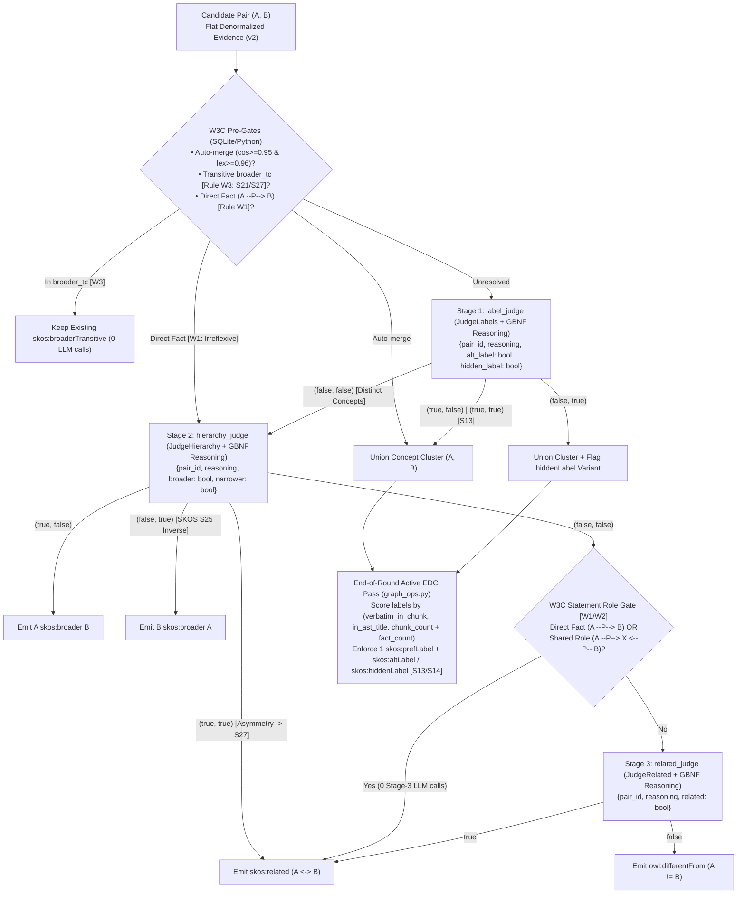

# Technical Specification: W3C Semantic Cascade & Active EDC Canonicalization (`docs/w3c-improvements.md`)

## 1. Context & Root-Cause Problem Statement

In [`benchmark_mobile_report.md`](file:///C:/Users/Harri.Ahokas/.gemini/antigravity/brain/705b1f4b-1f82-432f-af64-b480ab176de5/benchmark_mobile_report.md), the 4B model (`gemma-4-E4B-it-qat-q4_0`) systematically mixes semantic relations during Stage 3 synonym/ontology adjudication—classifying taxonomic subtypes as `skos:related` (e.g., `pilot tenants` $\leftrightarrow$ `tenants`, `telemetry points` $\leftrightarrow$ `telemetry`) and classifying both subtypes and domain-coupled concepts as `owl:differentFrom` (e.g., `seat` $\neq$ `consumption`, `Consumption price` $\neq$ `consumption`, `Finance` $\neq$ `Finance-Legal`). Because [`build_transition_matrix`](file:///c:/Users/Harri.Ahokas/Documents/yaw/yaw/daemon/graph/ppr.py#L168-L183) treats `owl:differentFrom` as an active negative inhibitor ($\alpha_{\text{diff}} = 0.5$) that subtracts Personalized PageRank mass, false `owl:differentFrom` edges actively suppress relevant neighbors during multi-hop retrieval.

Four concrete architectural defects cause this failure mode:
1. **Pointer-Table Cognitive Overload (`synonym-evidence-v1`)**: [`_Packet`](file:///c:/Users/Harri.Ahokas/Documents/yaw/yaw/daemon/graph/storage/synonyms.py#L19-L197) splits pair context across four separate lookup tables (`pairs`, `entities`, `facts`, `sources`) connected by synthetic pointer aliases (`e0`, `f0`, `s0`), forcing the 4B model to dereference multi-hop JSON pointers across batches of up to 64 pairs ([`planner.py`](file:///c:/Users/Harri.Ahokas/Documents/yaw/yaw/daemon/graph/planner.py#L1086-L1094)).
2. **Zero-Scratchpad 5-Way Single-Shot Ask**: [`JudgeSynonyms`](file:///c:/Users/Harri.Ahokas/Documents/yaw/yaw/daemon/graph/inference/prompts.py#L266-L313) and [`build_dspy_synonym_judge_grammar`](file:///c:/Users/Harri.Ahokas/Documents/yaw/yaw/daemon/graph/inference/grammars.py#L195-L237) force token `#1` of each decision to select one of five relations (`skos:altLabel`, `skos:hiddenLabel`, `skos:broader`, `skos:related`, `owl:differentFrom`) with zero thinking/reasoning tokens and an overloaded `"canonical"` string slot.
3. **Ontological Conflation of `owl:differentFrom` and `skos:semanticRelation`**: In W3C OWL 2, *every* pair of distinct `skos:Concept` nodes satisfies $A \neq B$ (`owl:differentFrom`), whereas W3C SKOS S19–S27 defines `skos:broader`, `skos:narrower`, and `skos:related` strictly *between* distinct concepts. Presenting `owl:differentFrom` alongside `skos:broader` and `skos:related` in a single-shot prompt causes the model to emit `owl:differentFrom` whenever $A \neq B$.
4. **Missing End-of-Round Active EDC Canonicalization**: [`prepare_synonym_candidates`](file:///c:/Users/Harri.Ahokas/Documents/yaw/yaw/daemon/graph/planner.py#L618-L626) and [`apply_synonym_adjudication`](file:///c:/Users/Harri.Ahokas/Documents/yaw/yaw/daemon/graph/planner.py#L740-L755) select the surviving `skos:prefLabel` during pairwise merges using either LLM-emitted `"canonical"` strings or naive string-length tuples `(len(def_a), -len(name_a), ea)`, allowing 1-off extraction typos to usurp `skos:prefLabel`.

---

## 2. Architecture, Dataflow & Domain Containment



### Domain Containment Check
All modifications strictly obey the domain containment tree enforced by [`tests/test_architecture.py`](file:///c:/Users/Harri.Ahokas/Documents/yaw/tests/test_architecture.py):
- `yaw.core.*` ([`yaw/core/types.py`](file:///c:/Users/Harri.Ahokas/Documents/yaw/yaw/core/types.py)) imports only Python standard library modules.
- `yaw.daemon.graph.storage.*` ([`synonyms.py`](file:///c:/Users/Harri.Ahokas/Documents/yaw/yaw/daemon/graph/storage/synonyms.py), [`graph_ops.py`](file:///c:/Users/Harri.Ahokas/Documents/yaw/yaw/daemon/graph/storage/graph_ops.py)) imports only `yaw.daemon.graph.storage.*` and `yaw.core.*`.
- `yaw.daemon.graph.inference.*` ([`prompts.py`](file:///c:/Users/Harri.Ahokas/Documents/yaw/yaw/daemon/graph/inference/prompts.py), [`grammars.py`](file:///c:/Users/Harri.Ahokas/Documents/yaw/yaw/daemon/graph/inference/grammars.py), [`parsers.py`](file:///c:/Users/Harri.Ahokas/Documents/yaw/yaw/daemon/graph/inference/parsers.py), [`adapter.py`](file:///c:/Users/Harri.Ahokas/Documents/yaw/yaw/daemon/graph/inference/adapter.py), [`invariants.py`](file:///c:/Users/Harri.Ahokas/Documents/yaw/yaw/daemon/graph/inference/invariants.py), [`diagnostics.py`](file:///c:/Users/Harri.Ahokas/Documents/yaw/yaw/daemon/graph/inference/diagnostics.py), [`program.py`](file:///c:/Users/Harri.Ahokas/Documents/yaw/yaw/daemon/graph/inference/program.py), [`optimizer.py`](file:///c:/Users/Harri.Ahokas/Documents/yaw/yaw/daemon/graph/inference/optimizer.py)) imports only `yaw.daemon.graph.inference.*` and `yaw.core.*`.
- `yaw.daemon.graph.*` ([`planner.py`](file:///c:/Users/Harri.Ahokas/Documents/yaw/yaw/daemon/graph/planner.py), [`engine.py`](file:///c:/Users/Harri.Ahokas/Documents/yaw/yaw/daemon/graph/engine.py)) orchestrates `storage` and `inference` within `yaw.daemon.graph`.

---

## 3. Formal Contracts & Typed Interfaces

### 3.1 Denormalized Evidence Packet (`yaw/daemon/graph/storage/synonyms.py` & `yaw/core/types.py`)

```python
# JSON schema emitted by iter_synonym_evidence ("format": "synonym-evidence-v2"):
# {
#   "format": "synonym-evidence-v2",
#   "pairs": [
#     {
#       "pair_id": "e0|e1",
#       "dense_sim": 0.88,
#       "lexical_sim": 0.72,
#       "shared_documents": ["docs/pricing.md"],
#       "shared_islands": [["docs/pricing.md", 10, 45]],
#       "direct_facts": [["pilot tenants", "participate in", "initial testing phase"]],
#       "shared_role_facts": [["pilot tenants", "billed via", "invoices"], ["tenants", "billed via", "invoices"]],
#       "broader_tc": "",  # "a_under_b" | "b_under_a" | ""
#       "entity_a": {
#         "name": "tenants",
#         "definition": "Customer organizations provisioned on the platform.",
#         "type": "skos:Concept",
#         "labels": {"skos:prefLabel": ["tenants"], "skos:altLabel": []},
#         "facts": [["tenants", "own", "subscriptions"]],
#         "sources": [{"path": "docs/pricing.md", "title": "Tenants", "text": "..."}]
#       },
#       "entity_b": {
#         "name": "pilot tenants",
#         "definition": "A group of low-volume tenants used for the initial testing phase.",
#         "type": "skos:Concept",
#         "labels": {"skos:prefLabel": ["pilot tenants"], "skos:altLabel": []},
#         "facts": [["pilot tenants", "participate in", "initial testing phase"]],
#         "sources": [{"path": "docs/pricing.md", "title": "Pilot Phase", "text": "..."}]
#       }
#     }
#   ]
# }
```

### 3.2 End-of-Round Active EDC Canonicalizer (`yaw/daemon/graph/storage/graph_ops.py`)

```python
def canonicalize_entity_labels_edc(
    conn: sqlite3.Connection | YawConnection,
    corpus_root: Path | str | None = None,
    *,
    entity_ids: Sequence[str] | None = None,
    hidden_label_norms_by_entity: Mapping[str, set[str]] | None = None,
) -> int:
    """Run deterministic end-of-round Active EDC label canonicalization over entity_labels and entities.

    For each candidate entity:
    1. Demotes any label norm in `hidden_label_norms_by_entity` or absent verbatim from its hydrated
       source chunk on disk (when `corpus_root` is available and chunk is non-stale) to `skos:hiddenLabel`.
    2. Scores all eligible (`skos:prefLabel` / `skos:altLabel`) label norms by provenance tuple:
       `(verbatim_in_source, in_ast_title, chunk_count + fact_count, is_cased_or_multiword, -len(raw_label), label_norm)`.
    3. Promotes the single winning norm to `skos:prefLabel` and updates `entities.name` to its best
       surface `raw_label`; demotes all other non-hidden norms to `skos:altLabel` (enforcing SKOS S13 & S14).
    Returns the number of entities whose canonical `skos:prefLabel` or `entities.name` was updated.
    """
```

### 3.3 3-Stage Paired-Boolean Signatures & Grammars (`yaw/daemon/graph/inference/prompts.py` & `grammars.py`)

```python
SYNONYM_JUDGE_STAGE_NAMES: tuple[str, str, str] = (
    "label_judge",
    "hierarchy_judge",
    "related_judge",
)


class JudgeLabels(dspy.Signature):
    """Evaluate Stage 1 W3C SKOS lexical identity (`skos:altLabel` and `skos:hiddenLabel`) for each candidate pair in `candidate_pairs`."""

    candidate_pairs: str = dspy.InputField(
        desc="JSON object (`synonym-evidence-v2`) containing candidate entity pairs with inline definitions, facts, and source excerpts."
    )
    decisions: list[dict[str, Any]] = dspy.OutputField(
        desc='List of {"pair_id": "e0|e1", "reasoning": "...", "alt_label": bool, "hidden_label": bool} objects.'
    )


class JudgeHierarchy(dspy.Signature):
    """Evaluate Stage 2 W3C SKOS taxonomic/partitive hierarchy (`skos:broader` and `skos:narrower`) for distinct concept pairs in `candidate_pairs`."""

    candidate_pairs: str = dspy.InputField(
        desc="JSON object (`synonym-evidence-v2`) containing distinct candidate entity pairs with inline definitions, facts, and source excerpts."
    )
    decisions: list[dict[str, Any]] = dspy.OutputField(
        desc=(
            'List of {"pair_id": "e0|e1", "reasoning": "...", "broader": bool, "narrower": bool} objects '
            "where broader=True iff entity_a is a narrower subtype/part/instance of broader concept entity_b (`A skos:broader B`), "
            "and narrower=True iff entity_b is a narrower subtype/part/instance of broader concept entity_a (`A skos:narrower B`)."
        )
    )


class JudgeRelated(dspy.Signature):
    """Evaluate Stage 3 W3C SKOS associative relation (`skos:related` vs `owl:differentFrom`) for distinct, non-hierarchical pairs in `candidate_pairs`."""

    candidate_pairs: str = dspy.InputField(
        desc="JSON object (`synonym-evidence-v2`) containing distinct, non-hierarchical entity pairs with inline definitions, facts, and source excerpts."
    )
    decisions: list[dict[str, Any]] = dspy.OutputField(
        desc='List of {"pair_id": "e0|e1", "reasoning": "...", "related": bool} objects.'
    )


def build_dspy_label_judge_grammar(
    max_decisions: int | None = None,
    *,
    pair_ids: Sequence[str] | None = None,
    max_reasoning_chars: int | None = 240,
) -> str:
    """Build pure-JSON GBNF grammar for JudgeLabels (`{"decisions": [{"pair_id": ..., "reasoning": ..., "alt_label": bool, "hidden_label": bool}]}`)."""


def build_dspy_hierarchy_judge_grammar(
    max_decisions: int | None = None,
    *,
    pair_ids: Sequence[str] | None = None,
    max_reasoning_chars: int | None = 240,
) -> str:
    """Build pure-JSON GBNF grammar for JudgeHierarchy (`{"decisions": [{"pair_id": ..., "reasoning": ..., "broader": bool, "narrower": bool}]}`)."""


def build_dspy_related_judge_grammar(
    max_decisions: int | None = None,
    *,
    pair_ids: Sequence[str] | None = None,
    max_reasoning_chars: int | None = 240,
) -> str:
    """Build pure-JSON GBNF grammar for JudgeRelated (`{"decisions": [{"pair_id": ..., "reasoning": ..., "related": bool}]}`)."""
```

### 3.4 Complete Replacement of Legacy `synonym_*` Predictors, Fingerprints, Caches, Audit Trails & Token Counters
1. **First-Class Predictors on `HippoRAGProgram` (`yaw/daemon/graph/inference/program.py`)**:
   - **Removes** `self.synonym_judge = dspy.Predict(JudgeSynonyms)`.
   - **Replaces** it with three first-class predictors on `HippoRAGProgram`:
     - `self.label_judge = dspy.Predict(JudgeLabels)`
     - `self.hierarchy_judge = dspy.Predict(JudgeHierarchy)`
     - `self.related_judge = dspy.Predict(JudgeRelated)`
   - Binds all three to `worker` LM in `_bind_predictor_lms`. Because they are `dspy.Predict` attributes on `HippoRAGProgram`, `program.named_predictors()` automatically exposes `"label_judge"`, `"hierarchy_judge"`, and `"related_judge"` to `dspy.GEPA`, `dspy.MIPROv2`, `ActiveTraceComponentSelector`, and `RLMInstructionProposer`.
2. **Replacement of `synonym_audit_trail` with Per-Stage Audit Trails (`program.py` & `diagnostics.py`)**:
   - **Removes** `self.synonym_audit_trail`.
   - **Replaces** it with three stage-specific `DiagnosticHistory` trails on `HippoRAGProgram`:
     - `self.label_judge_audit_trail = DiagnosticHistory()`
     - `self.hierarchy_judge_audit_trail = DiagnosticHistory()`
     - `self.related_judge_audit_trail = DiagnosticHistory()`
   - Updates `dump_audit_trails` ([`program.py:260-280`](file:///c:/Users/Harri.Ahokas/Documents/yaw/yaw/daemon/graph/inference/program.py#L260-L280)) and `trim_diagnostics` ([`diagnostics.py:21-34`](file:///c:/Users/Harri.Ahokas/Documents/yaw/yaw/daemon/graph/inference/diagnostics.py#L21-L34)) to serialize and bound `label_judge_audit_trail`, `hierarchy_judge_audit_trail`, and `related_judge_audit_trail`.
3. **Replacement of `synonym_fingerprint` & `_synonym_fp_cache` with Per-Stage Fingerprints & Caches (`optimizer.py` & `engine.py`)**:
   - **Why Replace Instead of Update**: During GEPA optimization, [`ActiveTraceComponentSelector`](file:///c:/Users/Harri.Ahokas/Documents/yaw/yaw/daemon/graph/inference/optimizer.py#L762-L813) mutates **one** predictor per iteration (`label_judge`, OR `hierarchy_judge`, OR `related_judge`). If all three judges shared a single `synonym_fingerprint`, mutating `related_judge` (Stage 3) would invalidate cached decisions and traces for Stage 1 (`label_judge`) and Stage 2 (`hierarchy_judge`).
   - **Removes** `synonym_fingerprint(program)` and `self._synonym_fp_cache`.
   - **Replaces** them with:
     - `judge_stage_fingerprint(program: HippoRAGProgram, stage_name: Literal["label_judge", "hierarchy_judge", "related_judge"]) -> str` (plus convenience functions `label_judge_fingerprint`, `hierarchy_judge_fingerprint`, `related_judge_fingerprint`) in [`optimizer.py`](file:///c:/Users/Harri.Ahokas/Documents/yaw/yaw/daemon/graph/inference/optimizer.py#L300-L330).
     - Three stage-isolated `CandidateStageCache` instances in [`HippoRAGEngine.__init__`](file:///c:/Users/Harri.Ahokas/Documents/yaw/yaw/daemon/graph/engine.py#L246-L252):
       - `self._label_judge_fp_cache` (stage `"label_judge"`)
       - `self._hierarchy_judge_fp_cache` (stage `"hierarchy_judge"`)
       - `self._related_judge_fp_cache` (stage `"related_judge"`)
     - Each stage caches `(stage_fp, stage_pairs_fp) -> (stage_decisions, stage_traces, stage_tokens)` independently so mutating Stage 3 (`related_judge`) reuses 100% of Stage 1 (`label_judge`) and Stage 2 (`hierarchy_judge`) cache entries!
     - `extraction_fingerprint(program)` in [`optimizer.py:333-368`](file:///c:/Users/Harri.Ahokas/Documents/yaw/yaw/daemon/graph/inference/optimizer.py#L333-L368) replaces `"synonym_judge"` in `graph_stage_keys` with `"label_judge"`, `"hierarchy_judge"`, and `"related_judge"`.
4. **Replacement of `synonym_judge_tokens` with Per-Stage Token Counters (`engine.py`, `optimizer.py`, `parsers.py`)**:
   - **Removes** `synonym_judge_tokens` from [`HippoRAGEngine._empty_graph_rlm_stats`](file:///c:/Users/Harri.Ahokas/Documents/yaw/yaw/daemon/graph/engine.py#L510), [`_hydrate_chunk_traces_and_stats_from_db`](file:///c:/Users/Harri.Ahokas/Documents/yaw/yaw/daemon/graph/engine.py#L486), [`optimizer.py`](file:///c:/Users/Harri.Ahokas/Documents/yaw/yaw/daemon/graph/inference/optimizer.py#L1338), and [`compute_task_quality_score`](file:///c:/Users/Harri.Ahokas/Documents/yaw/yaw/daemon/graph/inference/parsers.py#L1058).
   - **Replaces** it with `label_judge_tokens`, `hierarchy_judge_tokens`, and `related_judge_tokens`.
5. **`STAGE_SCHEMA_CONTRACTS`, `validate_stage_invariants` & `YawGBNFAdapter` (`invariants.py`, `adapter.py`)**:
   - Removes `"synonym_judge"` from `STAGE_SCHEMA_CONTRACTS` and replaces it with contracts for `"label_judge"`, `"hierarchy_judge"`, and `"related_judge"` so `InstructionSynthesizerWorker` (`proposer.py:98`) injects the exact schema contract for each judge during GEPA/SIMBA instruction evolution.
   - Updates `validate_stage_invariants` to validate `"label_judge"`, `"hierarchy_judge"`, and `"related_judge"` predictions (checking non-empty `"reasoning"` and exact boolean keys per `pair_id`).
   - Updates `YawGBNFAdapter` to remove `JudgeSynonyms` and wire `JudgeLabels` $\to$ `build_dspy_label_judge_grammar`, `JudgeHierarchy` $\to$ `build_dspy_hierarchy_judge_grammar`, and `JudgeRelated` $\to$ `build_dspy_related_judge_grammar`.
6. **Trace Capture for GEPA (`yaw/daemon/graph/engine.py`)**:
   - Updates `extract_named_trace_entries` at [`engine.py:1594-1598`](file:///c:/Users/Harri.Ahokas/Documents/yaw/yaw/daemon/graph/engine.py#L1594-L1598) to capture per-stage traces for `{"label_judge"}`, `{"hierarchy_judge"}`, and `{"related_judge"}` so GEPA's `ActiveTraceComponentSelector` receives live execution trajectories for each individual judge stage.

---

## 4. Invariants & Explicit Non-Goals

### Non-Negotiable Invariants
1. **Short-Circuit Funnel Invariant**: Every pair resolved by a deterministic W3C pre-gate or an earlier LLM stage is immediately filtered out and **never** sent to subsequent LLM stages.
2. **2×2 Truth-Table Determinism**:
   - Stage 1 `(alt_label, hidden_label)`:
     - `(True, False)` $\to$ `relation="skos:altLabel"`
     - `(False, True)` $\to$ `relation="skos:hiddenLabel"`
     - `(True, True)` (SKOS S13 overlap) $\to$ `relation="skos:altLabel"` (with Active EDC enforcing S13 disjointness)
     - `(False, False)` $\to$ distinct concepts; advance to Stage 2.
   - Stage 2 `(broader, narrower)`:
     - `(True, False)` $\to$ `relation="skos:broader"`, `source_id=entity_a`, `target_id=entity_b` (`A skos:broader B`)
     - `(False, True)` $\to$ by SKOS S25 (`owl:inverseOf`), `relation="skos:broader"`, `source_id=entity_b`, `target_id=entity_a` (`B skos:broader A`)
     - `(True, True)` (SKOS hierarchy asymmetry conflict on distinct concepts) $\to$ by SKOS S27, `relation="skos:related"`
     - `(False, False)` $\to$ non-hierarchical; if `direct_facts` (Rule W1) or `shared_role_facts` (Rule W2) is non-empty, resolve deterministically to `relation="skos:related"`, else advance to Stage 3.
   - Stage 3 `(related)`:
     - `True` $\to$ `relation="skos:related"`
     - `False` $\to$ `relation="owl:differentFrom"`.
3. **Active EDC SKOS S13/S14 Invariant**: At the end of every adjudication round, every entity in `stage_conn` has at most one `skos:prefLabel` norm, zero overlap between `skos:prefLabel`, `skos:altLabel`, and `skos:hiddenLabel`, and `entities.name` matches the highest-provenance non-hidden label.
4. **Full GEPA Visibility & Zero Old Judges/Trails**: `self.synonym_judge`, `JudgeSynonyms`, `synonym_fingerprint`, `_synonym_fp_cache`, `synonym_audit_trail`, and `synonym_judge_tokens` are completely removed and replaced with stage-explicit equivalents for `label_judge`, `hierarchy_judge`, and `related_judge`.

### Explicit Non-Goals (Anti-Invention Contract)
- **Zero SQLite Schema Migrations**: Do not add new tables or columns to `yaw.db`.
- **Zero Disjoint-Document `owl:differentFrom` Heuristics**: Never infer `owl:differentFrom` merely because two concepts reside in different documents; cross-document pairs that pass Stage 1 and Stage 2 without shared facts must be adjudicated by Stage 3 (`JudgeRelated`).
- **Zero Legacy Compatibility Shims**: Do not keep `synonym_judge`, `JudgeSynonyms`, `build_dspy_synonym_judge_grammar`, `synonym_fingerprint`, `synonym_audit_trail`, or `synonym_judge_tokens` as fallback aliases.

---

## 5. Superslim Implementation Slices & Oblivion Protocol

Each slice below is scoped to 1–3 production files so a `flash` model can implement it atomically, followed by a mandatory **Critic Round**, **Simplification Round**, and **Deprecated Code Removal Gate**.

---

### Slice 1: Denormalized Pair Evidence (`synonym-evidence-v2`) & W3C Structural Queries {#slice-01}

- **Files**:
  - `[MODIFY]` [`yaw/daemon/graph/storage/synonyms.py`](file:///c:/Users/Harri.Ahokas/Documents/yaw/yaw/daemon/graph/storage/synonyms.py#L19-L254)
  - `[MODIFY]` [`yaw/core/types.py`](file:///c:/Users/Harri.Ahokas/Documents/yaw/yaw/core/types.py#L180-L245)
  - `[MODIFY]` [`tests/daemon/graph/storage/test_storage.py`](file:///c:/Users/Harri.Ahokas/Documents/yaw/tests/daemon/graph/storage/test_storage.py)
- **Scope**:
  1. Refactor [`_Packet`](file:///c:/Users/Harri.Ahokas/Documents/yaw/yaw/daemon/graph/storage/synonyms.py#L19-L197) in `yaw/daemon/graph/storage/synonyms.py` to emit `"format": "synonym-evidence-v2"` containing only `"pairs": [...]` with inline `entity_a`, `entity_b`, `direct_facts` (Rule W1), `shared_role_facts` (Rule W2: shared `(pred, obj_id)` or `(subj_id, pred)` in `facts`), and `broader_tc` (Rule W3: `"a_under_b"` or `"b_under_a"` via recursive `skos:broader` check).
  2. Update [`SynonymEvidenceBatch.resolve_decisions`](file:///c:/Users/Harri.Ahokas/Documents/yaw/yaw/core/types.py#L204-L242) to resolve alias IDs (`e0`, `e1`) into real `entity_id` values directly from `source_id`/`target_id` or `pair_id` without requiring a `"canonical"` field, and add `SynonymEvidenceBatch.subset(pair_ids)` so downstream cascade stages receive filtered `SynonymEvidenceBatch` packets containing only unresolved pairs.
  3. Default `iter_synonym_evidence` micro-batch size to `batch_size: int = 6` so each stage prompt stays compact.
- **Verifiable Goal**:
  - `uv run --no-sync pytest tests/daemon/graph/storage/test_storage.py -k "synonym" --no-testmon -q` passes 100%, verifying that `"synonym-evidence-v2"` contains zero top-level `"entities"`, `"facts"`, or `"sources"` pointer tables and populates `direct_facts`, `shared_role_facts`, and `broader_tc`.
- **Critic Round**:
  - Delegate to `critic`: verify zero N+1 SQLite queries inside `_Packet` when computing `shared_role_facts` and `broader_tc`, and verify context-budget halving in `iter_synonym_evidence` preserves all pair fields.
- **Simplification Round**:
  - Delegate to `simplifier`: remove `_Packet.fact()`, `_Packet.source()`, `_Packet.facts`, `_Packet.sources`, and `_Packet.spans` indirection methods.
- **Deprecated Code Removal**:
  - `git grep -w "synonym-evidence-v1"` returns `0` matches across `yaw/` and `tests/`.

---

### Slice 2: End-of-Round Active EDC Label Canonicalizer {#slice-02}

- **Files**:
  - `[MODIFY]` [`yaw/daemon/graph/storage/graph_ops.py`](file:///c:/Users/Harri.Ahokas/Documents/yaw/yaw/daemon/graph/storage/graph_ops.py#L630-L752)
  - `[MODIFY]` [`yaw/daemon/graph/storage/__init__.py`](file:///c:/Users/Harri.Ahokas/Documents/yaw/yaw/daemon/graph/storage/__init__.py)
  - `[MODIFY]` [`tests/daemon/graph/storage/test_storage.py`](file:///c:/Users/Harri.Ahokas/Documents/yaw/tests/daemon/graph/storage/test_storage.py)
- **Scope**:
  1. Implement `canonicalize_entity_labels_edc` in [`yaw/daemon/graph/storage/graph_ops.py`](file:///c:/Users/Harri.Ahokas/Documents/yaw/yaw/daemon/graph/storage/graph_ops.py) and export it in [`yaw/daemon/graph/storage/__init__.py`](file:///c:/Users/Harri.Ahokas/Documents/yaw/yaw/daemon/graph/storage/__init__.py).
  2. Compute provenance scores per `(entity_id, label_norm)` using:
      - `verbatim_in_source`: `1` if any `raw_label` for `(entity_id, label_norm)` appears case-insensitively in its hydrated chunk text on disk (or when `corpus_root is None` / chunk is synthetic `__*__`), `0` if the chunk exists on disk and `raw_label` is absent from the source span (demoting such extraction typos to `skos:hiddenLabel`).
      - `in_ast_title`: `1` if `raw_label` appears case-insensitively in `chunks.title` for any provenance chunk.
      - `support_count`: `COUNT(DISTINCT chunk_id)` in `entity_labels` + `COUNT(DISTINCT fact_id)` in `facts` where the surface form appears in `raw_triple_json`.
  3. Enforce SKOS S13 & S14: any label norm in `hidden_label_norms_by_entity` or failing verbatim grounding is set to `skos:hiddenLabel`; the highest-ranked eligible norm becomes `skos:prefLabel` (and updates `entities.name`), and all remaining eligible norms become `skos:altLabel`.
- **Verifiable Goal**:
  - `uv run --no-sync pytest tests/daemon/graph/storage/test_storage.py -k "edc or merge_entities" --no-testmon -q` passes, proving that a 1-chunk typo (`"Neccessary"`) merged into or onto a multi-chunk/heading-backed entity (`"Necessary"`) is demoted to `skos:hiddenLabel`, `entities.name` becomes `"Necessary"`, and `lint_graph_shacl(conn)` reports `0` label violations.
- **Critic Round**:
  - Delegate to `critic`: verify `canonicalize_entity_labels_edc` runs inside `write_tx(conn)`, handles entities with only 1 label safely (never leaving an entity with 0 `skos:prefLabel` rows), and introduces zero SHACL S13 regressions.
- **Simplification Round**:
  - Delegate to `simplifier`: streamline SQL aggregation of `chunk_count`, `fact_count`, and `chunks.title` into a single batched query.
- **Deprecated Code Removal**:
  - Remove redundant post-merge label fixup branches superseded by `canonicalize_entity_labels_edc`.

---

### Slice 3: 3-Stage Paired-Boolean Signatures, GBNF Grammars, Adapter & Invariants {#slice-03}

- **Files**:
  - `[MODIFY]` [`yaw/daemon/graph/inference/prompts.py`](file:///c:/Users/Harri.Ahokas/Documents/yaw/yaw/daemon/graph/inference/prompts.py#L266-L313)
  - `[MODIFY]` [`yaw/daemon/graph/inference/grammars.py`](file:///c:/Users/Harri.Ahokas/Documents/yaw/yaw/daemon/graph/inference/grammars.py#L195-L237)
  - `[MODIFY]` [`yaw/daemon/graph/inference/parsers.py`](file:///c:/Users/Harri.Ahokas/Documents/yaw/yaw/daemon/graph/inference/parsers.py#L315-L380)
  - `[MODIFY]` [`yaw/daemon/graph/inference/adapter.py`](file:///c:/Users/Harri.Ahokas/Documents/yaw/yaw/daemon/graph/inference/adapter.py#L48-L100)
  - `[MODIFY]` [`yaw/daemon/graph/inference/invariants.py`](file:///c:/Users/Harri.Ahokas/Documents/yaw/yaw/daemon/graph/inference/invariants.py#L45-L82)
  - `[MODIFY]` [`yaw/daemon/graph/inference/__init__.py`](file:///c:/Users/Harri.Ahokas/Documents/yaw/yaw/daemon/graph/inference/__init__.py)
  - `[MODIFY]` [`tests/daemon/graph/inference/test_grammars.py`](file:///c:/Users/Harri.Ahokas/Documents/yaw/tests/daemon/graph/inference/test_grammars.py)
  - `[MODIFY]` [`tests/daemon/graph/inference/test_parsers.py`](file:///c:/Users/Harri.Ahokas/Documents/yaw/tests/daemon/graph/inference/test_parsers.py)
- **Scope**:
  1. Remove `JudgeSynonyms` from [`prompts.py`](file:///c:/Users/Harri.Ahokas/Documents/yaw/yaw/daemon/graph/inference/prompts.py#L266-L313) and replace it with `JudgeLabels`, `JudgeHierarchy`, and `JudgeRelated`.
  2. Remove `DSPY_SYNONYM_JUDGE_GBNF_GRAMMAR` and `build_dspy_synonym_judge_grammar` from [`grammars.py`](file:///c:/Users/Harri.Ahokas/Documents/yaw/yaw/daemon/graph/inference/grammars.py#L195-L237) and replace with `build_dspy_label_judge_grammar`, `build_dspy_hierarchy_judge_grammar`, and `build_dspy_related_judge_grammar` backed by a shared helper `_build_pair_boolean_grammar(pair_ids, bool_fields, max_decisions=None, max_reasoning_chars=240)`.
  3. Replace `parse_synonym_decisions` in [`parsers.py`](file:///c:/Users/Harri.Ahokas/Documents/yaw/yaw/daemon/graph/inference/parsers.py) with `parse_label_decisions`, `parse_hierarchy_decisions`, and `parse_related_decisions` implementing the exact 2×2 truth tables from Section 4, and replace `synonym_judge_tokens` in [`compute_task_quality_score`](file:///c:/Users/Harri.Ahokas/Documents/yaw/yaw/daemon/graph/inference/parsers.py#L1058) with `label_judge_tokens`, `hierarchy_judge_tokens`, and `related_judge_tokens`.
  4. Update [`YawGBNFAdapter.resolve_grammar`](file:///c:/Users/Harri.Ahokas/Documents/yaw/yaw/daemon/graph/inference/adapter.py#L48-L100) and [`STAGE_SCHEMA_CONTRACTS` / `validate_stage_invariants`](file:///c:/Users/Harri.Ahokas/Documents/yaw/yaw/daemon/graph/inference/invariants.py#L45-L82) to replace `JudgeSynonyms` / `"synonym_judge"` with `JudgeLabels` (`"label_judge"`), `JudgeHierarchy` (`"hierarchy_judge"`), and `JudgeRelated` (`"related_judge"`).
- **Verifiable Goal**:
  - `uv run --no-sync pytest tests/daemon/graph/inference/test_grammars.py tests/daemon/graph/inference/test_parsers.py --no-testmon -q` passes 100%.
- **Critic Round**:
  - Delegate to `critic`: verify that the GBNF grammars strictly constrain `"reasoning"` before the boolean fields, reject empty reasoning strings (`char{1,240}`), and wire all three signatures cleanly in `YawGBNFAdapter` and `invariants.py`.
- **Simplification Round**:
  - Delegate to `simplifier`: ensure all three GBNF functions share `_build_pair_boolean_grammar` (~25 lines total) and all three parser functions share common `pair_id` + `reasoning` validation.
- **Deprecated Code Removal**:
  - Remove `JudgeSynonyms`, `DSPY_SYNONYM_JUDGE_GBNF_GRAMMAR`, `build_dspy_synonym_judge_grammar`, `parse_synonym_decisions`, and `synonym_judge_tokens` from `prompts.py`, `grammars.py`, `parsers.py`, `adapter.py`, `invariants.py`, and `__init__.py`.

---

### Slice 4: Short-Circuiting Cascade, Per-Stage Trails/Caches & GEPA Wiring in `program.py`, `diagnostics.py`, `optimizer.py`, `planner.py` & `engine.py` {#slice-04}

- **Files**:
  - `[MODIFY]` [`yaw/daemon/graph/inference/diagnostics.py`](file:///c:/Users/Harri.Ahokas/Documents/yaw/yaw/daemon/graph/inference/diagnostics.py#L21-L34)
  - `[MODIFY]` [`yaw/daemon/graph/inference/program.py`](file:///c:/Users/Harri.Ahokas/Documents/yaw/yaw/daemon/graph/inference/program.py#L200-L285)
  - `[MODIFY]` [`yaw/daemon/graph/inference/optimizer.py`](file:///c:/Users/Harri.Ahokas/Documents/yaw/yaw/daemon/graph/inference/optimizer.py#L300-L368)
  - `[MODIFY]` [`yaw/daemon/graph/planner.py`](file:///c:/Users/Harri.Ahokas/Documents/yaw/yaw/daemon/graph/planner.py#L674-L820)
  - `[MODIFY]` [`yaw/daemon/graph/engine.py`](file:///c:/Users/Harri.Ahokas/Documents/yaw/yaw/daemon/graph/engine.py#L246-L260)
  - `[MODIFY]` [`tests/daemon/graph/inference/test_program.py`](file:///c:/Users/Harri.Ahokas/Documents/yaw/tests/daemon/graph/inference/test_program.py)
  - `[MODIFY]` [`tests/daemon/graph/test_planner.py`](file:///c:/Users/Harri.Ahokas/Documents/yaw/tests/daemon/graph/test_planner.py)
  - `[MODIFY]` [`tests/daemon/graph/inference/test_prompts.py`](file:///c:/Users/Harri.Ahokas/Documents/yaw/tests/daemon/graph/inference/test_prompts.py)
- **Scope**:
  1. **Replace predictor & audit trail in `program.py` and `diagnostics.py`**:
     - Remove `self.synonym_judge` and `self.synonym_audit_trail` from [`HippoRAGProgram.__init__`](file:///c:/Users/Harri.Ahokas/Documents/yaw/yaw/daemon/graph/inference/program.py#L204-L216), [`dump_audit_trails`](file:///c:/Users/Harri.Ahokas/Documents/yaw/yaw/daemon/graph/inference/program.py#L260-L280), [`_bind_predictor_lms`](file:///c:/Users/Harri.Ahokas/Documents/yaw/yaw/daemon/graph/inference/program.py#L282-L300), and [`trim_diagnostics`](file:///c:/Users/Harri.Ahokas/Documents/yaw/yaw/daemon/graph/inference/diagnostics.py#L21-L34).
     - Register `self.label_judge = dspy.Predict(JudgeLabels)`, `self.hierarchy_judge = dspy.Predict(JudgeHierarchy)`, `self.related_judge = dspy.Predict(JudgeRelated)` and `self.label_judge_audit_trail`, `self.hierarchy_judge_audit_trail`, `self.related_judge_audit_trail`.
  2. **Replace `synonym_fingerprint` & `_synonym_fp_cache` with Per-Stage GEPA Fingerprints, Caches & Token Counters in `optimizer.py` and `engine.py`**:
     - Replace `synonym_fingerprint` in [`optimizer.py:300-330`](file:///c:/Users/Harri.Ahokas/Documents/yaw/yaw/daemon/graph/inference/optimizer.py#L300-L330) with `judge_stage_fingerprint(program, stage_name)` (`label_judge_fingerprint`, `hierarchy_judge_fingerprint`, `related_judge_fingerprint`) and update `extraction_fingerprint` (`graph_stage_keys`) to hash `"label_judge"`, `"hierarchy_judge"`, and `"related_judge"`.
     - Replace `self._synonym_fp_cache` in [`engine.py:246-252`](file:///c:/Users/Harri.Ahokas/Documents/yaw/yaw/daemon/graph/engine.py#L246-L252) with `self._label_judge_fp_cache`, `self._hierarchy_judge_fp_cache`, and `self._related_judge_fp_cache`, and replace `synonym_judge_tokens` with `label_judge_tokens`, `hierarchy_judge_tokens`, and `related_judge_tokens` in `_empty_graph_rlm_stats`, `_hydrate_chunk_traces_and_stats_from_db`, and `optimizer.py`.
  3. **Implement the short-circuiting cascade with per-stage caching and trace capture**:
     - Pre-resolve pairs with non-empty `broader_tc` (Rule W3).
     - Route pairs with non-empty `direct_facts` (Rule W1) directly to Stage 2 (`hierarchy_judge`), skipping Stage 1 (`label_judge`).
     - Run Stage 1 (`label_judge`, cached via `_label_judge_fp_cache` keyed by `(label_judge_fingerprint(program), stage1_batch.cache_identity)`) on remaining pairs; record in `label_judge_audit_trail` and `label_judge_tokens`; short-circuit matches (`skos:altLabel`, `skos:hiddenLabel`) and pass `(False, False)` pairs to Stage 2.
     - Run Stage 2 (`hierarchy_judge`, cached via `_hierarchy_judge_fp_cache` keyed by `(hierarchy_judge_fingerprint(program), stage2_batch.cache_identity)`) on unresolved pairs; record in `hierarchy_judge_audit_trail` and `hierarchy_judge_tokens`; short-circuit `skos:broader` (including SKOS S25 inverse when `narrower=True`) and `(True, True)` $\to$ `skos:related`.
     - Route Stage 2 `(False, False)` pairs with non-empty `direct_facts` (Rule W1) or `shared_role_facts` (Rule W2) deterministically to `skos:related` (0 Stage-3 LLM calls).
     - Run Stage 3 (`related_judge`, cached via `_related_judge_fp_cache` keyed by `(related_judge_fingerprint(program), stage3_batch.cache_identity)`) on the residual unresolved pairs; record in `related_judge_audit_trail` and `related_judge_tokens` to classify `skos:related` vs `owl:differentFrom`.
  4. **Update `apply_synonym_adjudication` in `planner.py`**:
     - Apply directed `skos:broader` (`source_id` $\to$ `target_id`), track `hidden_label` norms on merged entities, and call `canonicalize_entity_labels_edc(stage_conn, corpus_root)` at the end of the round.
- **Verifiable Goal**:
  - `uv run --no-sync pytest tests/daemon/graph/inference/test_program.py tests/daemon/graph/test_planner.py --no-testmon -q` passes 100%, including asserting that:
    1. `dict(program.named_predictors())` exposes `"label_judge"`, `"hierarchy_judge"`, and `"related_judge"` (and not `"synonym_judge"`).
    2. Mutating only `program.related_judge.signature.instructions` hits 100% cache on `_label_judge_fp_cache` and `_hierarchy_judge_fp_cache` (0 Stage-1 or Stage-2 LLM calls re-executed).
  - Live Gemma-4-E4B verification (`uv run --no-sync pytest tests/daemon/graph/inference/test_prompts.py -m live --no-testmon -q`) passes 100%, verifying `pilot tenants` $\to$ `skos:broader` `tenants`, `seat` $\to$ `skos:broader` `consumption`, and `Consumption price` $\leftrightarrow$ `skos:related` `consumption`.
- **Critic Round**:
  - Delegate to `critic`: audit the end-to-end cascade in `program.py`, `diagnostics.py`, `optimizer.py`, `engine.py`, and `planner.py` for short-circuit completeness, per-stage cache isolation, GEPA predictor registration, per-stage audit trails/tokens, and domain boundary compliance.
- **Simplification Round**:
  - Delegate to `simplifier`: remove all legacy `"canonical"` string matching branches and unify per-stage execution/caching into a single clean helper.
- **Deprecated Code Removal**:
  - Verify `git grep -w` returns `0` matches across the entire repository (`yaw/`, `tests/`, `scripts/`) for all retired symbols in the Oblivion Demolition Table below.

---

### Oblivion Demolition Table

| Retired Symbol / Format | Previous Location | Replacement | Verification Gate |
| :--- | :--- | :--- | :--- |
| `"synonym-evidence-v1"` | [`yaw/daemon/graph/storage/synonyms.py`](file:///c:/Users/Harri.Ahokas/Documents/yaw/yaw/daemon/graph/storage/synonyms.py#L187) | `"synonym-evidence-v2"` (inline denormalized pair evidence) | `git grep -w "synonym-evidence-v1"` $\to$ `0` matches |
| `_Packet.fact` / `_Packet.source` | [`yaw/daemon/graph/storage/synonyms.py`](file:///c:/Users/Harri.Ahokas/Documents/yaw/yaw/daemon/graph/storage/synonyms.py#L47-L97) | Inline pair facts and sources in `_Packet.add` | `git grep -E "def (fact|source)\(" yaw/daemon/graph/storage/synonyms.py` $\to$ `0` matches |
| `JudgeSynonyms` | [`yaw/daemon/graph/inference/prompts.py`](file:///c:/Users/Harri.Ahokas/Documents/yaw/yaw/daemon/graph/inference/prompts.py#L266) | `JudgeLabels`, `JudgeHierarchy`, `JudgeRelated` | `git grep -w "JudgeSynonyms"` $\to$ `0` matches |
| `self.synonym_judge` | [`yaw/daemon/graph/inference/program.py`](file:///c:/Users/Harri.Ahokas/Documents/yaw/yaw/daemon/graph/inference/program.py#L211) | `self.label_judge`, `self.hierarchy_judge`, `self.related_judge` | `git grep -w "synonym_judge" yaw/` $\to$ `0` matches |
| `synonym_audit_trail` | [`yaw/daemon/graph/inference/program.py`](file:///c:/Users/Harri.Ahokas/Documents/yaw/yaw/daemon/graph/inference/program.py#L204) | `label_judge_audit_trail`, `hierarchy_judge_audit_trail`, `related_judge_audit_trail` | `git grep -w "synonym_audit_trail"` $\to$ `0` matches |
| `synonym_fingerprint` | [`yaw/daemon/graph/inference/optimizer.py`](file:///c:/Users/Harri.Ahokas/Documents/yaw/yaw/daemon/graph/inference/optimizer.py#L300) | `judge_stage_fingerprint`, `label_judge_fingerprint`, `hierarchy_judge_fingerprint`, `related_judge_fingerprint` | `git grep -w "synonym_fingerprint"` $\to$ `0` matches |
| `_synonym_fp_cache` | [`yaw/daemon/graph/engine.py`](file:///c:/Users/Harri.Ahokas/Documents/yaw/yaw/daemon/graph/engine.py#L246) | `_label_judge_fp_cache`, `_hierarchy_judge_fp_cache`, `_related_judge_fp_cache` | `git grep -w "_synonym_fp_cache"` $\to$ `0` matches |
| `synonym_judge_tokens` | [`yaw/daemon/graph/engine.py`](file:///c:/Users/Harri.Ahokas/Documents/yaw/yaw/daemon/graph/engine.py#L510) | `label_judge_tokens`, `hierarchy_judge_tokens`, `related_judge_tokens` | `git grep -w "synonym_judge_tokens"` $\to$ `0` matches |
| `DSPY_SYNONYM_JUDGE_GBNF_GRAMMAR` | [`yaw/daemon/graph/inference/grammars.py`](file:///c:/Users/Harri.Ahokas/Documents/yaw/yaw/daemon/graph/inference/grammars.py#L51) | `DSPY_LABEL_JUDGE_GBNF_GRAMMAR`, `DSPY_HIERARCHY_JUDGE_GBNF_GRAMMAR`, `DSPY_RELATED_JUDGE_GBNF_GRAMMAR` | `git grep -w "DSPY_SYNONYM_JUDGE_GBNF_GRAMMAR"` $\to$ `0` matches |
| `build_dspy_synonym_judge_grammar` | [`yaw/daemon/graph/inference/grammars.py`](file:///c:/Users/Harri.Ahokas/Documents/yaw/yaw/daemon/graph/inference/grammars.py#L195) | `build_dspy_label_judge_grammar`, `build_dspy_hierarchy_judge_grammar`, `build_dspy_related_judge_grammar` | `git grep -w "build_dspy_synonym_judge_grammar"` $\to$ `0` matches |
| `parse_synonym_decisions` | [`yaw/daemon/graph/inference/parsers.py`](file:///c:/Users/Harri.Ahokas/Documents/yaw/yaw/daemon/graph/inference/parsers.py#L319) | `parse_label_decisions`, `parse_hierarchy_decisions`, `parse_related_decisions` | `git grep -w "parse_synonym_decisions"` $\to$ `0` matches |

---

## 6. Real-Substrate Verification Strategy

### Per-Slice TDD & Subagent Workflow
For each slice (`Slice 1` $\to$ `Slice 2` $\to$ `Slice 3` $\to$ `Slice 4`):
1. **Implementer (`flash` subagent)**: Writes real-substrate tests (`tmp_path`, real SQLite `yaw.db`) and minimal implementation for that slice's files.
2. **Critic (`critic` subagent)**: Audits the slice against W3C SKOS/OWL invariants, GEPA predictor registration, per-stage cache/trail isolation, domain boundaries, and zero fallbacks.
3. **Simplifier (`simplifier` subagent)**: Resolves all Critic findings, removes dead code, and verifies the slice's Oblivion Gate (`git grep -w` == 0).

### Mandatory Quality Gates (End of Each Slice & Final Completion)
```powershell
uv run --no-sync ty check
uv run --no-sync ruff check --fix
uv run --no-sync ruff format
uv run --no-sync pytest -m "not live" --no-testmon -q
uv run --no-sync pytest tests/daemon/graph/inference/test_prompts.py -m live --no-testmon -q
git diff --check
```
